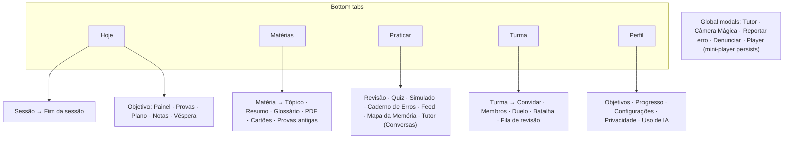

# Studify — UX Guidelines

| | |
|---|---|
| **Status** | Draft v1. Visual identity items are **proposals** until tested with classmates. |
| **Scope** | Design principles, navigation, screen inventory, interaction patterns, components, layout, theming, motion, accessibility and healthy-use rules for the Android app. |
| **Related** | [User flows](../product/user-flows.md) · [PT-BR copy guide](copy-pt-br.md) · [Mobile app](../engineering/mobile-app.md) (route tree) · [Security & privacy](../engineering/security-privacy.md) (protective defaults) · [Feature specs](../specs/) |

---

## 1. Design principles

These turn the [PRD principles](../product/PRD.md#2-product-principles) into screen-level rules.

| PRD principle | Screen-level rule |
|---|---|
| Active recall over re-reading | Every reading surface ends in a retrieval prompt ("Agora tenta lembrar"). The primary button on a topic is practice, not "next page". |
| Spaced repetition | Due reviews are always the first item on Hoje and in every session. Reviews never need more than one tap to start. |
| Grounded in your material | Every generated item shows a **📄 p. N** chip. Content not grounded in the material carries a visible badge ("Conhecimento geral"). Every AI surface carries "Gerado por IA" (SP-10). |
| Adaptive | Show *why* something is suggested ("Biologia hoje porque a prova é quarta…"). Never present a recommendation without a reason. |
| Fast start | No empty screens: each empty state has one primary action. Onboarding is ≤ 6 steps to the first upload. |
| Phone-first | One-thumb reach for primary actions (bottom 40% of the screen). Sessions survive interruption and resume exactly where they stopped. |
| Better together | Social is opt-in and structured (duels, battles, insights). No feeds of other people, no public profiles, no free chat in v1. |
| (Minors) Protective by default | Quiet hours on, at most 3 unrequested notifications a day, finite sessions, no loss-aversion pressure. See §11. |

## 2. Navigation map

Five bottom tabs, consistent with [mobile-app.md §2](../engineering/mobile-app.md#2-navigation-expo-router). Labels are PT-BR; route segments are English.



**Rules**
- **Tutor is a modal, not a tab.** Entry points: the "Perguntar" button on Matéria, Tópico, Resumo and PDF screens; text selection; "Não entendi" on question feedback; and **Praticar → Tutor** for the list of conversations (S-TUT-01).
- **Câmera Mágica** (Phase 3) opens from a camera icon in the Hoje header, the Praticar hub and "Adicionar material".
- **Goals** live outside the tabs (`goal/…` stack). Hoje links to the active goal's dashboard; Perfil → Objetivos lists all of them.
- **ENEM** screens (Phase 4) are a goal stack (`goal/[id]/enem/…`), reached from Hoje when an ENEM goal is active.
- **Turma tab before Phase 2** shows an explainer and "Em breve".
- **Back** always returns to the previous screen. Sessions, quizzes and simulados ask for confirmation before discarding progress, and save it either way.
- **Deep links** land on the target screen with the tab bar visible, so the user can orient (mobile-app §2.3).

## 3. Screen anatomy

```
┌──────────────────────────────┐
│ App bar: ← title · actions   │  ← title ≤ 24 chars; at most 2 action icons
│ (optional) context chip      │  ← e.g. "Prova de Biologia · 3 dias"
│──────────────────────────────│
│                              │
│ Content (scroll)             │
│                              │
│                              │
│──────────────────────────────│
│ Primary action (sticky)      │  ← thumb zone; one primary per screen
│ Bottom tabs                  │  ← hidden in immersive screens
└──────────────────────────────┘
```

**Immersive screens** (no tab bar, minimal chrome): Revisão, Sessão, Questão, Simulado, Feed, Batalha, Modo Véspera, Modo foco, Player (full), Ensine o Lucas, Câmera.

## 4. Screen inventory

Ids are stable and used by flows, tickets and tests. **Phase** is when the screen first ships. Screens marked *(sheet)* are bottom sheets and *(state)* are screen states with their own design.

### 4.1 Auth and onboarding (`S-AUTH`)

| Id | Title (PT-BR) | Purpose | Features | Phase | Entry points |
|---|---|---|---|---|---|
| S-AUTH-01 | Entrar | Google or e-mail sign-in | PLT-02 | 0 | First launch, signed out |
| S-AUTH-02 | Código de verificação | Magic link / 6-digit code | PLT-02 | 0 | S-AUTH-01 (e-mail) |
| S-AUTH-03 | Convite | Invite code for pilot sign-up (prefilled from a Turma link) | PLT-02, SP-02 | 0 | New account |
| S-AUTH-04 | Sua idade | Birth month + year age gate | SP-01 | 0 | S-AUTH-03 |
| S-AUTH-05 | Responsável | Guardian e-mail for ages 12–15 | SP-03 | 2 | S-AUTH-04 |
| S-AUTH-06 | Seu perfil | Display name, school year, privacy notice link | PLT-02 | 0 | Onboarding |
| S-AUTH-07 | Pra que você vai estudar? | Intent (Semana de Provas / ENEM / one subject) | GOL-01 | 0 | Onboarding |
| S-AUTH-08 | Sua primeira matéria | Create a subject + first upload | PLT-03, ING-01 | 0 | Onboarding |

### 4.2 Hoje (`S-HOJE`)

| Id | Title | Purpose | Features | Phase | Entry points |
|---|---|---|---|---|---|
| S-HOJE-01 | Hoje | Today's plan, countdowns, cards (max 3), "Começar sessão", streak/goal header (Phase 2) | GOL-05, MOT-01 | 1 (stub in 0) | Tab, notification, widget |
| S-HOJE-02 | Sessão | Mixed session runner (reviews → learn → practice) | GOL-05.2–05.3 | 1 | Hoje |
| S-HOJE-03 | Fim da sessão | Summary + next step | GOL-05, MEM-02 | 1 | End of a session or review |
| S-HOJE-04 | Modo foco | Pomodoro countdown, current activity, break screen | WEL-01 | 5 | Hoje, session |
| S-HOJE-05 | Bloqueio (overlay) | Shown over blocked apps during focus | WEL-02 | 5 | System overlay |

### 4.3 Matérias (`S-MAT`)

| Id | Title | Purpose | Features | Phase | Entry points |
|---|---|---|---|---|---|
| S-MAT-01 | Matérias | Subject list, personal + Turma (badge) | PLT-03 | 0 | Tab |
| S-MAT-02 | Nova matéria / Editar matéria | Name, color, icon, ENEM area (Phase 4), archive | PLT-03 | 0 | S-MAT-01 |
| S-MAT-03 | {Matéria} | Outline, materials, processing card, progress, shortcuts (Praticar, Tutor, Podcast) | ING-03, ING-03.8 | 0 | S-MAT-01, deep link |
| S-MAT-04 | Adicionar material *(sheet)* | File picker, kind chips, share-intent "Salvar em qual matéria?" | ING-01 | 0 | S-MAT-03, Android share |
| S-MAT-05 | Processamento | Per-stage progress and errors | ING-03.8 | 0 | Processing card |
| S-MAT-06 | Revisar mapa | Outline tree: rename, merge, split, move, delete, "Não cai na prova" | ING-04 | 0 | After first S1, S-MAT-03 menu |
| S-MAT-07 | Documentos da matéria | Materials list: status, rename, delete, offline download | ING-01, PLT-07 | 0 | S-MAT-03 |
| S-MAT-08 | Visualizador de PDF | Viewer, thumbnails, search, cited-passage highlight, region select | ING-08, TRU-01 | 0 | 📄 chips anywhere |
| S-MAT-09 | {Tópico} | Top tabs: Resumo · Cartões · Questões · Glossário; retrieval prompt | LRN-01, MEM-01, PRA-01 | 1 (outline-only in 0) | S-MAT-03, search, plan item |
| S-MAT-10 | Resumo | Full-screen reader with depth switcher | LRN-01 | 1 | S-MAT-09 |
| S-MAT-11 | Explica de outro jeito *(sheet)* | Simpler / analogy / example / step by step | LRN-03 | 1 | Notes, question feedback |
| S-MAT-12 | Glossário | A–Z terms with search | LRN-02 | 1 | S-MAT-03, S-MAT-09 |
| S-MAT-13 | {Termo} *(sheet)* | Definition, 📄, "Criar cartão" | LRN-02 | 1 | Tapping an underlined term |
| S-MAT-14 | Mapa de conceitos | Interactive graph + prerequisite detective | LRN-04 | 2 | S-MAT-03 |
| S-MAT-15 | Cartões da matéria | Card browser: search, filter, suspend, hidden cards | MEM-01 | 1 | S-MAT-03, S-MAT-09 |
| S-MAT-16 | Editar cartão | Front/back with Markdown + math preview, type, image, source | MEM-01 | 1 | S-MAT-15, review menu |
| S-MAT-17 | Máscaras da imagem | Crop + mask editor for image occlusion | MEM-03 | 3 | S-MAT-16 |
| S-MAT-18 | Provas antigas | Past tests per teacher; upload; practice | PRA-09 | 2 | S-MAT-03 |
| S-MAT-19 | Perfil do professor | Structure, "Temas quentes", patterns, confidence | PRA-09 | 2 | S-MAT-18 |
| S-MAT-20 | Mapa (trilha) | Skill tree with bosses | MOT-02 | 5 | S-MAT-03 |
| S-MAT-21 | Avisos do material | Material checker findings | ING-06 | 5 | S-MAT-07 |
| S-MAT-22 | Ver em diagrama | Auto-visual viewer | LRN-05 | 5 | S-MAT-10 |
| S-MAT-23 | Estúdio de Mnemônicos | Macetes, palaces | MEM-06 | 5 | Card menu, leech prompt |

### 4.4 Praticar (`S-PRA`)

| Id | Title | Purpose | Features | Phase | Entry points |
|---|---|---|---|---|---|
| S-PRA-01 | Praticar | Hub: Revisar, Fazer quiz, Simulado, Refazer erros, Caderno de Erros, Tutor, Feed, Mapa da Memória | — | 1 | Tab |
| S-PRA-02 | Revisão | FSRS review session | MEM-02 | 1 | Hoje, Praticar, notification, widget |
| S-PRA-03 | Configurar quiz / simulado | Scope, length, types, mode, time | PRA-01, PRA-03 | 1 | Praticar, topic, exam detail |
| S-PRA-04 | Questão | Stem, stimulus, answer input per type, confidence, Confirmar | PRA-01, PRA-05 | 1 | Quiz, session |
| S-PRA-05 | Feedback *(state)* | Correct/incorrect, explanation, rationale, 📄, cause picker, card toast | PRA-02, PRA-04 | 1 | After Confirmar (practice mode) |
| S-PRA-06 | Simulado em andamento | Timer, navigator, marked questions, Entregar | PRA-03 | 1 | S-PRA-03 |
| S-PRA-07 | Resultado | Score/grade, breakdowns, wrong answers, next steps | PRA-03 | 1 | End of quiz/simulado |
| S-PRA-08 | Correção | AI grading: rubric, verdicts, feedback, model answer, dispute | PRA-01, PRA-07 | 1 (short answer), 3 (essay) | Result, CAM-03 |
| S-PRA-09 | Caderno de Erros | List, filters, cause stats, "Refazer erros" | PRA-04 | 1 | Praticar, result |
| S-PRA-10 | Erro | Entry detail, contrast drill, retry, "O que eu aprendi" | PRA-04 | 1 | S-PRA-09 |
| S-PRA-11 | Medidor de Confiança | Calibration chart + insights | PRA-05 | 2 | Praticar, result |
| S-PRA-12 | Problema | Problem with hint ladder + worked solution | PRA-08 | 3 | Praticar, topic |
| S-PRA-13 | Ache o Erro | Tap the wrong passage | PRA-06 | 3 | Praticar, session |
| S-PRA-14 | Mapa da Memória | Retention graph, time slider, list view | MEM-05 | 2 | Praticar, subject |
| S-PRA-15 | Feed | Vertical pager | FED-01 | 2 | Praticar |
| S-PRA-16 | Checkpoint do Feed *(state)* | Summary, "Parar por aqui" / "Mais 5 minutos" | FED-01 | 2 | Feed session goal |

### 4.5 Tutor (`S-TUT`)

| Id | Title | Purpose | Features | Phase | Entry points |
|---|---|---|---|---|---|
| S-TUT-01 | Conversas | Thread list with scope chips | TUT-01 | 1 | Praticar → Tutor |
| S-TUT-02 | Tutor *(modal)* | Thread: scope picker, modes, streaming answer with 📄, follow-up chips | TUT-01…05 | 1 | Perguntar buttons, selection, "Não entendi", capture follow-up |
| S-TUT-03 | Conversa por voz | Hold-to-talk + spoken replies | TUT-06 | 3 | S-TUT-02 mic |

### 4.6 Objetivos and Semana de Provas (`S-OBJ`)

| Id | Title | Purpose | Features | Phase | Entry points |
|---|---|---|---|---|---|
| S-OBJ-01 | Pra que você vai estudar? | Mode picker: Semana de Provas / ENEM | GOL-01 | 1 | Hoje CTA, Objetivos |
| S-OBJ-02 | Nome e datas | Wizard step 1 | GOL-01.2 | 1 | S-OBJ-01 |
| S-OBJ-03 | Matérias da semana | Wizard step 2 | GOL-01.2 | 1 | Wizard |
| S-OBJ-04 | Quando são suas provas? | Wizard step 3: test list | GOL-02 | 1 | Wizard, dashboard |
| S-OBJ-05 | Adicionar prova *(sheet)* | Subject, date, time / "Horário a definir", kind, weight | GOL-02.1 | 1 | S-OBJ-04, S-OBJ-10 |
| S-OBJ-06 | O que vai cair? | Content list: photo, paste, type, pick topics | GOL-03.1 | 1 | Wizard step 4, exam detail |
| S-OBJ-07 | Revisar conteúdo | ✅ 🟡 ❌ mapping review | GOL-03.3 | 1 | S-OBJ-06 |
| S-OBJ-08 | Seu tempo | Minutes per weekday + exceptions | GOL-04.3 | 1 | Wizard step 5, plan |
| S-OBJ-09 | Plano | Week view, drag to move, long-press to pin, triage banner | GOL-04 | 1 | Hoje, dashboard |
| S-OBJ-10 | Painel da semana | Timeline + test cards with readiness | GOL-08 | 1 | Hoje |
| S-OBJ-11 | {Prova} | Scope, mastery, readiness, predicted grade, actions | GOL-08.2, GOL-11 | 1 | Dashboard, countdown chip |
| S-OBJ-12 | Prova Provável | Generate / take / per-question rationale | PRA-09 | 2 | S-OBJ-11 |
| S-OBJ-13 | Quanto preciso tirar? | Components, grades, required grade per test | GOL-06 | 1 | Dashboard, grade prompt |
| S-OBJ-14 | Regras da escola | Grading-rule presets + "Personalizar" | GOL-06.1, GOL-06.7 | 1 | S-OBJ-13, wizard step 6 |
| S-OBJ-15 | Modo Véspera | Guided night-before session (calm style) | GOL-07 | 1 | Notification, Hoje card |
| S-OBJ-17 | Modo Desespero: oferta | Bottom sheet offering the mode when a test is ≤ 6 days away | GOL-12.1 | 1 | Wizard end, Hoje card, S-OBJ-04 |
| S-OBJ-18 | Diagnóstico rápido | 5-min one-question-per-topic check (immersive) | GOL-12.3 | 1 | S-OBJ-17 |
| S-OBJ-19 | Plano de ataque | Foco total / Só o básico / Fica de fora + coverage estimate; time presets | GOL-12.4–12.5 | 1 | S-OBJ-18, Hoje header |
| S-OBJ-16 | Importar calendário de provas | Photo → extracted tests (draft) → confirm | ING-07 | 2 | Wizard step 3, S-OBJ-04 |

### 4.7 Turma (`S-TUR`)

| Id | Title | Purpose | Features | Phase | Entry points |
|---|---|---|---|---|---|
| S-TUR-01 | Turma | List of Turmas, Criar / Entrar (explainer before Phase 2) | SOC-01 | 2 | Tab |
| S-TUR-02 | Criar turma | Name, school, school year | SOC-01.1 | 2 | S-TUR-01 |
| S-TUR-03 | Entrar numa turma | Code field + QR scan | SOC-01 | 2 | S-TUR-01 |
| S-TUR-04 | Prévia da turma | Name, school, organizer, counts → Entrar | SOC-01.6 | 2 | App Link, S-TUR-03 |
| S-TUR-05 | {Turma} | Shared subjects, "O que a turma mais erra", battle banner, my duels, rooms | SOC-01, SOC-04 | 2 | S-TUR-01 |
| S-TUR-06 | Convidar | Code, QR, WhatsApp, copy link, invite settings | SOC-01.3–01.4 | 2 | S-TUR-05 |
| S-TUR-07 | Membros | Nicknames, roles, pending requests, member menu | SOC-01.5, SOC-01.8 | 2 | S-TUR-05 |
| S-TUR-08 | Configurações da turma | Join policy, hosting, nickname, leave, delete | SOC-01 | 2 | S-TUR-05 |
| S-TUR-09 | Novo duelo | Opponent, subject, topics, length | SOC-02.2 | 2 | Members, subject, Revanche |
| S-TUR-10 | Duelo | Question with 30 s timer ring | SOC-02.4 | 2 | S-TUR-09, push |
| S-TUR-11 | Resultado do duelo | Waiting state, totals, side by side, Revanche | SOC-02.7 | 2 | After playing |
| S-TUR-12 | Batalha: sala de espera | PIN, QR, live players, Começar | SOC-03.2–03.3 | 2 | Host, banner, push |
| S-TUR-13 | Batalha | Question → reveal with distribution (≥ 5) and top 5 | SOC-03.4–03.6 | 2 | Lobby |
| S-TUR-14 | Pódio | Top 5 + own position → own review | SOC-03.9 | 2 | End of battle |
| S-TUR-15 | Fila de revisão | Flag triage queue for owner/mods/uploader | TRU-02.6–02.8 | 2 | S-TUR-05 badge |
| S-TUR-16 | Sala de estudo | Shared timer, presence, group goal, reactions | SOC-05 | 3 | S-TUR-05 |
| S-TUR-17 | Compartilhar desafio *(sheet)* | Share token + score card | SOC-09 | 2 | Result screens |
| S-TUR-18 | Desafio recebido | Take a shared quiz from a link | SOC-09.1–09.2 | 2 | App Link `/q/{token}` |
| S-TUR-19 | Dividir e conquistar | Split topics, contributions, AI merge | SOC-06 | 5 | S-TUR-05 |
| S-TUR-20 | Perguntas da turma | Peer questions, votes, validation | SOC-07 | 5 | S-TUR-05 |
| S-TUR-21 | Liga da semana | Opt-in weekly league | SOC-08 | 5 | S-TUR-05, Progresso |

### 4.8 Câmera Mágica (`S-CAM`)

| Id | Title | Purpose | Features | Phase | Entry points |
|---|---|---|---|---|---|
| S-CAM-01 | Câmera Mágica | Intent picker: Me explica · Resolver questão · Adicionar à matéria · Corrigir minha resposta | CAM-01…03 | 3 | Hoje header, Praticar, Adicionar material |
| S-CAM-02 | Scanner | ML Kit document scanner or fallback camera | CAM-01…03 | 3 | S-CAM-01 |
| S-CAM-03 | Aviso de qualidade *(state)* | Specific photo problem + retake/continue | CAM-01…03 | 3 | After capture |
| S-CAM-04 | Explicação | Transcription + streamed explanation with 📄 | CAM-01 | 3 | Me explica |
| S-CAM-05 | Resolver questão | Topic chip, hint ladder, full solution | CAM-02 | 3 | Resolver questão |
| S-CAM-06 | Confere se eu li certo | Mandatory transcription review | CAM-03 | 3 | Corrigir minha resposta, redação photo |
| S-CAM-07 | Qual questão? | Pick one of several detected questions | CAM-02.1 | 3 | S-CAM-05 |

### 4.9 Interactive learning (`S-INT`)

| Id | Title | Purpose | Features | Phase | Entry points |
|---|---|---|---|---|---|
| S-INT-01 | Novo episódio | Scope, duration, style, cached-episode notice | INT-01.2 | 3 | Subject, topic, exam, Hoje |
| S-INT-02 | Player | Playback, chapters, transcript, ✋, Fontes; mini-player | INT-01.7 | 3 | S-INT-01, push |
| S-INT-03 | ✋ Perguntar *(sheet)* | Voice/text question, answer card with citations | INT-01.8 | 3 | Player |
| S-INT-04 | Ensine o Lucas | Teaching chat with Lucas | INT-02 | 3 | Topic, Hoje, end of session |
| S-INT-05 | O que o Lucas entendeu | Score ring, band, gaps, errors taught | INT-02.7 | 3 | End of lesson |
| S-INT-06 | Treino de Argumentação | Theme, mode, thesis | INT-03.1–03.4 | 4 | Subject, ENEM Redação |
| S-INT-07 | Debate | Alternating cards, rubric chips, round counter | INT-03.5 | 4 | S-INT-06 |
| S-INT-08 | Resumo da argumentação | Rubric, highlights, fallacies, repertório, Esqueleto | INT-03.7 | 4 | End of debate |

### 4.10 ENEM (`S-ENEM`)

| Id | Title | Purpose | Features | Phase | Entry points |
|---|---|---|---|---|---|
| S-ENEM-01 | Configurar ENEM | Edition, foreign language, time, optional Meta SISU | ENM-01.1 | 4 | S-OBJ-01 |
| S-ENEM-02 | ENEM {ano} | Countdown, 5 area cards (estimate vs target), week plan, next simulado/redação | ENM-01, ENM-07 | 4 | Hoje |
| S-ENEM-03 | {Área} | Skill grid H1–H30, topics with mastery | ENM-01.5 | 4 | S-ENEM-02 |
| S-ENEM-04 | Habilidade {código} | Official description, topics, "Praticar essa habilidade" | ENM-01.5 | 4 | S-ENEM-03 |
| S-ENEM-05 | Banco de Questões | Filters (area, year, skill, difficulty), list | ENM-02 | 4 | ENEM home, area |
| S-ENEM-06 | Questão do ENEM | Item (crop + transcription toggle), answer, commented solution | ENM-02 | 4 | S-ENEM-05, results |
| S-ENEM-07 | Novo simulado | Mode and source | ENM-04.1–04.2 | 4 | ENEM home, plan |
| S-ENEM-08 | Simulado ENEM | One item per screen, timer, warnings | ENM-04.3 | 4 | S-ENEM-07 |
| S-ENEM-09 | Cartão-resposta | A–E bubbles, answered/blank/marked | ENM-04.3 | 4 | S-ENEM-08 |
| S-ENEM-10 | Resultado do simulado | TRI estimates with interval, coherence, time, review | ENM-04.5–04.6 | 4 | End of simulado |
| S-ENEM-11 | Evolução das notas | Per-area history chart | ENM-04.9 | 4 | S-ENEM-10, ENEM home |
| S-ENEM-12 | Tema da redação | "Me dá um tema", theme prompt with motivating texts | ENM-05.8 | 4 | ENEM home, plan |
| S-ENEM-13 | Escrever redação | 30-line editor | ENM-05.1 | 4 | S-ENEM-12 |
| S-ENEM-14 | Correção da redação | C1–C5, proposta checklist, repertório, rewrites | ENM-05.3–05.6 | 4 | Push, history |
| S-ENEM-15 | Evolução da redação | Per-competência progress | ENM-05.7 | 4 | S-ENEM-14 |
| S-ENEM-16 | Meta SISU | Search/manual entry → targets per area | ENM-06 | 4 | S-ENEM-01, ENEM home |
| S-ENEM-17 | Prova Provável ENEM | Mais cobrados · Em alta · Pra você agora | ENM-08 | 4 | ENEM home |
| S-ENEM-18 | Temas prováveis de redação | Ranked themes → detail → "Escrever redação" | ENM-08 | 4 | S-ENEM-17, S-ENEM-12 |
| S-ENEM-19 | Atualidades da semana | Weekly digest | ENM-09 | 4 | ENEM home, notification |
| S-ENEM-20 | {Atualidade} | Item detail, questions, "Salvar como repertório" | ENM-09 | 4 | S-ENEM-19 |
| S-ENEM-21 | Meu repertório | Saved references with verification status | ENM-05.5, ENM-09 | 4 | S-ENEM-14, S-ENEM-20 |
| S-ENEM-22 | Reta Final | Checklist, final-weeks schedule | ENM-10 | 4 | Auto-activation card |

### 4.11 Perfil (`S-PERF`)

| Id | Title | Purpose | Features | Phase | Entry points |
|---|---|---|---|---|---|
| S-PERF-01 | Perfil | Name/avatar, links to sections | PLT-02 | 0 | Tab |
| S-PERF-02 | Objetivos | Goals list, Novo objetivo, archive | GOL-01 | 1 | Perfil |
| S-PERF-03 | Progresso | Level, XP, streak calendar, achievements | MOT-01 | 2 | Perfil, Hoje header |
| S-PERF-04 | Configurações | Theme, content language, sections below | PLT-01 | 0 | Perfil |
| S-PERF-05 | Notificações | Channels, reminder times, quiet hours | PLT-05 | 1 | Configurações |
| S-PERF-06 | Memória | Meta de lembrança, new cards/day, max reviews | MEM-02 | 1 | Configurações |
| S-PERF-07 | Armazenamento | Offline downloads, storage quota | PLT-07 | 1 | Configurações |
| S-PERF-08 | Sincronização | Pending items, last sync, retry | PLT-07 | 1 | Configurações, sync warning |
| S-PERF-09 | Acessibilidade | Font size, Leitura facilitada, contrast, motion, read-aloud, time extension | WEL-04 | 1 (baseline) | Configurações |
| S-PERF-10 | Bem-estar | Quiet hours, nudges, weekly check-in, help card | WEL-03 | 5 (help card 1) | Configurações |
| S-PERF-11 | Privacidade | Visibility, guardian, export, delete | SP-14 | 1 | Perfil |
| S-PERF-12 | Excluir conta | Explanation, choices, re-auth, typed confirm | SP-14 | 1 | S-PERF-11 |
| S-PERF-13 | Uso de IA | Today's usage vs limit, Turma usage (owner) | PLT-04 | 0 | Perfil, budget banner |
| S-PERF-14 | Retrospectiva | Story cards | MOT-04 | 5 | Notification, Progresso |
| S-PERF-15 | Ajuda e sobre | Help, privacy notice, terms, version, contact | SP-13, SP-15 | 0 | Perfil |

### 4.12 System and outside the app (`S-SYS`, `S-EXT`)

| Id | Title | Purpose | Features | Phase | Entry points |
|---|---|---|---|---|---|
| S-SYS-01 | Atualização necessária | Blocks old builds; install link | PLT-06 | 0 | Launch |
| S-SYS-02 | Permissão *(sheet)* | In-context rationale before an Android permission prompt | PLT-05, CAM, TUT-06 | 1 | Before notifications/camera/mic |
| S-SYS-03 | Reportar erro *(sheet)* | Content error report form | TRU-02 | 1 | ⚑ on any item |
| S-SYS-04 | Denunciar *(sheet)* | Abuse report (people, Turma names, AI outputs) | SP-09 | 1 (AI), 2 (Turma) | Member menu, item menu |
| S-EXT-01 | Widget | 2×2 / 4×2 home-screen review | MEM-04 | 2 | Android home screen |
| S-EXT-02 | Notificação com resposta | Answer a card from a notification | MEM-04 | 2 | Notification |
| S-EXT-03 | Página do convite / desafio | Web landing for `/c/{code}`, `/i/{code}`, `/q/{token}` and `/b/{pin}` with APK download | SOC-09.4 | 2 | WhatsApp link |
| S-EXT-04 | Painel do responsável | Guardian supervision (web, PT-BR) | SP-04 | 2 | Guardian e-mail |

**Count:** 148 in-app screens, sheets and states plus 4 surfaces outside the app (152 total).

## 5. Interaction patterns

### 5.1 Flashcard review (S-PRA-02)

- **Tap the card or "Mostrar resposta"** to flip. No swipe-to-rate in the review screen, so ratings are never accidental.
- After the flip, four rating buttons appear in the thumb zone. Each shows its next interval: **Errei** `10 min` · **Difícil** `1 d` · **Bom** `3 d` · **Fácil** `8 d`. Colors come from semantic tokens (§8.2), and each button also carries its label, so color is never the only signal.
- **Desfazer** snackbar for 5 s after each rating.
- Tags above the card: "Novo", "Reforço pra prova · Biologia em 3 dias".
- Card menu (⋯): Editar · Suspender · Excluir pra mim · ⚑ Reportar erro · Criar macete.
- **Feed and widget use two ratings:** "Errei / Lembrei". In the Feed, flipped cards accept swipe left/right with on-screen hints "← Errei · Lembrei →" plus tap buttons, for accessibility.
- TalkBack: custom actions "Avaliar: Errei/Difícil/Bom/Fácil" on the card.

### 5.2 Answering questions (S-PRA-04)

- **Select, then Confirmar.** Selection never submits on its own. Exception: timed duels and battles submit on tap, because the timer is part of the game; this is announced before the first question.
- Option rows have 56 dp min height, letter badge (A–E) + text. The whole row is tappable.
- **Confidence step (PRA-05):** after selecting, before Confirmar, a 4-chip row "Quão confiante você está?" — Chutando · Acho que sim · Bem confiante · Certeza. If enabled, it is required; it can be turned off in settings.
- **Feedback in practice mode** opens in place (S-PRA-05): result line, correct answer highlighted, "Por que a B está errada:", 📄 chip, then the cause picker on wrong answers, then a toast about the auto-created card. **Simulado mode** shows no feedback until "Entregar".
- "Pular" and "Marcar pra revisar" sit in the app bar overflow during simulados and as text buttons in practice.

### 5.3 Page chips and citations

- Format: **📄 p. 12**, or **📄 p. 12–14** for a range. With several documents in a subject, the chip says **📄 Slides Aula 3 · p. 12** when space allows and **📄 p. 12** otherwise; long-press shows the document name.
- Tap → S-MAT-08 at that page, with the cited passage highlighted (ING-08). Long-press → preview popover with the page thumbnail and the cited text.
- **Inline citations** in tutor answers and notes are small chips placed right after the sentence they support, never superscript numbers.
- Unavailable sources: "Material removido" (disabled chip) and "Material disponível só para a turma" (shared quiz outside the Turma).
- Ungrounded content: "Conhecimento geral" badge in the info color, with a tooltip "Não está no seu material. Confira com seu professor(a)."

### 5.4 Background generation progress

- **Processing card** on S-MAT-03: stage label + progress bar + count ("Gerando resumos e cartões… 12 de 30 tópicos"). Tap → S-MAT-05.
- Content becomes available **per topic**; unfinished topics show "Ainda estou escrevendo esse resumo…" and move up the queue when opened.
- One push when the whole job finishes (channel `processing`, low importance). No push per topic.
- On Hoje, a compact progress chip appears only while a job for an in-scope subject is running.

### 5.5 System states

| State | Pattern |
|---|---|
| **Loading (list/content)** | Skeletons shaped like the content; no spinners for > 300 ms waits |
| **Loading (AI)** | Streaming text with a subtle caret. If no token arrives within 3 s, a one-line status ("Pensando…", "Lendo seu material…") |
| **Empty** | Illustration (optional) + one sentence + one primary action. Never just "Nada aqui". |
| **Error** | What happened in plain PT-BR + "Tentar de novo". No codes, no stack traces. |
| **Offline** | Thin top banner "Sem internet — revisões e resumos baixados continuam funcionando." AI buttons stay visible but disabled; tapping one explains why. |
| **Budget exhausted** | Banner on AI surfaces linking to S-PERF-13; AI buttons disabled with the reason; non-AI flows unaffected. Never a modal blocking the screen. |
| **Partial content** | Show what exists, with a progress hint. Never block a whole screen on one missing piece. |
| **Read-only shared content** | Lock icon + "Só quem organiza a turma pode mudar o mapa." Personal options remain ("não cai na *sua* prova"). |

### 5.6 Undo and confirmation

- **Undo snackbar (5 s)** for reversible actions: ratings, outline edits (rename/merge/delete topic), hide/suspend card, delete note highlight, mark plan item done/skipped.
- **Confirm dialog** for actions with wider effect: leave a session/simulado, cancel a test, share a subject with the Turma, regenerate content.
- **Typed confirmation** for irreversible actions: delete account (type EXCLUIR), delete a Turma (type the Turma name).

### 5.7 Celebrations without dark patterns

- Celebrate **effort and progress**, not standing: "Meta batida! 🎉", "Resolvido 🎉", boss defeated.
- Small and short: ≤ 1.5 s animation, skippable, no sound by default, never during Modo Véspera or after 22:00.
- **Deterministic rewards only**: no random drops, no mystery boxes, no currency (SP-07).
- Never use loss-aversion pressure ("Você vai perder sua sequência!"). A streak reset is mentioned once, on the next open, kindly (spec 13).
- No leaderboards outside duels, battles and opt-in leagues. Leaderboards show the top 5 and the viewer only.

### 5.8 Text input and AI composer

- Chat composer pinned above the keyboard; send button disabled while empty; 4,000-character limit with a counter after 3,500.
- Hold-to-talk mic (Phase 3) sits left of the field; never auto-records.
- Paste from WhatsApp is a first-class action ("Colar") on content-list inputs, reading the clipboard only on tap.

## 6. Components

| Component | Notes |
|---|---|
| `AppBar` | Back, title, ≤ 2 actions, optional context chip below |
| `BottomTabBar` | 5 tabs, labels always visible, badge dot for Turma requests |
| `Button` (primary / secondary / text / destructive) | Min height 48 dp; primary is full-width in the thumb zone |
| `IconButton` | 48×48 dp touch target, 24 dp icon, mandatory accessibility label |
| `Chip` (filter / scope / status / **PageChip**) | Squared key when tappable, inline text when it only states something; PageChip is a footnote link (icon + page label), tap and long-press behaviors (§5.3) |
| `Card` (subject, topic, plan item, test, Hoje card) | The subject color hangs as a bookmark ribbon from the top edge |
| `CountdownChip` | Calendar leaf with the day, then "Faltam 3 dias" / "É amanhã!" / "Hoje às 14:00" |
| `ProgressBar`, `ProgressRing`, `GoalRing` | Goal ring on Hoje; readiness ring on tests |
| `Flashcard` | Front/back, flip animation (reduced-motion: crossfade), tags |
| `RatingBar` | 4 buttons with intervals; 2-button variant for Feed/widget |
| `QuestionView` | One variant per question type (MC, T/F, fill-in, matching, ordering, short answer, essay) |
| `ConfidencePicker` | 4 chips, single select |
| `FeedbackPanel` | Correct/incorrect header, explanation, rationale, PageChip, actions |
| `CauseSheet` | 4 causes with the AI suggestion preselected |
| `MarkdownView` | Markdown + KaTeX (WebView), heading/table/formula styles (§7.3) |
| `StreamingText` | Token streaming with caret and inline PageChips |
| `ChatBubble` | User / tutor / Lucas / Advogado do Diabo variants |
| `PdfViewer` | Page view, thumbnails, highlight overlay, region select |
| `BottomSheet`, `Dialog`, `Snackbar` (with Undo), `Toast`, `Banner` (offline / budget / processing / info) | |
| `EmptyState`, `ErrorState`, `Skeleton` | |
| `TimerRing` | Duels and battles; color shift in the last 5 s plus a haptic tick |
| `AnswerSheet` | ENEM cartão-resposta A–E grid |
| `ScoreRing`, `RubricBars`, `CompetenciaCard` | Grading results (PRA-08, ENM-05, INT-02, INT-03) |
| `GraphView` | Concept map (LRN-04) and Mapa da Memória (MEM-05) |
| `Leaderboard` | Top 5 + "você" row |
| `Avatar` | Preset avatars only (SOC-01.9) |
| `StreakBadge`, `XPBar`, `AchievementTile` | Phase 2 |
| `MiniPlayer`, `PlayerControls`, `RaiseHandButton` | Podcast |
| `Stepper` | Wizard progress dots with "Pular por enquanto" |
| `DatePicker`, `TimePicker`, `MinutesSlider`, `SegmentedControl` | dd/mm, 24 h |
| `Capi`, `CapiScene` | Mascot illustrations by stage and mood with accessories; scenes for empty / hello / offline (§9) |

## 7. Layout and typography

### 7.1 Layout

- **Phone-first**, 360–412 dp wide as the design baseline; test at 320 dp. No horizontal scrolling except carousels with visible overflow.
- Grid: 16 dp side margins, 8 dp spacing scale (4, 8, 12, 16, 24, 32, 48).
- **Touch targets ≥ 48×48 dp**, ≥ 8 dp apart. Answer options ≥ 56 dp tall.
- **Thumb zone:** primary actions in the bottom 40%; destructive actions never in the thumb zone's default position.
- Tablets: not a target in v1. Layouts must not break on large screens (max content width 600 dp, centered).

### 7.2 Typography

Three faces, each with one job:

| Role | Size / line height (sp) | Face |
|---|---|---|
| Display (screen heroes, lesson titles, Hoje greeting) | 32 / 36, tracking −0.6 | Bricolage Grotesque ExtraBold |
| Title (app bar, sheets) | 24 / 29 | Bricolage Grotesque ExtraBold |
| Heading (sections, card titles) | 19 / 24 | Bricolage Grotesque Bold |
| Body (UI text) | 16 / 24 | Figtree Regular |
| Body small (metadata) | 14 / 20 | Figtree Regular |
| Label (buttons, chips, tabs) | 15 / 20 | Figtree SemiBold (Bold on primary buttons) |
| Reading (explanations, rationales, tutor answers, term definitions) | 18 / 29 | Literata Regular |
| Card face (flashcards) | 21 / 30 | Literata Medium |

- Bricolage carries the voice; Figtree is for everything you operate; Literata is for everything you study.
- All are free (SIL OFL) with full PT-BR diacritics. The note reader's WebView embeds WOFF2 subsets (`apps/mobile/scripts/reader-fonts.py`), so lessons keep their type offline.
- **Leitura facilitada** (WEL-04) switches every face, including the note reader, to Atkinson Hyperlegible and increases spacing (letter +0.05 em, line height ×1.2).
- Never below 14 sp for text a student must read; 12 sp only for legal footnotes, never for content.

### 7.3 Study-content styles (Markdown + KaTeX)

- The lesson page reads like a book: Literata 17 px at 1.7 line height, hyphenated, with old-style figures; headings in Bricolage with generous space above.
- **Bold is a highlighter**: bold text sits on a lamp-yellow marker stroke. Bold is used for what the student must remember, nothing else.
- Study sections: **Ideia central** is set larger as the lead; **Cuidado na prova** sits on a warm tinted panel; **Conexões** is quieter.
- Lists use small lagoon diamonds; ordered lists use Bricolage numerals in the primary color. Blockquotes are margin notes with a lagoon rule.
- **Citations** are footnote links (document icon + "p. 14"), never bubbles.
- **Formulas:** inline `$…$` matches body size; display `$$…$$` sits on its own soft panel and scrolls horizontally inside it if too wide (never the page).
- **Tables:** horizontally scrollable, hairline rows, sticky first column, Figtree header row.
- **Key terms** are underlined with a lagoon dotted line (tap → S-MAT-13). Underline is used for nothing else.
- Generated content always shows "Gerado por IA" in the metadata line (SP-10).

## 8. Color and theming

### 8.1 Rules

- **Semantic tokens only** in components; raw colors live in the theme file.
- Light and dark themes from day one (PLT-01); default follows the system.
- Contrast: text ≥ 4.5:1, large text and UI components ≥ 3:1 (WCAG 2.2 AA), in both themes. Every token pair below must be re-verified with a contrast checker before release.
- **Color is never the only signal**: ratings, correct/incorrect, mastery and readiness always pair color with text or an icon.

### 8.2 Semantic tokens

"Riverbank study nook": reed-paper days and deep-indigo nights. The primary is the book indigo from Capi's art, lagoon teal (the stopwatch) is the second accent, lamp yellow is the highlighter.

| Token | Light | Dark | Use |
|---|---|---|---|
| `bg` | `#EFF0E7` | `#16162A` | App background (paper / night) |
| `surface-1` | `#FAFAF5` | `#1F1F38` | Cards, sheets, fields |
| `surface-2` | `#E3E5D8` | `#2A2A48` | Wells, tracks, table headers |
| `text-primary` | `#1E2033` | `#ECEBF5` | Body text (ink) |
| `text-secondary` | `#555A69` | `#A9A8C4` | Metadata |
| `border` | `#CED2C2` | `#3A3A5E` | Dividers, outlines |
| `primary` | `#4A3FD1` | `#B0A9FF` | Primary actions, focus |
| `on-primary` | `#FFFFFF` | `#16162A` | Text on primary |
| `success` | `#1D7548` | `#6CD69C` | Correct, "Bom" rating |
| `warning` | `#9C5800` | `#F4C25E` | "Difícil", fading memory, tight plan |
| `danger` | `#B3362A` | `#FF8D7E` | Wrong, "Errei", destructive |
| `info` | `#0E7470` | `#62D5C8` | "Fácil", "Conhecimento geral" badge, tips |
| `lagoon` | `#0C6F6A` | `#62D5C8` | Key terms, list markers, goal ring |
| `lamp` / `highlight` | `#E9A62B` / 42 % | `#F4C25E` / 28 % | Highlighter under bold study text |
| `calm-surface` | `#E6ECE3` | `#191E31` | Modo Véspera and Modo foco background |

All text pairs pass WCAG AA (4.5:1) on `bg`, `surface-1` and their soft tints.

**Rating colors:** Errei = `danger`, Difícil = `warning`, Bom = `success`, Fácil = `info`.

**Mastery scale (Mapa da Memória, readiness):** a single-hue sequential ramp from `primary` (strong) to `border` (not studied), plus the labels "Forte · Ok · Apagando · Quase esquecido · Ainda não estudado". No red–green scales.

### 8.3 Subject colors

Twelve subject hues the student can choose from, each with a light-theme value (used for accents on white) and a dark-theme value. Proposal (Tailwind 600 / 400 steps): indigo, blue, sky, teal, green, lime, amber, orange, red, pink, purple, slate. Subject color is used as an accent only (left bar, icon background, Feed accent), never as a text color on surfaces unless it passes 4.5:1.

## 9. Visual identity

- **Tone:** cozy and calm, a study nook you can sit in for hours: a study buddy, not a school portal and not a game.
- **No capsules.** Corners grow with the size of the thing (4 → 22 dp). Tappable choices are squared keys that ink in when chosen; statuses are inline text with an icon or a small diamond, never a pill.
- **Tactile:** everything you press stands on a ledge a few dp tall (`Tactile`) and sinks onto it under the finger, with a light haptic tick (Acessibilidade → "Vibrar ao tocar" turns ticks off). Buttons, chips, answer options, rating keys, tappable cards and subject notebooks all share it; text you only read stays flat. Flashcards are chunky cards in the Duolingo spirit: a thick rim and ledge, a squish on press, a lagoon rim and a band repeating the question on the answer side; ratings are four coloured keys; sessions use a thick, gliding progress bar.
- **Study objects look like study objects:** flashcards are index cards with a rule under the header, subjects are notebooks with a coloured binding, exam countdowns are calendar leaves, a subject colour on a card is a bookmark ribbon, the plan is a checklist.
- **Mascot:** **Capi**, a capybara, drawn as illustrations per stage (filhote, jovem, adulta, sábia) and mood (comemorando, curiosa, focada, descansando, sonolenta), with unlockable accessories drawn on top from per-pose anchors (`apps/mobile/src/components/capi-anchors.ts`). Scenes for empty, first-run and offline moments. Capi never guilt-trips; hiding Capi also swaps the scenes for icons.
- **Icons:** Ionicons outline at 24 dp, filled variant for the active tab.
- **App icon and logo:** to be designed; must read at 48 dp on a busy home screen.

## 10. Motion

| Motion | Duration | Notes |
|---|---|---|
| Screen transitions | 200–250 ms | Platform default slide; immersive screens fade |
| Card flip | 250 ms | Reduced motion: 150 ms crossfade |
| Feedback reveal | 150 ms | Color + icon, no shake animations; success buzz on a right answer or a Bom/Fácil rating, a soft thud on a miss |
| Press | instant | Tactile controls sink onto their ledge; flashcards squish to 97 % and spring back (off with reduced motion) |
| Celebrations | ≤ 1.5 s | Skippable; off after 22:00 and in Modo Véspera |
| Progress updates | 200 ms ease-out | No pulsing for longer than 2 s |
| Timer last 5 s | — | Color shift + haptic tick; no flashing (photosensitivity) |

**Reduced motion** (system setting or S-PERF-09 "Reduzir animações"): no parallax, no confetti, crossfades instead of slides and flips.

## 11. Accessibility

| Area | Requirement |
|---|---|
| **TalkBack** | Every interactive element has a PT-BR label. Icon-only buttons are labeled ("Abrir página 12 do material"). Ratings and answer options expose custom actions. Live regions announce feedback ("Resposta certa") and timer warnings. |
| **Font scaling** | Layouts work up to **200%** system font scale. Text wraps; nothing truncates critical info. Card faces and options grow vertically. |
| **Contrast** | WCAG 2.2 AA in both themes (§8). "Alto contraste" option raises borders and secondary text. |
| **Leitura facilitada** | Dyslexia-friendly font option and spacing (§7.2). |
| **Reduced motion** | §10. |
| **Time limits** | Untimed by default outside duels, battles and simulados. "Tempo extra em atividades com tempo" (+50%) for simulados; duels and battles show a notice that timers can't be extended there. |
| **Read-aloud** (Phase 3) | "Ouvir" on notes, cards and questions via on-device TTS. |
| **Voice input** (Phase 3) | Hold-to-talk where text input exists. |
| **Touch** | 48 dp targets; no gestures without a button alternative. |
| **Math** | KaTeX output includes MathML/aria labels so TalkBack can read formulas. |

## 12. Healthy-use rules for teens

These implement security-privacy SP-05/SP-06/SP-07 and ECA Digital duties. They are product rules, not settings to tune for engagement.

1. **Quiet hours 22:00–07:00 by default.** Users under 18 can shift them but not disable them (mobile-app §5.3).
2. **At most 3 unrequested notifications per day.** Reminders the student set explicitly don't count. Streak reminders never after 20:00 (spec 13).
3. **Finite sessions.** Feed has a session goal and a checkpoint with "Parar por aqui" as the primary button. After 3 extensions it suggests a break; there's a 45-min daily soft limit (FED-01).
4. **No loss aversion.** No countdown to losing a streak, no "your friends are ahead" pushes, no red badges for missed days. Missed days are silently replanned.
5. **Rest is part of studying.** Late-night sessions get one gentle sleep nudge. Burnout heuristics (WEL-03) suggest breaks, never block study.
6. **No comparison by default.** Class insights are anonymized aggregates (k ≥ 5). Leagues are opt-in (SOC-08).
7. **Help is always one tap away.** The help card (CVV 188, cvv.org.br, emergency 192) is in Perfil → Bem-estar and appears when distress is detected in conversational features.
