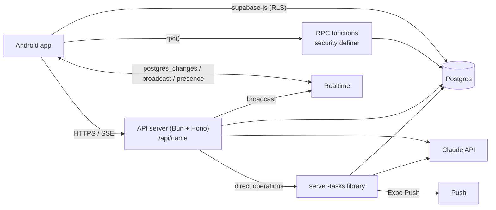
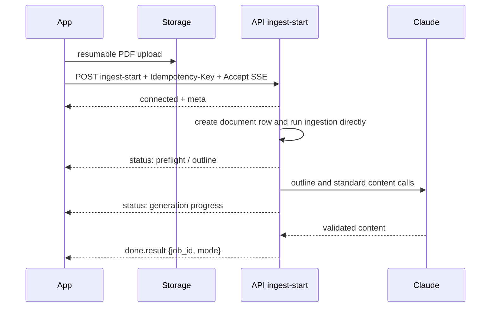

# Studify — API

| | |
|---|---|
| **Status** | Draft v1 |
| **Scope** | Every server interface: direct table access under RLS, Postgres RPC functions, API functions, direct domain operations, Realtime channels, push notifications, deep links |
| **Consistent with** | [data-model.md](data-model.md) (all table/column names), [architecture.md](architecture.md), [security-privacy.md](security-privacy.md), [mobile-app.md](mobile-app.md), the specs in [docs/specs/](../specs/) |
| **Schemas** | Request/response shapes are written as TypeScript types; each one is a Zod schema in `packages/shared/src/api/` with the same name, used by the app and the server. |

---

> **Hosting note.** The synchronous API functions run on the API server (Bun + Hono, `apps/api`) at
> `https://studify.vendua.com.br/api/<name>`, deployed on the owner's VPS. They were Supabase Edge Functions at
> `/functions/v1/<name>`; the route names, bodies, responses and error envelopes did not change. See
> [ADR 0008](adr/0008-vps-bun-hono-api.md) and [deployment.md](deployment.md).


## 1. Interface types



| Type | Use it for | Never use it for |
|---|---|---|
| **Direct table access** (PostgREST via supabase-js, RLS) | Reading anything the user may see; writing the user's own simple rows (goals, exams, settings, overrides, highlights) | Anything that calls Claude, changes another user's data, needs server timing, or must validate cross-row invariants |
| **RPC functions** (`supabase.rpc`) | Transactional, AI-free operations with invariants: join a Turma, edit the outline, log a grade, resolve a flag, anonymized insights | Long work; AI calls |
| **API functions** (`/api/<name>`) | All privileged and AI work, including ingestion and generation, running directly behind SSE | Unauthenticated service-role access |
| **Calendar triggers** (same API process) | Future deadlines, quiet-hour delivery, budget resets, UTC recurring computations | Interactive request execution |
| **Realtime** | Live progress, duels, battles, study rooms | Authoritative writes (clients only send presence) |

---

## 2. Conventions

### 2.1 Authentication and headers

- Every call carries the Supabase session JWT: `Authorization: Bearer <access_token>` (supabase-js does it). API functions call `supabase.auth.getUser(jwt)` first and authorize explicitly before any service-role query (security-privacy.md §3).
- Client headers on every API call: `x-studify-version: <android versionCode>`, `x-studify-schema: <sync schema version>`, `x-device-id: <stable per-install id>`.
- A client below `min_supported_version_code` ([data-model §5.11](data-model.md#511-ai-operations-and-platform) `app_versions`) or with an unknown future schema gets **`426 Upgrade Required`** with code `app_update_required`.

### 2.2 Error envelope

All API functions and RPC errors map to one shape. `message` is always a PT-BR string safe to show; `code` is stable for the app's logic.

```ts
type ApiError = {
  error: {
    code: ErrorCode;           // see §11
    message: string;           // PT-BR, user-facing, e.g. "Você atingiu o limite de IA de hoje. Volta amanhã!"
    retry_after_s?: number;    // 429 and budget errors
    resets_at?: string;        // ISO, budget errors
    details?: Record<string, unknown>;  // machine-readable extras (never PII of others)
  };
};
```

| HTTP | When |
|---|---|
| 400 | Validation failed (`invalid_request`) |
| 401 | Missing/invalid JWT |
| 403 | Authenticated but not allowed (`forbidden`, `not_member`, `blocked`) |
| 404 | Not found **or** not visible (never reveal existence) |
| 409 | State conflict (`already_exists`, `duplicate_document`, `attempt_open_elsewhere`, `duel_not_open`) |
| 422 | Semantically invalid input (`pdf_password_protected`, `photo_unreadable`) |
| 426 | `app_update_required` |
| 429 | `rate_limited` (per-minute) |
| 402 | `budget_exhausted` (PLT-04; 402 is used as an app-level code, no payment involved) |
| 503 | `ai_unavailable` (Claude overloaded after retries) |

RPC functions raise Postgres exceptions with `errcode` `P0001` and a `HINT` containing the `code`; the shared client wrapper converts them into the same `ApiError`.

### 2.3 Pagination and sync reads

- Lists use **keyset** pagination: `?limit=50&cursor=<opaque>` where the cursor encodes `(created_at, id)` or `(updated_at, id)`; responses are `{ items: T[], next_cursor: string | null }`. Max `limit` 200.
- Incremental sync reads use `updated_at > :cursor_ts or (updated_at = :cursor_ts and id > :cursor_id)` ordered by `(updated_at, id)`, including tombstones (`deleted_at` not null) — see [§3.2](#32-sync-pull).

### 2.4 Idempotency

- Every **mutating API call** requires an `Idempotency-Key: <uuid v7>` header. The server stores `(user_id, function, key) → response` in `private.idempotency_keys` for 24 h; a retry with the same key returns the stored response (same status and body) without re-running side effects or re-charging AI budget. Same key with a different body → `409 idempotency_mismatch`.
- App builds that follow running calls send `x-studify-operations: 1` on every call; the two rules below apply only to them (older builds get inline calls and `409 already_exists` for a repeat that is still running).
- **Direct streaming calls** ([ADR 0010](adr/0010-direct-sse-api.md)): every SSE request uses an `Idempotency-Key`. A duplicate attaches to live work, and an identical structured AI call by the same student can join under a new key; each joined key gets a stored result. There is no `202 running` polling protocol or interactive queue.
- Rows created offline carry **client-generated UUIDs** (`review_logs.id`, `quiz_attempts.id`, `attempt_answers.id`, `study_sessions.id`, `xp_events.id`, `feed_impressions.id`); inserts are `on conflict (id) do nothing`, so the id itself is the idempotency key.

### 2.5 Rate limits and AI budget classes

Every AI-calling endpoint goes through `ai_budget_reserve(user, class_group, feature, estimated_cost)` before calling Claude and `ai_budget_settle` after (security-privacy.md §7). Classes set the default estimate reserved:

| Class | Typical endpoints | Default reservation | Per-user rate limit |
|---|---|---|---|
| `A` small | grade one short answer, explain differently, scope matching, card draft | ~2k in / 1k out | 10 req/min (shared AI limit) |
| `B` chat | `tutor-chat`, `teaching-turn`, `argument-turn`, `podcast-ask` | context-pack size estimate | 10 req/min; tutor 60 messages/day |
| `C` generation | `note-generate` (deep), `cards-generate-more`, `questions-generate-more` | per item count | 10 req/min; per-topic caps from specs |
| `D` heavy | `ingest-start`, `podcast-create`, `grade-essay` (ENEM), `prova-provavel-generate`, `enem-simulado-create` (if generation needed) | upfront estimate, adjusted on settle | 3 concurrent jobs per user |

Shared Turma content is charged to the Turma budget (PLT-04.5). When a reservation fails the endpoint returns `402 budget_exhausted` with `resets_at`. JSON responses may include `x-ai-usage-today: <0–100>`. SSE reports usage in its final event so the stream opens without waiting for a budget-read query (percentage, never dollars; PLT-04.2).

### 2.6 Streaming (SSE)

All new app calls send `Accept: text/event-stream`. After admission, `meta` and heartbeats cover retrieval and model thinking; structured handlers send their JSON as `done.result`, with the original handler status in `done.status`. Every data frame has a monotonic `id`. Streaming endpoints respond with `Content-Type: text/event-stream`. The app reads them with `expo/fetch` streaming. Events:

```ts
type SseEvent =
  | { event: "meta";     data: { request_id: string; message_id?: string; thread_id?: string } }
  | { event: "delta";    data: { text: string } }                      // append to the visible text
  | { event: "citation"; data: Citation & { index: number } }          // Citations shape, original page numbers
  | { event: "tool";     data: { name: string; payload: unknown } }    // e.g. registrar_avaliacao (tutor)
  | { event: "status";   data: { key: string; params?: object } }      // i18n progress key, e.g. "tutor.searching_pages"
  | { event: "done";     data: { stop_reason: "end_turn" | "max_tokens" | "refusal"; usage_pct_today: number; result?: unknown } }
  | { event: "error";    data: ApiError["error"] };
```

- Citations arrive as separate events so the UI can render 📄 chips progressively; `start`/`end` offsets refer to the final concatenated text.
- A `refusal` ends the stream with `done.stop_reason = "refusal"` after the server-side fallback was tried where the model has one (Haiku 5.5 has none, so it ends at once); the app shows the spec's friendly refusal copy.
- If the connection drops or stalls for 45 seconds, reconnect with the same key and `Last-Event-ID`. The server attaches the connection to the live producer and sends only newer events, or replays the completed transcript. Event IDs prevent duplicate delivery.
- A stream opens before any plain Claude call the function makes, so the heartbeat covers the wait; errors after that arrive as the `error` event, which the app reads as the same ApiError as an HTTP error.

### 2.7 Dates and times

Instants are ISO 8601 UTC (`2026-11-09T13:30:00Z`); student days are `YYYY-MM-DD` local dates computed with the user's `timezone` and `day_rollover_hour` (data-model R9).

---

## 3. Direct table access (supabase-js under RLS)

### 3.1 What the app reads and writes directly

| Area | Reads | Direct writes (own rows) |
|---|---|---|
| Profile & settings | `profiles` (self), `profiles_public`, `study_preferences`, `app_versions`, `release_notes`, `feature_flags` via `my_feature_flags()` | `profiles` (display name, avatar preset, school year, settings), `study_preferences`, `push_tokens`, `app_feedback` |
| Subjects & materials | `subjects`, `subject_user_settings`, `documents`, `document_pages` (text for search UI), `knowledge_nodes`, `node_sources`, `node_prerequisites`, `ai_jobs` | personal `subjects` insert/update; `subject_user_settings`; `documents` insert (row created **before** upload, `status = uploaded`), `node_user_settings` |
| Content | `notes`, `glossary_terms`, `cards`, `questions`, `feed_items`, `explanations`, `concept_contrasts`, `podcast_episodes` | user cards (`origin = user`), `card_overrides`, `glossary_term_overrides`, `note_highlights`, `item_hides`, `mnemonics`, `memory_palaces`, `repertorio_items` |
| Learning state | `card_states`, `review_logs`, `mastery`, `mistakes`, `quiz_attempts`, `attempt_answers`, `calibration_stats`, `daily_activity`, `streaks`, `achievements` | practice `quizzes`/`quiz_attempts`/`attempt_answers` while `in_progress` (synced via `sync-push` when offline), `mistakes` (cause, note) |
| Goals | `goals`, `exams`, `exam_scope_items`, `exam_scope_nodes`, `grading_rules`, `grade_components`, `plan_items`, `readiness_snapshots` | `goals`, `exams`, `exam_scope_nodes` (confirm/uncheck), `grading_rules`, `grade_components`, `plan_items` (`status`, `pinned`), `availability_exceptions` |
| Tutor | `tutor_threads`, `tutor_messages` | `tutor_threads` (rename, archive, delete), `tutor_messages.feedback` |
| Turma | `class_groups`, `class_group_members_public`, `duels`, `duel_participants_public`, `battles`, `battle_players`, `study_rooms` | own membership flags (`nickname`, `contribute_insights`, `league_opt_in`, `accepts_duels`), `user_blocks`, `quiz_shares` |
| ENEM | all ENEM reference tables, `essay_themes`, `atualidades_*`, `sisu_offers` | custom `essay_themes`, `sisu_targets` (via RPC `set_sisu_target`) |

### 3.2 Sync pull

The sync engine pulls each mirrored table ([data-model §9.1](data-model.md#91-mirrored-tables)) with a per-table cursor:

```ts
supabase.from("cards")
  .select(CARD_COLUMNS)
  .in("subject_id", activeSubjectIds)
  .or(`updated_at.gt.${ts},and(updated_at.eq.${ts},id.gt.${id})`)
  .order("updated_at").order("id")
  .limit(500);
```

Rows with `deleted_at` set are tombstones. Pull runs **after** push ([§4.1 `sync-push`](#41-platform-account-and-sync)). Large initial loads (> 5,000 cards) use RPC `sync_snapshot(table, subject_ids)` which returns a gzip JSON export URL from Storage.

---

## 4. API functions

Format per function: **name** — features · class · method. `Req` = request body, `Res` = response body. All mutating functions require `Idempotency-Key`.

### 4.1 Platform, account and sync

#### `signup-complete` — PLT-02.2–7, SP-01–03 · no AI · `POST`
Called once after the first sign-in, before any other call (the `before user created` auth hook only checks the invite code is syntactically valid; this function does the real work transactionally).
```ts
type SignupCompleteReq = {
  invite_code: string;                    // pilot or Turma invite
  birth_month: number; birth_year: number;
  display_name: string; avatar_preset?: string;
  school_year: "ef9" | "em1" | "em2" | "em3" | "cursinho" | "outro";
  privacy_notice_version: string;
};
type SignupCompleteRes = {
  profile_id: string;
  guardian_required: boolean;             // < 16 and SP-03 enabled (Phase 2)
  class_group?: { id: string; name: string; status: "active" | "pending" };   // when a Turma code was used
};
```
Errors: `under_age` (no data stored, auth user deleted), `invite_invalid`, `invite_expired`, `invite_used_up`, `display_name_rejected`, `already_completed`.

#### `sync-push` — PLT-07, MEM-02, ADR 0007 · no AI · `POST`
```ts
type SyncPushReq = {
  schema_version: number; device_id: string;
  items: OutboxItem[];                    // ≤ 200, in local creation order
};
type OutboxItem = { id: string; kind: OutboxKind; payload: unknown; created_at: string };
// OutboxKind = review_log | quiz_attempt | attempt_answer | plan_item_status | card_override | card_state_flag
//   | node_user_setting | subject_user_setting | mistake_update | note_highlight | flag | feed_impression
//   | xp_event | study_session | topic_read | podcast_play | study_preferences
type SyncPushRes = {
  acked: string[];                        // processed or already processed (idempotent)
  rejected: { id: string; code: "invalid" | "forbidden" | "not_found" | "stale"; drop: boolean }[];
  card_states: CardState[];               // authoritative states for every card touched
  server_time: string;
};
```
Behavior: validates each payload with its Zod schema; inserts `review_logs` `on conflict do nothing`, clamps `reviewed_at` (> 5 min in the future → clamp + `clock_skew = true`), replays FSRS for touched (user, card) pairs with the pinned `ts-fsrs`, writes `mastery_evidence`, processes offline quiz answers (auto-gradable re-scored server-side; AI-graded ones enqueued `grading.answer`), applies LWW fields clamped to server time ± 5 min. Never charges AI budget itself.

#### `account-export` — SP-14, PLT-02.9 · `POST` → `202 { export_id }`
Enqueues `account.export`; result via `data_exports` row + push `export_ready`.

#### `account-delete` — SP-14, PLT-02.9 · `POST`
```ts
type AccountDeleteReq = { otp_code: string; delete_shared_uploads: boolean };
type AccountDeleteRes = { deletion_id: string; completes_by: string };  // ≤ 15 days
```
Re-authentication with a fresh email OTP is required. Signs out all sessions, enqueues `account.delete`.

#### `guardian-link` — SP-03, SP-04 (Phase 2) · `POST`
`Req { guardian_email }` → sends the PT-BR notice + verification link; `Res { link_id, status: "pending" }`.

### 4.2 Ingestion and knowledge map

#### `ingest-start` — ING-01, ING-02, ING-03, PLT-04.4 · class D · `POST`
Called after the file is uploaded to `documents/{subject_id}/{document_id}.pdf` and the `documents` row exists.
```ts
type IngestStartReq = { document_id: string; mode?: "full" | "outline_only" };
type IngestStartRes = { job_id: string; estimated_pages: number; mode: "full" | "outline_only"; budget_note?: "outline_only_today" };
```
Checks: caller `can_upload_to_subject`, file exists, size/page limits, duplicate checksum (`409 duplicate_document` with `details.existing_document_id`). If the full reservation fails but the outline fits, returns `mode: "outline_only"` (PLT-04.4). Enqueues `ingest.document`.

#### `ingest-retry` — ING-01 · class D · `POST`
`Req { document_id: string; from_stage?: "S0" | "S1" | "S4" }` → `Res { job_id }`. Allowed when `documents.status in ('failed','waiting_budget')` or a topic's `content_status = 'failed'`.

#### `upload-photos` — ING-01 (photo material), CAM-01 · no AI · `POST`
`Req { subject_id, image_paths: string[] }` → server builds a PDF from the photos (worker job `ingest.photos_to_pdf`) and creates the `documents` row with `kind = photo`; `Res { document_id, job_id }`.

#### `schedule-import` — ING-07 (Phase 2) · class A · `POST`
`Req { document_id }` → `202 { job_id, schedule_import_id }`; the job fills `schedule_imports.extracted`; RPC `apply_schedule_import` creates draft exams.

### 4.3 Learn

#### `note-generate` — LRN-01.4, LRN-01.12 · class C · `POST` (SSE when `depth = deep`)
```ts
type NoteGenerateReq = { node_id: string; depth: "tldr" | "study" | "deep"; regenerate?: boolean };
// non-streaming response (tldr/study already queued or ready):
type NoteGenerateRes = { note_id: string; status: "pending" | "generating" | "ready" };
// streaming (deep): SSE meta → delta/citation… → done{result:{note_id}}
```
Rules: `regenerate` on personal subjects max 3/topic/day (`429 regenerate_limit`); on shared subjects only organizers (`403`). Existing ready notes are returned without AI cost.

#### `explain` — LRN-03 · class A · `POST` · SSE
```ts
type ExplainReq = {
  target_type: "note_paragraph" | "concept" | "glossary_term" | "question_explanation" | "card_back";
  target_id: string; paragraph_index?: number;
  style: "simpler" | "analogy" | "example" | "step_by_step";
  force_new?: boolean;                    // "Tentar de novo" → personal explanation
};
// SSE: meta{explanation_id} → delta/citation… → done
```
Cache hit (shared `explanations` row) streams the stored body immediately at no cost.

#### `cards-generate-more` — MEM-01.6 · class C · `POST`
`Req { node_id }` → `Res { card_ids: string[] }` (≤ 10, deduplicated against existing fronts).

#### `card-draft` — MEM-01.7, LRN-01.9 · class A · `POST`
`Req { subject_id, node_id?, selection: string, source: "note" | "pdf", document_id?, page?: number }` → `Res { front, back, type: "basic" | "cloze", source_pages }` (draft only; the app inserts the card after the user edits).

#### `questions-generate-more` — PRA-01.4, ENM-03.5 · class C · `POST`
`Req { node_id, count?: 10, enem_style?: boolean }` → `Res { question_ids: string[] }` (ENEM style defaults to 5).

#### `visual-generate` — LRN-05 (Phase 5) · class A · `POST`
```ts
type VisualGenerateReq = { node_id: string; type?: "flowchart" | "timeline" | "comparison_table" | "hierarchy" | "cycle" };
type VisualGenerateRes =
  | { fits: true; visual: { id: string; node_id: string; type: VisualType; title: string; spec: VisualSpec; alt_text: string; source_pages: SourcePages }; cached: boolean }
  | { fits: false; reason: string };
```
Without `type` the AI picks the best diagram or says none fits; the answer is cached per `(node_id, type)` in `visuals` (a `none` row for "nothing fits", R29), so a second open costs nothing. The server re-checks the spec limits (LRN-05.6) and maps document labels to ids before saving. The app renders the spec natively (boxes as views, lines in SVG) with the alt text for TalkBack.

#### `mnemonic-suggest` — MEM-06 (Phase 5) · class A · `POST`
```ts
type MnemonicSuggestReq = {
  card_id?: string; node_id?: string;                // at least one
  type?: MnemonicType | "any";                       // acronym · phrase · rhyme · story · palace · keyword
  palace_id?: string;                                // required for "palace"
  items?: string[];                                  // an ordered list to encode (2–20)
  exclude_titles?: string[];                         // "Outras ideias"
};
type MnemonicSuggestRes = { options: { type: MnemonicType; title: string; content: { text: string; items?: string[]; how_to_use?: string; loci?: { locus: string; item: string; image: string }[] } }[] };  // 1–3
```
Nothing is stored: the app saves the chosen (and possibly edited) option into `mnemonics` under RLS. Acronyms are re-checked on the server (the letters must spell the items) and options unsuitable for minors are dropped.

### 4.4 Tutor

#### `tutor-chat` — TUT-01…06, CAM-01.4 · class B · `POST` · SSE
```ts
type TutorChatReq = {
  thread_id?: string;                     // omitted → new thread with this scope
  scope?: { type: "subject" | "goal" | "topic" | "passage" | "capture";
            subject_id?: string; goal_id?: string; node_id?: string; capture_id?: string;
            passage?: { source: "note" | "pdf"; document_id?: string; note_id?: string; page?: number; text: string } };
  mode: "answer" | "socratic" | "quiz";
  message: string;                        // ≤ 4,000 chars
  client_message_id: string;              // uuid v7; also the user message id
  voice?: boolean;                        // TUT-06 (text came from on-device STT)
  allow_general_answer?: boolean;         // TUT-04.3 one-off opt-in
};
// SSE: meta{thread_id, message_id} → status("tutor.searching_pages") → delta/citation… → tool? → done
```
Server: budget check (class B, 60 messages/day), retrieval (knowledge-map routing + FTS), context pack, Claude call with citations and streaming, stores both messages (`raw_content` for exact replay), maps citations to original pages. Tool events (`registrar_avaliacao`, `marcar_fora_do_material`) arrive as `tool` events and are stored in `tool_events`.

### 4.5 Practice and grading

#### `quiz-create` — PRA-01, PRA-03, PRA-04, PRA-09.7, MOT-02 · class C only if generation needed · `POST`
```ts
type QuizCreateReq = {
  kind: "practice" | "mock_exam" | "mistake_retry" | "predicted_test" | "boss";
  scope: { exam_id?: string; goal_id?: string; subject_id?: string; node_ids?: string[]; weak_only?: boolean };
  types?: QuestionType[]; count: number;  // 5–90
  mode: "practice" | "exam_conditions" | "relaxed";
  time_limit_s?: number;
};
type QuizCreateRes = { quiz_id: string; attempt_id: string; question_ids: string[]; generated: number };
```
Practice quizzes over already-cached questions can also be assembled **on device** (offline) and inserted directly; `quiz-create` is required when the bank must be topped up, for simulados with adaptive composition (spec 05 §8.7), and for predicted tests.

**Chefões (MOT-02, Phase 5):** `kind = "boss"` takes `scope: { subject_id, unit_node_id }`; the count is 10 for units with ≤ 4 topics and 15 above. Every topic gets one question first (weakest first), the rest are drawn with weight `1.2 − mastery`, and questions from earlier attempts are used only when the unseen ones run out. Other members' personal questions are never drawn (R8). `quiz-submit` writes `boss_attempts` (pass at 70%); the app awards the `boss_defeated` XP event once per unit.

#### `quiz-submit` — PRA-01.6, PRA-02, PRA-03, PRA-04, PRA-05, ENM-04 · class A per AI-graded answer · `POST`
```ts
type QuizSubmitReq = { attempt_id: string; answers: AttemptAnswerInput[]; finished_at: string };
type AttemptAnswerInput = {
  id: string; question_id: string; response: unknown | null; confidence?: 1 | 2 | 3 | 4;
  time_spent_ms: number; hints_used?: number; solution_viewed?: boolean; marked_for_review?: boolean;
  input_mode?: "typed" | "photo"; essay_id?: string;
};
type QuizSubmitRes = {
  attempt: { id: string; status: "submitted"; score: number | null; grade: number | null;
             area_results?: EnemAreaResults };          // ENEM simulados: TRI estimate per area (labeled estimate)
  answers: { id: string; correct: boolean | null; score: number | null;
             grading_status: "graded" | "pending" | "failed" }[];
  mistakes_created: string[]; cards_created: string[];  // PRA-02 auto-card, PRA-04
  pending_ai_grading: number;                           // results arrive via Realtime on attempt_answers… or re-fetch
};
```
Auto-gradable answers are scored server-side (authoritative, same code as on device). AI-graded answers in a simulado are graded after submission in parallel (PRA-03.6). For `enem_simulado` the TRI estimate is computed here ([learning-engine.md](learning-engine.md), spec 09 §8.3).

#### `grade-answer` — PRA-01.6, PRA-07, PRA-08 · class A · `POST`
`Req { attempt_answer_id }` → `Res { score, points_awarded, points_max, grader_confidence, feedback: { criteria: [{id, verdict: "full"|"partial"|"none", comment}], summary } }`. Used in practice mode for immediate feedback on `short_answer`, `essay_question`, `problem`. Empty answer → 0 without AI call.

#### `grade-essay` — PRA-07, ENM-05, CAM-03 · school: class A sync; ENEM: class D async · `POST`
```ts
type GradeEssayReq = { essay_id: string };
type GradeEssayRes =
  | { mode: "sync"; essay: { id: string; status: "graded"; feedback: unknown } }       // kind = school_answer, < 30 s
  | { mode: "async"; job_id: string; eta_s: number };                                 // kind = enem_redacao, push when done
```
Requires `essays.text` confirmed (photo transcriptions go through `capture-confirm` first). ENEM weekly essay budget is enforced here (owner-set; spec 09 open question).

#### `flag-create` — TRU-02, SP-09 · no AI in request (triage async) · `POST`
`Req { item_type, item_id, reason, comment? }` → `Res { flag_id, status: "open", hidden_for_you: boolean }`. Enqueues `flag.triage`. One open flag per (item, reporter).

#### `report-create` — SP-09, SOC · `POST`
`Req { reported_id?, class_group_id?, reason, context_type?, context_id?, comment? }` → `Res { report_id }`. Notifies the Turma moderators (or the app admin for `self_harm_concern` and reports about moderators).

### 4.6 Goals and planning

#### `scope-resolve` — GOL-03 · class A · `POST`
```ts
type ScopeResolveReq = { exam_id: string; items?: string[]; text?: string; document_id?: string };  // typed list, pasted text, or photo/PDF
type ScopeResolveRes = {
  items: { id: string; raw_text: string; status: "matched" | "partial" | "unmatched";
           nodes: { node_id: string; confidence: number }[]; placeholder_node_id?: string }[];
  scope_status: "pending_review";
};
```
Target < 15 s p50 (spec 07 §7). Photos are transcribed in the same call. The student confirms with RPC `confirm_exam_scope`.

#### `plan-recompute` — GOL-04, GOL-05, ENM-07 · no AI in the request (the worker job runs `plan.coach`, GOL-04.10) · `POST`
```ts
type PlanRecomputeReq = { trigger: PlanTrigger; goal_id?: string; local_date?: string };
type PlanRecomputeRes = { plan_run_id: string; version: number; feasible: boolean;
                          triage?: { dropped_node_ids: string[]; reason_key: string }; items_changed: number };
```
Runs `buildPlan` from `packages/shared` (same code the device runs offline). Debounced: calls within 30 s for the same user coalesce. Pinned items and past days are never moved.

#### `vespera-prepare` — GOL-07 · class C · `POST`
`Req { exam_id }` → `Res { status: "ready", sheet_note_id } | { status: "preparing", job_id }`. Normally pre-generated by the nightly job at D−1 04:00.

#### `prova-provavel-generate` — PRA-09 · class D · `POST`
`Req { exam_id, regenerate?: boolean }` → `202 { job_id, quiz_id_when_ready?: null }`; target < 3 min, progress via `ai_jobs`, result is a `quizzes.kind = predicted_test`.

### 4.7 Turma, duels and battles

#### `duel-create` — SOC-02 · no AI unless questions must be generated · `POST`
```ts
type DuelCreateReq = { class_group_id: string; opponent_id: string; subject_id: string; node_ids?: string[];
                       length: 5 | 7 | 10; rematch_of?: string };
type DuelCreateRes = { duel_id: string; quiz_id: string; attempt_id: string };   // challenger plays now
```
Checks SOC-02.9 limits, blocks (SOC-02.11), `accepts_duels`. Questions: auto-gradable types only.

#### `duel-respond` — SOC-02.5 · `POST`
`Req { duel_id, accept: boolean }` → `Res { attempt_id? }` (declined → status `declined`, no penalty).

#### `duel-next` / `duel-answer` — SOC-02.4, SOC-02.6 · `POST`
```ts
type DuelNextReq = { attempt_id: string };
type DuelNextRes = { index: number; total: number; question: QuestionPublic; deadline_at: string } | { finished: true };
// QuestionPublic = question without answer key, rationales or explanation
type DuelAnswerReq = { attempt_id: string; question_id: string; response: unknown; answer_id: string };
type DuelAnswerRes = { correct: boolean; points: number; correct_response: unknown; explanation: string; source_pages: SourcePages };
```
`duel-next` records `private.question_served`; answers after `deadline_at` + 1.5 s grace score 0.

#### `battle-control` — SOC-03 · `POST`
```ts
type BattleControlReq =
  | { action: "create"; class_group_id: string; subject_id: string; node_ids?: string[]; count: 5 | 10 | 15; seconds_per_question?: number }
  | { action: "start" | "next" | "end"; battle_id: string }
  | { action: "kick"; battle_id: string; user_id: string };
type BattleControlRes = { battle_id: string; pin?: string; status: BattleStatus };
```
Host-only except `create` (any member unless the Turma restricts hosting). State transitions are broadcast on `battle:{id}`; the worker job `battle.tick` advances at each `question_closes_at`.

#### `battle-join` / `battle-answer` — SOC-03.3, SOC-03.5, SOC-03.7 · `POST`
`battle-join Req { pin } → Res { battle_id, nickname }`. `battle-answer Req { battle_id, question_index, response, answer_id } → Res { accepted: boolean }` (correctness is revealed on the channel at reveal time, never in this response).

#### `room-control` — SOC-05 (Phase 3) · `POST`
`Req { action: "create" | "start" | "pause" | "resume" | "skip" | "close" | "react"; room_id?; class_group_id?; timer_config?; group_goal?; reaction?: "👏" | "🔥" | "💪" }` → `Res { room_id, timer_state }`. Reactions are rate-limited (1 per 5 s).

#### `divide-review` / `divide-submit` / `divide-merge` — SOC-06 (Phase 5) · class A (review), class C (merge) · `POST`
```ts
type ContributionReviewReq = { contribution_id: string };
type ContributionReviewRes = { feedback: { errors: { quote: string; correction: string; page: number | null; document_id: string | null }[]; missing_concepts: string[]; ok_to_merge: boolean; summary: string } };
type ContributionSubmitReq = { contribution_id: string };
type ContributionSubmitRes = { status: "submitted" | "approved"; merge_started: boolean };
type DivideMergeReq = { divide_plan_id: string };
type DivideMergeRes = { job_id: string | null; status: "merging" | "done" };
```
The members claim topics with RPC `claim_divide_topic` and write their contribution (typed, or text from a Câmera Mágica capture) directly under RLS while it is a draft. `divide-review` gives the author a **private** AI review against the material (SOC-06.3); `divide-submit` locks it (auto-approved when the last review had no errors). When every topic has a submitted contribution, or a moderator calls `divide-merge`, the job `divide.merge` builds one `class_summary` note per topic with credits and pushes `divide_merged`.

#### `peer-question-create` — SOC-07 (Phase 5) · class A · `POST`
```ts
type PeerQuestionCreateReq = { subject_id: string; node_id: string; type: "mcq_single" | "true_false" | "short_answer";
                               stem: string; payload: Record<string, unknown>; explanation?: string; anonymous?: boolean; dry_run?: boolean };
type PeerQuestionCreateRes = {
  status: "pending" | "needs_changes" | "ok"; question_id: string | null;
  validation: { grounded: boolean; evidence_pages: { document_id: string; page: number }[]; single_correct_answer: boolean;
                clarity_issues: string[]; appropriate: boolean; suggested_fix: { stem: string; payload: object; explanation: string | null } | null };
  blocking: ("not_grounded" | "not_single_answer" | "inappropriate" | "duplicate")[];
};
```
The AI checks the question against the subject's material and the near-duplicates found through `questions.stem_tsv`. `dry_run` only returns the check; otherwise a question without blocking issues enters the pool as `origin = peer`, `review_status = pending` (readable by the Turma for voting, R30). It is approved after 3 votes (`vote_peer_question`) or by a moderator (`review_peer_question`); only approved questions are used in quizzes. Limit: 20 per member per day.

#### `quiz-share` — SOC-09 · `POST`
`Req { quiz_id }` → `Res { token, url: "https://{BASE_URL}/q/{token}", expires_at }`. Opening the link requires sign-in and Turma membership of the quiz's subject (whether quizzes may be shared outside the Turma is an open owner decision).

### 4.8 Interactive learning and camera

#### `podcast-create` — INT-01 · class D · `POST`
`Req { subject_id, node_ids, style: "overview" | "deep" | "exam_review", length_minutes: 5 | 10 | 15 }` → `Res { episode_id, status: "ready" | "queued" }`. Cache hit on `cache_key` returns an existing episode at no cost.

#### `podcast-ask` — INT-01.8–9 · class B · `POST` · SSE
`Req { episode_id, position_ms, segment_id, question_text, input_mode: "voice" | "text" }` → SSE `delta` events carry `{speaker, text}` lines; `done.result = { interaction_id, answer_audio_url?: string, tts_fallback: boolean }` (audio synthesized after the text; on TTS failure the app uses on-device TTS).

#### `teaching-start` / `teaching-turn` / `teaching-finish` — INT-02 · class B · `POST`
`teaching-start Req { node_id, length: "short" | "full" } → Res { session_id, opening: string }` (the hidden plan never leaves the server).
`teaching-turn Req { session_id, message } →` SSE (Lucas's reply).
`teaching-finish Req { session_id } → Res { score, rubric, gaps: {concept_id, text}[], errors_taught: string[] }`.

#### `argument-start` / `argument-turn` / `argument-finish` — INT-03 · class B · `POST`
`argument-start Req { goal_mode, theme?, theme_source, mode: "debate" | "build", subject_id? } → Res { session_id, theme, opening }`; `argument-turn` SSE; `argument-finish → Res { rubric, summary, outline?, essay_id? }`.

#### `argument-themes` — INT-03.2 "Sugerir temas" (Phase 4) · class A · `POST`
`Req { subject_id }` → `Res { themes: { question: string; node_ids: string[]; why: string }[] }` (5 debatable questions grounded in the subject's topics). Nothing is stored.

#### `capture-analyze` — CAM-01, CAM-02, CAM-03 · class A · `POST`
Called after the images are uploaded to `photos/{user_id}/{capture_id}/…` and the `camera_captures` row is inserted.
```ts
type CaptureAnalyzeReq = { capture_id: string };
type CaptureAnalyzeRes = {
  content_type: "book_page" | "whiteboard" | "handwritten_notes" | "exercise" | "essay" | "other";
  quality: { ok: boolean; issues: ("blur" | "glare" | "partial" | "dark" | "multiple_questions")[] };
  transcription: string;                         // line breaks preserved; unreadable spans marked ⟦?⟧
  detected_questions?: { index: number; text: string }[];
  match?: { subject_id: string; node_ids: string[]; confidence: number };
};
```
`422 photo_unreadable` when quality is too low to transcribe.

#### `capture-act` — CAM-01…03 · class A (C for `add_to_subject`) · `POST` (SSE for `explain`)
```ts
type CaptureActReq =
  | { capture_id: string; intent: "explain" }                                   // SSE explanation with citations
  | { capture_id: string; intent: "solve"; question_index?: number; reveal: "hint" | "next_hint" | "solution" }
  | { capture_id: string; intent: "add_to_subject"; subject_id: string }        // → document + ingest job
  | { capture_id: string; intent: "grade_answer" | "grade_essay"; confirmed_text: string; question_id?: string; theme_id?: string };
type CaptureActRes =
  | { intent: "solve"; hint_level: number; content: string; final?: { solution_md: string; answer: string } }
  | { intent: "add_to_subject"; document_id: string; job_id: string }
  | { intent: "grade_answer" | "grade_essay"; essay_id: string; next: "grade-essay" };
```
Solve follows the hint ladder; `reveal = "solution"` marks `attempt_answers.assisted` when tied to an attempt.

### 4.9 ENEM

#### `enem-simulado-create` — ENM-04 · class C if items must be generated (`provavel`/`misto`) · `POST`
```ts
type EnemSimuladoCreateReq = {
  goal_id: string; mode: "full_day1" | "full_day2" | "area" | "mini";
  area?: "LC" | "CH" | "CN" | "MT"; source: "replica" | "misto" | "provavel";
  edition?: number; language: "en" | "es"; includes_essay?: boolean;
};
type EnemSimuladoCreateRes = { quiz_id: string; attempt_id: string; time_limit_min: number; item_count: number };
```
Scored by `quiz-submit` (TRI estimate in `area_results`).

#### `essay-theme-generate` — ENM-05.8 · class A · `POST`
`Req { axis?: string; source: "predicted" | "atualidades" | "custom"; title?: string }` → `Res { theme_id }`.

#### `enem-questions-generate` — ENM-03 · class C · `POST`
Alias of `questions-generate-more` with `enem_style = true` (kept as one function).

**Phase 4 notes.** Meta SISU (ENM-06) needs no function: the app computes the per-area targets with the shared solver from `sisu_offers` and writes `sisu_targets` under RLS (owner only, never the Turma), then asks for a replan. ENEM goals tag the student's topics with the global taxonomy through the job `enem.tag_nodes`.

### 4.11 Trilha

#### `trail-open` — TRL-01.1–01.3 · no AI · `POST`
`Req { subject_id }` → `TrailState`. Creates the student's trail for the subject on first use from the subject's path (`trail_subject_plans`, outline order until it exists); re-plans the chapters not started when the outline changed, or when the subject's path became ready for a trail that started in outline order; closes the chapter when its test is passed and a finished Ensine o Lucas lesson on the topic scored ≥ 70 (`state.chapter_done`). 404 when the subject has no topic with material. Never calls Claude (ADR 0011): when the subject has no path for its current map it starts `trail.plan_subject` in the background, and when the current or next chapter lacks shared content it starts `trail.prepare_topic` for them. The step it returns is marked served (resume).

Every Trilha call (`trail-open`, `trail-prepare`, `trail-answer`, `trail-settle`) copies the next move's steps from the shared content (`trail_concept_content`) before building the state, so `preparing` is true only when that content does not cover the move.

#### `trail-prepare` — TRL-01.8 · class A · `POST`
`Req { trail_id }` → `TrailState`. Generates at most one need the shared content does not cover (`trail.lesson`, `trail.remediate` or `trail.checkpoint`): the one blocking the next step, else up to `TRAIL.lookahead` (2) lessons ahead within the chapter. A lesson goes into the shared content (for every student of the subject); a re-teaching or a test round is stored as the student's steps. A 150 s lease on `trails.preparing_until` serializes generation; a concurrent call returns the state unchanged. Lookahead failures are swallowed.

#### `trail-answer` — TRL-01.5–01.7, 01.10 · no AI · `POST`
`Req { trail_id, step_id, response: 'A'…'D' | null, time_spent_ms? }` → `{ feedback | null, checkpoint_result | null, mistake_id | null, state }`. `null` marks a lesson read. Writes `mastery_evidence` (`source trail`, `ref_type trail_step`) and enqueues `mastery.recompute`; a miss is saved to the Caderno (personal question + implicit `trail` attempt + `mistakes`, best effort); advances `chapter_index` when the test passed and Lucas was taught. A step already answered returns its stored feedback. The app now answers a question with `trail-grade` and `trail-settle` (below); `trail-answer` stays for lessons and for app builds that predate the split.

#### `trail-grade` — TRL-01.5 · no AI · `POST`
`Req { trail_id, step_id, response: 'A'…'D', time_spent_ms? }` → `{ correct, correct_option }`. Records the answer on the step and returns the verdict at once; nothing else is written. A step already answered returns its first verdict.

#### `trail-settle` — TRL-01.5–01.7, 01.13 · no AI · `POST`
`Req { trail_id, step_id, time_spent_ms? }` → `TrailAnswerRes` (`feedback` with the explanation and tip, `checkpoint_result`, `mistake_id`, `state`). Runs what `trail-answer` runs after grading: mastery evidence, the Caderno entry for a miss (saved once: a repeat call finds the question already linked), the chapter-test round and the chapter advance. The app calls it right after `trail-grade`; calling it again is harmless.

`TrailState { trail_id, subject_id, status, goal, progress, chapter_index, chapters[{topic_id, unit_id, title, why, status, concepts[{id, title, state}]}], phase (learning · checkpoint · teach · completed), checkpoint, step, next_step, teach {topic_id, title, pass_score, best_score, attempts}, boss {unit_id, title}, chapter_done, preparing, prefetch }` (`prefetch`: a lookahead the shared content does not cover, worth a `trail-prepare` in the background); A question's `step` carries its `answer` (`correct_option`, `explanation`, `tip`, `rationales`), so the app shows the verdict at once; `trail-grade` records the answer behind it, and `trail-settle` follows with the Caderno and the next state. On a lesson, `next_step` is the step that follows it when that step is already written (else null): the app shows it at once on "Entendi" and sends the lesson's `trail-answer` behind it, and a question's `trail-grade` waits for that answer. `explain` accepts `target_type: trail_step` (a lesson, or a question once answered).

### 4.10 Admin (app admin only)

`admin-budgets` (PLT-04.6: read spend by day/feature/Turma, set limits), `admin-enem-import` (`Req { year, application? }`; enqueue `enem.import_edition` after the admin uploads `enem/{year}/raw/` with a `manifest.json`, the ITENS_PROVA microdata CSV and one booklet PDF + answer key per day; nothing is published unless every check passes), `admin-atualidades-publish` (ENM-09), `admin-moderation` (escalated reports, takedowns). All check `private.is_app_admin()`.

---

## 5. RPC functions

All are `security definer`, `set search_path = ''`, check `auth.uid()` explicitly, and raise `ApiError` codes (§2.2).

| Function | Features | Args → returns | Notes |
|---|---|---|---|
| `my_feature_flags()` | PLT-01.6 | → `text[]` enabled flag keys | |
| `create_class_group(name, school?, school_year?)` | SOC-01.1 | → `{class_group_id, invite_code}` | Caller becomes owner; creates the first `invites` row (7 days) |
| `join_class_group(code)` | SOC-01.2–5 | → `{class_group_id, status: 'active'\|'pending'}` | Errors `invite_invalid`, `invite_expired`, `invite_used_up`, `class_full`, `banned`, `rate_limited` (5 failed codes/hour) |
| `rotate_invite(class_group_id, expires_in_days = 7, uses_left = null)` | SOC-01.4 | → `{invite_code, expires_at}` | Revokes the previous invite |
| `moderate_member(class_group_id, user_id, action)` | SOC-01.5, SOC-X | `action ∈ approve, reject, remove, ban, unban, promote, demote` → `void` | Logs `private.moderation_actions` |
| `leave_class_group(class_group_id)` | SOC-01 | → `void` | Owner must transfer ownership first |
| `create_shared_subject(class_group_id, name, color, icon)` | SOC-01.10 | → `subject_id` | Needs moderator or `allow_member_uploads` |
| `share_subject(subject_id, class_group_id, copyright_ack boolean)` | SOC-01.10, security §11 | → `void` | Moves a personal subject to the Turma; uploader keeps edit rights; per-user state untouched |
| `edit_outline(subject_id, ops jsonb)` | ING-04 | `ops: [{op: rename\|move\|reorder\|merge\|split\|delete\|restore\|create, ...}]` → `{event_ids: uuid[], regenerate_node_ids: uuid[]}` | Needs `can_edit_subject`; writes `node_events`; enqueues `content.regenerate_topic` for merged/split topics |
| `undo_outline_event(event_id)` | ING-04.5 | → `void` | Within 30 days |
| `confirm_exam_scope(exam_id, node_ids uuid[], default_all boolean)` | GOL-03 | → `void` | Sets `scope_status = confirmed`; triggers `plan.recompute` |
| `start_desperate_mode(goal_id, exam_ids, minutes_per_day)` | GOL-12 | → `{desperate_mode_id, diagnostic_quiz_id?}` | Checks eligibility (spec 07 §8.10.1); writes `availability_exceptions` (source `desperate`); triggers replan `desperate_on` |
| `set_desperate_groups(desperate_mode_id, moves: [{node_id, group}])` | GOL-12.5 | → `{topic_groups, coverage: [{exam_id, pct}]}` | Recomputes the plano de ataque; triggers replan |
| `end_desperate_mode(desperate_mode_id)` | GOL-12.11 | → `{ok}` | Removes `desperate` availability exceptions; replan `desperate_off`. Also run by the nightly job after the last covered test |
| `log_exam_grade(exam_id, grade, grade_max)` | GOL-06 | → `{required: [{exam_id, needed, status: 'secured'\|'needed'\|'impossible'}]}` | Uses the shared solver (spec 07 §8.5); triggers replan + `readiness` refresh |
| `apply_schedule_import(schedule_import_id, goal_id?)` | ING-07 | → `{goal_id, exam_ids}` | Creates `exams.status = draft` |
| `set_sisu_target(goal_id, offer_id?, manual?, modality_label?, margin?, priority?)` | ENM-06 | → `{sisu_target_id, targets}` | Recomputes per-area targets; triggers replan |
| `search_sisu_offers(q, edition_year?)` | ENM-06 | → `sisu_offers[]` (≤ 30) | Trigram search |
| `class_insights_for(class_group_id, subject_id?, node_id?)` | SOC-04 (R11) | → `[{question_id?, node_id?, pct_wrong, n_bucket, option_pcts?}]` | Applies spec 10 §8.4 thresholds (k ≥ 5, members contributing); never per-user |
| `class_group_ai_usage(class_group_id, month)` | PLT-04.5 | → `{spent_pct, by_feature}` | Moderators only |
| `resolve_flag(flag_id, decision, fix jsonb?)` | TRU-02 | `decision ∈ accept, reject, remove` → `void` | Applies fix → new `item_revisions` row, bumps `version`, re-scores affected attempts (job `flag.apply_fix`) |
| `handle_report(report_id, action)` | SP-09 | `action ∈ dismiss, warn, remove_content, remove_member, escalate` → `void` | |
| `block_user(user_id)` / `unblock_user(user_id)` | SOC-X.3 | → `void` | Also cancels open duels between the pair |
| `sync_snapshot(table, subject_ids uuid[])` | PLT-07 | → `{url}` | Large first sync |
| `vote_material_finding(finding_id, vote)` | ING-06.3 (Phase 5) | `vote ∈ not_error, is_error` → `{status, confirmations, dismissals}` | One vote per reader (changeable). On a personal subject the owner's vote decides; on a Turma subject 2 confirmations confirm and ≥ 2 dismissals (more than the confirmations) dismiss |
| `claim_divide_topic(plan_id, node_id, claim = true)` | SOC-06.1 | → `assignments jsonb` | One claimer per topic, ≤ `max_claims` per member; a submitted topic cannot be released |
| `divide_progress(plan_id)` | SOC-06 | → `[{node_id, user_id, nickname, status}]` | Claim and contribution state only (no text, no feedback, R31) |
| `vote_peer_question(question_id)` | SOC-07.3 | → `review_status` | Approved after 3 votes; the author cannot vote |
| `review_peer_question(question_id, approve)` | SOC-07.3 | → `review_status` | Moderators only |
| `league_board(class_group_id, week_start?)` | SOC-08 | → `[{user_id, nickname, league_xp, rank, badges, is_me}]` | Opted-in members only; top 10 + the caller; blocked pairs hidden; the live week is computed from `xp_events` |
| `set_calendar_availability(days jsonb)` | GOL-09.2 | `[{local_date, minutes \| null}]` (≤ 62 days) → `int` | Writes `availability_exceptions` with source `calendar` (R33); the student's own rows win; `null` clears a day |

---

## 6. Request flows (reference)



---

## 7. Direct domain operations

The operation catalog below keeps its existing payloads and progress identifiers, but handlers now execute directly inside the API service (`packages/server-tasks`). Queue retry, expiration, pickup and concurrency metadata in older specs are superseded by ADR 0010. Future triggers use the API calendar; ordinary calls bypass it. Side work the caller does not wait for (AI grading, flag triage, pushes, topic regeneration, the prerequisites and material check of a material, the Trilha content) is a calendar trigger due now (`inBackground`, `startAfter: 0`, ADR 0011): it starts within about a second and adds nothing to the request; a trigger refused at its operation's concurrency limit is re-scheduled 5 s later. Progress rows remain in `ai_jobs` for app compatibility and notifications; they are a read model, not an execution queue.

| Job | Features | Trigger | Payload | Retries | Singleton / notes |
|---|---|---|---|---|---|
| `ingest.document` | ING-01…05 | `ingest-start` | `{document_id, mode}` | 3 (S1: 2 s/8 s/30 s) | key `document_id`; runs S0 preflight + S1 outline synchronously (standard API), then fans out |
| `ingest.transcribe_pages` | ING-02 | from S0 for scanned pages | `{document_id, pages: int[]}` | 3 | Batch API when > 10 pages |
| `ingest.merge` | ING-01 merge | new document in a subject with an existing map | `{document_id}` | 3 | S1_merge; respects `edited_by_user` |
| `ingest.topic_content` | LRN-01, LRN-02, MEM-01, PRA-01, FED-01 | after S1 | `{subject_id, node_ids, kinds: ("notes"\|"glossary"\|"cards"\|"questions"\|"feed")[]}` | 2 | Creates one Message Batch; `custom_id = "{node_id}:{kind}:{prompt_version}"` |
| `batch.poll` | all batch users | scheduled every 60 s while batches are open | `{batch_id, ai_job_id}` | ∞ until ended | Results processed in any order, keyed by `custom_id`; errored items retried once in a new batch |
| `ingest.photos_to_pdf` | ING-01, CAM-01 | `upload-photos` | `{subject_id, image_paths, document_id}` | 3 | EXIF strip, face blur, HEIC→JPEG |
| `content.regenerate_topic` | ING-04, LRN-01.12 | `edit_outline`, regenerate requests | `{node_id, kinds}` | 2 | key `node_id` |
| `notes.prefetch_deep` | LRN-01.4 | nightly 02:00 | `{}` | 1 | Batch for users with an exam ≤ 7 days, in-scope topics with mastery < 0.5 |
| `grading.answer` | PRA-01.6, PRA-03.6 | offline answers synced, simulado submit | `{attempt_answer_id}` | 2 | standard API (parallel) |
| `essay.grade` | ENM-05, PRA-07 | `grade-essay` (ENEM) | `{essay_id}` | 2 | standard API, target < 90 s, push `essay_graded` |
| `flag.triage` | TRU-02 | `flag-create` | `{flag_id}` | 2 | AI verdict + proposed fix; notifies moderators |
| `flag.apply_fix` | TRU-02, PRA §9 | `resolve_flag` accept | `{flag_id}` | 3 | Re-scores attempts, deletes mistakes created from a wrong key, notifies affected users |
| `mastery.recompute` | MEM-05, PRA | after evidence insert (debounced 60 s per user) | `{user_id, node_ids}` | 3 | key `user_id` |
| `srs.optimize_params` | MEM-02.14 | weekly | `{user_id}` | 1 | Only users with ≥ 1,000 valid logs |
| `plan.recompute` | GOL-04 | RPCs, sync, `plan-recompute` | `{user_id, trigger}` | 3 | key `user_id`, debounce 30 s |
| `plan.nightly` | GOL-04, GOL-08, GOL-11 | daily 03:30 per timezone | `{user_ids}` (chunked) | 2 | Replans missed days, writes `readiness_snapshots` |
| `vespera.prepare` | GOL-07 | D−1 04:00 local; `vespera-prepare` | `{exam_id, user_id}` | 2 | standard API (latency matters) |
| `scope.match` | GOL-03 | `scope-resolve` fallback when > 15 s | `{exam_id}` | 2 | |
| `pp.analyze_past_test` | PRA-09.2–4 | ingestion of `kind = past_test` | `{document_id}` | 2 | standard API; Batch when ≥ 4 tests uploaded together |
| `pp.generate` | PRA-09.6–7 | `prova-provavel-generate` | `{exam_id, user_id}` | 2 | target < 3 min |
| `schedule.import` | ING-07 | `schedule-import` | `{schedule_import_id}` | 2 | |
| `duel.expire` | SOC-02.10 | scheduled at `expires_at` | `{duel_id}` | 3 | idempotent on status |
| `battle.tick` | SOC-03.4 | scheduled at each `question_closes_at` / reveal end | `{battle_id, index}` | 3 | idempotent on `(battle_id, index, status)` |
| `insights.recompute` | SOC-04 | nightly + after each battle | `{class_group_id}` | 2 | writes `private.class_insights` |
| `notify.dispatch` | PLT-05, all push types | any producer | `{user_id, type, data}` | 3 | Applies quiet hours, daily cap, channel toggles; writes `notification_log` and `notification_inbox` (§9.1) |
| `notify.live` | PLT-05, §9.1 | each stage change / terminal state of a live job, at most 1 per minute within a stage (`singletonKey`) | `{ai_job_id}` | 1 | Ephemeral data-only push with the live progress payload; `rich_cancel` when a non-ingestion job ends |
| `streaks.rollover` | MOT-01 | hourly (users whose `day_rollover_hour` passed) | `{user_ids}` | 2 | `daily_activity`, `streaks`, shields |
| `xp.award` | MOT-01 | `sync-push` XP events, server events | `{user_id, events}` | 3 | Unique key prevents double award |
| `podcast.generate` | INT-01 | `podcast-create` | `{episode_id}` | 2 | Script (streamed, standard API) → TTS → mp3; push `podcast_ready` |
| `enem.tag_nodes` | ENM-01.4 | ENEM goal created / new material | `{subject_id}` | 2 | Links topics to `enem_topics` (`knowledge_node_enem_topics`) |
| `enem.import_edition` | ENM-02 | admin | `{year, application}` | 1 | Fan-out: `enem.bank.transcribe`, `.explain`, `.tagTopics` (Batch API) |
| `enem.topic_stats` | ENM-08.1–2 | monthly (1st Monday) / admin | `{}` | 1 | Global |
| `atualidades.weekly` | ENM-09 | weekly (Monday 06:00) | `{week_start}` | 1 | `web_search` server tool; draft → admin publish |
| `account.export` | SP-14 | `account-export` | `{export_id}` | 3 | ZIP to `exports`, push `export_ready` |
| `account.delete` | SP-14 | `account-delete` | `{deletion_id}` | 5 | ≤ 15 days; anonymizes `ai_usage` |
| `files.sweep` | R14, security §10 | hourly | `{}` | 1 | Deletes expired Anthropic Files API uploads |
| `storage.purge` | data-model §1.1 | nightly | `{}` | 1 | Hard-deletes tombstones > 30 days, expired captures/exports, `notification_inbox` rows > 60 days |
| `trail.prepare_topic` | TRL-01.8 (ADR 0011) | in the background after a topic's content is written; `trail-open` for an incomplete current or next chapter | `{topic_id, user_id}` | — | key `topic_id`; `trail.lesson` then `trail.reinforce` for each concept still missing them, into `trail_concept_content` (`content` budget); 4 at once |
| `trail.plan_subject` | TRL-01.2 (ADR 0011) | in the background after a material's prerequisites; `trail-open` when the subject has no path for its map | `{subject_id, user_id}` | — | key `subject_id`; `trail.plan` into `trail_subject_plans` when the map's hash changed |
| `ingest.material_check` | ING-06 (Phase 5) | after ingestion | `{document_id}` | 1 | Standard API (R31); writes `material_findings` (possible errors, never applied by themselves) |
| `energy.windows` | GOL-10 (Phase 5) | nightly | `{user_ids}` | 1 | Per 2-hour bucket: mean residual (observed − expected) with a 90% interval; `good` once ≥ 14 active days and ≥ 300 events |
| `divide.merge` | SOC-06 (Phase 5) | `divide-submit` (last topic) / `divide-merge` | `{divide_plan_id}` | 2 | Standard API; one `class_summary` note per topic with credits; push `divide_merged` |
| `league.weekly` | SOC-08 (Phase 5) | Monday 00:05 (São Paulo) | `{}` | 1 | Closes last week: `league_entries` with rank and badges for opted-in members |
| `retro.generate` | MOT-04 (Phase 5) | daily | `{}` | 1 | Goal (day after the last exam), semester (after each `semester_ends`) and year (December 20, R32) periods; AI title with a fixed fallback; push `retro_ready` |

---

## 8. Realtime channels

### 8.1 `postgres_changes`

Subscribed tables and filters are in [data-model §8.1](data-model.md#81-postgres_changes-rls-filtered). The app treats them as **hints** and refetches the row (payloads may omit large columns).

### 8.2 Broadcast and presence

```ts
// battle:{battle_id}  — sent by battle-control / battle.tick
type LeaderRow    = { user_id: string; nickname: string; score: number; rank: number };
type BattleState  = { event: "state"; status: BattleStatus; current_index: number; total: number;
                      opens_at?: string; closes_at?: string; question?: QuestionPublic; players?: number }; // never contains the answer
type BattleReveal = { event: "reveal"; index: number; correct_response: unknown; explanation?: string;
                      distribution: Record<string, number> | null;   // null unless ≥ 5 answered (SOC-03.10)
                      leaderboard: LeaderRow[] };                     // top 5; own result via battle-answer history
type BattlePodium = { event: "podium"; leaderboard: LeaderRow[] };     // top 3
// presence payload (clients): { nickname: string; avatar_preset?: string }

// room:{room_id}
type RoomTimer    = { event: "timer"; phase: "focus" | "break" | "paused"; started_at: string; ends_at?: string; cycle: number };
type RoomGoal     = { event: "goal"; progress: number; target: number };
type RoomReaction = { event: "reaction"; nickname: string; reaction: "👏" | "🔥" | "💪" };

// turma:{class_group_id}
type TurmaEvent =
  | { event: "battle_started"; battle_id: string; pin: string; host_nickname: string }
  | { event: "subject_shared"; subject_id: string; name: string };

// turma:{class_group_id}:mods  — owners/moderators only (separate topic, Realtime Authorization)
type TurmaModsEvent =
  | { event: "moderation_queue"; count: number }
  | { event: "join_request"; user_id: string; nickname: string };

// user:{user_id}
type UserHint =
  | { event: "plan_updated"; plan_run_id: string }
  | { event: "sync_requested" }
  | { event: "budget_reset"; resets_at: string };
```


---

## 9. Push notifications

Sent by `notify.dispatch` through the Expo Push API → FCM. Payload: `{ type, title, body, data: { deep_link, ...ids } }`. Copy lives in the [PT-BR copy guide](../design/copy-pt-br.md). Quiet hours and the 3/day cap for unrequested notifications apply (PLT-05.3–4).

| Type | Feature | Channel | Push / local | Counts toward cap | Deep link |
|---|---|---|---|---|---|
| `material_ready` | ING-01 | processing | push | no | `studify://subjects/{subject_id}` |
| `material_failed` | ING-01 | processing | push | no | `studify://subjects/{subject_id}/document/{document_id}` |
| `reviews_due` | MEM-02 | reviews | local | yes | `studify://practice/review` |
| `daily_plan` | GOL-04 | plan | local | no (user-set) | `studify://today` |
| `exam_eve` | GOL-07 | plan | local | no (user-set) | `studify://goal/{goal_id}/eve/{exam_id}` |
| `grade_log_prompt` | GOL-06 | plan | local | yes | `studify://goal/{goal_id}/exam/{exam_id}?log=1` |
| `essay_graded` | ENM-05 | processing | push | no | `studify://enem/essay/{essay_id}` |
| `podcast_ready` | INT-01 | processing | push | no | `studify://podcast/{episode_id}` |
| `export_ready` | SP-14 | processing | push | no | `studify://profile/privacy` |
| `duel_challenge` | SOC-02.5 | class | push | yes | `studify://class/{class_group_id}/duel/{duel_id}` |
| `duel_finished` | SOC-02 | class | push | yes | same |
| `battle_starting` | SOC-03.2 | class | push (optional) | yes | `studify://class/{class_group_id}/battle/{battle_id}` |
| `subject_shared` | SOC-01 | class | push | yes | `studify://subjects/{subject_id}` |
| `join_request` | SOC-01.5 | class | push (moderators) | yes | `studify://class/{class_group_id}?tab=members` |
| `content_fixed` | TRU-02 | processing | push | no | item deep link |
| `streak_at_risk` | MOT-01 | plan | local, opt-in, never in quiet hours | yes | `studify://today` |
| `atualidades_published` | ENM-09.5 (Phase 4) | plan | push | yes | `studify://enem/atualidades/{digest_id}` |
| `reta_final_start`, `enem_eve`, `enem_between_days`, `enem_exam_day` | ENM-10 (Phase 4) | plan | push | no | `studify://enem/reta-final` |
| `content_flag_review` | TRU-02 | class | push (moderators) | yes | `studify://class/{class_group_id}?tab=review` |
| `divide_merged` | SOC-06 (Phase 5) | class | push | yes | `studify://class/{class_group_id}/divide/{divide_plan_id}` |
| `retro_ready` | MOT-04 (Phase 5) | plan | push | yes | `studify://retro` |

Tapping a notification opens its `data.deep_link` (`src/platform/notification-links.ts`); duel and battle links are opened at their top-level routes (`/duel/{id}`, `/battle/{id}`). The Modo foco countdown and its end-of-phase alerts are not push notifications: the Android focus service posts them on its own channels (`focus_ongoing`, `focus_alert`).

### 9.1 Rich notifications, live progress and the Central de notificações

Every notification also carries a **rich payload** (`RichNotificationSchema`, `packages/shared/src/core/schemas/notifications.ts`). One payload drives three renderers: the Android module `studify-notify` (custom layouts with drawn graphics, Android 16 Live Updates, actions), the in-app Central de notificações (`RichCard`), and the plain title/body for devices without the module. The title and body alone must still make sense.

| Field | Notes |
|---|---|
| `v` | `1` |
| `key` | ≤ 80 chars. A notification with the same key **replaces** the previous one (shade and inbox); live progress updates in place. |
| `template` | `basic` · `progress` · `countdown` · `goal` · `duel` · `score` · `card` · `achievement` · `retro` · `media` · `digest` · `message`; each non-basic template needs its block of the same name |
| `channel` | the four channels of PLT-05.7, plus `live` (silent, low importance; never in the inbox) |
| `title` ≤ 80, `body` ≤ 240, `sub` ≤ 60 | `sub` is the small line next to the app name ("Biologia", "Turma 2B") |
| `glyph` | one of 16 icons shipped as vector drawables (`book`, `cards`, `quiz`, `trophy`, `flame`, `calendar`, `podcast`, `pen`, `camera`, `people`, `sparkles`, `timer`, `alert`, `check`, `map`, `news`) |
| `accent` | `#RRGGBB`, the subject or feature color; defaults per channel |
| `deep_link` | `studify://…`; the native module appends `notif=<key>` so the app can mark the inbox row read |
| `group` | notifications sharing a group are bundled under an InboxStyle summary |
| `actions` | ≤ 3: `open` (needs `deep_link`), `snooze` (`snooze_min` 5–240), `dismiss`, `reveal` (card → answer), `rate_again` / `rate_good` (queued on the phone and recorded by the app with `recordReview`, `source = notification`) |

Blocks: `progress {steps[1..6] {label, state done|active|pending|failed}, fraction, state running|done|failed, eta_s?}` (a running progress must use the `live` channel) · `countdown {target_at, label, readiness?, chips[≤4]}` · `goal {done_min, goal_min, streak, shields}` · `duel {me, them {name, score?}, state challenge|your_turn|waiting|won|lost|draw, subject?}` · `score {value, max, label, delta?, breakdown[≤5] {label, value}}` · `card {card_id, front, back?, due, subject?}` · `achievement {name, criterion, emoji}` · `retro {headline, stats[1..3] {label, value}}` · `media {kind podcast, duration_s}` · `digest {lines[1..6]}` · `message {sender, text, conversation?}`.

**Delivery.** The worker builds the payload in `richFor` (`packages/server-tasks/src/lib/rich.ts`) from the type and the rows it names, validates it and keeps it under 3,000 bytes (FCM data limit 4 KB); if that fails it falls back to a `basic` payload made from the title and body. Expo delivers it as JSON in the FCM data (`data.rich`); `StudifyMessagingService` (a subclass of Expo's FCM service) draws it and falls back to Expo's own presentation for anything it does not recognize. `data.rich_cancel = <key>` removes a notification.

**Live progress (Uber-style).** For `ingest.document`, `podcast.generate`, `essay.grade` and `pp.generate`, each stage change and terminal state (and at most one update per minute within a stage) enqueues `notify.live`, which sends an **ephemeral** data-only push: no inbox row, no sound, not counted toward the cap, dropped in quiet hours. The key is `doc:{document_id}` for ingestion (so the final "Material pronto" replaces the tracker) and `job:{ai_job_id}` otherwise. On Android 16 (API 36) the module posts it as a **Live Update** (`Notification.ProgressStyle` with one segment per step, a tracker icon, the remaining time (or the percentage) as the status-bar chip, promoted to the lock screen when the student allows it); on older versions it is a custom layout with the drawn tracker. While the app is open it mirrors the same payloads from `ai_jobs` itself (`live-jobs.ts`), so progress appears without a Firebase project too.

**Local reminders.** The app plans its own rich reminders (`reminders.ts`): reviews due with the next card (Ver resposta → Errei / Acertei, answered from the shade), the day's plan as a digest, the exam-eve countdown, the streak ring at 19:00 and the grade prompt at 18:00. Quiet hours, "never after 20:00" and the 3/day cap apply as in `notification-policy.ts`. The native module schedules them with inexact alarms (no exact-alarm permission) and re-arms them after a reboot or an update. The plan is redone on start, after each sync, when the app comes back and every 30 minutes. `profiles.settings.reminders_enabled = false` turns them off.

**Central de notificações** (`studify://notifications`). Every non-ephemeral push is saved in `notification_inbox` (data-model R34) whether or not a device received it; same key → same row (moved to the top, unread again). The app lists the last 100 grouped by day with channel filters, keeps the unread count on the Hoje bell through Realtime, and marks rows read when opened from the list or from the shade. Rows are deleted after 60 days.

---

## 10. Deep links and App Links

Custom scheme `studify://` for in-app links (notifications, widget); **HTTPS App Links** on `https://{BASE_URL}` for anything shared outside the app (WhatsApp does not linkify custom schemes). The domain is `studify.vendua.com.br` (D-05, decided 2026-10-27); `BASE_URL` defaults to it, and `{BASE_URL}` in the tables below stands for that host. The landing page opens the app when installed (App Links verified via `/.well-known/assetlinks.json`) or shows the install link and keeps the code for after install (00 §9).

| HTTPS link | App route | Feature |
|---|---|---|
| `https://{BASE_URL}/c/{invite_code}` | `studify://class/join?code={invite_code}` | SOC-01, PLT-02.2 |
| `https://{BASE_URL}/i/{invite_code}` | `studify://auth/invite?code={invite_code}` (pilot) | PLT-02.2 |
| `https://{BASE_URL}/q/{token}` | `studify://quiz/shared/{token}` | SOC-09 |
| `https://{BASE_URL}/b/{pin}` | `studify://class/battle/join?pin={pin}` | SOC-03.2 |
| `https://{BASE_URL}/auth/callback` | `studify://auth/callback#…` | PLT-02.1 magic link |
| `https://{BASE_URL}/guardian/{token}` | web page only (supervision panel) | SP-04 |

| Custom-scheme route | Opens |
|---|---|
| `studify://today` | Hoje |
| `studify://practice/review` | Review session |
| `studify://subjects/{subject_id}[/document/{document_id}?page=N&cite=ID]` | Subject home / PDF viewer at a citation |
| `studify://goal/{goal_id}[/exam/{exam_id}][/eve/{exam_id}]` | Goal dashboard / exam / Modo Véspera |
| `studify://class/{class_group_id}[/duel/{id}][/battle/{id}]` | Turma screens |
| `studify://tutor/{thread_id}` | Tutor thread |
| `studify://podcast/{episode_id}` | Player |
| `studify://enem/essay/{essay_id}` | Redação result |
| `studify://profile/privacy` | Privacy (export/deletion) |
| `studify://enem/atualidades/{digest_id}`, `studify://enem/reta-final` | ENEM screens (Phase 4) |
| `studify://class/{class_group_id}/divide/{plan_id}` | Divisão (Phase 5) |
| `studify://retro[/{retro_id}]` | Retrospectivas / one story (Phase 5) |
| `studify://focus` | Modo foco (opened from the countdown notification, Phase 5) |

Every deep link re-checks authorization on load; an unauthorized or deleted target opens Hoje with a toast ("Esse conteúdo não está mais disponível").

---

## 11. Error codes

| Code | HTTP | PT-BR message (default) |
|---|---|---|
| `invalid_request` | 400 | "Algo deu errado com esse pedido. Tenta de novo." |
| `forbidden` | 403 | "Você não tem permissão pra fazer isso." |
| `not_member` | 403 | "Você precisa estar na turma pra ver isso." |
| `blocked` | 403 | "Não dá pra fazer isso com essa pessoa." |
| `not_found` | 404 | "Não encontramos isso. Talvez tenha sido apagado." |
| `already_exists` | 409 | "Isso já existe." |
| `duplicate_document` | 409 | "Você já enviou esse material nessa matéria." |
| `attempt_open_elsewhere` | 409 | "Esse simulado está aberto em outro aparelho." |
| `duel_not_open` | 409 | "Esse duelo já terminou." |
| `idempotency_mismatch` | 409 | (internal; app retries with a new key) |
| `pdf_password_protected` | 422 | "Esse PDF tem senha. Tira a senha e envia de novo." |
| `pdf_corrupt` | 422 | "Não consegui abrir esse arquivo. Ele pode estar corrompido — tenta baixar de novo." |
| `file_too_large` | 422 | "Esse arquivo é grande demais (máx. 100 MB). Tenta dividir em partes." |
| `too_many_pages` | 422 | "Esse PDF tem mais de 1.000 páginas. Envia só os capítulos que você precisa." |
| `photo_unreadable` | 422 | "Não deu pra ler a foto. Tenta de novo com mais luz e sem tremer." |
| `under_age` | 422 | "A Studify é para estudantes a partir de 12 anos." |
| `invite_invalid` / `invite_expired` / `invite_used_up` | 422 | "Esse convite não vale mais. Peça um novo para quem te convidou." |
| `class_full` | 422 | "Essa turma já está cheia." |
| `banned` | 403 | "Você não pode entrar nessa turma." |
| `display_name_rejected` | 422 | "Esse nome não pode ser usado. Que tal outro?" |
| `regenerate_limit` | 429 | "Você já refez esse resumo 3 vezes hoje. Tenta amanhã!" |
| `rate_limited` | 429 | "Calma! Tente em instantes." |
| `budget_exhausted` | 402 | "Você atingiu o limite de IA de hoje. Volta amanhã!" |
| `class_budget_exhausted` | 402 | "A turma usou toda a IA do mês. O resto volta dia 1º." |
| `ai_unavailable` | 503 | "A IA está ocupada agora. Tenta de novo em alguns minutos." |
| `ai_refused` | 200 (in `done`) | "Não consegui responder isso. Tenta perguntar de outro jeito." |
| `app_update_required` | 426 | "Tem uma versão nova da Studify. Atualiza pra continuar." |
| `offline` | client-only | "Você está sem internet. Isso precisa de conexão." |

Messages here are defaults; the [copy guide](../design/copy-pt-br.md) is the source of truth for final wording.
