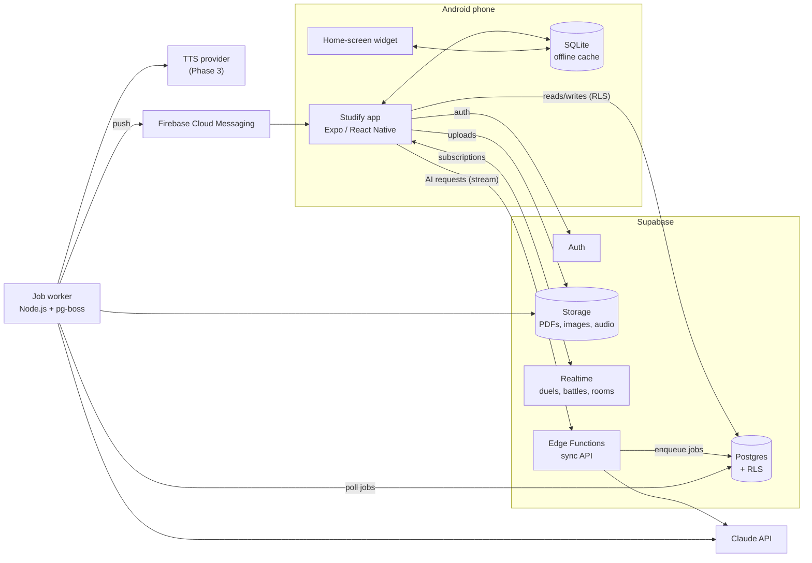
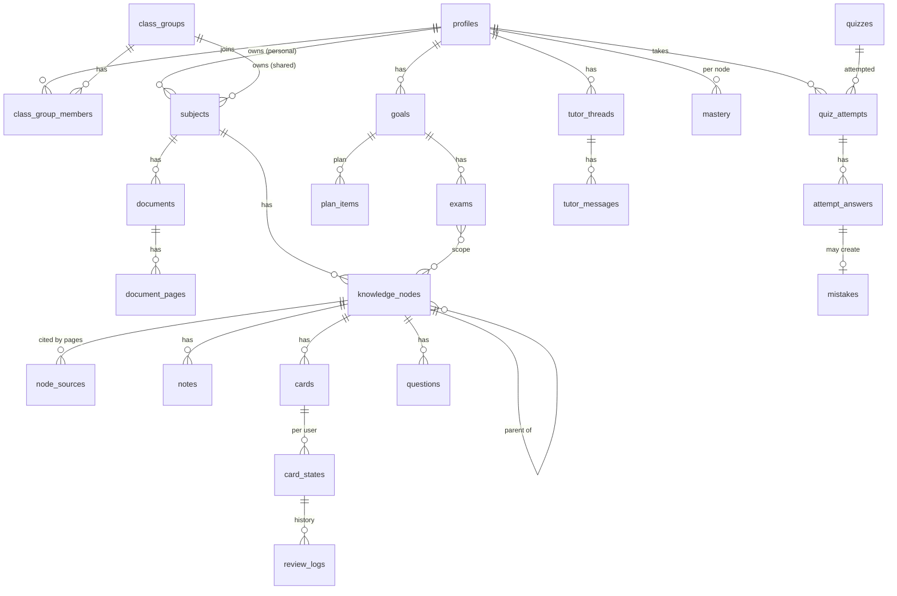
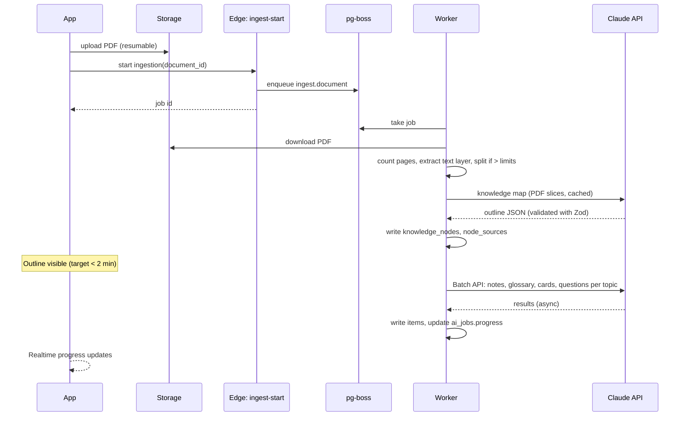

# Studify — Architecture

| | |
|---|---|
| **Status** | Draft v1 |
| **Scope** | System architecture, tech stack, domain model and cross-cutting conventions. Detailed schema in [data-model.md](data-model.md), endpoints in [api.md](api.md), AI details in [ai-pipeline.md](ai-pipeline.md), algorithms in [learning-engine.md](learning-engine.md), app internals in [mobile-app.md](mobile-app.md). |
| **Decisions** | Recorded as ADRs in [adr/](adr/). |

---

## 1. System overview

**Three runtime pieces:**

| Piece | Responsibility | Why |
|---|---|---|
| **Android app** (Expo) | All UI; offline cache of cards, review logs, notes; FSRS scheduling runs **on device** so reviews work offline. | Phone-first, offline reviews. |
| **Supabase** | Auth, Postgres (source of truth, Row Level Security on every table), Storage, Realtime, and **Edge Functions** for short synchronous AI calls (tutor chat, grading one answer, explain-differently). | One managed backend; RLS keeps per-user and per-Turma data isolated without a custom API for plain CRUD. |
| **Job worker** (Node.js, TypeScript) | Long-running and bulk work: PDF ingestion, knowledge-map generation, bulk card/question/note generation (Claude Batch API), podcast audio, nightly plan recomputation, push notifications. Queue: **pg-boss** on the same Postgres. | Ingestion can take minutes; Batch API is asynchronous; Edge Functions have short time limits. |

**Rule:** the Claude API key lives **only** in Edge Function and worker secrets. The app never holds it and never calls Claude directly.

## 2. Tech stack

| Layer | Choice | Notes |
|---|---|---|
| Language | **TypeScript** everywhere | Shared types package between app, Edge Functions and worker. |
| Monorepo | pnpm workspaces | `apps/mobile`, `apps/worker`, `supabase/` (migrations + functions), `packages/shared` (types, schemas, FSRS wrapper, grading rules), `packages/prompts`. |
| Mobile | Expo SDK (latest stable), Expo Router, React Native | Android-only builds via EAS; development builds (not Expo Go) because of native modules (PDF viewer, widgets). |
| Server state | TanStack Query | Caching, retries, optimistic updates. |
| Local state | Zustand | UI/session state. |
| Local DB | expo-sqlite + Drizzle ORM | Offline cards, card states, review logs, downloaded notes; sync queue. |
| Validation | Zod | One schema per AI output and per API payload, shared across app/server. |
| Backend | Supabase (Postgres 15+, Auth, Storage, Realtime, Edge Functions on Deno) | Migrations in `supabase/migrations`. |
| Queue | pg-boss | Jobs table in Postgres; retries with backoff. |
| AI | Claude API via `@anthropic-ai/sdk` | Details in [ai-pipeline.md](ai-pipeline.md). |
| Spaced repetition | `ts-fsrs` | Runs on device and on server (same package version). |
| PDF | Viewer: `react-native-pdf`. Server: `pdf-lib` (split/slice), `pdfjs-dist` (page count, text layer for search). | |
| Math & rich text | Markdown + KaTeX (rendered in a lightweight WebView component) | Notes, cards and questions store Markdown with `$…$` / `$$…$$` LaTeX. |
| Search | Postgres full-text search (`portuguese` config) over page text | Used for tutor retrieval and search. Embeddings optional later. |
| Push | expo-notifications + FCM | |
| Widgets | `react-native-android-widget` | MEM-04. |
| Speech | On-device Android TTS/STT for read-aloud and voice input; cloud TTS for podcast (provider TBD in Phase 3) | Claude handles text only. |
| Errors/crashes | Sentry (app + worker) | No analytics SDKs that profile minors. |
| i18n | i18next with a single `pt-BR` locale at launch | All UI strings externalized from day one. |

## 3. Domain model

Code uses English names; the UI uses PT-BR names (see [PRD glossary](../product/PRD.md#8-glossary)). This is the **canonical list of entities**; every spec refers to these names. Column-level detail lives in [data-model.md](data-model.md).

### 3.1 Core entities

| Entity | Purpose | Key fields (summary) |
|---|---|---|
| `profiles` | One per user (extends Supabase `auth.users`). | display name, avatar, birth year (for age-gating), school grade, foreign language (ENEM), settings JSON |
| `class_groups` | A **Turma**. | name, invite code, owner, AI budget |
| `class_group_members` | Membership. | role: `owner` / `moderator` / `member` |
| `subjects` | A **Matéria**. Owned by a profile **or** a class group. | name, color, icon, `owner_profile_id` xor `owner_class_group_id`, language, ENEM area (nullable) |
| `documents` | An uploaded file. | subject, storage path, kind (`slides` / `notes` / `textbook` / `past_test` / `content_list` / `photo`), page count, status (`uploaded` → `processing` → `ready` / `failed`), checksum |
| `document_pages` | One row per page. | document, page number, extracted text, `tsvector`, has_images flag, thumbnail path |
| `knowledge_nodes` | Knowledge map node. | subject, parent, kind (`unit` / `topic` / `concept`), title, summary, order, learning objectives, `excluded` ("não cai na prova"), ENEM skill codes (nullable) |
| `node_sources` | Where a node is grounded. | node, document, page start, page end |
| `node_prerequisites` | Prerequisite edges. | node, prerequisite node |
| `glossary_terms` | Glossary. | subject, term, definition, node, source pages |
| `notes` | Generated notes. | node, depth (`tldr` / `study` / `deep`), Markdown body, citations JSON, version |
| `cards` | Flashcards. | node, type (`basic` / `cloze` / `reverse` / `image_occlusion`), front, back, media, source pages, origin (`generated` / `user` / `from_mistake`), created_by |
| `card_states` | **Per-user** FSRS state of a card. | user, card, FSRS fields (due, stability, difficulty, reps, lapses, state, last review), suspended |
| `review_logs` | Append-only review history. | user, card, rating, reviewed_at, elapsed, device id, client-generated UUID (idempotent sync) |
| `questions` | Practice questions of every type. | node, type, stem (Markdown), payload JSON (options, answer, rubric…), explanation, Bloom level, difficulty, source pages, origin (`generated` / `past_test` / `enem_official` / `peer`), ENEM fields (nullable) |
| `quizzes` | A set of questions. | owner, subject/goal/exam, kind (`practice` / `mock_exam` / `duel` / `battle` / `enem_simulado`), config JSON, question ids |
| `quiz_attempts` | One user taking a quiz. | user, quiz, started/finished, score, TRI estimate (nullable) |
| `attempt_answers` | One answer. | attempt, question, response JSON, correct, confidence (1–4, nullable), time spent, AI feedback JSON |
| `mistakes` | **Caderno de Erros** entry. | user, question, answer, cause (`didnt_know` / `confused` / `careless` / `misread`), resolved_at |
| `mastery` | Per-user mastery per node. | user, node, mastery 0–1, retrievability, evidence count, updated_at |
| `goals` | **Objetivo**. | user, mode (`exam_week` / `enem`), name, start date, end date, settings JSON (grading rules, SISU target…) |
| `exams` | A **Prova** inside a goal. | goal, subject, starts_at, weight, scope (node ids), status, grade obtained |
| `grading_rules` | School grade rules ("Quanto preciso tirar?"). | goal or subject, scale (e.g. 0–10), passing average, formula JSON (weights per test/term) |
| `plan_items` | A planned study block. | user, goal, date, subject, node(s), activity (`learn` / `review` / `practice` / `mock` / `essay`), minutes, status (`planned` / `done` / `skipped` / `moved`) |
| `study_sessions` | What actually happened. | user, started/ended, activities JSON, plan item (nullable) |
| `tutor_threads` / `tutor_messages` | Tutor chat. | scope (subject / goal / node / passage), mode, messages with citations JSON |
| `content_flags` | **TRU-02** error reports. | item type + id, reporter, reason, status, resolution |
| `duels`, `battles`, `battle_players` | Competitive modes (Realtime). | participants, quiz, status, scores |
| `xp_events`, `achievements`, `streaks` | Motivation. | |
| `ai_jobs` | Mirror of pg-boss jobs with user-visible progress. | type, subject/document, status, progress %, error |
| `ai_usage` | One row per Claude call. | user, class group, feature ID, model, input/output/cache tokens, cost estimate, request id |
| `essays` | Redação (ENEM) and long answers. | user, prompt/theme, text, image paths, transcription, scores JSON, feedback JSON |
| ENEM tables | `enem_items`, `enem_item_params`, `sisu_targets`… | Defined in [09-enem-mode](../specs/09-enem-mode.md) and [data-model.md](data-model.md). |

### 3.2 Ownership and sharing rules

1. **Content belongs to a subject; state belongs to a user.** Notes, cards, questions, knowledge nodes and glossary terms belong to a subject. Card states, review logs, attempts, mistakes, mastery and plans are always per user.
2. A subject is **personal** (`owner_profile_id`) or **shared** with a Turma (`owner_class_group_id`). Members of the Turma read shared content; only the uploader, owner or moderators can edit or delete it.
3. **Personal edits on shared content** create a per-user override (e.g. `card_overrides`), never a silent change for everyone. Fixes for everyone go through TRU-02 (flag → owner/moderator accepts).
4. **Generated once, used by everyone.** Shared subjects are generated a single time; classmates do not pay AI cost again.
5. Every table has RLS. Policies are defined next to the migration and tested (see [testing-strategy.md](testing-strategy.md)).

## 4. Key flows

### 4.1 PDF ingestion (ING-01 … ING-03)

### 4.2 Review (offline-first, MEM-02)

1. The app downloads cards + card states for active subjects into SQLite.
2. Each review is scheduled **on device** with `ts-fsrs`, written to SQLite and appended to a local outbox with a client UUID.
3. When online, the outbox is pushed to Postgres (`review_logs` insert is idempotent on the UUID); the server recomputes `card_states` from logs to resolve conflicts between devices (latest review wins, replayed in timestamp order).

### 4.3 Tutor chat (TUT-01)

1. App calls the `tutor-chat` Edge Function with thread id, scope and message.
2. Function retrieves relevant pages (topic routing via the knowledge map + Postgres full-text search), slices those pages from the PDFs, and calls Claude with **citations enabled** and streaming.
3. Streamed text and citations go back to the app; citations are mapped back to original document page numbers.

## 5. Cross-cutting conventions

| Topic | Convention |
|---|---|
| IDs | UUID v7 everywhere (time-ordered); clients may generate IDs for offline-created rows. |
| Time | Store UTC (`timestamptz`); display in `America/Sao_Paulo` or device time zone. Dates for plans are local dates. |
| Money/cost | Store AI cost estimates in micro-dollars (integer). |
| Feature IDs | Reference PRD IDs (e.g. `MEM-02`) in commits, PR titles, code comments for non-obvious logic, and `ai_usage.feature`. |
| AI outputs | Every AI output is validated with a Zod schema before it is stored. Invalid output → retry once → mark item failed. |
| Citations | Every generated item stores `source_pages` as `{document_id, page_start, page_end}[]` referencing **original** page numbers. |
| Errors in UI | Friendly PT-BR messages; never show raw errors or stack traces. |
| Feature flags | `profiles.settings.flags` + a server-side `feature_flags` table, so phases can be released to the Turma gradually. |
| Environments | `dev` (local Supabase), `staging`, `prod`; separate Claude API keys and spend caps per environment. |

## 6. Non-functional requirements

| Requirement | Target |
|---|---|
| Outline after upload (50 pages) | < 2 min p50, < 5 min p95 |
| All Phase 1 content for a 50-page PDF | < 30 min p95 (Batch API) |
| Tutor first token | < 3 s p50 |
| Review screen interaction | < 100 ms per card flip/rating, fully offline |
| App cold start | < 2.5 s on a mid-range Android phone |
| Availability | Best effort (student project); no data loss on review sync |
| Cost | Per-user and per-Turma budgets enforced server-side before every AI call (PLT-04) |
| Privacy | Users are mostly minors; LGPD-aware design (see [security-privacy.md](security-privacy.md)) |
