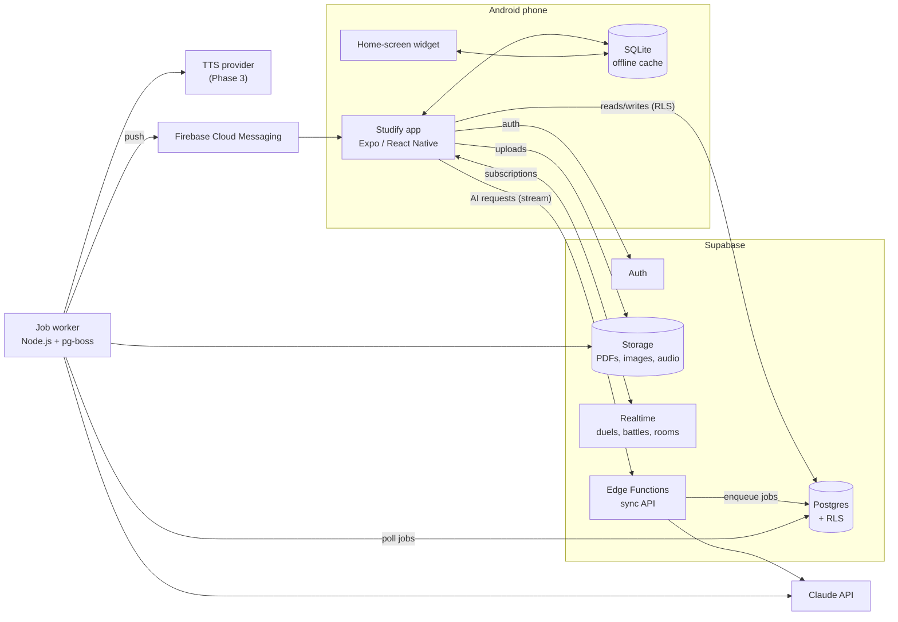
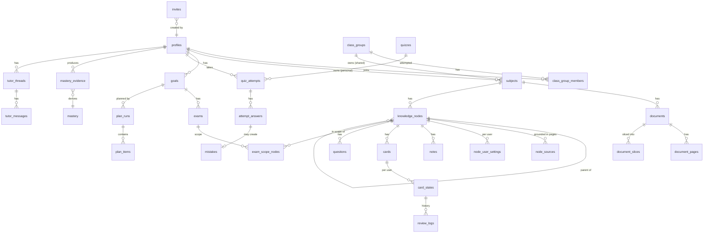
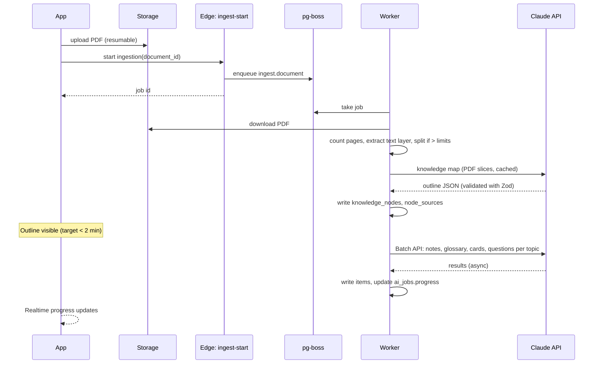

# Studify — Architecture

| | |
|---|---|
| **Status** | Draft v1 |
| **Scope** | System architecture, tech stack, domain model and cross-cutting conventions. Detailed schema in [data-model.md](data-model.md), endpoints in [api.md](api.md), AI details in [ai-pipeline.md](ai-pipeline.md), algorithms in [learning-engine.md](learning-engine.md), app internals in [mobile-app.md](mobile-app.md). |
| **Decisions** | Recorded as ADRs in [adr/](adr/). |

---

## 1. System overview

**Three runtime pieces:**

| Piece | Responsibility | Why |
|---|---|---|
| **Android app** (Expo) | All UI; offline cache of cards, review logs, notes; FSRS scheduling runs **on device** so reviews work offline. | Phone-first, offline reviews. |
| **Supabase** | Auth, Postgres (source of truth, Row Level Security on every table), Storage, Realtime, and **Edge Functions** for short synchronous AI calls (tutor chat, grading one answer, explain-differently). | One managed backend; RLS keeps per-user and per-Turma data isolated without a custom API for plain CRUD. |
| **Job worker** (Node.js, TypeScript) | Long-running and bulk work: PDF ingestion, knowledge-map generation, bulk card/question/note generation (Claude Batch API), podcast audio, nightly plan recomputation, push notifications. Queue: **pg-boss** on the same Postgres. | Ingestion can take minutes; Batch API is asynchronous; Edge Functions have short time limits. |

**Rule:** the Claude API key lives **only** in Edge Function and worker secrets. The app never holds it and never calls Claude directly.

## 2. Tech stack

| Layer | Choice | Notes |
|---|---|---|
| Language | **TypeScript** everywhere | Shared types package between app, Edge Functions and worker. |
| Monorepo | pnpm workspaces | `apps/mobile`, `apps/worker`, `supabase/` (migrations + functions), `packages/shared` (types, schemas, FSRS wrapper, grading rules), `packages/prompts`. |
| Mobile | Expo SDK (latest stable), Expo Router, React Native | Android-only builds via EAS; development builds (not Expo Go) because of native modules (PDF viewer, widgets). |
| Server state | TanStack Query | Caching, retries, optimistic updates. |
| Local state | Zustand | UI/session state. |
| Local DB | expo-sqlite + Drizzle ORM | Offline cards, card states, review logs, downloaded notes; sync queue. |
| Validation | Zod | One schema per AI output and per API payload, shared across app/server. |
| Backend | Supabase (Postgres 15+, Auth, Storage, Realtime, Edge Functions on Deno) | Migrations in `supabase/migrations`. |
| Queue | pg-boss | Jobs table in Postgres; retries with backoff. |
| AI | Claude API via `@anthropic-ai/sdk` | Details in [ai-pipeline.md](ai-pipeline.md). |
| Spaced repetition | `ts-fsrs` | Runs on device and on server (same package version). |
| PDF | Viewer: `react-native-pdf`. Server: `pdf-lib` (split/slice), `pdfjs-dist` (page count, text layer for search). | |
| Math & rich text | Markdown + KaTeX (rendered in a lightweight WebView component) | Notes, cards and questions store Markdown with `$…$` / `$$…$$` LaTeX. |
| Search | Postgres full-text search (`portuguese` config) over page text | Used for tutor retrieval and search. Embeddings optional later. |
| Push | expo-notifications + FCM | |
| Widgets | `react-native-android-widget` | MEM-04. |
| Speech | On-device Android TTS/STT for read-aloud and voice input; cloud TTS for podcast (provider TBD in Phase 3) | Claude handles text only. |
| Errors/crashes | Sentry (app + worker) | No analytics SDKs that profile minors. |
| i18n | i18next with a single `pt-BR` locale at launch | All UI strings externalized from day one. |

## 3. Domain model

Code uses English names; the UI uses PT-BR names (see [PRD glossary](../product/PRD.md#8-glossary)). This section is the **canonical overview of entities**; every spec refers to these names. **[data-model.md](data-model.md) is authoritative** for columns, enum values, constraints and RLS. If this section and data-model.md disagree, data-model.md wins.

### 3.1 Core entities

| Entity | Purpose | Key fields (summary) |
|---|---|---|
| `profiles` | One per user (extends Supabase `auth.users`). | display name + `display_name_status`, `avatar_preset`, `birth_year` + `birth_month` (age gate), `school_year` (no school name), `timezone`, `app_role` (`user` / `app_admin`), `invite_id`, privacy acceptance, ENEM foreign language (`en` / `es`), `settings` jsonb |
| `study_preferences` | Per-user planner and wellbeing settings. | study minutes, availability, quiet hours, **day boundary (04:00)** |
| `invites` | Pilot and Turma invites (one table). | code, creator, `class_group_id` (nullable), uses left, expiry, revoked |
| `class_groups` | A **Turma**. | name, owner, `join_policy`, `member_cap`, `allow_member_uploads`, `ai_budget_monthly_micro_usd` |
| `class_group_members` | Membership. | role (`owner` / `moderator` / `member`), `status` (`pending` / `active` / `removed` / `banned` / `left`), nickname, opt-ins (insights, leagues, duels) |
| `subjects` | A **Matéria**. Owned by a profile **or** a class group. | name, color, icon, `owner_profile_id` xor `owner_class_group_id`, `created_by`, `content_language`, `is_language_subject`, ENEM area (`LC` / `CH` / `CN` / `MT`, nullable). Per-user pin/order/archive in `subject_user_settings`. |
| `documents` | An uploaded file. | subject, title, storage path, size, `checksum_sha256` (unique per subject), `uploaded_by`, kind (`slides` / `notes` / `textbook` / `past_test` / `content_list` / `photo` / `other`), `detected_kind`, language, page count, status (`uploaded` → `processing` → `ready` / `failed` / `waiting_budget`), error code |
| `document_pages` | One row per page. | page number, extracted text, `text_source` (text layer or model transcription), generated `tsvector` with per-row text-search config, text items (for highlight), image/thumbnail paths |
| `document_slices` | Page-range PDFs sent to Claude. | document, page start/end, storage path, ephemeral Files API `file_id` (≤ 48 h) |
| `knowledge_nodes` | Knowledge-map node. | subject, parent, kind (`unit` / `topic` / `concept`), title, summary, `position`, learning objectives, `key_terms`, `formulas`, `is_placeholder`, `est_learn_minutes`, `content_status`, `version`, ENEM skill codes (nullable) |
| `node_sources` | Where a node is grounded. | node, document, page start, page end |
| `node_prerequisites` / `node_relations` | Prerequisite edges / concept-map relations. | |
| `node_user_settings` | **Per-user** node settings. | "não cai na prova" (excluded), hidden |
| `glossary_terms` | Glossary. | subject, term, normalized term, aliases, definition, example, node, source pages |
| `notes` | Generated notes. | node, depth (`tldr` / `study` / `deep` / `class_summary`), Markdown body, citations, `status` (incl. `superseded`), `supersedes_note_id`, `prompt_version` |
| `cards` | Flashcards. | subject, node, concept, type (`basic` / `cloze` / `reverse` / `image_occlusion`), front, back, media, source pages, origin (`generated` / `user` / `from_mistake` / `from_tutor`), `sibling_group_id`, `cloze_index`, `personal_for_user_id`, status, version |
| `card_states` | **Per-user** FSRS state. | user, card, FSRS fields, `hidden`, `is_leech`, `introduced_at`. Written only by the server when replaying review logs. |
| `review_logs` | Append-only review history. | user, card, rating, `source`, `client_reviewed_at`, `duration_ms`, `hint_used`, `undoes_log_id`, `clock_skew`, client UUID (idempotent sync) |
| `questions` | Practice questions of every type. | subject, node, `concept_ids`, type (canonical list in data-model.md, e.g. `mcq_single`, `multi_select`), `stimulus` / `texto_base`, stem, payload, explanation, Bloom level, difficulty, source pages, origin (`generated` / `past_test` / `enem_official` / `peer` / `photo` / `user`), status, `review_status`, `personal_for_user_id`, ENEM fields |
| `quizzes` | A set of questions. | owner, scope, kind (`practice` / `mock_exam` / `mistake_retry` / `feed` / `predicted_test` / `boss` / `duel` / `battle` / `enem_simulado`), `mode`, `time_limit_s`, config |
| `quiz_attempts` | One user taking a quiz. | user, quiz, status, score, grade, `paused_seconds`, `area_results` (ENEM TRI estimates), essay |
| `attempt_answers` | One answer. | response, correct, `score`, `grading_status`, `grader_confidence`, confidence (1–4), time spent, `hints_used`, `assisted`, `self_override`, AI feedback |
| `mistakes` | **Caderno de Erros** entry. | user, question, answer, cause (`didnt_know` / `confused` / `careless` / `misread`), `suggested_cause`, `cause_source`, note, retry schedule, remediation card, resolved |
| `mastery_evidence` / `mastery` | Append-only evidence → derived per-user mastery per node. | evidence: source, weight, outcome; mastery: 0–1, retrievability, evidence count |
| `goals` | **Objetivo**. | user, mode (`exam_week` / `enem`), name, dates, `status`, `term_index`, `school_year`, settings |
| `exams` | A **Prova** inside a goal. | goal, user, subject, starts_at, `local_date`, kind, status, `parent_exam_id` (recuperação), weight, `scope_status`, grade + `grade_max`, teacher name |
| `exam_scope_items` / `exam_scope_nodes` | **Conteúdo da prova**: the raw content-list items and the knowledge nodes they map to. | |
| `grading_rules` / `grade_components` | School grade rules ("Quanto preciso tirar?"). | owned by a profile per school year, optional subject; scale, passing average, formula |
| `plan_runs` / `plan_items` | Planner output. | run: inputs hash, created; item: `local_date`, subject, `node_ids`, `exam_id`, `unit_type`, minutes, deadline, priority, `pinned`, status (`planned` / `done` / `skipped` / `moved`) |
| `study_sessions` | What actually happened. | user, `kind`, start/end, activities, plan item, focus fields |
| `tutor_threads` / `tutor_messages` | Tutor chat. | scope (subject / goal / node / passage / capture), mode; messages with citations, `raw_content`, retrieval, tool events, status, `safety_flag` |
| `content_flags` | **TRU-02** error reports. | item type + id, reporter, reason, AI triage, status, resolution; with `item_revisions`, `item_hides` |
| `user_reports` / `user_blocks` | Safety (SP-09). | |
| `duels`, `battles`, `battle_players` | Competitive modes (Realtime). | participants, quiz, status, scores; server-side timing in `private.question_served` |
| `essays` | Long answers: ENEM redação and school essay questions. | kind (`enem_redacao` / `school_answer`), theme/prompt, text, images, transcription, scores, feedback |
| `ai_jobs` | User-visible job progress (mirrors pg-boss). | type, stage, parent job, items total/done, batch id, status (incl. `waiting_batch` / `waiting_budget`), progress, error |
| `ai_usage` | One row per Claude call. | user, class group, feature ID, task, model, input/output/cache tokens, `fallback_model`, `refusal_category`, cost (micro-USD), `price_version`, request id |
| `private.ai_budgets` | Budget reservations per scope and period (PLT-04). | Not exposed to clients. |

**Supporting tables** (full definitions in [data-model.md §5](data-model.md#5-tables-by-domain)), grouped by area:

- **Platform & safety:** `push_tokens`, `notification_log`, `app_feedback`, `release_notes`, `feature_flags`, `app_versions`, `guardian_links`, `guardian_settings`, `data_exports`, `account_deletions`, `private.moderation_actions`, `private.idempotency_keys`.
- **Learn & remember:** `glossary_term_overrides`, `note_highlights`, `topic_reads`, `explanations`, `explanation_feedback`, `visuals`, `card_overrides`, `concept_contrasts`, `feed_items`, `feed_impressions`, `mnemonics`, `memory_palaces`, `node_events`, `material_findings`.
- **Goals & prediction:** `availability_exceptions`, `readiness_snapshots`, `performance_windows`, `teacher_profiles`, `topic_predictions`, `exam_outcome_topics`, `schedule_imports`.
- **Turma:** `study_rooms`, `divide_plans`, `contributions`, `question_votes`, `league_entries`, `quiz_shares`, `private.class_insights` (read only through an RPC with k-anonymity).
- **Interactive & camera:** `podcast_episodes`, `podcast_plays`, `podcast_interactions`, `teaching_sessions`, `argument_sessions`, `camera_captures`.
- **Motivation & wellbeing:** `xp_events`, `streaks`, `achievements`, `daily_activity`, `boss_attempts`, `retrospectives`, `nudge_events`.
- **ENEM:** `enem_editions`, `enem_skills`, `enem_topics`, `knowledge_node_enem_topics`, `enem_items`, `enem_item_params`, `essay_themes`, `repertorio_items`, `sisu_offers`, `sisu_targets`, `atualidades_digests`, `atualidades_items`, `enem_topic_stats`, `enem_topic_trends`, `enem_redacao_themes`.
- **AI ops:** `ai_batch_requests`.

### 3.2 Ownership and sharing rules

1. **Content belongs to a subject; state belongs to a user.** Notes, cards, questions, knowledge nodes and glossary terms belong to a subject. Card states, review logs, attempts, mistakes, mastery and plans are always per user.
2. A subject is **personal** (`owner_profile_id`) or **shared** with a Turma (`owner_class_group_id`). Members of the Turma read shared content; only the uploader, owner or moderators can edit or delete it. Whether members may upload to a shared subject is a Turma setting (`allow_member_uploads`).
3. **Personal edits on shared content** create a per-user override (e.g. `card_overrides`, `glossary_term_overrides`), never a silent change for everyone. Items a member creates inside a shared subject are private to them (`personal_for_user_id`). Hiding an item is per user (`card_states.hidden`, `item_hides`). Fixes for everyone go through TRU-02 (flag → owner/moderator accepts → `item_revisions`).
4. **Generated once, used by everyone.** Shared subjects are generated a single time; classmates do not pay AI cost again.
5. Every table has RLS. Policies are defined next to the migration and tested (see [testing-strategy.md](testing-strategy.md)).

## 4. Key flows

### 4.1 PDF ingestion (ING-01 … ING-03)

### 4.2 Review (offline-first, MEM-02)

1. The app downloads cards + card states for active subjects into SQLite.
2. Each review is scheduled **on device** with `ts-fsrs`, written to SQLite and appended to a local outbox with a client UUID.
3. When online, the outbox is pushed through the `sync-push` Edge Function ([api.md](api.md)); `review_logs` inserts are idempotent on the client UUID, and the server recomputes `card_states` by replaying logs in timestamp order to resolve conflicts between devices. Clients never write `review_logs` or `card_states` directly.

### 4.3 Tutor chat (TUT-01)

1. App calls the `tutor-chat` Edge Function with thread id, scope and message.
2. Function retrieves relevant pages (topic routing via the knowledge map + Postgres full-text search), slices those pages from the PDFs, and calls Claude with **citations enabled** and streaming.
3. Streamed text and citations go back to the app; citations are mapped back to original document page numbers.

## 5. Cross-cutting conventions

| Topic | Convention |
|---|---|
| IDs | UUID v7 everywhere (time-ordered); clients may generate IDs for offline-created rows. |
| Enums | `text` columns with `CHECK` constraints, mirrored in `packages/shared/src/enums.ts` and kept in sync by a CI test ([data-model.md](data-model.md)). |
| Deletion | `deleted_at` = soft delete and sync tombstone; `archived_at` = a real, restorable archive only. |
| Day boundary | A study "day" runs from **04:00 to 04:00** local time (plans, streaks, daily limits of study features). AI budgets reset at local midnight. |
| Time | Store UTC (`timestamptz`); display in `America/Sao_Paulo` or device time zone. Dates for plans are local dates. |
| Money/cost | Store AI cost estimates in micro-dollars (integer). |
| Feature IDs | Reference PRD IDs (e.g. `MEM-02`) in commits, PR titles, code comments for non-obvious logic, and `ai_usage.feature`. |
| AI outputs | Every AI output is validated with a Zod schema before it is stored. Invalid output → retry once → mark item failed. |
| Citations | Every generated item stores `source_pages` as `{document_id, page_start, page_end}[]` referencing **original** page numbers. |
| Errors in UI | Friendly PT-BR messages; never show raw errors or stack traces. |
| Feature flags | `profiles.settings.flags` + a server-side `feature_flags` table, so phases can be released to the Turma gradually. |
| Environments | `dev` (local Supabase), `staging`, `prod`; separate Claude API keys and spend caps per environment. |

## 6. Non-functional requirements

| Requirement | Target |
|---|---|
| Outline after upload (50 pages) | < 2 min p50, < 5 min p95 |
| All Phase 1 content for a 50-page PDF | < 30 min p95 (Batch API) |
| Tutor first token | < 3 s p50 |
| Review screen interaction | < 100 ms per card flip/rating, fully offline |
| App cold start | < 2.5 s on a mid-range Android phone |
| Availability | Best effort (student project); no data loss on review sync |
| Cost | Per-user and per-Turma budgets enforced server-side before every AI call (PLT-04) |
| Privacy | Users are mostly minors; LGPD-aware design (see [security-privacy.md](security-privacy.md)) |
