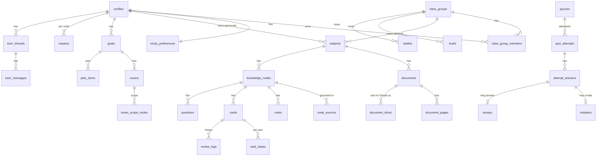

# Studify — Data Model

| | |
|---|---|
| **Status** | Draft v1 — authoritative schema |
| **Scope** | Postgres schema (Supabase), Row Level Security, Storage buckets, Realtime, local SQLite mirror, per-phase migration plan |
| **Sources** | §6 of every spec in [docs/specs/](../specs/), [architecture.md](architecture.md), [security-privacy.md](security-privacy.md), [mobile-app.md](mobile-app.md), [ADR 0007](adr/0007-offline-first-append-only-reviews.md) |
| **Rule** | When a spec and this document disagree on a name, type or enum value, **this document wins**. Spec aliases are listed in [§2](#2-decisions-and-reconciliations). |

---

## 1. Conventions

### 1.1 General

| Topic | Convention |
|---|---|
| Database | Postgres 15+ (Studify's own, on the VPS; ADR 0012). App tables live in `public` (RLS always on; the app reaches them only through data endpoints that run as the student, api.md §3). Internal tables that clients must never read directly live in schema `private` (never reached as a student): `private.class_insights`, `private.ai_budgets`, `private.ai_budget_limits`, `private.question_served`, `private.moderation_actions`, `private.admin_audit`. Helper functions used by policies live in `private` and are `security definer`, `stable`, with `set search_path = ''`. |
| Naming | `snake_case`, plural table names, singular column names. FKs are `<entity>_id`. Booleans are adjectives or `is_`/`has_` (`hidden`, `is_leech`, `has_bookmarks`). Code names are English; PT-BR only in UI strings. |
| Primary keys | `uuid`, **UUID v7** (time-ordered). Default `public.uuid_v7()` — a thin wrapper over the built-in `uuidv7()` on Postgres ≥ 18, or a PL/pgSQL implementation on older versions. Clients **may** supply ids (offline-created rows: attempts, answers, review logs, overrides, XP events); the server never trusts them for authorization. |
| Join tables | Composite PK of the two FKs (e.g. `class_group_members (class_group_id, user_id)`). |
| Timestamps | `created_at timestamptz not null default now()`, `updated_at timestamptz not null default now()` maintained by trigger `private.set_updated_at()`. All instants are `timestamptz` (UTC). Calendar days that belong to the student are `date` columns named `local_date` (or `*_date`), computed in the user's `profiles.timezone` with the day boundary `study_preferences.day_rollover_hour`. |
| Soft delete / tombstones | Every table mirrored to the device has `deleted_at timestamptz`. A non-null `deleted_at` is a **tombstone**: the row is hidden everywhere, pulled by sync to delete the local copy, restorable for 30 days (undo, ING-04.5), then hard-deleted by a nightly job. |
| Archive | `archived_at timestamptz` means *hidden from active lists but kept and usable* (`subject_user_settings`, tutor threads). Goals use `status = archived` instead. Never use `archived_at` as a delete. |
| Enumerations | **`text` + `CHECK (col in (...))`**, not Postgres enum types. Reason: specs add values phase by phase (e.g. `quizzes.kind` grows from 2 to 9 values); `ALTER TYPE … ADD VALUE` cannot be undone and has transaction restrictions, while a CHECK is replaced in one migration. The canonical value lists live in `packages/shared/src/enums.ts`; a CI test asserts every CHECK matches it. |
| jsonb | Used for nested, schema-validated payloads (question payloads, rubrics, citations, settings). Every jsonb column has a **Zod schema in `packages/shared`** named after the column (e.g. `QuestionPayload`); writes from Edge Functions/worker are validated against it. The DB enforces only the top-level type (`check (jsonb_typeof(col) = 'array')`). |
| Money | AI cost in **micro-dollars** (`bigint`, 1 USD = 1,000,000), suffix `_micro_usd`. |
| Versions | Content items editable after generation carry `version int not null default 1` (TRU-02 revisions) and `prompt_version text` (which prompt produced them). |
| Feature IDs | Each table lists the PRD feature IDs that use it. `ai_usage.feature` stores the feature ID of the call. |
| Row size | Large text blobs (page text items with coordinates, podcast scripts' audio, exports) live in Storage; tables keep the path. |

### 1.2 Shared jsonb shapes

| Shape (Zod name) | Definition | Used by |
|---|---|---|
| `SourcePages` | `[{document_id: uuid, page_start: int ≥ 1, page_end: int ≥ page_start}]` — **original** document page numbers (TRU-01.1) | `node_sources` (as rows), `cards`, `questions`, `glossary_terms`, `feed_items`, `concept_contrasts`, `visuals`, `material_findings` |
| `Citations` | `[{start: int, end: int, document_id: uuid, page_start: int, page_end: int, cited_text: string}]` — `start`/`end` are character offsets into the prose body (TRU-01.1, TRU-01.3) | `notes`, `explanations`, `tutor_messages`, `camera_captures.result`, `podcast_interactions` |
| `Formula` | `{latex: string, description: string}` | `knowledge_nodes.formulas` |
| `Media` | Image: `{path, width, height}`. Image occlusion: `{path, width, height, mode: "hide_one" \| "hide_all", masks: [{id, x, y, w, h, label}], target_mask_id}` (x/y/w/h normalized 0–1) | `cards.media` |
| `ReasonRef` | `{key: string, params: object}` — i18n key + params, never prose | `plan_items.reason_*` |

### 1.3 Standard columns (not repeated in the tables below)

Unless a table says otherwise: `id uuid pk default uuid_v7()`, `created_at`, `updated_at`; tables marked **[sync]** also have `deleted_at` and an index on `(updated_at, id)` for incremental pull. Append-only tables (marked **[append]**) have only `created_at` and no `updated_at`/`deleted_at`.

---

## 2. Decisions and reconciliations

Specs were written in parallel; these are the choices this document makes. Spec text should be read through this table.

| # | Topic | Decision | Spec names that map to it (aliases) |
|---|---|---|---|
| R1 | "Não cai na prova" | **Per user**: `node_user_settings.excluded`. There is no `knowledge_nodes.excluded` column. Exam scope still comes from `exam_scope_nodes`. | architecture §3.1 `knowledge_nodes.excluded` (01 ING-04.6) |
| R2 | Exam scope | `exam_scope_items` (one per line of the teacher's content list) + `exam_scope_nodes` (resolved topics). No inline `exams.scope` array. `exams.scope_status` tracks review state. | architecture `exams.scope`, `exam.scope` (PRD glossary) |
| R3 | Soft delete | `deleted_at` (tombstone, restorable 30 days) everywhere a spec wrote "soft delete via `archived_at`". `archived_at` kept only for real archives: `subject_user_settings` (per-user subject archive) and tutor threads. | 01 `documents.archived_at`, `knowledge_nodes.archived_at`; 02 `notes.archived_at` |
| R4 | Note versions | `notes.status` gains `superseded`; the new version points back with `supersedes_note_id`. | 02 "archived old versions" |
| R5 | Essays | One `essays` table for ENEM redações and long school answers. `essays.kind ∈ {enem_redacao, school_answer}`. Linked from `attempt_answers.essay_id`, `camera_captures.essay_id`, `argument_sessions.essay_id`, `quiz_attempts.essay_id`. | 09 `kind = dissertativa` → `school_answer` |
| R6 | `quizzes.kind` | `practice, mock_exam, mistake_retry, feed, predicted_test, boss, duel, battle, enem_simulado`. | 05/06 `refazer_erros` → `mistake_retry`; 13 boss tests use `boss` |
| R7 | Personal hide | Cards: `card_states.hidden` (the per-user row already exists and the device needs it offline). Every other item type: `item_hides`. `item_hides.item_type` never takes `card`. | 04 `card_states.hidden`; 10 `item_hides` |
| R8 | Personal items inside shared subjects | Items a user creates inside a Turma subject are private to them by default: `personal_for_user_id uuid null` on `cards`, `questions`, `explanations`, `feed_items`. `null` = visible to everyone who can read the subject. | 02 `explanations.personal_for_user_id`; 04 MEM-03.7; 11 photo questions |
| R9 | Quiet hours and day boundary | Single source of truth: `study_preferences.quiet_start`, `quiet_end` (default 22:00–07:00) and `day_rollover_hour` (default **4**, i.e. a study day ends at 04:00). | 04 `profiles.settings.memory.quiet_hours`; 13 `profiles.settings.quiet_hours` and the proposed 03:00 boundary |
| R10 | Nudges | One `nudge_events` table for both the prerequisite detective (LRN-04.7) and wellbeing nudges (WEL-03). | 13 `wellbeing_nudges` |
| R11 | Class insights | Raw aggregates in `private.class_insights`; clients read **only** through RPC `class_insights_for(...)`, which applies the anonymity thresholds (spec 10 §8.4). No select policy for members. | security-privacy.md §4.2 row "Aggregates" (member S) |
| R12 | TRI result | `quiz_attempts.area_results` (per-area θ, score, CI, coherence, time). No `tri_estimate` column. | architecture `quiz_attempts.tri_estimate` |
| R13 | Mastery evidence | New append-only `mastery_evidence` table (one row per piece of evidence); `mastery` is the derived per-(user, node) state written by the service role. Weights live in [learning-engine.md](learning-engine.md). | 03 "mastery evidence source `tutor_quiz`"; 05 §8.6 |
| R14 | Files API ids | `document_slices.anthropic_file_id` is **ephemeral**: kept with `anthropic_file_expires_at` (≤ 48 h, long enough for a Batch run) and deleted by the worker sweeper, per security-privacy.md §10. Synchronous calls (tutor, on-demand notes) send slices as base64 from Storage and rely on prompt caching. | 01 `document_slices.anthropic_file_id` |
| R15 | Grading rules | `grading_rules` per (owner, school year, optional subject); `subject_id = null` is the school default. Not attached to goals. | architecture "goal or subject" |
| R16 | Enum spellings | Mistake causes `didnt_know, confused, careless, misread`; ENEM areas `LC, CH, CN, MT` (+ `RED` only inside SISU weights). | — |
| R17 | Study session kinds | `mixed` (Hoje session), `review`, `practice`, `simulado`, `feed`, `focus`, `vespera`, `tutor`, `teaching`, `podcast`. | 06 `feed`; 13 `focus` |
| R18 | Document status | `uploaded, processing, ready, failed, waiting_budget` (waiting for budget isn't a failure). `error_code` explains `failed`. | 01 `error_code = waiting_budget` |
| R19 | Content flags item types | `knowledge_node, note, glossary_term, card, question, explanation, feed_item, podcast_episode, tutor_message, visual, document`. The same list is used by `item_revisions` and `item_hides` (minus `card` for hides). | 10 `content_flags.item_type` |
| R20 | Card/question visibility after moderation | `hidden_reason ∈ {under_review, removed}` + `status`. `questions.status = disputed` while an answer-key flag is open; `questions.review_status` only for peer questions (SOC-07). | 05, 10 |
| R21 | Age data | `profiles.birth_year` + `birth_month` (age gate SP-01 asks month + year). | architecture "birth year" |
| R23 | Invites | One `invites` table for owner (pilot) invites and Turma invites (`class_group_id` set). Rotating a Turma link revokes the old row and inserts a new one. | 10 `class_groups.invite_code`, `invite_expires_at`, `invite_max_uses`, `invite_uses`; security §9 |
| R24 | App-level admin | `profiles.app_role ∈ {user, app_admin}`; helper `private.is_app_admin()`. Column is `app_role` (not `role`) to avoid confusion with Turma roles. | 00 `profiles.role` |
| R25 | Push tokens | Columns `token`, `platform`, `invalidated_at` (00 PLT-05.6). | — |
| R26 | Material finding types | `material_findings.type` follows the feature spec ING-06.1: `contradiction`, `numeric_or_formula_typo`, `skipped_step`, `unclear` (Phase 5 migration). | older list `typo`, `outdated`, `other` |
| R27 | Mnemonic types | `acronym`, `phrase`, `rhyme`, `story`, `palace`, `keyword` (MEM-06.2). A `palace` mnemonic needs `palace_id`. | older list `image`, `palace_locus` |
| R28 | Energy windows | `performance_windows.bucket` (0–11), since `window` is reserved in Postgres. | `performance_windows.window` |
| R29 | Visual cache | `visuals.subject_id` is denormalized for RLS, and `type = none` caches "no diagram fits" (LRN-05.2). | — |
| R30 | Peer questions | Pending peer questions are readable by the Turma (voting needs them); quizzes and the Feed only use approved ones. | 10 SOC-07.3 |
| R31 | Contributions | Private to the author and the Turma moderators; progress through `divide_progress()`. Material check and the divisão merge use the standard API, not Batch (they are short and the student is waiting). | 10 SOC-06 |
| R32 | Yearly Retrospectiva | Generated on December 20, covering January 1 to December 19 (before the holidays). | 13 MOT-04.1 "in December" |
| R33 | Calendar availability | Clients may only write `availability_exceptions` with `source = user`. Calendar rows go through RPC `set_calendar_availability(days)`; the student's own and Modo Desespero rows win; a cleared day is soft-deleted. | 07 GOL-09.2 |
| R34 | Central de notificações | Every push that is not ephemeral is kept in `notification_inbox`, one row per `(user_id, key)`: a newer notification with the same key replaces the row and makes it unread again. Written even when no device received the push. Live progress (`live` channel) and local reminders are not kept. Rows are deleted after 60 days. | api.md §9.1 |
| R22 | Teacher identity | Stored as free text (`exams.teacher_name`, `documents.teacher_name`) and normalized into `teacher_profiles.teacher_key`. Whether real names or aliases are stored is an **open owner decision** (spec 08). | — |

---

## 3. Domain overview



| Domain | Tables | Section |
|---|---|---|
| A. Identity, Turma, safety | `profiles`, `study_preferences`, `invites`, `guardian_links`, `guardian_settings`, `push_tokens`, `notification_log`, `class_groups`, `class_group_members`, `user_blocks`, `user_reports` | [§4](#4-core-ddl-phase-01), [§5.1](#51-identity-turma-safety) |
| B. Subjects & knowledge map | `subjects`, `subject_user_settings`, `documents`, `document_pages`, `document_slices`, `knowledge_nodes`, `node_sources`, `node_prerequisites`, `node_relations`, `node_user_settings`, `node_events`, `schedule_imports`, `material_findings`, `material_finding_votes` | [§4](#4-core-ddl-phase-01), [§5.2](#52-subjects-documents-knowledge-map) |
| C. Content items | `notes`, `note_highlights`, `topic_reads`, `glossary_terms`, `glossary_term_overrides`, `explanations`, `explanation_feedback`, `visuals`, `cards`, `card_overrides`, `questions`, `concept_contrasts`, `feed_items`, `mnemonics`, `memory_palaces`, `item_revisions`, `item_hides` | [§4](#4-core-ddl-phase-01), [§5.3](#53-content-items) |
| D. Learning state | `card_states`, `review_logs`, `mastery`, `mastery_evidence`, `quizzes`, `quiz_attempts`, `attempt_answers`, `mistakes`, `essays`, `feed_impressions`, view `calibration_stats` | [§4](#4-core-ddl-phase-01), [§5.4](#54-per-user-learning-state) |
| E. Goals & planning | `goals`, `exams`, `exam_scope_items`, `exam_scope_nodes`, `grading_rules`, `grade_components`, `plan_runs`, `plan_items`, `plan_coach`, `study_sessions`, `availability_exceptions`, `readiness_snapshots`, `performance_windows`, `teacher_profiles`, `topic_predictions`, `exam_outcome_topics`, `trails`, `trail_steps`, `trail_concept_content`, `trail_subject_plans` | [§4](#4-core-ddl-phase-01), [§5.5](#55-goals-exams-grading-planning) |
| F. Tutor | `tutor_threads`, `tutor_messages` | [§5.6](#56-tutor) |
| G. Social & moderation | `duels`, `battles`, `battle_players`, `private.question_served`, `private.class_insights`, `study_rooms`, `divide_plans`, `contributions`, `question_votes`, `league_entries`, `quiz_shares`, `content_flags`, `private.moderation_actions` | [§5.7](#57-social-and-moderation) |
| H. Interactive & camera | `podcast_episodes`, `podcast_plays`, `podcast_interactions`, `teaching_sessions`, `argument_sessions`, `camera_captures` | [§5.8](#58-interactive-learning-and-camera) |
| I. Motivation & wellbeing | `xp_events`, `daily_activity`, `streaks`, `achievements`, `boss_attempts`, `retrospectives`, `nudge_events` | [§5.9](#59-motivation-and-wellbeing) |
| J. ENEM | `enem_editions`, `enem_skills`, `enem_topics`, `knowledge_node_enem_topics`, `enem_items`, `enem_item_params`, `enem_topic_stats`, `enem_topic_trends`, `enem_redacao_themes`, `essay_themes`, `repertorio_items`, `sisu_offers`, `sisu_targets`, `atualidades_digests`, `atualidades_items` | [§5.10](#510-enem) |
| K. AI ops & platform | `ai_jobs`, `ai_usage`, `private.ai_budgets`, `private.ai_budget_limits`, `private.admin_audit`, `private.idempotency_keys`, `feature_flags`, `app_versions`, `data_exports`, `account_deletions` | [§5.11](#511-ai-operations-and-platform) |

---

## 4. Core DDL (Phase 0–1)

These statements are the starting point for the first migrations in `packages/db/migrations/`. Triggers (`set_updated_at`), RLS enablement and policies are in [§6](#6-row-level-security). Columns are commented with the feature/requirement that needs them.

```sql
-- 0000_extensions.sql
create extension if not exists pgcrypto;
create extension if not exists unaccent;
create extension if not exists pg_trgm;
create schema if not exists private;

-- uuid_v7(): use built-in uuidv7() on Postgres >= 18; otherwise the PL/pgSQL fallback in 0000_uuid_v7.sql
create or replace function public.uuid_v7() returns uuid language sql volatile as $$ select uuidv7() $$;

-- immutable wrapper so unaccent can be used in generated columns / indexes
create or replace function private.f_unaccent(text) returns text
  language sql immutable parallel safe strict
  as $$ select public.unaccent('public.unaccent'::regdictionary, $1) $$;
```

### 4.1 Identity and Turma

```sql
create table public.profiles (
  id                      uuid primary key references auth.users(id) on delete cascade,
  display_name            text not null check (char_length(display_name) between 2 and 30),  -- PLT-02.5
  display_name_status     text not null default 'pending' check (display_name_status in ('pending','approved','rejected')), -- SP-11 moderation
  avatar_preset           text,                                   -- preset avatar id (no uploads in v1, PLT-02.5)
  avatar_path             text,                                   -- avatars bucket (later phase)
  birth_year              smallint not null check (birth_year between 1950 and 2100),   -- SP-01 age gate
  birth_month             smallint not null check (birth_month between 1 and 12),
  school_year             text check (school_year in ('ef9','em1','em2','em3','cursinho','outro')),  -- no school name (data minimization)
  timezone                text not null default 'America/Sao_Paulo',
  foreign_language        text check (foreign_language in ('en','es')),                 -- ENM-01
  app_role                text not null default 'user' check (app_role in ('user','app_admin')),  -- app_admin = owner (PLT-04.6, moderation escalation, ENEM curation)
  invite_id               uuid,                                   -- invites.id used at sign-up (SP-02 pilot gating)
  privacy_notice_version  text not null,                          -- PLT-02.7
  privacy_accepted_at     timestamptz not null,
  settings                jsonb not null default '{}'::jsonb check (jsonb_typeof(settings) = 'object'), -- ProfileSettings, §5.1
  onboarding_completed_at timestamptz,
  created_at              timestamptz not null default now(),
  updated_at              timestamptz not null default now(),
  deleted_at              timestamptz
);

create table public.class_groups (
  id                         uuid primary key default public.uuid_v7(),
  name                       text not null check (char_length(name) between 2 and 60),
  owner_id                   uuid not null references public.profiles(id),
  school                     text,
  school_year                text,
  join_policy                text not null default 'approval' check (join_policy in ('approval','open')), -- SOC-01.5; default is an owner decision
  member_cap                 int not null default 60 check (member_cap between 2 and 60),  -- SOC-01.7
  allow_member_uploads       boolean not null default false,                          -- security §4.2 "if the Turma allows member uploads"
  ai_budget_monthly_micro_usd bigint check (ai_budget_monthly_micro_usd >= 0),        -- PLT-04 (mirrored into private.ai_budgets)
  settings                   jsonb not null default '{}'::jsonb,                       -- {duels_enabled, battles_host: 'owner_mods'|'anyone', ...}
  created_at                 timestamptz not null default now(),
  updated_at                 timestamptz not null default now(),
  deleted_at                 timestamptz
);

-- One table for pilot invites and Turma invites (R23). A Turma's current link = its newest non-revoked invite.
create table public.invites (
  id             uuid primary key default public.uuid_v7(),
  code           text not null unique check (code ~ '^[A-HJ-NP-Z2-9]{8}$'),  -- 8 chars, no 0/O/1/I (security §9)
  created_by     uuid not null references public.profiles(id),
  class_group_id uuid references public.class_groups(id) on delete cascade, -- null = owner (pilot) invite
  email          citext,                                                    -- optional: bound to one email
  uses_left      int check (uses_left >= 0),                                -- null = unlimited (until member_cap)
  expires_at     timestamptz not null default now() + interval '7 days',
  revoked_at     timestamptz,
  created_at     timestamptz not null default now()
);
create index invites_group on public.invites (class_group_id) where revoked_at is null;
alter table public.profiles add constraint profiles_invite_fk foreign key (invite_id) references public.invites(id) on delete set null;

create table public.class_group_members (
  class_group_id      uuid not null references public.class_groups(id) on delete cascade,
  user_id             uuid not null references public.profiles(id) on delete cascade,
  role                text not null default 'member' check (role in ('owner','moderator','member')),
  status              text not null default 'pending' check (status in ('pending','active','removed','banned','left')),
  nickname            text check (char_length(nickname) between 1 and 30),            -- SOC-01.9 (moderated)
  approved_by         uuid references public.profiles(id),
  joined_at           timestamptz,
  left_at             timestamptz,
  contribute_insights boolean not null default true,                                   -- SOC-04.6
  league_opt_in       boolean not null default false,                                  -- SOC-08.1 (opt-in, SP-05)
  accepts_duels       boolean not null default true,                                   -- SOC-02.12
  created_at          timestamptz not null default now(),
  updated_at          timestamptz not null default now(),
  primary key (class_group_id, user_id)
);
create index class_group_members_user_active on public.class_group_members (user_id) where status = 'active';
create unique index class_group_members_one_owner on public.class_group_members (class_group_id) where role = 'owner' and status = 'active';
```

### 4.2 Subjects, documents, knowledge map

```sql
create table public.subjects (
  id                   uuid primary key default public.uuid_v7(),
  owner_profile_id     uuid references public.profiles(id) on delete cascade,
  owner_class_group_id uuid references public.class_groups(id) on delete cascade,
  created_by           uuid not null references public.profiles(id),     -- keeps edit rights after sharing (SOC-01.10)
  name                 text not null check (char_length(name) between 1 and 60),
  color                text not null check (color ~ '^#[0-9A-Fa-f]{6}$'),
  icon                 text not null,
  content_language     text,                                             -- BCP 47 (ING-05.2)
  is_language_subject  boolean not null default false,                   -- ING-05.3
  enem_area            text check (enem_area in ('LC','CH','CN','MT')),  -- ENM-01 / PLT-03.7
  created_at           timestamptz not null default now(),
  updated_at           timestamptz not null default now(),
  deleted_at           timestamptz,
  check (num_nonnulls(owner_profile_id, owner_class_group_id) = 1)
);
create index subjects_owner_profile on public.subjects (owner_profile_id) where deleted_at is null;
create index subjects_owner_group   on public.subjects (owner_class_group_id) where deleted_at is null;

create table public.documents (
  id                   uuid primary key default public.uuid_v7(),
  subject_id           uuid not null references public.subjects(id) on delete cascade,
  uploaded_by          uuid references public.profiles(id) on delete set null,  -- "ex-membro" after account deletion
  title                text not null check (char_length(title) between 1 and 200),
  kind                 text not null check (kind in ('slides','notes','textbook','past_test','content_list','photo','other')),
  detected_kind        text check (detected_kind in ('slides','notes','textbook','past_test','content_list','photo','other')),
  storage_path         text not null,                       -- documents/{subject_id}/{document_id}.pdf or photos/...
  mime_type            text not null default 'application/pdf',
  size_bytes           bigint not null check (size_bytes > 0),
  page_count           int check (page_count between 1 and 1000),
  checksum_sha256      text not null check (checksum_sha256 ~ '^[0-9a-f]{64}$'),
  language             text,                                -- BCP 47 from S1
  has_bookmarks        boolean,
  status               text not null default 'uploaded'
                       check (status in ('uploaded','processing','ready','failed','waiting_budget')),
  error_code           text check (error_code in ('password_protected','corrupt','empty','too_large','too_many_pages',
                                                  'not_study_material','ai_failed','ai_refused','unsupported_type')),
  teacher_name         text,                                -- PRA-09 (R22)
  exam_year            smallint,                            -- PRA-09 past tests
  exam_term            smallint,
  integrity_confirmed  boolean not null default false,      -- PRA-09.1 "the test already happened"
  copyright_ack_at     timestamptz,                         -- security §11 upload confirmation in shared subjects
  created_at           timestamptz not null default now(),
  updated_at           timestamptz not null default now(),
  deleted_at           timestamptz
);
create unique index documents_subject_checksum on public.documents (subject_id, checksum_sha256) where deleted_at is null;
create index documents_subject on public.documents (subject_id) where deleted_at is null;

create table public.document_pages (
  document_id              uuid not null references public.documents(id) on delete cascade,
  page_number              int not null check (page_number >= 1),
  text                     text,
  text_source              text not null default 'none' check (text_source in ('pdf_text_layer','ai_transcription','none')),
  transcription_confidence text check (transcription_confidence in ('high','medium','low')),
  char_count               int not null default 0,
  has_images               boolean not null default false,
  thumbnail_path           text,           -- page-images bucket, ~50 dpi (ING-02.4)
  image_path               text,           -- page-images bucket, ~1600 px (citation view)
  text_items_path          text,           -- page-text bucket: positioned spans with normalized bboxes (ING-08 highlight)
  ts_config                regconfig not null default 'portuguese',
  tsv                      tsvector generated always as (to_tsvector(ts_config, private.f_unaccent(coalesce(text, '')))) stored,
  created_at               timestamptz not null default now(),
  updated_at               timestamptz not null default now(),
  primary key (document_id, page_number)
);
create index document_pages_tsv on public.document_pages using gin (tsv);

create table public.knowledge_nodes (
  id                  uuid primary key default public.uuid_v7(),
  subject_id          uuid not null references public.subjects(id) on delete cascade,
  parent_id           uuid references public.knowledge_nodes(id) on delete cascade,
  kind                text not null check (kind in ('unit','topic','concept')),
  title               text not null check (char_length(title) between 1 and 200),
  summary             text,
  position            int not null default 0,                    -- order among siblings
  learning_objectives text[] not null default '{}',
  key_terms           text[] not null default '{}',              -- glossary seed (ING-03)
  formulas            jsonb not null default '[]'::jsonb check (jsonb_typeof(formulas) = 'array'), -- Formula[]
  enem_skill_codes    text[] not null default '{}',              -- ENM-01.4, e.g. {'CN-H17'}
  is_placeholder      boolean not null default false,            -- GOL-03.4 topic from a content list with no material
  est_learn_minutes   int check (est_learn_minutes > 0),         -- GOL-04 §8.2.2 cache
  edited_by_user      boolean not null default false,            -- protects edits during merges (ING-01 merge)
  origin_document_id  uuid references public.documents(id) on delete set null,
  content_status      text not null default 'pending'
                      check (content_status in ('pending','generating','ready','failed','skipped_excluded')),
  version             int not null default 1,                    -- TRU-02
  hidden_reason       text check (hidden_reason in ('under_review','removed')),
  created_at          timestamptz not null default now(),
  updated_at          timestamptz not null default now(),
  deleted_at          timestamptz,
  check ((kind = 'unit') = (parent_id is null))   -- units are the only roots; topics/concepts always have a parent
);
create index knowledge_nodes_tree on public.knowledge_nodes (subject_id, parent_id, position) where deleted_at is null;
create index knowledge_nodes_sync on public.knowledge_nodes (updated_at, id);
create index knowledge_nodes_title_trgm on public.knowledge_nodes using gin (private.f_unaccent(title) gin_trgm_ops);
```

### 4.3 Cards, review state, questions

```sql
create table public.cards (
  id                   uuid primary key default public.uuid_v7(),
  subject_id           uuid not null references public.subjects(id) on delete cascade,   -- denormalized for RLS + sync filter
  node_id              uuid not null references public.knowledge_nodes(id) on delete cascade,  -- topic
  concept_id           uuid references public.knowledge_nodes(id) on delete set null,     -- concept tested (MEM-05 map)
  type                 text not null check (type in ('basic','cloze','reverse','image_occlusion')),
  front                text not null,                       -- Markdown + KaTeX
  back                 text not null,
  media                jsonb,                               -- Media
  has_math             boolean not null default false,      -- mobile-app.md §8
  sibling_group_id     uuid,                                -- cloze siblings, reverse pairs, occlusion masks (burying)
  cloze_index          smallint check (cloze_index >= 1),
  source_pages         jsonb not null default '[]'::jsonb check (jsonb_typeof(source_pages) = 'array'),  -- SourcePages
  origin               text not null check (origin in ('generated','user','from_mistake','from_tutor')),
  created_by           uuid references public.profiles(id) on delete set null,
  personal_for_user_id uuid references public.profiles(id) on delete cascade,  -- R8: private card inside a shared subject
  status               text not null default 'active' check (status in ('active','archived')),
  hidden_reason        text check (hidden_reason in ('under_review','removed')),
  version              int not null default 1,
  prompt_version       text,
  gen_batch_id         uuid,
  created_at           timestamptz not null default now(),
  updated_at           timestamptz not null default now(),
  deleted_at           timestamptz
);
create index cards_node on public.cards (node_id) where deleted_at is null;
create index cards_subject_sync on public.cards (subject_id, updated_at, id);

create table public.card_states (
  user_id         uuid not null references public.profiles(id) on delete cascade,
  card_id         uuid not null references public.cards(id) on delete cascade,
  subject_id      uuid not null references public.subjects(id) on delete cascade,  -- denormalized for sync filter
  due             timestamptz not null,
  stability       double precision not null default 0,
  difficulty      double precision not null default 0,
  elapsed_days    int not null default 0,
  scheduled_days  int not null default 0,
  reps            int not null default 0,
  lapses          int not null default 0,
  state           smallint not null default 0 check (state between 0 and 3),  -- ts-fsrs State: 0 New, 1 Learning, 2 Review, 3 Relearning
  learning_steps  int not null default 0,
  last_review     timestamptz,
  suspended       boolean not null default false,
  hidden          boolean not null default false,       -- "Excluir pra mim" (R7)
  is_leech        boolean not null default false,
  introduced_at   timestamptz,                          -- left New (new-card quota)
  last_log_id     uuid,                                 -- last review_logs.id folded into this state (replay checkpoint)
  updated_at      timestamptz not null default now(),
  primary key (user_id, card_id)
);
create index card_states_due on public.card_states (user_id, due) where not suspended and not hidden;
create index card_states_sync on public.card_states (user_id, updated_at);

create table public.review_logs (                       -- [append] ADR 0007
  id                 uuid primary key,                   -- client-generated UUID v7 (idempotency key)
  user_id            uuid not null references public.profiles(id) on delete cascade,
  card_id            uuid not null references public.cards(id) on delete cascade,
  rating             smallint not null check (rating between 1 and 4),   -- 1 Errei, 2 Difícil, 3 Bom, 4 Fácil
  reviewed_at        timestamptz not null,                -- server-clamped
  client_reviewed_at timestamptz not null,                -- raw device time
  elapsed_days       int,
  scheduled_days     int,
  state_before       smallint check (state_before between 0 and 3),
  duration_ms        int check (duration_ms >= 0),
  source             text not null default 'session'
                     check (source in ('session','feed','widget','notification','map','vespera')),
  reason             text not null default 'scheduled' check (reason in ('scheduled','exam_boost','early')),
  hint_used          boolean not null default false,      -- MEM-06.4
  undoes_log_id      uuid references public.review_logs(id), -- MEM-02.8 undo marker
  device_id          text,
  clock_skew         boolean not null default false,      -- testing-strategy.md: > 5 min in the future at receipt
  schema_version     smallint not null default 1,
  created_at         timestamptz not null default now()
);
create index review_logs_replay on public.review_logs (user_id, card_id, reviewed_at);

create table public.questions (
  id                    uuid primary key default public.uuid_v7(),
  subject_id            uuid not null references public.subjects(id) on delete cascade,
  node_id               uuid not null references public.knowledge_nodes(id) on delete cascade,
  concept_ids           uuid[] not null default '{}',
  type                  text not null check (type in ('mcq_single','multi_select','true_false','fill_blank','numeric',
                                                      'matching','ordering','short_answer','essay_question','find_error','problem')),
  stem                  text not null,                     -- Markdown
  stimulus              jsonb,                             -- {markdown?, image_path?, table_markdown?}
  texto_base            jsonb,                             -- ENM-03 {kind, content_md, chart_data?, source_pages?, label?}
  payload               jsonb not null check (jsonb_typeof(payload) = 'object'),   -- QuestionPayload by type (spec 05 §8.1)
  explanation           text,
  bloom_level           text check (bloom_level in ('remember','understand','apply','analyze','evaluate','create')),
  difficulty            smallint check (difficulty between 1 and 5),
  difficulty_band       text check (difficulty_band in ('facil','media','dificil','muito_dificil')),  -- ENEM bands
  empirical_difficulty  real check (empirical_difficulty between 0 and 1),   -- after >= 20 first attempts (PRA §8.10)
  empirical_n           int not null default 0,
  fixed_order           boolean not null default false,
  has_math              boolean not null default false,
  source_pages          jsonb not null default '[]'::jsonb check (jsonb_typeof(source_pages) = 'array'),
  origin                text not null check (origin in ('generated','past_test','enem_official','peer','photo','user')),
  variant_of            uuid references public.questions(id) on delete set null,
  source_document_id    uuid references public.documents(id) on delete set null,   -- PRA-09 past test
  source_capture_id     uuid,                              -- CAM-02.9 (FK added with camera_captures, Phase 3)
  position              int,                               -- question number in the original test
  points                numeric,
  format_features       text[] not null default '{}',      -- contextualized, figure, graph, table, calculation, multi_part
  answer_key_source     text check (answer_key_source in ('printed','generated','official')),
  node_match_confidence real,
  rationale             text,                              -- "Por que essa questão?" (predicted tests)
  enem_skill_code       text,                              -- e.g. 'MT-H21'
  enem_style            boolean not null default false,
  author_id             uuid references public.profiles(id) on delete set null,     -- SOC-07 peer questions
  author_anonymous      boolean not null default false,
  personal_for_user_id  uuid references public.profiles(id) on delete cascade,      -- R8
  review_status         text not null default 'approved' check (review_status in ('approved','pending','rejected')),
  status                text not null default 'active' check (status in ('active','archived','disputed')),
  hidden_reason         text check (hidden_reason in ('under_review','removed')),
  version               int not null default 1,
  prompt_version        text,
  gen_batch_id          uuid,
  created_at            timestamptz not null default now(),
  updated_at            timestamptz not null default now(),
  deleted_at            timestamptz
);
create index questions_node on public.questions (node_id) where deleted_at is null and status = 'active';
create index questions_subject_sync on public.questions (subject_id, updated_at, id);
create index questions_concepts on public.questions using gin (concept_ids);
```

### 4.4 Goals, exams, plan

```sql
create table public.goals (
  id           uuid primary key default public.uuid_v7(),
  user_id      uuid not null references public.profiles(id) on delete cascade,
  mode         text not null check (mode in ('exam_week','enem')),
  name         text not null check (char_length(name) between 1 and 80),
  start_date   date not null,
  end_date     date not null check (end_date >= start_date),
  status       text not null default 'active' check (status in ('active','completed','archived')),  -- GOL-01.5
  term_index   smallint check (term_index between 1 and 4),          -- GOL-06
  school_year  smallint,                                              -- calendar year of the school year
  settings     jsonb not null default '{}'::jsonb,                    -- GoalSettings: {enem_edition?, language?, sisu_target_id?, ...}
  created_at   timestamptz not null default now(),
  updated_at   timestamptz not null default now(),
  deleted_at   timestamptz
);
create index goals_user_active on public.goals (user_id) where status = 'active' and deleted_at is null;

create table public.exams (
  id             uuid primary key default public.uuid_v7(),
  goal_id        uuid not null references public.goals(id) on delete cascade,
  user_id        uuid not null references public.profiles(id) on delete cascade,   -- denormalized for RLS
  subject_id     uuid references public.subjects(id) on delete set null,          -- null until the student picks/creates one
  title          text not null,
  local_date     date not null,                     -- planning uses this
  starts_at      timestamptz,                       -- null = "horário a definir"
  duration_min   int check (duration_min > 0),
  kind           text not null default 'regular' check (kind in ('regular','recuperacao','final')),
  status         text not null default 'scheduled' check (status in ('draft','scheduled','done','cancelled')),  -- draft from ING-07
  parent_exam_id uuid references public.exams(id) on delete set null,             -- recuperação → original
  teacher_name   text,
  weight         numeric check (weight > 0),        -- planner override; else derived from grade_components
  scope_status   text not null default 'none' check (scope_status in ('none','pending_review','confirmed')),
  grade          numeric check (grade >= 0),
  grade_max      numeric check (grade_max > 0),
  created_at     timestamptz not null default now(),
  updated_at     timestamptz not null default now(),
  deleted_at     timestamptz
);
create index exams_goal on public.exams (goal_id, local_date) where deleted_at is null;
create index exams_user_upcoming on public.exams (user_id, local_date) where status = 'scheduled' and deleted_at is null;

create table public.plan_items (
  id             uuid primary key default public.uuid_v7(),
  user_id        uuid not null references public.profiles(id) on delete cascade,
  goal_id        uuid references public.goals(id) on delete cascade,   -- null for cross-goal review blocks
  plan_run_id    uuid not null,                                         -- FK plan_runs (§5.5)
  local_date     date not null,
  subject_id     uuid references public.subjects(id) on delete set null,
  exam_id        uuid references public.exams(id) on delete set null,
  node_ids       uuid[] not null default '{}',
  unit_type      text not null check (unit_type in ('learn','learn_light','practice','mock','vespera','warmup',
                                                     'review','upload_material','essay')),
  minutes        int not null check (minutes between 1 and 240),
  deadline       date,
  priority       numeric not null default 0,
  order_in_day   int not null default 0,
  demanding      boolean not null default false,
  pinned         boolean not null default false,            -- user-pinned; never moved by replanning
  status         text not null default 'planned' check (status in ('planned','done','skipped','moved')),
  reason_key     text,                                      -- ReasonRef.key (i18n)
  reason_params  jsonb,
  completed_session_id uuid,                                -- study_sessions.id
  created_at     timestamptz not null default now(),
  updated_at     timestamptz not null default now(),
  deleted_at     timestamptz
);
create index plan_items_user_day on public.plan_items (user_id, local_date) where deleted_at is null;
```

---
## 5. Tables by domain

Notation: **[sync]** = mirrored to the device, has `deleted_at` + `(updated_at, id)` index. **[append]** = insert-only, no `updated_at`/`deleted_at`. **[svc]** = written only by the service role (worker / Edge Functions). Standard columns (`id`, `created_at`, `updated_at`) are omitted. "Null" column: `N` = nullable, `—` = not null; defaults in the same cell.

### 5.1 Identity, Turma, safety

#### `profiles` [sync] — PLT-02, all features
DDL in [§4.1](#41-identity-and-turma). `settings` follows the **`ProfileSettings`** schema (all keys optional; defaults applied in `packages/shared`):

| Key | Type | Default | Feature |
|---|---|---|---|
| `theme` | `system` · `light` · `dark` | `system` | PLT-01 |
| `notifications` | `{reviews, plan, class, processing: bool}` | all `true` | PLT-05 |
| `storage_quota_mb` | 250 · 500 · 1000 · 2000 | 500 | PLT-07 |
| `memory` | `{desired_retention (0.80–0.97), new_per_day, max_reviews_per_day, fsrs_params: number[], fsrs_params_version, fsrs_optimized_at, reminders_enabled, class_hours?}` | retention 0.9 | MEM-02 |
| `feed` | `{session_minutes, daily_soft_limit_min, bedtime "HH:mm"}` | 10, 45, "23:00" | FED-01 |
| `tutor_personalization`, `allow_general_answers` | bool | `true`, `false` | TUT-05.5, TUT-04.3 |
| `tutor_voice`, `tts` | `{voice_id, rate}` | device default | TUT-06, WEL-04 |
| `daily_goal_minutes` | int | 20 | MOT-01 |
| `reminders_enabled`, `wellbeing_nudges_enabled`, `checkin_enabled` | bool | `true`, `true`, `false` | MOT-01, WEL-03 |
| `reduce_motion`, `high_contrast` | bool | `false` | WEL-04 |
| `font_family`, `letter_spacing`, `line_height` | `system` · `atkinson` · `opendyslexic`; numbers | `system` | WEL-04 |
| `time_extension` | 1 · 1.5 · 2 | 1 | WEL-04 (timed quizzes) |
| `mascot` | `{visible, accessories: string[]}` | visible | MOT-03 |
| `semester_ends` | date | — | MOT-04 |
| `flags` | string[] | `[]` | feature-flag opt-ins |

Quiet hours and the study-day boundary are **not** here (R9) — see `study_preferences`; 00-platform's "quiet hours in settings" maps there.

View **`profiles_public`** (`id`, `display_name` only when `display_name_status = 'approved'`, `avatar_preset`, `avatar_path`) is readable by users who share an active Turma (security-privacy.md §4.2).

#### `study_preferences` [sync] — GOL-04, GOL-10, MEM-04, PLT-05, WEL-03
One row per user (PK `user_id`).

| Column | Type | Null / default | Notes |
|---|---|---|---|
| `user_id` | uuid → profiles | — | PK |
| `minutes_by_weekday` | int[7] | `{60,60,60,60,60,90,30}` | Mon…Sun planning budget (owner to confirm defaults, spec 07 open question) |
| `window_start`, `window_end` | time | 14:00, 21:30 | Daily study window |
| `min_block_min`, `max_block_min` | int | 15, 45 | |
| `max_subjects_per_day` | int | 3 | |
| `quiet_start`, `quiet_end` | time | 22:00, 07:00 | Canonical quiet hours (R9); users < 18 need an interval of ≥ 8 h (PLT-05.3), enforced by trigger using `profiles.birth_*` |
| `vespera_time` | time | 19:00 | GOL-07 reminder |
| `day_rollover_hour` | smallint 0–6 | 4 | Study-day boundary for FSRS days, streaks, plans (R9) |
| `enem_min_share` | real | 0.2 | Minimum ENEM share when an exam week overlaps an ENEM goal |
| `review_seconds_estimate` | real | 8 | Learned average seconds per review |

#### `invites` — PLT-02.2, SOC-01.2–4 (R23)
DDL in [§4.1](#41-identity-and-turma). Redeemed only through the sign-up function (pilot) or RPC `join_class_group` (Turma); 5 failed codes per hour per user are allowed (security §9).

#### `guardian_links`, `guardian_settings` — SP-03, SP-04 (Phase 2)

| `guardian_links` column | Type | Null / default | Notes |
|---|---|---|---|
| `student_id` | uuid → profiles | — | |
| `guardian_email` | citext | — | |
| `guardian_user_id` | uuid → auth.users | N | Set when the guardian signs in to the supervision panel (guardians have no `profiles` row) |
| `status` | text | `pending` | `pending` · `active` · `revoked` |
| `verify_token_hash` | text | N | Email verification |
| `verified_at`, `revoked_at` | timestamptz | N | |

`guardian_settings` (PK `student_id`): `daily_limit_min int N`, `quiet_start time N`, `quiet_end time N` (a **floor**: the effective quiet window is the union of the student's and the guardian's), `updated_by uuid`, `updated_at`.

#### `push_tokens` — PLT-05

| Column | Type | Null / default | Notes |
|---|---|---|---|
| `user_id` | uuid → profiles | — | |
| `token` | text unique | — | Expo push token |
| `device_id` | text | — | One active token per device |
| `platform` | text | `android` | |
| `app_version` | text | N | |
| `last_seen_at` | timestamptz | `now()` | Tokens unseen for 60 days are pruned |
| `invalidated_at` | timestamptz | N | Sign-out, account deletion, Expo `DeviceNotRegistered` |

#### `notification_log` [svc] — PLT-05.3, PLT-05.4
`user_id`, `type` (catalog in [00 §8.4](../specs/00-platform.md) and later specs), `channel` (`reviews` · `plan` · `class` · `processing`), `counts_toward_cap bool`, `scheduled_for`, `sent_at N`, `dropped_reason N` (`daily_cap` · `quiet_hours_superseded` · `disabled` · `no_token`). Push notifications are logged by the worker; local notifications keep an on-device log only.

#### `notification_inbox` [svc] — PLT-05, R34
| Column | Type | Null / default | Notes |
|---|---|---|---|
| `user_id` | uuid → profiles | — | on delete cascade |
| `key` | text | — | The rich payload key; unique `(user_id, key)` |
| `type` | text | — | Notification type (api.md §9) |
| `channel` | text | — | `reviews` · `plan` · `class` · `processing` |
| `title`, `body` | text | — | ≤ 80 and ≤ 240 chars |
| `deep_link` | text | N | `studify://…` |
| `rich` | jsonb | N | `RichNotificationSchema` payload, ≤ 8 KB |
| `read_at` | timestamptz | N | The only column the owner may update |
| `created_at`, `updated_at` | timestamptz | `now()` | `created_at` is reset when the row is replaced and orders the list (index `(user_id, created_at desc)`); partial index on unread rows |

In the `supabase_realtime` publication (unread badge, §8.1).

#### `class_groups`, `class_group_members` — SOC-01
DDL in [§4.1](#41-identity-and-turma). View **`class_group_members_public`** exposes `class_group_id, user_id, role, nickname, display_name, avatar_path` for active members only.

#### `user_blocks` — SOC (security §9)
PK `(blocker_id, blocked_id)`, both → profiles, `created_at`. Check `blocker_id <> blocked_id`. Blocking hides the pair from each other's duels, battles, leagues and room presence.

#### `user_reports` — SP-09, SOC
| Column | Type | Null / default | Notes |
|---|---|---|---|
| `reporter_id` | uuid → profiles | — | |
| `reported_id` | uuid → profiles | N | Null when the report is about content only |
| `class_group_id` | uuid → class_groups | N | |
| `reason` | text | — | `harassment` · `inappropriate_name` · `inappropriate_content` · `spam` · `copyright` · `self_harm_concern` · `other` |
| `context_type`, `context_id` | text, uuid | N | e.g. `nickname`, `battle`, `peer_question`, `document` |
| `comment` | text | N | ≤ 500 chars |
| `status` | text | `open` | `open` · `actioned` · `dismissed` · `escalated` (to the app admin) |
| `handled_by`, `handled_at` | uuid, timestamptz | N | |

### 5.2 Subjects, documents, knowledge map

`subjects`, `documents`, `document_pages`, `knowledge_nodes`: DDL in [§4.2](#42-subjects-documents-knowledge-map).

#### `subject_user_settings` [sync] — PLT-03.2, PLT-03.4
PK `(user_id, subject_id)`; `pinned bool default false`, `sort_order int default 0`, `archived_at timestamptz N`. Per user for personal **and** shared subjects, so archiving or pinning a Turma subject never affects classmates. Archived subjects drop out of plans, Hoje and review queues for that user.

#### `document_slices` [svc] — ING-02, TUT-01
| Column | Type | Null / default | Notes |
|---|---|---|---|
| `document_id` | uuid → documents | — | |
| `purpose` | text | — | `outline` · `topic` · `transcription` · `tutor` |
| `page_start`, `page_end` | int | — | Original page numbers |
| `storage_path` | text | — | `slices/{document_id}/{page_start}-{page_end}.pdf` |
| `size_bytes`, `est_tokens` | bigint, int | — | Request packing |
| `anthropic_file_id` | text | N | Files API id, ephemeral (R14) |
| `anthropic_file_expires_at` | timestamptz | N | Sweeper deletes the remote file after this |
Unique `(document_id, purpose, page_start, page_end)`.

#### `node_sources` [sync] — ING-03, TRU-01
`node_id → knowledge_nodes`, `document_id → documents`, `page_start int`, `page_end int` (check `page_end >= page_start`), `origin` (`ai` · `user`). Unique `(node_id, document_id, page_start, page_end)`. Index `(document_id)` for "which topics cite this page".

#### `node_prerequisites` [sync] — ING-03, LRN-04
PK `(node_id, prerequisite_node_id)`, `origin` (`ai` · `user`), `confidence real N`. Check `node_id <> prerequisite_node_id`. A nightly check rejects cycles.

#### `node_relations` [sync] — LRN-04.1 (Phase 2)
`subject_id`, `from_node_id`, `to_node_id`, `kind` (`related` · `contrast`), `reason text`. Unique `(from_node_id, to_node_id, kind)`.

#### `node_user_settings` [sync] — ING-04.6 (R1)
PK `(user_id, node_id)`; `excluded bool not null default false`; `updated_at`. Edited offline via the outbox (LWW).

#### `node_events` [append] — ING-04 audit and undo
`subject_id`, `node_id`, `actor_id`, `action` (`create` · `rename` · `reorder` · `move` · `merge` · `split` · `delete` · `restore`), `payload jsonb` (before/after), `undone_at timestamptz N`.

#### `schedule_imports` — ING-07 (Phase 2)
`user_id`, `document_id`, `extracted jsonb` (`[{subject_name, title, local_date, starts_at?, content_items[]}]`), `status` (`draft` · `applied` · `discarded`), `goal_id N`. Applying creates `exams` with `status = draft` (spec 07 contract).

#### `material_findings`, `material_finding_votes` — ING-06 (Phase 5)
`material_findings`: `document_id`, `subject_id`, `node_id N`, `related_document_id N` + `related_page N` (the other side of a contradiction), `type` (`contradiction` · `numeric_or_formula_typo` · `skipped_step` · `unclear`, R26), `severity` (`low` · `medium` · `high`), `page_start`, `page_end`, `description` (≤ 600), `suggested_fix N`, `status` (`open` · `dismissed` · `confirmed`), `confirmations`, `dismissals`, `prompt_version`. Read with the subject; written by the worker (`ingest.material_check`).
`material_finding_votes`: PK `(finding_id, user_id)`, `vote` (`not_error` · `is_error`). Votes go through RPC `vote_material_finding(finding, vote)`, which keeps the counters and the status consistent (ING-06.3).

### 5.3 Content items

`cards` and `questions`: DDL in [§4.3](#43-cards-review-state-questions). Question `payload` shapes are defined in [05 §8.1](../specs/05-practice-exams.md) and validated by `QuestionPayload` (discriminated union on `type`).

#### `notes` [sync] — LRN-01, SOC-06.4
| Column | Type | Null / default | Notes |
|---|---|---|---|
| `subject_id` | uuid → subjects | — | |
| `node_id` | uuid → knowledge_nodes | N | Null only when `scope_kind = subject_overview` |
| `scope_kind` | text | `topic` | `topic` · `subject_overview` |
| `depth` | text | — | `tldr` · `study` · `deep` · `class_summary` |
| `body` | text | `''` | Markdown + KaTeX |
| `citations` | jsonb | `[]` | `Citations` |
| `language` | text | — | |
| `word_count` | int | 0 | |
| `has_math` | bool | false | |
| `status` | text | `pending` | `pending` · `generating` · `ready` · `failed` · `superseded` (R4) |
| `supersedes_note_id` | uuid → notes | N | "Desfazer" after "Refazer resumo" |
| `low_citation_coverage` | bool | false | LRN §8.2 |
| `contributors` | uuid[] | `{}` | SOC-06 class summaries |
| `created_by` | uuid → profiles | N | Who triggered a regeneration |
| `version`, `prompt_version`, `gen_batch_id` | | | |
Unique `(node_id, depth) where status in ('pending','generating','ready') and deleted_at is null` (one current note per depth).

#### `note_highlights` [sync] — LRN-01.10
`user_id`, `note_id`, `start int`, `end int`, `quote text`, `color text` (`yellow` · `green` · `blue` · `pink`), `orphaned bool default false`.

#### `topic_reads` [append] — LRN-01.11
`id` (client UUID), `user_id`, `node_id`, `depth`, `read_at`, `seconds int`. Evidence for mastery (`mastery_evidence.source = read` is **not** used; reads only feed the planner's "learned" signal).

#### `glossary_terms` [sync] — LRN-02
| Column | Type | Null / default | Notes |
|---|---|---|---|
| `subject_id`, `node_id` | uuid | — / N | |
| `term`, `normalized_term` | text | — | Unique `(subject_id, normalized_term)` where not deleted |
| `aliases` | text[] | `{}` | |
| `definition`, `example` | text | — / N | |
| `source_pages` | jsonb | `[]` | `SourcePages` |
| `version`, `hidden_reason`, `prompt_version` | | | TRU-02 |

#### `glossary_term_overrides` [sync] — LRN-02.7
PK `(user_id, term_id)`, `definition text`, `updated_at`.

#### `explanations` — LRN-03
| Column | Type | Null / default | Notes |
|---|---|---|---|
| `subject_id` | uuid | — | |
| `target_type` | text | — | `note_paragraph` · `concept` · `glossary_term` · `question_explanation` · `card_back` |
| `target_id` | uuid | — | |
| `paragraph_index` | int | N | For `note_paragraph` |
| `style` | text | — | `simpler` · `analogy` · `example` · `step_by_step` |
| `language`, `body`, `citations` | | — | |
| `personal_for_user_id` | uuid | N | R8; null = shared cache |
| `saved` | bool | false | "Salvar" (personal only) |
| `prompt_version` | text | — | |
Cache key: unique `(target_type, target_id, coalesce(paragraph_index,-1), style, language, prompt_version) where personal_for_user_id is null`.

#### `explanation_feedback` [append] — LRN-03.4
`user_id`, `explanation_id`, `helpful bool`.

#### `visuals` — LRN-05 (Phase 5)
`subject_id` (denormalized from the node so RLS reads the subject directly, R29), `node_id`, `type` (`flowchart` · `timeline` · `comparison_table` · `cycle` · `hierarchy` · `none`), `title N`, `spec jsonb`, `alt_text`, `source_pages jsonb`, `status` (`ready` · `failed`), `prompt_version`, `created_by N`. Unique `(node_id, type)`. A `none` row caches "no diagram fits this topic" (LRN-05.2) so the AI is not asked again. Written by the API (`visual-generate`).

#### `card_overrides` [sync] — MEM-01, architecture §3.2 rule 3
PK `(user_id, card_id)`; `front text N`, `back text N`, `media jsonb N`; `updated_at` (LWW, clamped).

#### `concept_contrasts` — PRA-04 ("X vs Y" drills)
`subject_id`, `concept_a_id`, `concept_b_id` (check `a < b`), `content jsonb`, `source_pages jsonb`. Unique `(concept_a_id, concept_b_id)`.

#### `feed_items` [sync] — FED-01
| Column | Type | Null / default | Notes |
|---|---|---|---|
| `subject_id`, `node_id` | uuid | — | |
| `concept_id` | uuid | N | Required for `micro_lesson`, `quick_question` (check) |
| `type` | text | — | `micro_lesson` · `quick_question` · `diagram` · `did_you_know` |
| `content` | jsonb | — | Per type (spec 06 §8.1) |
| `media_path` | text | N | `media` bucket |
| `source_pages` | jsonb | `[]` | |
| `external_knowledge` | bool | false | Labeled in UI |
| `personal_for_user_id` | uuid | N | R8 |
| `status` | text | `active` | `active` · `archived` |
| `prompt_version`, `gen_batch_id` | | | |

#### `mnemonics`, `memory_palaces` [sync] — MEM-06 (Phase 5)
`mnemonics`: `user_id`, `card_id N`, `node_id N` (check at least one), `type` (`acronym` · `phrase` · `rhyme` · `story` · `palace` · `keyword`, R27), `title`, `content jsonb` (`{text, items?, how_to_use?, loci?}`), `palace_id N` (required for `palace`). One live mnemonic per card. Soft-deleted with `deleted_at`.
`memory_palaces`: `user_id`, `name` (≤ 60), `loci jsonb` (2–20 ordered strings), `deleted_at`.
Both are written by the owner directly under RLS (creating one needs the network anyway: the options come from the AI) and pulled to the phone for offline reviews.

#### `item_revisions` [append] — TRU-02.9
`item_type` (R19 list), `item_id`, `version int`, `content jsonb` (full snapshot), `changed_by uuid N`, `flag_id uuid N`, `answer_changed bool`. Unique `(item_type, item_id, version)`.

#### `item_hides` [sync] — TRU-02.3/.5 (R7)
PK `(user_id, item_type, item_id)`; `reason` (`not_useful` · `wrong` · `duplicate` · `other`). `item_type <> 'card'`.

### 5.4 Per-user learning state

`card_states`, `review_logs`: DDL in [§4.3](#43-cards-review-state-questions). The server's `card_states` is **derived** by replaying `review_logs` per (user, card) in `reviewed_at` order with the pinned `ts-fsrs` version (ADR 0007); undo pairs (`undoes_log_id`) cancel out.

#### `mastery` [svc] [sync: pull only] — MEM-05, GOL-08, TUT-05, PRA
PK `(user_id, node_id)`. `subject_id`, `mastery real 0–1`, `retrievability real N` (from card states of the node's cards), `evidence_count int`, `last_evidence_at timestamptz`, `updated_at`. Computed by the worker/Edge from `mastery_evidence` ([learning-engine.md](learning-engine.md)).

#### `mastery_evidence` [append] [svc] — R13
| Column | Type | Null / default | Notes |
|---|---|---|---|
| `user_id`, `node_id`, `subject_id` | uuid | — | `node_id` is a concept when known, else the topic |
| `source` | text | — | `quiz_answer` · `review` · `tutor_quiz` · `feed_question` · `duel` · `battle` · `teaching` · `boss` · `simulado` |
| `outcome` | real 0–1 | — | Correctness / partial credit |
| `weight` | real | — | From the evidence-weight table (question type × confidence × assisted × self-override) |
| `ref_type`, `ref_id` | text, uuid | — | e.g. `attempt_answer`, `review_log`, `teaching_session` |
| `occurred_at` | timestamptz | — | |
Index `(user_id, node_id, occurred_at)`. Unique `(ref_type, ref_id, node_id)` makes recomputation idempotent.

#### `quizzes` [sync] — PRA-01, PRA-03, FED-01, SOC-02/03, ENM-04, PRA-09, MOT-02
| Column | Type | Null / default | Notes |
|---|---|---|---|
| `owner_id` | uuid → profiles | — | Creator |
| `subject_id`, `goal_id`, `exam_id`, `class_group_id` | uuid | N | Context |
| `kind` | text | — | R6 list |
| `mode` | text | `practice` | `practice` · `exam_conditions` · `relaxed` |
| `title` | text | N | |
| `question_ids` | uuid[] | — | Ordered |
| `time_limit_s` | int | N | |
| `scope` | jsonb | `{}` | `{exam_id?, goal_id?, subject_id?, node_ids?, weak_only?}` |
| `config` | jsonb | `{}` | Kind-specific (ENEM: `{mode, area?, source, edition?, language, item_ids, time_limit_min, includes_essay, seed, predicted?}`) |
| `seed` | bigint | random | Deterministic shuffling |

#### `quiz_attempts` [sync] — PRA-03, ENM-04
| Column | Type | Null / default | Notes |
|---|---|---|---|
| `id` | uuid | client-generated | Replaces spec 05 `client_id` |
| `user_id`, `quiz_id` | uuid | — | |
| `status` | text | `in_progress` | `in_progress` · `submitted` · `expired` · `abandoned` |
| `started_at`, `finished_at` | timestamptz | — / N | |
| `paused_seconds` | int | 0 | ENM-04.4 |
| `device_id` | text | — | One device per attempt (05 §9) |
| `score` | real 0–1 | N | |
| `grade` | numeric | N | On the goal's grading scale |
| `area_results` | jsonb | N | ENEM per-area TRI result (R12; spec 09 §6.2 shape) |
| `essay_id` | uuid → essays | N | Simulado Day 1 redação |

#### `attempt_answers` [sync] — PRA-01…08, PRA-05, CAM-02.10
| Column | Type | Null / default | Notes |
|---|---|---|---|
| `id` | uuid | client-generated | Idempotent sync |
| `attempt_id`, `user_id`, `question_id` | uuid | — | Unique `(attempt_id, question_id)` |
| `question_version` | int | — | For re-scoring after TRU-02 fixes |
| `response` | jsonb | N | Null = blank |
| `correct` | bool | N | Null while pending AI grading |
| `score` | real 0–1 | N | |
| `points_awarded`, `points_max` | numeric | N | |
| `grading_status` | text | `graded` | `graded` · `pending` · `failed` · `self_graded` |
| `grader_confidence` | text | N | `high` · `medium` · `low` |
| `ai_feedback` | jsonb | N | Rubric verdicts + feedback |
| `confidence` | smallint 1–4 | N | PRA-05 (1 Chutando … 4 Certeza) |
| `time_spent_ms` | int | — | |
| `hints_used` | int | 0 | PRA-08 |
| `solution_viewed`, `marked_for_review`, `self_override`, `typo_tolerated`, `assisted` | bool | false | |
| `input_mode` | text | `typed` | `typed` · `photo` |
| `essay_id` | uuid → essays | N | |
| `answered_at` | timestamptz | — | |

#### `mistakes` [sync] — PRA-04 (Caderno de Erros)
| Column | Type | Null / default | Notes |
|---|---|---|---|
| `user_id`, `question_id`, `attempt_answer_id` | uuid | — | |
| `subject_id`, `node_id` | uuid | — | Denormalized for filters |
| `cause` | text | N | `didnt_know` · `confused` · `careless` · `misread` |
| `suggested_cause` | text | N | Same values |
| `cause_source` | text | `suggested` | `suggested` · `user` |
| `user_note` | text | N | "O que eu aprendi" |
| `next_retry_at` | date | — | |
| `retry_step` | smallint | 0 | 0/1/2 → +1/+3/+7 days |
| `success_days` | smallint | 0 | |
| `remediation_card_id` | uuid → cards | N | PRA-02 |
| `resolved_at` | timestamptz | N | |
Unique `(user_id, question_id) where resolved_at is null and deleted_at is null` (one open entry per question).

#### `essays` [sync] — PRA-07, ENM-05, CAM-03, INT-03 (R5)
| Column | Type | Null / default | Notes |
|---|---|---|---|
| `user_id` | uuid | — | |
| `kind` | text | — | `enem_redacao` · `school_answer` |
| `theme_id` | uuid → essay_themes | N | ENEM |
| `question_id` | uuid → questions | N | School answers (`essay_question`) |
| `text` | text | `''` | Confirmed text that is graded |
| `input_mode` | text | `typed` | `typed` · `photo` |
| `image_paths` | text[] | `{}` | photos bucket |
| `capture_id` | uuid → camera_captures | N | CAM-03.6 |
| `transcription_original`, `edited_ratio` | text, real | N | CAM-03.4–5 |
| `line_count`, `est_handwritten_lines` | int | N | ENM-05 line rules |
| `status` | text | `draft` | `draft` · `grading` · `graded` · `failed` |
| `total`, `is_zero`, `zero_reasons` | int, bool, text[] | N | ENEM (0–1000) |
| `competencias`, `proposta`, `repertorio`, `rewrites`, `grading_runs` | jsonb | N | ENM-05 (spec 09) |
| `feedback` | jsonb | N | School answers: rubric verdicts |
| `version`, `parent_essay_id` | int, uuid | 1, N | Rewrites (PRA-07.8) |

#### `feed_impressions` [append] — FED-01
`id` (client UUID), `user_id`, `feed_item_id N`, `item_kind` (`feed_item` · `card` · `mistake`), `item_ref_id`, `session_id`, `shown_at`, `dwell_ms`, `action` (`answered` · `rated` · `read` · `skipped` · `hidden`), `helpful bool N`. Uploaded in batches through the outbox.

#### View `calibration_stats` — PRA-05
```sql
create view public.calibration_stats with (security_invoker = true) as
select aa.user_id, q.node_id, aa.confidence,
       count(*) as n, count(*) filter (where aa.correct) as n_correct
from public.attempt_answers aa join public.questions q on q.id = aa.question_id
where aa.confidence is not null and aa.correct is not null and not aa.self_override
group by 1, 2, 3;
```

### 5.5 Goals, exams, grading, planning

`goals`, `exams`, `plan_items`: DDL in [§4.4](#44-goals-exams-plan).

#### `exam_scope_items` [sync] — GOL-03
`exam_id`, `raw_text`, `position int`, `status` (`matched` · `partial` · `unmatched`), `placeholder_node_id uuid N`, `source_document_id uuid N` (the content-list photo/PDF).

#### `exam_scope_nodes` [sync] — GOL-03 (R2)
PK `(exam_id, node_id)`; `scope_item_id uuid N`, `source` (`ai` · `user` · `default_all`), `confidence real 0–1`, `confirmed bool default false`. The FSRS exam boost and the planner read **confirmed** rows (or `default_all` rows when the student skipped scoping).

#### `grading_rules` [sync] — GOL-06 (R15)
| Column | Type | Null / default | Notes |
|---|---|---|---|
| `owner_profile_id` | uuid → profiles | — | |
| `subject_id` | uuid → subjects | N | Null = school default for that year |
| `school_year` | smallint | — | |
| `formula` | jsonb | — | `GradingFormula` (spec 07 §8.5.1) |
| `preset_key` | text | N | e.g. `bimestre_media6` |
| `template_class_group_id` | uuid → class_groups | N | Rules copied from a Turma template |
Unique `(owner_profile_id, school_year, coalesce(subject_id, '00000000-0000-0000-0000-000000000000'))`.

#### `grade_components` [sync] — GOL-06.2
`user_id`, `subject_id`, `school_year`, `term_index`, `name`, `kind` (`exam` · `assignment` · `other`), `weight numeric N`, `max_points numeric N`, `grade numeric N`, `exam_id uuid N`, `position int`.

#### `plan_runs` [svc] — GOL-04.9
`user_id`, `version int`, `trigger` (`goal_created` · `exam_changed` · `scope_changed` · `day_missed` · `grade_logged` · `user_rebalance` · `nightly` · `availability_changed` · `material_added`), `input_hash text`, `feasible bool`, `triage jsonb`, `computed_by` (`server` · `device`). Unique `(user_id, version)`.

#### `topic_study_estimates` [svc] — GOL-04 §8.2.2
PK `(node_id, document_id)`: `minutes int` (1–600, the model's first-time study estimate for that topic's pages in that document, from `ingest.topicDetail`), `prompt_version`. Service only (no client access). The planner sums them per topic; `knowledge_nodes.est_learn_minutes` caches the sum.

#### `trails` [svc] — TRL-01
One per `(user_id, subject_id)`: `status` (`active` · `completed`), `goal`, `plan jsonb` (`[{topicId, why, conceptIds}]` in path order), `outline_hash` (re-plan when it changes), `chapter_index`, `prompt_version` (null = outline order), `preparing_until` (generation lease), `quiz_attempt_id` (the implicit `quizzes.kind = trail` attempt holding answers sent to the Caderno), `completed_at`. The student selects their own row; only the API writes.

#### `trail_steps` [svc] — TRL-01
Every generated step of a trail: `trail_id`, `user_id`, `chapter_index`, `topic_id`, `concept_id`, `purpose` (`lesson` · `practice` · `remedial_lesson` · `remedial_question` · `checkpoint`), `round`, `for_step_id`, `created_seq` (unique per trail), `served_seq`, `status` (`ready` · `done` · `discarded`), `content jsonb`, `source_pages`, `response`, `correct`, `question_id` (the bank question a miss was saved as), `answered_at`, `prompt_version`. Own rows readable; only the API writes. `mastery_evidence.source` gains `trail`, `quizzes.kind` gains `trail`, `explanations.target_type` gains `trail_step`.

#### `trail_concept_content` [svc] — TRL-01.8, ADR 0011
One row per concept (`concept_id` PK; the topic itself when it has no concepts), written ahead while the material is processed and shared by every student of the subject: `topic_id`, `subject_id`, `lesson` (`{title, body, terms, source_pages}`), `practice` (3 questions `{stem, options[4]{id, text, rationale}, correct, explanation, tip, terms, source_pages}`), `remedial_lesson` (another angle, nullable until written), `remedial_questions` (3), `test_questions` (4), `prompt_version` (`trail.lesson`), `reinforce_prompt_version` (`trail.reinforce`, null until written). Students' trails copy their steps from it. Service only (no client access); removed with the concept or the subject.

#### `trail_subject_plans` [svc] — TRL-01.2, ADR 0011
One row per subject (`subject_id` PK): `chapters jsonb` (`[{topicId, why, conceptIds}]`, `trail.plan` repaired against the prerequisites), `goal`, `outline_hash` (of the subject's map before any student's exclusions; a new hash plans again), `prompt_version`. Service only.

#### `plan_coach` [svc] — GOL-04.10
One row per student (`user_id` PK): `plan_run_id` (the run that used it, N), `local_date` (study day it was written for), `signals_hash text` (same hash → no new AI call), `output jsonb` (`{headline, watch_out, exams: [{exam_id, title, strategy, risk}], topics: [{node_id, title, priority, approach, focus, why}], next_steps: [{when, title, detail, node_id}]}`), `prompt_version`, `calls_date`, `calls_today int` (daily call cap). The student selects their own row; only the worker writes. Per-topic texts are also copied to `plan_items.reason_params.coach`.

#### `study_sessions` [sync] — GOL-05, FED-01, WEL-01/02, MOT-01 (R17)
| Column | Type | Null / default | Notes |
|---|---|---|---|
| `id` | uuid | client-generated | |
| `user_id` | uuid | — | |
| `kind` | text | — | R17 list |
| `plan_item_id`, `goal_id` | uuid | N | |
| `started_at`, `ended_at` | timestamptz | — / N | |
| `active_minutes` | int | 0 | |
| `activities` | jsonb | `[]` | `[{type, ref_id, count}]` |
| `planned_focus_minutes`, `cycles_planned`, `cycles_done`, `interruptions`, `blocked_attempts` | int | N | WEL-01/02 |
| `dnd_used` | bool | false | |

#### `availability_exceptions` [sync] — GOL-04.3, GOL-09.2
PK `(user_id, local_date)`; `minutes int` (0 = blocked), `source` (`user` · `calendar` · `desperate`).

#### `desperate_modes` [sync] — GOL-12
`id`, `user_id`, `goal_id`, `status` (`active` · `ended` · `cancelled`), `exam_ids uuid[]`, `minutes_per_day int` (60–240), `topic_groups jsonb` (`{node_id: 'focus' | 'basic' | 'out'}`), `user_moves jsonb` (topics moved by hand), `diagnostic_attempt_id uuid N` (a `quiz_attempts` row of a `practice` quiz with `mode = 'diagnostic'`), `started_at`, `ended_at N`. Partial unique index: one `active` row per `(user_id, goal_id)`. `plan_runs.trigger` gains `desperate_on` · `desperate_off`; `mastery_evidence.source` gains `diagnostic`.

#### `readiness_snapshots` [svc] — GOL-08, GOL-11
PK `(user_id, exam_id, local_date)`; `readiness real`, `readiness_proj real`, `pred_low`, `pred_mid`, `pred_high numeric N`, `evidence jsonb`.

#### `performance_windows` [svc] — GOL-10 (Phase 5)
PK `(user_id, bucket)` (2-hour local bucket 0–11; `window` is a reserved word in Postgres, R28); `n_events`, `mean_residual`, `ci_low N`, `ci_high N`, `good bool`, `updated_at`. Written nightly by the worker (`energy.windows`); the expected value for a card review is the student's own pass rate for that card state (learning-engine §11.10).

#### `teacher_profiles` [svc] — PRA-09.4
`subject_id`, `teacher_key text N` (null = subject aggregate), `teacher_display`, `source_document_ids uuid[]`, `n_tests int`, `profile jsonb` (spec 08 §8.1), `confidence` (`low` · `mid` · `high`), `computed_at`, `version`. Unique `(subject_id, coalesce(teacher_key, ''))`.

#### `topic_predictions` [svc] — PRA-09.6, ENM-08.3
`target_type` (`exam` · `enem_goal`), `target_id`, `node_id N` (school), `enem_topic_id N` (ENEM; check exactly one), `weight real`, `base_weight real`, `evidence jsonb`, `teacher_profile_id N`, `computed_at`.

#### `exam_outcome_topics` — PRA-09.11 ("O que caiu?")
PK `(exam_id, user_id, node_id)`.

### 5.6 Tutor

#### `tutor_threads` [sync: metadata] — TUT-01…06, CAM-01.4
| Column | Type | Null / default | Notes |
|---|---|---|---|
| `user_id` | uuid | — | |
| `scope_type` | text | — | `subject` · `goal` · `topic` · `passage` · `capture` |
| `subject_id`, `goal_id`, `node_id`, `capture_id` | uuid | N | Check: the column matching `scope_type` is set |
| `passage` | jsonb | N | `{source: note\|pdf, document_id?, note_id?, page?, text, rect?, image_path?}` |
| `mode` | text | `answer` | `answer` · `socratic` · `quiz` |
| `title` | text | N | |
| `context_pages` | jsonb | `[]` | `[{document_id, page}]` already sent (context pack) |
| `state` | jsonb | `{}` | Mode state |
| `continued_from_thread_id` | uuid | N | TUT-01.8 |
| `last_message_at` | timestamptz | N | Retention: deleted 12 months after (security §10) |
| `archived_at` | timestamptz | N | |

#### `tutor_messages` — TUT-01…06
| Column | Type | Null / default | Notes |
|---|---|---|---|
| `thread_id`, `user_id` | uuid | — | |
| `role` | text | — | `user` · `assistant` · `system_note` |
| `content` | text | `''` | Display text (Markdown) |
| `raw_content` | jsonb | N | Assistant content blocks exactly as returned (replay for caching) |
| `citations` | jsonb | `[]` | `Citations` |
| `mode`, `scope_snapshot` | text, jsonb | — | |
| `retrieval` | jsonb | N | `{method: fts\|router\|fixed, pages_added, nodes}` |
| `tool_events` | jsonb | N | `registrar_avaliacao`, `marcar_fora_do_material` |
| `general_knowledge`, `voice` | bool | false | |
| `status` | text | `complete` | `streaming` · `complete` · `interrupted` · `refused` · `failed` |
| `safety_flag` | text | N | `distress` (`[[APOIO]]` marker), `blocked_content` |
| `feedback`, `feedback_reason` | smallint (−1/1), text | N | |
| `ai_usage_id` | uuid → ai_usage | N | |
Index `(thread_id, created_at)`.

### 5.7 Social and moderation

#### `duels` — SOC-02
| Column | Type | Null / default | Notes |
|---|---|---|---|
| `class_group_id`, `challenger_id`, `opponent_id` | uuid | — | Check `challenger_id <> opponent_id` |
| `quiz_id` | uuid → quizzes | — | Same questions for both |
| `status` | text | `waiting_opponent` | `waiting_opponent` · `declined` · `finished` · `expired` · `cancelled` |
| `expires_at` | timestamptz | `now() + 48h` | |
| `challenger_attempt_id`, `opponent_attempt_id` | uuid → quiz_attempts | N | |
| `challenger_score`, `opponent_score` | int | N | Server-computed (time bonus from `private.question_served`) |
| `winner_id` | uuid | N | Null = tie |
| `rematch_of` | uuid → duels | N | |
View **`duel_participants_public`**: `duel_id, user_id, display_name, score` for participants only.

#### `battles`, `battle_players` — SOC-03
`battles`: `class_group_id`, `host_id`, `quiz_id`, `pin text` (4 digits, unique among live battles; SOC-03.2), `status` (`lobby` · `question_open` · `question_closed` · `reveal` · `podium` · `ended` · `cancelled`), `current_index int`, `question_opens_at`, `question_closes_at`, `seconds_per_question int default 20`, `ended_at`.
`battle_players`: PK `(battle_id, user_id)`; `nickname`, `score int default 0`, `answer_streak int default 0`, `joined_at`, `last_seen_at`, `quiz_attempt_id`.

#### `private.question_served` [svc] — SOC-02.4, SOC-03.5
PK `(quiz_attempt_id, question_id)`; `served_at`, `deadline_at`. Answers arriving after `deadline_at` + 1.5 s grace score 0.

#### `private.class_insights` [svc] — SOC-04 (R11)
`class_group_id`, `question_id N`, `node_id N`, `n_answered`, `n_wrong`, `option_counts jsonb`, `computed_at`. Read only through RPC `class_insights_for(class_group_id, subject_id?)`.

#### `study_rooms` — SOC-05 (Phase 3)
`class_group_id`, `host_id`, `name`, `timer_config jsonb`, `timer_state jsonb` (`{phase, started_at, paused_at}`), `group_goal jsonb`, `status` (`open` · `closed`), `closed_at`.

#### `divide_plans`, `contributions` — SOC-06 (Phase 5)
`divide_plans`: `class_group_id`, `subject_id`, `exam_id N`, `title`, `node_ids uuid[]` (1–60), `assignments jsonb` (`{node_id: user_id}`), `max_claims` (1–10, default 3), `status` (`open` · `merging` · `done` · `cancelled`), `created_by`. Claims go through RPC `claim_divide_topic(plan, node, claim)` (one claimer per topic, at most `max_claims` per member).
`contributions`: `divide_plan_id`, `node_id`, `author_id`, `body_md` (≤ 20 000), `input_mode` (`typed` · `photo`), `capture_id N`, `ai_feedback jsonb` (private review, SOC-06.3), `status` (`draft` · `submitted` · `approved` · `rejected`), `submitted_at`. Unique `(divide_plan_id, node_id, author_id)`. **Private** to the author and the Turma moderators (R31); members see who claimed what and how far it is through RPC `divide_progress(plan)` (no text, no feedback). The merged result is a `class_summary` note with credits.

#### `question_votes` — SOC-07 (Phase 5)
PK `(question_id, user_id)`; `vote smallint` (+1). Through RPC `vote_peer_question(question)`; moderators approve or reject with `review_peer_question(question, approve)`. Pending peer questions (`questions.review_status = pending`) are readable by the Turma so members can vote (R30); quizzes only take approved ones. `questions.stem_tsv` (generated, unaccented) backs the duplicate check.

#### `league_entries` [svc] — SOC-08 (Phase 5)
PK `(class_group_id, user_id, week_start)` (`week_start` is a Monday); `league_xp int`, `rank int N`, `badges text[]`, `reached_at`. Opt-in per member (`class_group_members.league_opt_in`); the board is read through RPC `league_board(group, week)` (top 10 + the caller, blocked pairs hidden, live week computed from `xp_events` until the weekly close job writes the rows).

#### `quiz_shares` — SOC-09
`token text unique` (22-char random), `quiz_id`, `created_by`, `snapshot jsonb` (question stems/options without answers), `expires_at` (default +7 days), `revoked_at`, `uses int`.

#### `content_flags` — TRU-02
| Column | Type | Null / default | Notes |
|---|---|---|---|
| `item_type`, `item_id`, `item_version` | text, uuid, int | — | R19 list |
| `class_group_id` | uuid | N | Set for shared items |
| `reporter_id` | uuid | — | |
| `reason` | text | — | `wrong_answer` · `wrong_fact` · `wrong_page` · `unclear` · `inappropriate` · `copyright` · `other` |
| `comment` | text | N | |
| `ai_verdict` | text | N | `confirmed` · `rejected` · `unsure` |
| `ai_confidence` | text | N | `low` · `medium` · `high` |
| `ai_explanation`, `ai_source_pages`, `ai_proposed_fix` | text, jsonb, jsonb | N | |
| `status` | text | `open` | `open` · `triaged` · `hidden_pending` · `accepted` · `rejected` · `removed` · `superseded` |
| `resolved_by`, `resolved_at` | uuid, timestamptz | N | |
| `reporter_weight` | real | 1 | Down-weights serial false reporters |
Unique `(item_type, item_id, reporter_id) where status in ('open','triaged','hidden_pending')`.

#### `private.moderation_actions` [append] [svc] — SP-09, security §12
`actor_id`, `actor_kind` (`moderator` · `owner` · `app_admin` · `system`), `action` (`hide` · `remove` · `restore` · `ban` · `unban` · `remove_member` · `takedown` · `appeal_upheld` · `appeal_rejected`), `target_type`, `target_id`, `reason`, `flag_id N`, `report_id N`. Retained ≥ 5 years.

### 5.8 Interactive learning and camera

#### `podcast_episodes` — INT-01 (Phase 3)
| Column | Type | Null / default | Notes |
|---|---|---|---|
| `subject_id` | uuid | — | |
| `node_ids` | uuid[] | — | |
| `style` | text | — | `overview` · `deep` · `exam_review` |
| `length_minutes` | int | — | 5 · 10 · 15 |
| `owner_user_id` | uuid | N | Personal `exam_review` episodes |
| `class_group_id` | uuid | N | Shared episodes |
| `cache_key` | text | — | Hash of (nodes, style, length, note versions, voices); unique where `status <> 'failed'` |
| `script`, `script_version` | jsonb, int | — | |
| `source_notes_versions` | jsonb | — | |
| `audio_path`, `duration_ms` | text, int | N | audio bucket |
| `chapters`, `line_timings`, `voices` | jsonb | N | |
| `status` | text | `queued` | `queued` · `scripting` · `synthesizing` · `ready` · `failed` |
| `superseded_by` | uuid | N | |
| `created_by` | uuid | — | |

#### `podcast_plays` [sync] — INT-01
PK `(user_id, episode_id)`; `position_ms`, `completed_at`, `downloaded bool`.

#### `podcast_interactions` — INT-01.8–9
`user_id`, `episode_id`, `position_ms`, `segment_id`, `question_text`, `input_mode` (`voice` · `text`), `answer_lines jsonb`, `citations jsonb`, `answer_audio_path N`, `tts_fallback bool`.

#### `teaching_sessions` — INT-02 (Ensine o Lucas)
`user_id`, `node_id`, `length` (`short` · `full`), `plan jsonb` (hidden misconceptions, key concepts, fix criteria, source pages — **never sent to the client before the session ends**), `messages jsonb`, `evaluation_state jsonb`, `score int 0–100`, `rubric jsonb`, `gaps jsonb`, `errors_taught jsonb`, `teach_back text`, `status` (`active` · `finished` · `abandoned`), `finished_at`.

#### `argument_sessions` — INT-03
`user_id`, `goal_mode` (`exam_week` · `enem`), `subject_id N`, `theme`, `theme_source` (`suggested` · `enem` · `custom`), `mode` (`debate` · `build`), `thesis`, `rounds jsonb`, `rubric jsonb`, `summary jsonb`, `outline jsonb`, `essay_id N`, `status` (`active` · `finished` · `abandoned`).

#### `camera_captures` — CAM-01…03 (Phase 3)
| Column | Type | Null / default | Notes |
|---|---|---|---|
| `user_id` | uuid | — | |
| `intent` | text | — | `explain` · `solve` · `add_to_subject` · `grade_answer` · `grade_essay` |
| `subject_id`, `node_id` | uuid | N | |
| `image_paths` | text[] | — | photos bucket |
| `quality_flags` | jsonb | `{}` | |
| `faces_blurred` | bool | false | |
| `content_type` | text | N | `book_page` · `whiteboard` · `handwritten_notes` · `exercise` · `essay` · `other` |
| `transcription`, `confirmed_text`, `edited_ratio` | text, text, real | N | |
| `detected_questions`, `match`, `result` | jsonb | N | |
| `status` | text | `queued` | `queued` · `processing` · `ready` · `failed` |
| `saved` | bool | false | |
| `expires_at` | timestamptz | `now() + 30 days` | Unsaved captures purged (owner to confirm, spec 11) |
| `document_id`, `question_id`, `essay_id`, `tutor_thread_id` | uuid | N | Outputs |

### 5.9 Motivation and wellbeing

#### `xp_events` [append] — MOT-01, SOC-08
`id` (client UUID), `user_id`, `amount int`, `source_feature text` (PRD ID), `ref_type`, `ref_id`, `occurred_at`, `local_date`, `in_quiet_hours bool`. Unique `(user_id, ref_type, ref_id, source_feature)` prevents double awards.

#### `daily_activity` [svc] [sync: pull] — MOT-01, WEL-03, MOT-04
PK `(user_id, local_date)`; `active_minutes`, `reviews`, `questions`, `sessions`, `xp`, `goal_minutes`, `goal_met bool`, `counted bool`, `shield_used bool`, `rest_day bool`, `late_night_minutes int`.

#### `streaks` [svc] [sync: pull] — MOT-01.2–5
PK `user_id`; `current_length`, `longest_length`, `last_counted_date`, `shields_available smallint 0–2`, `days_since_last_shield_earned`, `rest_weekday smallint 0–6 N`.

#### `achievements` [sync] — MOT-01.8
PK `(user_id, code)`; `progress int`, `unlocked_at N`, `show_in_turma bool default false`. Definitions (`code` → rule) live in `packages/shared`; deterministic, no random rewards (SP-07).

#### `boss_attempts` — MOT-02 (Phase 5)
`user_id`, `unit_node_id`, `quiz_attempt_id` (unique), `passed bool`, `score real 0–1`. Written by `quiz-submit` for `quizzes.kind = boss`; a retry draws unseen questions first.

#### `retrospectives` [svc] — MOT-04 (Phase 5)
`user_id`, `period_type` (`goal` · `semester` · `year`), `goal_id N` (required for `goal`), `period_start`, `period_end`, `stats jsonb` (`RetroStats` in `packages/shared`), `title` (≤ 60), `subtitle N`, `generated_at`, `seen_at N` (the only column the owner may update). One per `(user, type, period, goal)`. Generated by the worker (`retro.generate`): the day after a goal's last exam, after each semester end (`profiles.settings.semester_ends`, default 06-30 and 11-30) and on **December 20** for the year (R32).

#### `nudge_events` — LRN-04.7, WEL-03 (R10)
`user_id`, `kind` (`prerequisite_detective` · `long_session` · `daily_load` · `late_night` · `performance_drop` · `overload_trend` · `checkin_low`), `node_id N`, `related_node_id N`, `surface text`, `shown_at`, `action` (`acted` · `dismissed` · `accepted` · `disabled`) N, `action_at N`.

**Device-only (never uploaded):** focus blocklist and installed-app list, foreground-app events (WEL-02), weekly check-in answers (WEL-03), calendar event ids and busy calendars (GOL-09). Only aggregates leave the phone: focus counts in `study_sessions` and free minutes per date in `availability_exceptions` (source `calendar`, R33). See [§9](#9-local-sqlite-schema).

### 5.10 ENEM

All ENEM reference tables (`enem_editions`, `enem_skills`, `enem_topics`, `enem_items`, `enem_item_params`, `enem_topic_stats`, `enem_topic_trends`, `enem_redacao_themes`, `sisu_offers`, published `atualidades_*`, non-custom `essay_themes`) are **public read for authenticated users, service-role write** (security §4.2).

| Table | Key columns | Notes |
|---|---|---|
| `enem_editions` | PK `year`; `day1_date`, `day2_date N`, `dates_status` (`official` · `provisional`), `gates_open`, `gates_close`, `start_time` (local time), `timezone`, `day1_duration_min`, `day2_duration_min`, `checklist jsonb`, `edital_url`, `verified_at`, `verified_by` | ENM-01.2, ENM-10.3. Never show unverified dates as official. |
| `enem_skills` | PK `code` (e.g. `CN-H17`); `area`, `competency_no`, `skill_no`, `description` | Seeded from the Matriz de Referência |
| `enem_topics` | `area`, `subject`, `parent_id N`, `title`, `position` | Curated global taxonomy |
| `knowledge_node_enem_topics` | PK `(node_id, enem_topic_id)`; `confidence` | Links a student's topics to the taxonomy (job `enem.tagNodes`) |
| `enem_items` | `question_id → questions` (unique), `edition_year`, `application` (`regular` · `ppl` · `other`), `day`, `area`, `co_item` (INEP id), `positions jsonb`, `answer_key`, `skill_code → enem_skills`, `language` (`en` · `es` N), `annulled`, `annul_reason`, `crop_paths text[]`, `transcription_md`, `alt_text`, `enem_topic_ids uuid[]`, `subject`, `explanation_status`, `review_status` | ENM-02. The linked `questions` row carries stem/payload (`origin = enem_official`). Unique `(edition_year, application, co_item)`. |
| `enem_item_params` | PK `enem_item_id`; `a`, `b`, `c`, `scale` (`std` · `enem`), `source`, `logistic_d` (default 1.0) | TRI (spec 09 §8.3) |
| `enem_topic_stats` | PK `(enem_topic_id, edition_year)`; `area`, `item_count`, `area_item_count`, `share` | [svc] ENM-08.1 |
| `enem_topic_trends` | PK `enem_topic_id`; `share_last10`, `share_recent5`, `share_prev5`, `trend` (`up` · `flat` · `down`), `predicted_share`, `computed_at` | [svc] ENM-08.2 |
| `enem_redacao_themes` | PK `(edition_year, application)`; `theme`, `source_url` | ENM-08.5 |
| `essay_themes` | `title`, `axis`, `source` (`past_enem` · `predicted` · `atualidades` · `custom`), `edition_year N`, `prompt jsonb`, `rationale`, `connections jsonb`, `proposal_crop_path N`, `valid_until N`, `created_by N` | Custom themes are private to `created_by` |
| `repertorio_items` [sync] | `user_id`, `kind` (`quote` · `data` · `law` · `work` · `event`), `text`, `source_url`, `source_name`, `verified` (`yes` · `no` · `contradicted`), `atualidades_item_id N`, `tags text[]` | Personal repertório bank |
| `sisu_offers` | `edition_year`, `institution`, `institution_acronym`, `campus`, `course`, `degree`, `shift`, `weights jsonb {LC,CH,CN,MT,RED}`, `min_scores jsonb`, `cutoffs jsonb`, `source` (`open_data` · `edital` · `manual_admin`), `source_url`, `verified_at` | ENM-06; data source is an open owner decision |
| `sisu_targets` | `user_id`, `goal_id`, `offer_id N`, `manual jsonb N` (check one of offer/manual), `cutoff_used`, `modality_label`, `margin` (default 15), `priority` 1–3, `targets jsonb`, `computed_at` | Sensitive (ENM-06.5): never visible to the Turma |
| `atualidades_digests` | `week_start` unique, `status` (`draft` · `published` · `withdrawn`), `published_at` | ENM-09 |
| `atualidades_items` | `digest_id`, `title`, `summary_md`, `why_md`, `areas text[]`, `skill_codes text[]`, `redacao_axes text[]`, `repertorio jsonb`, `sources jsonb`, `question_ids uuid[]` | Questions live in `questions` under a system subject owned by the app admin |

### 5.11 AI operations and platform

#### `ai_jobs` [svc] — PLT-04, ING, all async features
| Column | Type | Null / default | Notes |
|---|---|---|---|
| `operation_id` | uuid | — | Unique direct invocation ID; legacy `pgboss_job_id` remains for historical rows |
| `type` | text | — | Direct operation name ([api.md §7](api.md#7-direct-domain-operations)) |
| `user_id` | uuid | N | Requester |
| `subject_id`, `document_id` | uuid | N | |
| `parent_job_id` | uuid → ai_jobs | N | Groups the stages of one ingestion |
| `stage` | text | N | `S0` · `S1` · `S1_merge` · `S2` · `S3` · `S4` · `transcription` · `material_check` · `schedule_import` (ingestion) or job-specific |
| `status` | text | `queued` | `queued` · `running` · `waiting_batch` · `waiting_budget` · `succeeded` · `failed` · `cancelled` |
| `progress` | real 0–1 | 0 | |
| `items_total`, `items_done` | int | N | "12 de 30 tópicos" |
| `batch_id` | text | N | Claude Message Batch id |
| `pgboss_job_id` | uuid | N | |
| `attempts` | int | 0 | |
| `error_code`, `error_message_key` | text | N | i18n key, never raw errors |
| `started_at`, `finished_at` | timestamptz | N | |
Published to Realtime (§8). Index `(subject_id, created_at desc)`, `(user_id, status)`.

#### `ai_usage` [append] [svc] — PLT-04
| Column | Type | Null / default | Notes |
|---|---|---|---|
| `user_id` | uuid | N | Anonymized (null) on account deletion |
| `class_group_id`, `subject_id` | uuid | N | Budget attribution |
| `feature` | text | — | PRD feature ID (e.g. `TUT-01`) |
| `task` | text | — | AI task id from [ai-pipeline.md](ai-pipeline.md) (e.g. `ing.outline`) |
| `model` | text | — | e.g. `claude-haiku-5-5` |
| `fallback_model` | text | N | Set when a server-side fallback served the request |
| `request_id` | text | N | Anthropic request id |
| `batch` | bool | false | Batch API (50% price) |
| `effort` | text | N | |
| `input_tokens`, `output_tokens`, `cache_creation_input_tokens`, `cache_read_input_tokens` | int | 0 | From `usage` |
| `thinking_tokens` | int | N | Thinking part of `output_tokens` (`usage.output_tokens_details.thinking_tokens`) |
| `server_tool_uses` | jsonb | N | e.g. `{web_search_requests: 3}` |
| `cost_micro_usd` | bigint | — | Computed with the price table version in `price_version` |
| `price_version` | text | — | |
| `stop_reason`, `refusal_category` | text | N | |
| `latency_ms` | int | N | |
| `prompt_version` | text | N | |
Indexes `(user_id, created_at)`, `(class_group_id, created_at)`, `(feature, created_at)`. Retained 24 months.

#### `private.ai_budgets` [svc] — PLT-04 (security §7)
PK `(scope_type, scope_id, period_type, period_start)`; `scope_type` (`user` · `class_group` · `global`), `scope_id uuid` (zero UUID for global), `period_type` (`day` · `month`), `period_start date`, `limit_micro_usd bigint`, `reserved_micro_usd bigint default 0`, `spent_micro_usd bigint default 0`, `updated_at`. Companion `private.ai_budget_reservations` (`id`, budget key, `amount_micro_usd`, `expires_at` = +10 min, `settled_at N`) so crashed requests release their reservation. Functions `private.ai_budget_reserve(...)` / `private.ai_budget_settle(...)` lock the rows (`for update`).

#### `feature_flags` — rollout per phase
PK `key text`; `description`, `enabled_all bool default false`, `user_ids uuid[]`, `class_group_ids uuid[]`, `percentage smallint 0–100`, `updated_at`. Readable by authenticated users (only keys and own eligibility via RPC `my_feature_flags()`).

#### `app_versions` — mobile-app.md §17
PK `version_code int`; `version_name`, `runtime_version`, `install_url`, `released_at`, `blocks_older bool default false`, `notes_ptbr`. `min_supported_version_code = max(version_code) where blocks_older`.

#### `app_feedback` — PLT-06.5
`user_id`, `text` (≤ 2,000 chars), `screenshot_path N` (`exports`-style private path `feedback/{user_id}/{id}.jpg` in the `photos` bucket), `app_version`, `device_model`. Insert own; select by `app_admin`.

#### `release_notes` — PLT-06.6
PK `version text`; `published_at`, `items jsonb` (PT-BR strings). Read by any authenticated user; written by svc.

#### `private.ai_budget_limits` [svc] — PLT-04.6
PK `(scope_type, scope_id)`; `scope_type` (`user` · `class_group` · `global`), `scope_id` (zero UUID = the default for that type; a user id = that student's override; Turma overrides stay in `class_groups.ai_budget_monthly_micro_usd`), `limit_micro_usd`, `updated_by N` (plain uuid), `updated_at`. Read by `private.ai_budget_limit`; written by `private.ai_budget_set_limit`, which also updates the open periods of `private.ai_budgets`. Missing rows fall back to `private.ai_budget_default` ($1/user/day, $50/Turma/month, $100/month global).

#### `private.admin_audit` [append] [svc] — security §12
`id`, `actor_id N` (plain uuid: the log outlives the admin's profile), `action` (e.g. `user.suspend`, `settings.set_limits`, `invite.create`), `target_type`, `target_id N` (text: a uuid, flag key or version code), `details jsonb` (object), `created_at`. Every change made from the web dashboard's Administração. Append-only (`private.forbid_mutation`), retained ≥ 5 years.

#### `private.idempotency_keys` [svc] — api.md §2.4
PK `(user_id, function_name, key)`; `request_hash text`, `status_code int`, `response jsonb`, `created_at`. Rows older than 24 h are purged nightly. Lets Edge Functions return the stored response when a client retries a mutating call with the same `Idempotency-Key`.

#### `data_exports`, `account_deletions` [svc] — SP-14, security §10
`data_exports`: `user_id`, `status` (`queued` · `running` · `ready` · `failed` · `expired`), `storage_path N`, `expires_at N` (+7 days), `completed_at N`.
`account_deletions`: `user_id` (kept as plain uuid, no FK), `requested_by` (`self` · `guardian`), `delete_shared_uploads bool`, `status` (`pending` · `running` · `done` · `failed`), `requested_at`, `completed_at N` (≤ 15 days).

---
## 6. Row Level Security

Rules from [security-privacy.md §4.1](security-privacy.md#41-rules) apply: RLS on every table (CI fails otherwise), security-definer helpers, per-user tables keyed on `auth.uid()`, append-only tables without client UPDATE/DELETE, derived tables written only by the service role. **Deletes by clients are soft** (an UPDATE setting `deleted_at`); hard deletes run as the service role (nightly purge, account deletion). Clients never get a DELETE policy unless stated.

### 6.1 Helper functions

```sql
-- All helpers: language sql, stable, security definer, set search_path = ''
create or replace function private.is_member(p_group uuid) returns boolean
language sql stable security definer set search_path = '' as $$
  select exists (select 1 from public.class_group_members m
                 where m.class_group_id = p_group and m.user_id = auth.uid() and m.status = 'active');
$$;

create or replace function private.is_moderator(p_group uuid) returns boolean
language sql stable security definer set search_path = '' as $$
  select exists (select 1 from public.class_group_members m
                 where m.class_group_id = p_group and m.user_id = auth.uid()
                   and m.status = 'active' and m.role in ('owner','moderator'));
$$;

create or replace function private.can_read_subject(p_subject uuid) returns boolean
language sql stable security definer set search_path = '' as $$
  select exists (select 1 from public.subjects s
                 where s.id = p_subject and s.deleted_at is null
                   and (s.owner_profile_id = auth.uid()
                        or (s.owner_class_group_id is not null and private.is_member(s.owner_class_group_id))));
$$;

-- personal owner; Turma owner/moderator; or the member who created the shared subject (SOC-01.10)
create or replace function private.can_edit_subject(p_subject uuid) returns boolean
language sql stable security definer set search_path = '' as $$
  select exists (select 1 from public.subjects s
                 where s.id = p_subject and s.deleted_at is null
                   and (s.owner_profile_id = auth.uid()
                        or (s.owner_class_group_id is not null
                            and (private.is_moderator(s.owner_class_group_id)
                                 or (s.created_by = auth.uid() and private.is_member(s.owner_class_group_id))))));
$$;

create or replace function private.can_upload_to_subject(p_subject uuid) returns boolean
language sql stable security definer set search_path = '' as $$
  select private.can_edit_subject(p_subject) or exists (
    select 1 from public.subjects s join public.class_groups g on g.id = s.owner_class_group_id
    where s.id = p_subject and g.allow_member_uploads and private.is_member(g.id));
$$;

-- R8: an item is visible if its subject is readable and it is not someone else's personal item
create or replace function private.can_read_item(p_subject uuid, p_personal uuid) returns boolean
language sql stable security definer set search_path = '' as $$
  select private.can_read_subject(p_subject) and (p_personal is null or p_personal = auth.uid());
$$;

create or replace function private.shares_class_with(p_user uuid) returns boolean
language sql stable security definer set search_path = '' as $$
  select exists (select 1 from public.class_group_members a join public.class_group_members b
                   on a.class_group_id = b.class_group_id
                 where a.user_id = auth.uid() and b.user_id = p_user and a.status = 'active' and b.status = 'active');
$$;

create or replace function private.is_app_admin() returns boolean
language sql stable security definer set search_path = '' as $$
  select exists (select 1 from public.profiles p where p.id = auth.uid() and p.app_role = 'app_admin');
$$;
```

### 6.2 Policy matrix

S/I/U/D = select/insert/update/delete. "own" = `user_id = auth.uid()` (or `id` for `profiles`). "svc" = service role only (Edge Functions/worker; bypasses RLS). "RPC" = only through a `security definer` function listed in [api.md §5](api.md#5-rpc-functions).

| Tables | S | I | U | D |
|---|---|---|---|---|
| `profiles` | own; others via `profiles_public` when `shares_class_with` | svc (sign-up function) | own (column grants exclude `app_role`, `birth_*`, `invite_id`, `display_name_status`) | svc |
| `study_preferences`, `guardian_settings` (student side) | own | own | own | — |
| `invites` | creator; `is_moderator(class_group_id)` | app admin (pilot); RPC `rotate_invite` (Turma) | RPC (revoke) | — |
| `guardian_links` | own student | svc | svc | svc |
| `notification_log` | own | svc | — | — |
| `notification_inbox` | own | svc | own (`read_at` only) | own |
| `app_feedback` | app admin | own | — | — |
| `release_notes` | any authenticated | svc | svc | svc |
| `push_tokens` | own | own | own | own |
| `class_groups` | `is_member(id)` | RPC `create_class_group` | `is_moderator(id)` | svc |
| `class_group_members` | own row; `is_moderator(group)`; others via `class_group_members_public` | RPC `join_class_group` | own row: `nickname`, opt-in flags, `status → left`; moderators via RPC `moderate_member` | — |
| `subjects` | `can_read_subject(id)` | own personal (`owner_profile_id = uid`, `created_by = uid`); shared via RPC `create_shared_subject` / `share_subject` | `can_edit_subject(id)`; owner columns not updatable (column grants) | — (soft) |
| `documents` | `can_read_subject(subject_id)` | `can_upload_to_subject(subject_id)` and `uploaded_by = uid` | `can_edit_subject(subject_id)` or `uploaded_by = uid` | — (soft) |
| `document_pages`, `document_slices`, `node_sources`, `node_prerequisites`, `node_relations` | `can_read_subject` (slices: svc only) | svc | svc (`node_sources` user edits via RPC `edit_outline`) | svc |
| `knowledge_nodes` | `can_read_subject(subject_id)` | RPC `edit_outline` / svc | RPC `edit_outline` (needs `can_edit_subject`) / svc | — |
| `subject_user_settings`, `node_user_settings`, `note_highlights`, `glossary_term_overrides`, `card_overrides`, `item_hides`, `topic_reads`, `explanation_feedback`, `mnemonics`, `memory_palaces`, `repertorio_items`, `podcast_plays` | own | own | own | own |
| `notes`, `glossary_terms`, `concept_contrasts`, `visuals` | `can_read_subject(subject_id)` (visuals via node) | svc | svc | svc |
| `cards`, `questions`, `feed_items`, `explanations` | `can_read_item(subject_id, personal_for_user_id)`; peer questions also need `review_status = 'approved'` unless author/moderator | user-origin items: `created_by`/`author_id = uid`, `can_read_subject`, and (`personal_for_user_id = uid` or `can_edit_subject`); generated: svc | `personal_for_user_id = uid` or `can_edit_subject(subject_id)` (personal subjects only — shared fixes go through TRU-02) | — (soft) |
| `card_states`, `mastery`, `daily_activity`, `streaks`, `readiness_snapshots`, `plan_runs`, `performance_windows`, `teacher_profiles`, `topic_predictions` | own (`teacher_profiles`/`topic_predictions` via subject or target ownership) | svc | svc | svc |
| `review_logs`, `mastery_evidence`, `xp_events`, `feed_impressions` | own | svc (`sync-push`) | — | — |
| `goals`, `exams`, `exam_scope_items`, `exam_scope_nodes`, `grading_rules`, `grade_components`, `plan_items`, `availability_exceptions`, `study_sessions`, `mistakes`, `essays`, `tutor_threads`, `teaching_sessions`, `argument_sessions`, `camera_captures`, `sisu_targets`, `exam_outcome_topics` | own (scope tables via parent exam) | own | own (`plan_items`: `status`, `pinned` only; `teaching_sessions.plan` not selectable — column grant) | — (soft) |
| `tutor_messages`, `podcast_interactions` | own | svc (Edge Functions write both turns) | own: `feedback`, `feedback_reason` only | — |
| `quizzes` | own; participants of a duel/battle using it | own (`kind` in `practice`, `mock_exam`, `mistake_retry`, `feed`); other kinds via Edge | own | — (soft) |
| `quiz_attempts`, `attempt_answers` | own | own (practice kinds); duel/battle/simulado attempts via Edge | own while `status = in_progress`; scoring columns via svc (column grants) | — |
| `duels`, `battles`, `battle_players` | participants; `battles` also `is_member(class_group_id)` | Edge (`duel-*`, `battle-control`) | Edge | — |
| `study_rooms` | `is_member(class_group_id)` | `is_member` | host | — |
| `quiz_shares` | own | own | own (`revoked_at`) | — |
| `content_flags` | own reports; `is_moderator(class_group_id)` | own (`reporter_id = uid`) | RPC `resolve_flag` | — |
| `user_reports` | own; moderators of `class_group_id`; app admin | own | RPC `handle_report` | — |
| `user_blocks` | own (`blocker_id`) | own | — | own |
| `item_revisions` | readers of the item | svc | — | — |
| `podcast_episodes` | `can_read_subject(subject_id)` and (`owner_user_id` is null or = uid) | Edge `podcast-create` | svc | svc |
| `ai_jobs` | own, or jobs of readable subjects | svc | svc | svc |
| `ai_usage` | own (Turma totals via RPC `class_group_ai_usage`) | svc | — | — |
| ENEM reference tables, `feature_flags` (keys), `app_versions` | any authenticated | svc | svc | svc |
| `essay_themes` | non-custom: any authenticated; custom: `created_by = uid` | own custom | own custom | — |
| `data_exports`, `account_deletions` | own | Edge | svc | svc |
| `private.*` | — (not exposed) | svc | svc | svc |

### 6.3 Representative policies

```sql
alter table public.subjects enable row level security;
create policy subjects_select on public.subjects for select to authenticated
  using (private.can_read_subject(id));
create policy subjects_insert_personal on public.subjects for insert to authenticated
  with check (owner_profile_id = auth.uid() and created_by = auth.uid() and owner_class_group_id is null);
create policy subjects_update on public.subjects for update to authenticated
  using (private.can_edit_subject(id)) with check (private.can_edit_subject(id));
revoke update (owner_profile_id, owner_class_group_id, created_by) on public.subjects from authenticated;

alter table public.cards enable row level security;
create policy cards_select on public.cards for select to authenticated
  using (private.can_read_item(subject_id, personal_for_user_id));
create policy cards_insert_user on public.cards for insert to authenticated
  with check (origin in ('user','from_mistake','from_tutor') and created_by = auth.uid()
              and private.can_read_subject(subject_id)
              and (personal_for_user_id = auth.uid() or private.can_edit_subject(subject_id)));
create policy cards_update on public.cards for update to authenticated
  using (personal_for_user_id = auth.uid()
         or (private.can_edit_subject(subject_id)
             and exists (select 1 from public.subjects s where s.id = subject_id and s.owner_profile_id = auth.uid())));

alter table public.card_states enable row level security;
create policy card_states_select_own on public.card_states for select to authenticated
  using (user_id = auth.uid());              -- writes only through sync-push (service role)

alter table public.review_logs enable row level security;
create policy review_logs_select_own on public.review_logs for select to authenticated
  using (user_id = auth.uid());              -- inserts only through sync-push; no update/delete ever

alter table public.duels enable row level security;
create policy duels_select_participant on public.duels for select to authenticated
  using (auth.uid() in (challenger_id, opponent_id));

alter table public.content_flags enable row level security;
create policy flags_select on public.content_flags for select to authenticated
  using (reporter_id = auth.uid() or (class_group_id is not null and private.is_moderator(class_group_id)));
create policy flags_insert on public.content_flags for insert to authenticated
  with check (reporter_id = auth.uid());

-- ENEM reference data
alter table public.enem_items enable row level security;
create policy enem_items_read on public.enem_items for select to authenticated using (true);
```

> **Stricter than security-privacy.md §4.2:** `review_logs` and `card_states` accept no direct client writes (the `sync-push` function validates, clamps clocks and replays FSRS); `class_insights` has no member SELECT (RPC only, R11). The security doc's matrix should be updated to match.

---

## 7. Storage buckets

All buckets are private; objects are read through RLS-checked paths or signed URLs (TTL 1 h). The first path segment is the authorization key.

| Bucket | Path | Read | Write | Notes |
|---|---|---|---|---|
| `documents` | `{subject_id}/{document_id}.pdf` | `can_read_subject(seg1)` | insert `can_upload_to_subject(seg1)`; delete svc | ≤ 100 MB, ≤ 1,000 pages, `%PDF-` magic bytes checked by worker |
| `photos` | `{user_id}/{document_id \| capture_id}/{n}.jpg` | `seg1 = uid` (shared copies are re-written to `media` by svc when a user shares) | `seg1 = uid` | ≤ 15 MB/image; EXIF stripped and faces blurred by worker |
| `page-images` | `{document_id}/{page}.webp`, `{document_id}/thumbs/{page}.jpg` | readers of the document's subject (lookup via `documents`) | svc | Citation view, thumbnails |
| `page-text` | `{document_id}/{page}.json` | same as `page-images` | svc | Positioned text spans with normalized bboxes (ING-08 highlights) |
| `slices` | `{document_id}/{page_start}-{page_end}.pdf` | svc | svc | PDF slices sent to Claude |
| `media` | `{subject_id}/{kind}/{id}.webp` (`kind`: `card`, `feed`, `visual`, `question`) | `can_read_subject(seg1)` (personal items: svc issues signed URLs) | svc; user image cards: `can_read_subject(seg1)` | Card images, occlusion bases, feed diagrams |
| `audio` | `{subject_id}/{episode_id}.mp3`, `answers/{user_id}/{interaction_id}.mp3` | `can_read_subject(seg1)` / `seg2 = uid` | svc | Podcasts (INT-01) |
| `enem` | `{edition_year}/{co_item}/{n}.webp` | any authenticated | svc | Official item crops (ENM-02) |
| `avatars` | `{user_id}.webp` | `shares_class_with(seg1)` or own | own | ≤ 1 MB, moderated (Phase 2) |
| `exports` | `{user_id}/{export_id}.zip` | own (signed URL, TTL 24 h) | svc | Deleted after 7 days |

```sql
create policy documents_read on storage.objects for select to authenticated
  using (bucket_id = 'documents' and private.can_read_subject(((storage.foldername(name))[1])::uuid));
create policy documents_upload on storage.objects for insert to authenticated
  with check (bucket_id = 'documents' and private.can_upload_to_subject(((storage.foldername(name))[1])::uuid));
create policy photos_own on storage.objects for all to authenticated
  using (bucket_id = 'photos' and (storage.foldername(name))[1] = auth.uid()::text)
  with check (bucket_id = 'photos' and (storage.foldername(name))[1] = auth.uid()::text);
```

---

## 8. Realtime

### 8.1 Row changes (RLS-filtered; api.md §8.1)

Tables added to the `supabase_realtime` publication — status/progress changes the app shows live:

| Table | Why | Typical filter |
|---|---|---|
| `ai_jobs` | Ingestion and generation progress (ING-01, "12 de 30 tópicos") | `subject_id=eq.{id}` |
| `documents` | Status `processing → ready/failed` | `subject_id=eq.{id}` |
| `notes` | Note status for on-demand generation | `node_id=eq.{id}` |
| `essays`, `camera_captures`, `podcast_episodes` | Async grading / analysis / audio ready | `id=eq.{id}` |
| `duels` | Opponent finished, expired | participant (RLS) |
| `class_group_members` | Pending join requests (moderators) | `class_group_id=eq.{id}` |
| `notification_inbox` | Central de notificações list and the Hoje unread badge (R34) | `user_id=eq.{uid}` |

### 8.2 Broadcast and presence channels (Realtime Authorization)

All channels are **private** (`config: { private: true }`); access is controlled by policies on `realtime.messages`. Clients may only send **presence**; broadcasts come from Edge Functions/worker.

| Topic | Purpose | Join policy |
|---|---|---|
| `battle:{battle_id}` | SOC-03 state, reveal, podium; presence = nickname, avatar | active member of the battle's Turma |
| `room:{room_id}` | SOC-05 timer state, group goal, reactions | active member of the room's Turma |
| `turma:{class_group_id}` | Battle started, subject shared | active member |
| `turma:{class_group_id}:mods` | Moderation queue count, join requests | owner/moderator |
| `user:{user_id}` | Per-user server hints: plan recomputed, sync requested, budget reset | `uid = user_id` |

```sql
create policy realtime_turma_read on realtime.messages for select to authenticated
using (
  (realtime.topic() ~ '^turma:[0-9a-f-]{36}$' and private.is_member(split_part(realtime.topic(), ':', 2)::uuid))
  or (realtime.topic() ~ '^turma:[0-9a-f-]{36}:mods$' and private.is_moderator(split_part(realtime.topic(), ':', 2)::uuid))
  or (realtime.topic() like 'room:%' and exists (
        select 1 from public.study_rooms r where r.id = split_part(realtime.topic(), ':', 2)::uuid
        and private.is_member(r.class_group_id)))
  or (realtime.topic() like 'battle:%' and exists (
        select 1 from public.battles b where b.id = split_part(realtime.topic(), ':', 2)::uuid
        and private.is_member(b.class_group_id)))
  or (realtime.topic() = 'user:' || auth.uid()::text)
);
create policy realtime_presence_only on realtime.messages for insert to authenticated
with check (realtime.messages.extension = 'presence'
            and (realtime.topic() like 'battle:%' or realtime.topic() like 'room:%'));
```

Payload schemas for each event are in [api.md §8](api.md#8-realtime-channels).

---

## 9. Local SQLite schema

Drizzle tables in `apps/mobile/src/db/schema.ts` mirror server tables **with the same names, column names and UUIDs**, restricted to the columns the app uses, plus `_pulled_at` (when the row was last pulled). Server-only columns (`prompt_version`, `gen_batch_id`, `raw_content`, AI internals) are not mirrored. jsonb columns become `text` (JSON).

### 9.1 Mirrored tables

| Phase | Tables (direction) |
|---|---|
| 1 | `profiles` (self, pull), `study_preferences` (pull + outbox), `subjects`, `subject_user_settings` (pull + outbox), `knowledge_nodes`, `node_sources`, `glossary_terms` (pull), `node_user_settings` (pull + outbox), `notes` (pull on open / prefetch for next 3 exams), `cards` (pull), `card_overrides` (pull + outbox), `card_states` (pull; local prediction updated on review), `review_logs` (local copy of the last 30 days + outbox), `goals`, `exams`, `exam_scope_nodes`, `plan_items` (pull ±7 days + outbox for status), `mistakes` (open entries, pull + outbox), `study_sessions` (outbox) |
| 2 | `questions` (in-scope topics of the next 3 exams), `quizzes`, `quiz_attempts`, `attempt_answers` (pull + outbox), `feed_items` (prefetched batch), `mastery`, `daily_activity`, `streaks`, `achievements` (pull), `note_highlights` (pull + outbox) |
| 3+ | `podcast_plays`, `essays` drafts, `repertorio_items` |
| 5 | `mnemonics`, `memory_palaces` (pull; written online under RLS, shown as review hints offline) |

### 9.2 Local-only tables

```ts
// outbox — pending mutations (mobile-app.md §4.3)
outbox: {
  id: text /* client UUID v7, also the server row id where applicable */, kind: text, payload: text /* JSON */,
  schema_version: integer, created_at: integer /* epoch ms */, attempts: integer, last_error: text | null,
}
// kind ∈ review_log | quiz_attempt | attempt_answer | plan_item_status | card_override | card_state_flag
//        | node_user_setting | mistake_update | note_highlight | flag | feed_impression | xp_event
//        | study_session | topic_read | podcast_play | study_preferences

sync_cursors: { table_name: text /* PK */, updated_at: text /* ISO */, last_id: text }
file_cache:   { path: text /* PK */, kind: text, bytes: integer, last_access: integer, pinned: integer /* "Baixar para offline" */ }
queue_cache:  { card_id: text /* PK */, effective_due: integer, priority: real, boost_exam_id: text | null }   // MEM-02 / MEM-04, read by the widget
calendar_events: { plan_item_id: text /* PK; tests are keyed "exam:<id>" */, calendar_id: text, event_id: text } // GOL-09, device-only
focus_blocklist: { package_name: text /* PK */, label: text }                                                // WEL-02, device-only
wellbeing_checkins: { week_start: text /* PK */, answers: text /* JSON */ }                                  // WEL-03, device-only
```

Small device settings live in MMKV rather than SQLite: the running Modo foco session (`studify.focus.v1`, so a killed app resumes it), the calendar choices (`calendar.*`: on/off, busy calendar ids, the Studify calendar id), the burnout guard's per-day caps (`wellbeing.caps`) and the continuous-use tracker (`wellbeing.activity`). The Android focus service keeps the actions taken from its notification or the Bloqueio overlay in its own SharedPreferences until the app replays them.

Rules: push before pull; outbox rows are idempotent on their UUID; tombstones (`deleted_at`) delete local rows and drop pending outbox edits for them; LWW fields clamped to server time ± 5 min ([mobile-app.md §4.3](mobile-app.md#43-sync-protocol)). A local `schema_version` mismatch with the server returns `426` and forces an update (`app_versions`).

---

## 10. Migration plan by phase

Each phase lands as a group of numbered migrations (`packages/db/migrations/<timestamp>_<name>.sql`, applied by the API at startup), each creating tables **with** their RLS policies and pgTAP tests in the same PR ([testing-strategy.md](testing-strategy.md)). Later phases only add tables, columns and CHECK values — never breaking renames (if unavoidable: add new column, backfill, switch readers, drop in a later phase).

| Phase | Migrations |
|---|---|
| **0** | extensions + `uuid_v7` + helpers; `profiles`, `study_preferences`, `invites`, `app_feedback`, `release_notes`; `class_groups`, `class_group_members` (tables only, needed by `subjects` FK and helpers); `subjects`, `subject_user_settings`, `documents`, `document_pages`, `document_slices`, `knowledge_nodes`, `node_sources`, `node_prerequisites`, `node_user_settings`, `node_events`, `glossary_terms`; `goals` (skeleton); `ai_jobs`, `ai_usage`, `private.ai_budgets` (+ reservations, reserve/settle functions); `feature_flags`, `app_versions`, `private.idempotency_keys`; buckets `documents`, `page-images`, `page-text`, `slices` |
| **1** | `notes`, `note_highlights`, `topic_reads`, `explanations`, `explanation_feedback`, `glossary_term_overrides`; `cards`, `card_overrides`, `card_states`, `review_logs`, `media` bucket; `questions`, `concept_contrasts`, `quizzes`, `quiz_attempts`, `attempt_answers`, `mistakes`; `mastery`, `mastery_evidence`; `exams`, `exam_scope_items`, `exam_scope_nodes`, `grading_rules`, `grade_components`, `plan_runs`, `plan_items`, `study_sessions`, `availability_exceptions`, `readiness_snapshots`; `tutor_threads`, `tutor_messages`; `content_flags`, `item_revisions`, `item_hides`, `user_reports`, `private.moderation_actions`; `push_tokens`, `notification_log`; `data_exports`, `account_deletions`, `exports` bucket |
| **2** | Turma columns + RPCs (`join_class_group`, …), `user_blocks`, `avatars` bucket; `duels`, `battles`, `battle_players`, `private.question_served`, `private.class_insights`, `quiz_shares`; `feed_items`, `feed_impressions`; `node_relations`, `nudge_events`; `schedule_imports`; `teacher_profiles`, `topic_predictions`, `exam_outcome_topics`; `xp_events`, `daily_activity`, `streaks`, `achievements`; `guardian_links`, `guardian_settings`; view `calibration_stats`; Realtime channel policies |
| **3** | `camera_captures` (+ FK from `questions.source_capture_id`, `essays.capture_id`), `photos` bucket; `essays`; `podcast_episodes`, `podcast_plays`, `podcast_interactions`, `audio` bucket; `teaching_sessions`; `study_rooms` |
| **4** | `enem_editions`, `enem_skills`, `enem_topics`, `knowledge_node_enem_topics`, `enem_items`, `enem_item_params`, `enem_topic_stats`, `enem_topic_trends`, `enem_redacao_themes`, `essay_themes`, `repertorio_items`, `sisu_offers`, `sisu_targets`, `atualidades_digests`, `atualidades_items`, `enem` bucket; `argument_sessions` |
| **5** | `material_findings`, `material_finding_votes`, `visuals`, `mnemonics`, `memory_palaces`, `divide_plans`, `contributions`, `question_votes`, `league_entries`, `boss_attempts`, `retrospectives`, `performance_windows`; `questions.stem_tsv`; RPCs `vote_material_finding`, `claim_divide_topic`, `divide_progress`, `vote_peer_question`, `review_peer_question`, `league_board`, `set_calendar_availability` (`20260107000000_phase5.sql`, pgTAP `rls_phase5.test.sql`) |

---

## 11. Delta vs architecture.md §3.1

Changes the canonical entity table in [architecture.md §3.1](architecture.md#31-core-entities) needs so it matches this document:

1. **`profiles`**: "birth year" → `birth_year` + `birth_month`; "school grade" → `school_year` (no school name); add `display_name_status`, `avatar_preset`, `timezone`, `app_role` (`user`/`app_admin`), `invite_id`, privacy acceptance; foreign language codes `en`/`es`. Add `study_preferences` (planner, quiet hours, day boundary — R9), `invites` (R23), `push_tokens`, `notification_log`.
2. **`class_groups`**: "invite code" moves to `invites` (R23); add `join_policy`, `member_cap`, `allow_member_uploads`; "AI budget" → `ai_budget_monthly_micro_usd` + `private.ai_budgets`.
3. **`class_group_members`**: add `status` (`pending`/`active`/`removed`/`banned`/`left`), `nickname`, `contribute_insights`, `league_opt_in`, `accepts_duels`.
4. **`subjects`**: add `created_by`, `content_language`, `is_language_subject`; ENEM area codes `LC/CH/CN/MT`. Archive/pin/order are per user in new `subject_user_settings`.
5. **`documents`**: add `title`, `size_bytes`, `checksum_sha256` (unique per subject), `uploaded_by`, `detected_kind`, `language`, `error_code`, past-test fields; `kind` gains `other`; `status` gains `waiting_budget` (R18).
6. **`document_pages`**: `tsvector` is generated with a per-row `ts_config`; add `text_source`, `image_path`, `text_items_path`. Add **`document_slices`**.
7. **`knowledge_nodes`**: **remove `excluded`** (→ `node_user_settings`, R1); "order" → `position`; add `key_terms`, `formulas`, `is_placeholder`, `est_learn_minutes`, `content_status`, `version`, `hidden_reason`. Add `node_user_settings`, `node_events`, `node_relations`.
8. **`notes`**: depth adds `class_summary`; add `status` (incl. `superseded`), `supersedes_note_id`, `scope_kind`.
9. **`cards`**: add `subject_id`, `concept_id`, `sibling_group_id`, `cloze_index`, `personal_for_user_id` (R8), `status`, `version`; origin adds `from_tutor`.
10. **`card_states`**: add `hidden`, `is_leech`, `introduced_at`; written only by the service role (sync-push replay).
11. **`review_logs`**: add `source`, `reason`, `undoes_log_id`, `client_reviewed_at`, `duration_ms`, `hint_used`, `clock_skew`.
12. **`questions`**: origin adds `peer`, `photo`, `user`; add `subject_id`, `concept_ids`, `stimulus`, `texto_base`, `status`, `review_status`, `personal_for_user_id`, past-test and ENEM fields.
13. **`quizzes`**: `kind` list per R6 (`practice`, `mock_exam`, `mistake_retry`, `feed`, `predicted_test`, `boss`, `duel`, `battle`, `enem_simulado`); add `mode`, `scope`, `time_limit_s`.
14. **`quiz_attempts`**: "TRI estimate" → `area_results` jsonb (R12); add `status`, `grade`, `paused_seconds`, `essay_id`.
15. **`attempt_answers`**: add `score`, `grading_status`, `grader_confidence`, `hints_used`, `assisted`, `self_override`, `essay_id`; confidence stays 1–4.
16. **`mistakes`**: add `suggested_cause`, `cause_source`, `user_note`, retry schedule, `remediation_card_id`.
17. **`mastery`**: add append-only **`mastery_evidence`** (R13).
18. **`goals`**: add `status`, `term_index`, `school_year`.
19. **`exams`**: **remove inline `scope`** → `exam_scope_items` + `exam_scope_nodes` (R2); add `user_id`, `local_date`, `kind`, `status`, `parent_exam_id`, `scope_status`, `grade_max`, `teacher_name`.
20. **`grading_rules`**: owned by a profile per school year, optional `subject_id` (R15) — not "goal or subject". Add `grade_components`.
21. **`plan_items`**: "date" → `local_date`; "activity" → `unit_type` (9 values); add `plan_run_id`, `node_ids`, `exam_id`, `deadline`, `priority`, `pinned`, reason key. Add `plan_runs`, `availability_exceptions`, `readiness_snapshots`.
22. **`study_sessions`**: add `kind` (R17) and focus fields.
23. **`tutor_threads` / `tutor_messages`**: scope adds `capture`; messages add `raw_content`, `retrieval`, `tool_events`, `status`, `safety_flag`.
24. **`content_flags`**: AI triage fields and the status list from TRU-02; add `item_revisions`, `item_hides`, `user_reports`, `user_blocks`, `private.moderation_actions`.
25. **`duels`, `battles`, `battle_players`**: full column sets (§5.7); add `private.question_served`, `private.class_insights` (RPC-only).
26. **`ai_jobs`**: add `stage`, `parent_job_id`, `items_total/done`, `batch_id`, `waiting_batch`/`waiting_budget` statuses. **`ai_usage`**: add `task`, cache token columns, `fallback_model`, `refusal_category`, `price_version`. Add `private.ai_budgets`.
27. **`essays`**: one table for `enem_redacao` and `school_answer` (R5), with transcription and grading fields.
28. **New tables to list** (grouped): `invites`, `notification_log`, `app_feedback`, `release_notes`, `guardian_links`, `guardian_settings`, `push_tokens`; `glossary_term_overrides`, `note_highlights`, `topic_reads`, `explanations`, `explanation_feedback`, `visuals`, `card_overrides`, `concept_contrasts`, `feed_items`, `feed_impressions`, `mnemonics`, `memory_palaces`; `exam_scope_items`, `exam_scope_nodes`, `grade_components`, `plan_runs`, `performance_windows`, `teacher_profiles`, `topic_predictions`, `exam_outcome_topics`, `schedule_imports`, `material_findings`; `study_rooms`, `divide_plans`, `contributions`, `question_votes`, `league_entries`, `quiz_shares`; `podcast_episodes`, `podcast_plays`, `podcast_interactions`, `teaching_sessions`, `argument_sessions`, `camera_captures`; `daily_activity`, `boss_attempts`, `retrospectives`, `nudge_events`; the ENEM tables of §5.10; `feature_flags`, `app_versions`, `data_exports`, `account_deletions`.
29. **§5 conventions**: add "`deleted_at` = tombstone/soft delete; `archived_at` = archive only" and "enums are text + CHECK".
