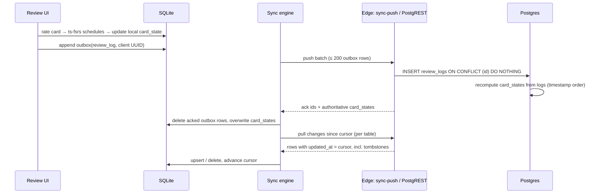

# Studify — Mobile App (Android, Expo)

| | |
|---|---|
| **Status** | Draft v1 |
| **Scope** | Internals of `apps/mobile`: layout, navigation, state, offline sync, notifications, widget, PDF/Markdown/math rendering, camera, audio, theming, accessibility, performance, errors, permissions, builds and dev setup. |
| **Related** | [Architecture](architecture.md) · [Data model](data-model.md) · [API](api.md) · [Security & privacy](security-privacy.md) · [Testing](testing-strategy.md) · [UX guidelines](../design/ux-guidelines.md) · ADRs [0001](adr/0001-expo-react-native-android-first.md), [0004](adr/0004-fsrs-on-device.md), [0007](adr/0007-offline-first-append-only-reviews.md) |

---

## 1. Monorepo layout

```text
studify/
├─ apps/
│  ├─ mobile/                  # Expo app (this document)
│  │  ├─ app/                  # Expo Router routes (file-based)
│  │  ├─ src/
│  │  │  ├─ api/               # Supabase client, query hooks, API function callers (EXPO_PUBLIC_API_URL)
│  │  │  ├─ db/                # expo-sqlite + Drizzle schema, migrations, sync engine
│  │  │  ├─ features/          # one folder per PRD area: ingestion, learn, memory, practice,
│  │  │  │                     #   tutor, goals, turma, feed, camera, interactive, motivation
│  │  │  ├─ components/        # shared UI (Button, Card, Sheet, MarkdownView, MathView, PageChip…)
│  │  │  ├─ platform/          # Android-only modules behind interfaces (widget, notification actions,
│  │  │  │                     #   app blocking) with no-op stubs for other platforms
│  │  │  ├─ stores/            # Zustand stores (UI/session state only)
│  │  │  ├─ theme/             # tokens, light/dark themes, typography
│  │  │  ├─ i18n/              # i18next setup + pt-BR.json
│  │  │  └─ lib/               # logging, Sentry, feature flags, formatting (dates, grades)
│  │  ├─ assets/               # fonts, images, bundled KaTeX/markdown-it web assets
│  │  ├─ app.config.ts         # Expo config (dynamic, per environment)
│  │  └─ eas.json
│  └─ worker/                  # Job worker (Bun, pg-boss)
├─ supabase/
│  ├─ migrations/              # SQL migrations + RLS policies
│  ├─ tests/                   # RLS / SQL tests
│  └─ seed.sql
├─ apps/api/                   # API server (Bun + Hono): /api/<name> functions, /api/health, link site
├─ packages/
│  ├─ shared/                  # types, Zod schemas, ts-fsrs wrapper, grading rules, planner, sync protocol
│  └─ prompts/                 # versioned prompt templates + output schemas (used by worker & API)
├─ docs/
├─ package.json                # pnpm workspaces
└─ pnpm-workspace.yaml
```

Rules:
- `packages/shared` has **no React Native or Node-only imports**; it runs on device, in the API server (Bun) and in the worker. It owns the FSRS wrapper, grade math ("Quanto preciso tirar?"), planner core and sync payload schemas so all three runtimes agree.
- `apps/mobile` never imports from `packages/prompts` (prompts are server-only).
- Expo + pnpm: use `node-linker=hoisted` in `.npmrc` (or Expo's documented monorepo setup) so Metro resolves workspace packages.

## 2. Navigation (Expo Router)

Route segments are English (code names); every label shown to the user is PT-BR from `i18n/pt-BR.json`.

### 2.1 Bottom tabs

| Tab (label) | Icon | Purpose |
|---|---|---|
| **Hoje** | sun | Today screen (GOL-05): one-button session, plan for today, due reviews, active goal countdown |
| **Matérias** | book | Subjects, materials, knowledge map, notes, glossary, PDF viewer |
| **Praticar** | target | Reviews, quizzes, simulados, Caderno de Erros, Feed (Phase 2) |
| **Turma** | users | Class groups, duels, battles, insights (Phase 2; before that shows an explainer + "Em breve") |
| **Perfil** | person | Profile, goals list, settings, privacy, AI usage, achievements |

### 2.2 Route tree

```text
app/
├─ _layout.tsx                      # providers: Sentry, QueryClient, Theme, i18n, DB, AuthGate
├─ (auth)/
│  ├─ sign-in.tsx                   # "Entrar" — email (magic link / OTP code) or Google
│  ├─ verify.tsx                    # 6-digit code entry; also handles magic-link deep link
│  └─ onboarding/
│     ├─ invite.tsx                 # S-AUTH-03 invite code for new accounts (prefilled from a Turma/pilot link; SP-02)
│     ├─ age.tsx                    # S-AUTH-04 birth month/year (age gate, see security-privacy.md)
│     ├─ guardian.tsx               # S-AUTH-05 responsável link when required by age (see security-privacy.md)
│     ├─ profile.tsx                # S-AUTH-06 display name, school year, privacy notice acceptance
│     ├─ intent.tsx                 # S-AUTH-07 "Pra que você vai estudar?" (Semana de Provas / ENEM / one subject)
│     └─ first-subject.tsx          # S-AUTH-08 create first Matéria + upload (target: < 2 min to first session)
├─ (tabs)/
│  ├─ _layout.tsx                   # bottom tabs
│  ├─ today/index.tsx               # Hoje
│  ├─ subjects/
│  │  ├─ index.tsx                  # Matérias list
│  │  └─ [subjectId]/
│  │     ├─ index.tsx               # subject home: outline (knowledge map), materials, progress
│  │     ├─ upload.tsx              # add material (PDF / photos)
│  │     ├─ outline-edit.tsx        # ING-04 rename/merge/split/delete/"não cai na prova"
│  │     ├─ topic/[nodeId].tsx      # topic: Resumo | Cartões | Questões | Glossário (top tabs)
│  │     ├─ note/[noteId].tsx       # full-screen note reader (3 depths switcher)
│  │     ├─ glossary.tsx
│  │     ├─ concept-map.tsx         # LRN-04 (Phase 2)
│  │     └─ document/[documentId].tsx  # PDF viewer (?page=N&cite=<citationId>)
│  ├─ practice/
│  │  ├─ index.tsx                  # Praticar hub
│  │  ├─ review.tsx                 # FSRS review session (MEM-02), offline-capable
│  │  ├─ quiz/new.tsx               # quiz builder (scope, types, count, timer)
│  │  ├─ quiz/[quizId].tsx          # quiz runner
│  │  ├─ result/[attemptId].tsx     # results + explanations
│  │  ├─ mistakes/index.tsx         # Caderno de Erros
│  │  ├─ tutor.tsx                  # Conversas: tutor thread list (S-TUT-01); threads open as the tutor modal
│  │  ├─ memory-map.tsx             # Mapa da Memória (Phase 2)
│  │  └─ feed.tsx                   # Feed de Estudos (Phase 2)
│  ├─ class/
│  │  ├─ index.tsx                  # Turma list / explainer
│  │  ├─ join.tsx                   # join via code (also deep link target)
│  │  └─ [classGroupId]/
│  │     ├─ index.tsx               # Turma home: shared subjects, members, insights
│  │     ├─ duel/[duelId].tsx       # SOC-02
│  │     └─ battle/[battleId].tsx   # SOC-03 (live)
│  └─ profile/
│     ├─ index.tsx
│     ├─ goals.tsx                  # list of Objetivos
│     ├─ settings.tsx               # theme, font, notifications & quiet hours, storage, language of content
│     ├─ privacy.tsx                # data export, account deletion, guardian, visibility
│     ├─ ai-usage.tsx               # PLT-04: today's AI usage vs limit
│     └─ achievements.tsx           # Phase 2
├─ goal/
│  ├─ new.tsx                       # create Semana de Provas / ENEM (mode picker)
│  └─ [goalId]/
│     ├─ index.tsx                  # exam-week dashboard (GOL-08)
│     ├─ exams.tsx                  # exam calendar (GOL-02)
│     ├─ exam/[examId].tsx          # one Prova: scope (GOL-03), grade, Modo Véspera entry
│     ├─ plan.tsx                   # day-by-day plan (GOL-04)
│     ├─ grades.tsx                 # Quanto preciso tirar? (GOL-06)
│     └─ eve/[examId].tsx           # Modo Véspera (GOL-07)
├─ session/[sessionId].tsx          # mixed study session runner launched from Hoje
├─ tutor/[threadId].tsx             # presented as modal; scope passed as params
├─ notifications/index.tsx          # Central de notificações (api.md §9.1), opened from the Hoje bell
├─ notifications/preview.tsx        # Perfil → Notificações → Ver exemplos
├─ +native-intent.tsx               # strips `notif=<key>` from notification taps, marks the inbox row read
├─ camera/index.tsx                 # Câmera Mágica (Phase 3)
└─ podcast/[podcastId].tsx          # player (Phase 3)
```

### 2.3 Deep links

The canonical route list (custom scheme and HTTPS App Links) is [api.md §10](api.md#10-deep-links-and-app-links); this table lists the most common ones.

| Link | Opens |
|---|---|
| `https://{BASE_URL}/c/{code}` → `studify://class/join?code={code}` | Join Turma (SOC-01) |
| `https://{BASE_URL}/i/{code}` → `studify://auth/invite?code={code}` | Pilot invite (PLT-02.2) |
| `https://{BASE_URL}/q/{token}` → `studify://quiz/shared/{token}` | Shared quiz (SOC-09) |
| `https://{BASE_URL}/b/{pin}` → `studify://class/battle/join?pin={pin}` | Join a live battle (SOC-03) |
| `studify://auth/callback#…` | Magic-link callback |
| `studify://practice/review` | Review session (from notification / widget) |
| `studify://goal/{goal_id}/eve/{exam_id}` | Modo Véspera (from reminder) |
| `studify://notifications` | Central de notificações (also the Hoje bell) |

WhatsApp does not make custom schemes clickable, so shareable links must be **HTTPS** (Android App Links) pointing to a small landing page that opens the app if installed or shows the install link otherwise. The domain is `studify.vendua.com.br` (D-05, decided 2026-10-27), so links are `https://studify.vendua.com.br/…`; the `{BASE_URL}` placeholder in the route tables stands for that host.

## 3. State management

| Kind of state | Where | Examples |
|---|---|---|
| **Offline domain data** | SQLite (Drizzle) — source of truth on device | cards, card states, review outbox, downloaded notes, today's plan |
| **Server state** (online screens) | TanStack Query | Turma lists, insights, job progress, tutor threads |
| **Ephemeral UI/session** | Zustand | current review session queue, quiz runner timer, sheet open/closed |
| **Small key-value** | MMKV (`react-native-mmkv`) | settings, feature-flag cache, last sync cursors, persisted query cache |
| **Secrets** | expo-secure-store (Android Keystore) | auth session encryption key (see §12) |

Conventions:
- Query keys: `['subject', subjectId]`, `['subject', subjectId, 'outline']`, `['job', jobId]`, `['classGroup', id, 'insights']`.
- Screens that work offline read **only** from SQLite via hooks in `src/db/hooks` (live queries re-render on change); they never depend on TanStack Query.
- Realtime (Supabase channels) feeds TanStack Query caches via `queryClient.setQueryData` (job progress, duels, battles).
- Mutations that must survive offline go through the **outbox** (§4), never directly to Supabase.

## 4. Offline-first design

### 4.1 What is cached

| Data | Cached when | Size estimate | Eviction |
|---|---|---|---|
| Subjects, knowledge nodes (titles, order, page refs) | Always for non-archived subjects | small | On archive |
| Cards + per-user `card_states` | Active subjects (in an active goal, or opened in last 30 days) | ~1 KB/card | Subject inactive > 30 days |
| `review_logs` outbox | Until acknowledged by server | tiny | After ack |
| Notes (Markdown + citations) | On open, and pre-fetched for in-scope topics of the next 3 exams | ~5–20 KB/note | LRU when over quota |
| Questions for offline quizzes | Phase 2 (PLT-07 full) | ~2 KB/question | LRU |
| Today's plan (`plan_items` for ±7 days) | Always | small | Rolling window |
| Page images used by citations | On view | ~150 KB/page | LRU |
| Full PDFs | Only when the user opens the viewer, or taps "Baixar para offline" | MBs | LRU, user-visible in Settings |
| Podcast audio | On "Baixar" | ~1 MB/min | LRU |

Default storage quota for files (PDFs, page images, audio): **500 MB**, adjustable in *Configurações → Armazenamento* ("Usar até 250 MB / 500 MB / 1 GB / 2 GB"). SQLite content has no quota (it is small) but archived subjects are pruned.

### 4.2 Local schema (summary)

Drizzle tables mirror server entities with the same names and UUIDs: `subjects`, `knowledge_nodes`, `cards`, `card_states`, `notes`, `questions`, `plan_items`, plus local-only tables:

| Local table | Purpose |
|---|---|
| `outbox` | Pending mutations: `id` (client UUID v7), `kind` (`review_log` / `attempt_answer` / `plan_item_status` / `card_override` / `mistake_update` / `flag`), `payload` JSON, `created_at`, `attempts`, `last_error` |
| `sync_cursors` | Per table: last server `updated_at` + last id pulled |
| `file_cache` | Path, kind, bytes, last_access (LRU) |

Detailed columns live in [data-model.md](data-model.md) (§ local SQLite schema).

### 4.3 Sync protocol

Consistent with [architecture §4.2](architecture.md#42-review-offline-first-mem-02) and [ADR 0007](adr/0007-offline-first-append-only-reviews.md).



**Triggers:** app foreground, connectivity regained (NetInfo), end of a review/quiz session, every 5 min while foregrounded, and opportunistically from the widget task.

**Rules:**
1. **Push before pull.** Local intent reaches the server before server state overwrites local rows.
2. **Idempotency.** Every outbox row has a client UUID v7; the server inserts with `ON CONFLICT DO NOTHING`, so replays (crash mid-push, duplicate retries, two sync loops) are harmless.
3. **Reviews never conflict.** `review_logs` is append-only. `card_states` is derived on the server by replaying all logs of a (user, card) in `reviewed_at` order; two devices reviewing offline both count. The device's local `card_state` is a prediction that the server's authoritative value replaces on ack.
4. **Editable fields** (card overrides, plan item status, mistake cause, settings) are last-writer-wins using the client's `updated_at`, clamped to server time ± 5 min to neutralize wrong device clocks.
5. **Deletes win.** Server rows carry `deleted_at` (tombstones); pulling a tombstone deletes the local row and any pending outbox edits for it.
6. **Pull is incremental** by `(updated_at, id)` cursor per table, filtered to the user's active subjects; RLS guarantees only authorized rows are returned.
7. **Backoff.** Failed pushes retry with exponential backoff (5 s → 10 min cap). After 10 failures a row is kept and surfaced in *Configurações → Sincronização* ("3 revisões aguardando sincronização").
8. **Schema versions.** Payloads carry `schema_version`; the server rejects unknown future versions with `426`, and the app prompts to update.

## 5. Notifications

Library: `expo-notifications` (permission, push token, plain fallback) and the local Expo module **`studify-notify`** (`apps/mobile/modules/studify-notify`, Kotlin) that draws the rich notifications. Push transport: Expo Push Service → FCM (the worker calls the Expo Push API with stored Expo push tokens). Payloads, live progress and the inbox are specified in [api.md §9.1](api.md#91-rich-notifications-live-progress-and-the-central-de-notificações).

**`studify-notify`** (Android only; without it the same payloads are shown as plain notifications through expo-notifications, `src/platform/rich-notify.ts`):

- **Custom layouts.** `DecoratedCustomViewStyle` with RemoteViews (collapsed ≤ 48 dp, expanded with a wide graphic, chips and a big chronometer), so the system keeps the app header, actions and dark mode. RemoteViews cannot draw shapes, so rings, the Uber-style step tracker, duel cards, score bars, the podcast waveform and the Retrospectiva banner are drawn as bitmaps (`Graphics.kt`, at most 2× density to keep the parcel small; light and dark variants). Countdowns tick on their own with a `Chronometer`. Messages use `MessagingStyle`, and notifications sharing a `group` get an InboxStyle summary.
- **Live Updates.** On Android 16 (API 36) running progress uses `Notification.ProgressStyle` (segments per step, tracker icon) with `setRequestPromotedOngoing` and a short status-bar chip; `POST_PROMOTED_NOTIFICATIONS` is declared, and the student can allow promotion in the system settings (Perfil → Notificações shows the state and opens them).
- **Push.** `StudifyMessagingService` extends Expo's FCM service (higher intent-filter priority): it draws `data.rich` payloads, handles `data.rich_cancel`, and hands everything else back to Expo.
- **Actions without opening the app.** Snooze (re-shows later), reveal (card → answer with Errei / Acertei) and dismiss run in a broadcast receiver. Ratings are queued in SharedPreferences and recorded by the app (`recordReview`, `source = notification`) on the next start or foreground — offline-first like the widget.
- **Scheduling.** `schedule(id, at, payload)` with inexact `setAndAllowWhileIdle` alarms; re-armed after `BOOT_COMPLETED` and `MY_PACKAGE_REPLACED`. Alarms more than an hour stale are dropped.
- **Taps** open the deep link with `notif=<key>` appended; `src/app/+native-intent.tsx` strips it, clears the notification and marks the inbox row read.

Remote push needs a Firebase project (`google-services.json` through `GOOGLE_SERVICES_FILE`, and `EXPO_PUBLIC_EAS_PROJECT_ID`); see [RELEASING.md](../../apps/mobile/RELEASING.md) step 6. Without it, local reminders, live progress while the app is open (mirrored from `ai_jobs`) and the Central de notificações still work. The token is registered after sign-in, after the permission is granted and when FCM rotates it; sign-out invalidates it.

### 5.1 Android channels

| Channel id | Name (PT-BR) | Default importance | Used for |
|---|---|---|---|
| `reviews` | Revisões | Default | "12 cartões para revisar (≈ 6 min)", answer-from-notification |
| `plan` | Plano de estudos | Default | Daily plan reminder, Modo Véspera |
| `class` | Turma | Default | Duel challenges, battle starting, new shared material |
| `processing` | Processamento | Low | "Seu material está pronto" |
| `live` | Ao vivo | Low, silent | Live progress of materials, podcasts, essays (created by `studify-notify`) |

### 5.2 Local vs push

| Local (scheduled on device) | Push (sent by worker) |
|---|---|
| Review reminders (computed from FSRS due counts in SQLite) | Ingestion/generation finished |
| Daily plan reminder at the user's chosen time | Duel challenge / turn |
| Modo Véspera reminder (evening before each exam) | Live battle about to start |
| Streak-at-risk reminder (Phase 2, opt-in, gentle) | New material shared in the Turma |
| Grade prompt after a test | Live progress (`notify.live`, ephemeral) |

Local reminders are planned by `src/features/notifications/reminders.ts` (rich layouts: the next card, the plan digest, the exam countdown, the streak ring) and rescheduled on app start, after every sync, when the inputs change, when the app comes back, every 30 minutes and on `BOOT_COMPLETED` (handled by `studify-notify`). We use **inexact** scheduling only (no `SCHEDULE_EXACT_ALARM`). Perfil → Notificações → **Lembretes inteligentes** turns them off; **Ver exemplos** shows every layout and sends it to the shade.

### 5.3 Limits and quiet hours (protective by default)

- **Quiet hours default 22:00–07:00** (user-adjustable, but users under 18 cannot disable quiet hours entirely — see [security-privacy.md](security-privacy.md) on compulsive-use design).
- **Max 3 non-requested notifications per day** (requested = reminders the user explicitly set). Processing-complete notifications don't count.
- No notifications engineered around streak loss anxiety; copy is encouraging, never guilt-based (see [copy guide](../design/copy-pt-br.md)).
- Android 13+ `POST_NOTIFICATIONS` permission is requested **in context** (after the first upload: "Quer que eu avise quando seu material estiver pronto?"), never at first launch.

## 6. Review anywhere (MEM-04, Phase 2)

### 6.1 Home-screen widget

Library: `react-native-android-widget` (widgets declared in `app.config.ts`, rendered from JSX to RemoteViews, handled by a headless JS task).

| Widget | Size | Content |
|---|---|---|
| **Revisão rápida** | 4×2 | Next due card front → tap **Mostrar** → back + **Errei** / **Acertei** |
| **Hoje** | 2×2 | Due count, next exam countdown, tap opens Hoje |

- The widget task reads the same SQLite database file as the app (same process sandbox), schedules with the shared ts-fsrs wrapper, writes the local `card_state` and appends to `outbox` — identical code path as the review screen (`packages/shared` + `src/db`).
- Two-button rating maps to FSRS `Again` / `Good`. The four-button scale stays in the app.
- Refresh: on every app sync/review, plus `updatePeriodMillis` = 30 min (Android minimum).
- No network calls from the widget task; sync happens next time the app or a background fetch runs.

### 6.2 Answer from notification

A `reviews` notification can show one card with actions **Ver resposta**. Tapping it replaces the notification (same key) with the answer and actions **Errei** / **Acertei**, handled without opening the app by `studify-notify`'s broadcast receiver, so it works with the app process killed. The rating is queued on the phone and recorded through the same review code path as the widget the next time the app starts or comes to the foreground. The plain expo-notifications path (`notification-actions.ts`, category actions with `opensAppToForeground: false`) remains for builds without the module.

## 7. PDF viewer and citations (ING-08, TRU-01)

Two views, because `react-native-pdf` (Pdfium-based) supports page navigation and zoom but **not** text selection or programmatic highlights:

| View | Used when | How |
|---|---|---|
| **Citation view** | A 📄 page chip is tapped | Shows the **single page image** (rendered by the worker at ingestion, ~1600 px wide, cached) inside a zoomable view with an SVG overlay that highlights the cited text spans. Buttons: **Abrir PDF completo**, **Perguntar ao tutor sobre isso**. |
| **Full viewer** | "Abrir PDF completo", or opening a document | `react-native-pdf` with `page` prop for jumps, horizontal page thumbnails strip, page indicator "pág. 14 de 52". Downloads the PDF to the file cache. |

**Highlights:** at ingestion the worker stores each page's text spans with normalized bounding boxes (`document_pages` span data, see data-model.md). A citation stores `{document_id, page_start, page_end, cited_text}`; the app fuzzy-matches `cited_text` against the page spans to get rectangles. If matching fails, the page opens without a highlight (never an error).

**Passage selection for the tutor (TUT-03):** in citation view, a long-press + drag selects spans over the page image (span hit-testing). The selected text + page reference becomes the tutor scope.

## 8. Markdown, math and rich content

All generated content is Markdown with LaTeX math (`$…$`, `$$…$$`) and simple tables. Items carry a `has_math` flag computed at generation time.

| Surface | Renderer | Why |
|---|---|---|
| Notes (long form) | **One WebView per screen** with bundled `markdown-it` + KaTeX (offline assets in `assets/web/`), content injected via `postMessage`, auto-height | Best typography and math fidelity; one WebView amortizes cost |
| Cards / questions / feed items **without** math | Native Markdown renderer (`react-native-markdown-display` with custom rules) | Fast, no WebView |
| Cards / questions / feed items **with** math | **Pooled `MathView` WebViews** (max 2 alive; reused) | Avoids a WebView per list item |

Performance rules:
- Card back is rendered **off-screen before the flip**, so flipping stays < 100 ms.
- Feed (Phase 2) keeps the current + next item pre-rendered; WebView pool size 2.
- Raw HTML in Markdown is disabled (sanitized); links render with their domain visible and open in the system browser after confirmation; remote images in AI output are not loaded.
- Fonts: system font by default; optional dyslexia-friendly font (Atkinson Hyperlegible, OFL) injected into the WebView CSS as well.

## 9. Camera and images (Phase 3 — CAM-01…03)

- Capture: `expo-camera` with a document-frame guide; gallery import via `expo-image-picker` (Android Photo Picker — no storage permission).
- Processing on device: `expo-image-manipulator` to crop/rotate and downscale to ≤ 2048 px long edge, JPEG quality 0.8 (≈ 300–600 KB) before upload.
- Multi-photo capture builds a `documents` row of kind `photo` (pages = photos).
- Uploads > 6 MB use resumable (TUS) uploads to Supabase Storage; smaller files use standard upload. Uploads continue if the user leaves the screen and resume on next launch (queued in `outbox` as kind `upload`).
- Photos are **personal by default** even inside a shared subject, unless the user explicitly adds them to the Turma's material (see security-privacy.md).

## 10. Audio (Phase 3 — INT-01 Podcast, WEL-04 read-aloud, TUT-06 voice)

| Need | Library |
|---|---|
| Podcast playback with background play, lock-screen/notification media controls, speed (0.75×–2×) | `react-native-track-player` (foreground service `mediaPlayback`) — re-evaluate `expo-audio` background support at Phase 3 |
| Read-aloud of notes/cards | `expo-speech` (on-device Android TTS, `pt-BR` voice) |
| Voice input / voice tutor | On-device Android speech recognition (community Expo module, chosen at Phase 3) |

Interactive podcast ✋: pressing ✋ pauses the track, opens a sheet (type or speak the question), sends it to the API with the current timestamp/segment, plays the generated answer clip, then resumes. Episodes are streamed; "Baixar" stores them in the file cache.

## 11. Theming

- Follows system light/dark by default; override in *Configurações → Aparência* ("Automático / Claro / Escuro").
- Tokens in `src/theme/tokens.ts`: color roles (`bg`, `surface`, `surfaceAlt`, `text`, `textMuted`, `primary`, `onPrimary`, `success`, `danger`, `warning`, `border`, `focus`), spacing scale (4-pt), radii, elevation, typography scale (`display`, `title`, `body`, `caption`, `mono`).
- **Subject colors:** a fixed palette of 12 hues, each with light/dark variants that meet WCAG AA contrast for text on chips.
- Correct/incorrect states always use **icon + text + color**, never color alone.
- Reduced motion: honor the OS "remove animations" setting (`AccessibilityInfo.isReduceMotionEnabled`) — card flip becomes a crossfade.

## 12. Auth on device

- Supabase JS client with a **LargeSecureStore** adapter: a random AES-256 key lives in `expo-secure-store` (Android Keystore); the encrypted session JSON lives in MMKV. (SecureStore values are size-limited; Supabase's Expo guide uses this pattern.)
- Sign-in: email (magic link **and** 6-digit OTP code fallback, because deep links from webmail are unreliable on Android) and Google (`@react-native-google-signin/google-signin` → `signInWithIdToken`).
- Token refresh handled by supabase-js; refresh is paused when the app is backgrounded (`AppState`) and resumed on foreground.
- "Sair de todos os dispositivos" in Perfil → Privacidade.
- Details: [security-privacy.md §3](security-privacy.md#3-authentication-and-sessions).

## 13. Accessibility (WEL-04)

| Requirement | Implementation / check |
|---|---|
| Font scaling up to 200% | `allowFontScaling` everywhere; layouts tested at 1.0×, 1.3×, 2.0×; no fixed-height text containers |
| TalkBack | Every touchable has `accessibilityLabel` (PT-BR) and `accessibilityRole`; flashcard announces "Frente" / "Verso"; rating buttons announce interval ("Bom, próxima revisão em 3 dias") |
| Touch targets | ≥ 48×48 dp |
| Contrast | WCAG AA (4.5:1 text, 3:1 large text/icons) in both themes; checked in CI on tokens |
| Focus order | Logical order in quiz runner and review session; timer not announced every second |
| Dyslexia-friendly font | Option in settings (Atkinson Hyperlegible) applied to native text and WebViews |
| Read-aloud / voice input | Phase 3 (§10) |
| Captions | Podcast shows a live transcript |

## 14. Performance budgets

Reference device: a mid-range Android phone typical of the class (e.g. Samsung Galaxy A-series / Motorola Moto G-series, 4 GB RAM) — the owner picks one physical reference device (open question).

| Metric | Budget | How measured |
|---|---|---|
| Cold start to interactive Hoje (TTI) | **< 2.5 s** | `adb shell am start -W` + custom TTI mark; Maestro perf flow on reference device |
| Review: card flip / rating → next card | < 100 ms | In-app perf marks |
| Quiz question transition | < 150 ms | perf marks |
| Scroll | 60 fps on lists (FlashList), no frame drops > 50 ms | Android GPU profiler |
| JS bundle (Hermes bytecode) | < 8 MB | CI check |
| APK size | < 60 MB | CI check on preview builds |
| Memory (steady state) | < 300 MB | Android Studio profiler |
| SQLite queries on the review path | < 16 ms | Drizzle query timing in dev |

Techniques: Hermes; lazy routes (PDF viewer, KaTeX WebView, camera, podcast player loaded on demand); FlashList for long lists; `expo-image` with disk cache for thumbnails; no network on the startup critical path (Hoje renders from SQLite/MMKV, then refreshes); defer Sentry/feature-flag fetch until after first frame.

## 15. Error handling and monitoring

- **Error boundaries** per route group with a friendly PT-BR fallback ("Algo deu errado aqui. Tente de novo.") and a retry button; the review/quiz runners persist progress so a crash never loses answers.
- **Network:** TanStack Query retries (3, exponential) for idempotent reads; an offline banner ("Você está offline — suas revisões serão sincronizadas depois") when NetInfo reports no connection.
- **AI errors** map to user messages by error code from the API (budget exceeded → "Você atingiu o limite de IA de hoje. Volta amanhã!"; generation failed → "Não conseguimos gerar isso agora. Tente de novo em instantes.").
- **Sentry** (`@sentry/react-native` Expo plugin): release = app version, dist = EAS build number; EAS Update id attached as tag; source maps uploaded in EAS build/update hooks. **PII scrubbing:** strip emails, display names, note/card/question text, tutor messages, and file names from events and breadcrumbs (`beforeSend`); no session replay. Sample rate 100% errors, 10% traces.
- No third-party analytics SDKs (no advertising or behavioral profiling of minors — see security-privacy.md). Product metrics are computed server-side from first-party tables.

## 16. Android permissions

Request each permission **in context**, with a PT-BR rationale shown before the system dialog.

| Permission | Phase | Rationale shown to the user (PT-BR) |
|---|---|---|
| `INTERNET`, `ACCESS_NETWORK_STATE` | 0 | — (install-time) |
| `POST_NOTIFICATIONS` | 1 | "Quer que eu avise quando seu material estiver pronto e lembre das suas revisões? Você escolhe os horários." |
| `RECEIVE_BOOT_COMPLETED` | 1 | — (install-time; reschedules reminders after restart) |
| `POST_PROMOTED_NOTIFICATIONS` | 1 | — (install-time, Android 16; lets live progress be promoted to a Live Update; the student can still turn promotion off in the system settings) |
| `VIBRATE` | 1 | — |
| `CAMERA` | 3 | "Para fotografar páginas, exercícios e suas respostas escritas à mão. As fotos ficam só com você, a menos que você compartilhe." |
| `RECORD_AUDIO` | 3 | "Para você falar com o tutor. O áudio é usado só para transcrever sua fala e não é guardado." |
| `FOREGROUND_SERVICE`, `FOREGROUND_SERVICE_MEDIA_PLAYBACK` | 3 | — (podcast background playback) |
| `PACKAGE_USAGE_STATS` + `SYSTEM_ALERT_WINDOW` (WEL-02 app blocking; no Accessibility service, spec 13 §8.9) | 5 | "Para bloquear apps que distraem durante o seu tempo de foco. A Studify não lê o que você faz nesses apps." — **sensitive; opt-in only; design review required**. Both are special access granted in system settings from the Modo foco screen; without them focus works as soft focus |
| `FOREGROUND_SERVICE`, `FOREGROUND_SERVICE_SPECIAL_USE` (WEL-01 focus countdown) | 5 | — (install-time; the service runs only while a focus session the student started is on) |
| `ACCESS_NOTIFICATION_POLICY` (WEL-01.4 Não perturbe) | 5 | "Para silenciar notificações só durante os blocos de foco." — policy access granted in system settings |
| `READ_CALENDAR`, `WRITE_CALENDAR` (GOL-09, opt-in) | 5 | "Para ver seus horários ocupados e colocar provas e blocos de estudo na agenda "Studify". Os títulos dos seus compromissos não saem do celular." |

Not requested: location, contacts, broad storage (`READ_EXTERNAL_STORAGE`/`READ_MEDIA_*` — the Photo Picker and Storage Access Framework are used instead), exact alarms (the focus end-of-phase alert uses an inexact alarm that may fire while idle, backed by the foreground service timer), phone state. The focus module lists installed apps through a launcher `<queries>` filter, not `QUERY_ALL_PACKAGES`.

## 17. Builds, distribution and updates

### 17.1 EAS Build profiles (`eas.json`)

| Profile | `developmentClient` | Distribution | Android artifact | Update channel | Env |
|---|---|---|---|---|---|
| `development` | true | internal | APK | `development` | local / dev Supabase |
| `preview` | false | internal (install link) | APK | `preview` | staging |
| `production` | false | internal (install link) for now; `store` later | APK now, AAB when a Play listing exists | `production` | prod |

- **Android only:** builds run with `--platform android`; no iOS credentials are configured.
- **Install link:** EAS internal distribution produces a URL/QR that installs the APK. Classmates must allow "Instalar apps desconhecidos" for their browser once — the onboarding message includes PT-BR step-by-step instructions with screenshots.
- **Signing:** EAS-managed Android keystore; keep a backup in the owner's password manager (losing it blocks updates to installed APKs).

### 17.2 Versioning

- User-facing version (`expo.version`) in semver: `MAJOR.MINOR.PATCH` (0.x until Phase 1 exit).
- `android.versionCode` managed remotely by EAS (`cli.appVersionSource: "remote"`, `autoIncrement: true` on `production`).
- **Runtime version policy: `fingerprint`** — the runtime version changes whenever native code/config changes, so an OTA update can never reach an incompatible binary. Trade-off accepted: more frequent native builds.

### 17.3 OTA updates (EAS Update)

- JS/asset changes ship via `eas update --channel <channel>`; native changes require a new APK.
- `production` updates roll out at 20% → 100% after 24 h without new Sentry issues; `eas update:rollback` if crash rate rises.
- Check for updates on launch (download in background, apply on next cold start). Critical fixes can force reload after a confirmation dialog.
- When a newer **native** build exists (tracked in a server `app_versions` table), the app shows "Nova versão disponível" with the install link; builds older than the server's `min_supported_version` are blocked with an update screen (needed when the sync `schema_version` changes).

## 18. Development setup (expected)

| Requirement | Notes |
|---|---|
| Node.js LTS + pnpm | `pnpm install` at the root |
| Android Studio | Emulator (API 34+) or a physical phone with USB debugging |
| Docker + Supabase CLI | `supabase start` runs Postgres, Auth, Storage and Realtime locally; `supabase db reset` applies migrations + `seed.sql` (includes fixture PDFs metadata and a demo user). The API runs separately with Bun: `pnpm api:dev` ([deployment.md §7](deployment.md)) |
| Dev client | Build once (`eas build --profile development --platform android` or `npx expo run:android`); afterwards `pnpm --filter mobile start` + Metro |
| Worker | `pnpm --filter worker dev` against local Supabase; uses a **dev** Claude key with a low spend cap |
| Env files | `apps/mobile/.env.development` holds only **public** values (`EXPO_PUBLIC_SUPABASE_URL`, `EXPO_PUBLIC_SUPABASE_ANON_KEY`, `EXPO_PUBLIC_ENV`). Secrets never go in the app. |
| API base | `EXPO_PUBLIC_API_URL`, default `https://studify.vendua.com.br/api`. Functions are called as `${EXPO_PUBLIC_API_URL}/<name>`. For the local API on the Android emulator use `http://10.0.2.2:3000/api`. |

## 19. Keeping iOS possible later

- All Android-only capabilities live in `src/platform/` behind interfaces (`ReviewWidget`, `NotificationActions`, `FocusBlocker`) with no-op implementations for other platforms.
- Chosen libraries support iOS (react-native-pdf, track-player, expo-camera, secure-store, MMKV) **except** `react-native-android-widget` (iOS would need a separate WidgetKit extension) and app blocking (iOS Screen Time APIs need special entitlements).
- `app.config.ts` keeps an `ios` section (bundle id reserved) but no iOS build profile is configured.
- No Android-specific assumptions in `packages/shared` or in the sync protocol.

## 20. Open questions

1. ~~**Domain** for HTTPS invite links / App Links~~ Decided 2026-10-27 (D-05): `studify.vendua.com.br`. Still open: the privacy-notice page on that domain (needed before inviting classmates).
2. **Reference device** for performance budgets — which phone model is most common in the class?
3. Notification-action handling with a killed process (spike in Phase 2, §6.2).
4. `expo-audio` vs `react-native-track-player` for background podcast playback (decide at Phase 3).
5. Speech-recognition module for voice input (decide at Phase 3).
