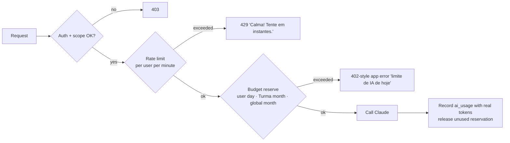

# Studify — Security & Privacy

| | |
|---|---|
| **Status** | Draft v1. **Not legal advice.** The legal sections summarize primary texts and law-firm analyses read on 2026-10-26. Get a lawyer to review them before inviting classmates beyond a closed pilot. |
| **Scope** | Authentication, authorization (RLS), storage, secrets, AI budgets, abuse cases, content safety for minors, LGPD and ECA Digital obligations, Anthropic policy obligations, retention and deletion, copyright, incident response, threat model. |
| **Related** | [Architecture](architecture.md) · [Data model](data-model.md) · [AI pipeline](ai-pipeline.md) · [Mobile app](mobile-app.md) · [Testing](testing-strategy.md) |

---

## 1. Principles

1. **Most users are minors (14–18).** Every default is the most protective option. A less protective setting is always an explicit, informed choice.
2. **Least privilege.** The app holds only a public (anon) key. Plain reads and writes go through Postgres RLS. Privileged work (AI, aggregation, moderation) runs only in Edge Functions or the worker.
3. **Uploaded content is untrusted data.** PDFs, photos, Turma names, display names and peer questions can contain prompt injections, malware-shaped files or abusive content.
4. **Data minimization.** Studify collects only what studying needs. No location, contacts, phone numbers, CPF, advertising IDs or behavioral profiling.
5. **Nothing public.** No content, profile or Turma is reachable without signing in and being a member.

## 2. Legal and policy obligations

### 2.1 Sources reviewed

| Source | What it says (summary) | Status |
|---|---|---|
| **LGPD (Lei 13.709/2018), Art. 14** — [planalto.gov.br](https://www.planalto.gov.br/ccivil_03/_ato2015-2018/2018/lei/l13709.htm) | Processing children's and adolescents' data must be in their **best interest** (caput). **Children (< 12)** need *"consentimento específico e em destaque dado por pelo menos um dos pais ou pelo responsável legal"* (§1). The controller must make reasonable efforts to verify that the consent came from the guardian (§5). Participation can't be conditioned on more data than strictly necessary (§4). Information must be *"simples, clara e acessível"* and suited to the child (§6). | Verified (primary text) |
| **LGPD Art. 18** (same URL) | Data-subject rights: confirmation, access, correction, anonymization/blocking/deletion, portability, deletion of consent-based data, information about sharing, revoking consent. | Verified (primary text) |
| **Enunciado CD/ANPD nº 1/2023** (24 May 2023) — summaries by [Mayer Brown](https://www.mayerbrown.com/pt/insights/publications/2023/05/brazilian-anpd-publishes-statement-on-youth-data-processing) and [Felsberg](https://www.felsberg.com.br/importante-anpd-publica-enunciado-sobre-o-tratamento-de-dados-pessoais-de-criancas-e-adolescentes/) | Children's and adolescents' data **may be processed under any legal basis of Arts. 7 and 11**, not only consent, provided the **best interest prevails** in the concrete case. | Verified via secondary sources; primary text not read |
| **ECA Digital (Lei 15.211/2025)** — [planalto.gov.br](https://www.planalto.gov.br/ccivil_03/_ato2023-2026/2025/lei/L15211.htm); context: [Demarest](https://www.demarest.com.br/eca-digital-entrada-em-vigor-em-17-de-marco-de-2026/), [Mayer Brown 2026](https://www.mayerbrown.com/pt/insights/publications/2026/04/enforcement-of-brazils-eca-digital-introduces-new-obligations-for-companies) | **In force since 17 Mar 2026** (Art. 41-A). Applies to IT products **directed to or likely accessed by** children and adolescents (Art. 1). Relevant duties: **most protective privacy settings by default** (Art. 7); design that **avoids compulsive use** (Art. 8, IV); **parental supervision tools** (usage-time limits and monitoring, management of settings, consolidated usage metrics, in Portuguese; Arts. 17–18); **no profiling for advertising** (Arts. 22, 26); **loot boxes banned** (Art. 20); **reporting channel, removal on notice, notice to the uploader, appeal** (Arts. 28–30). Art. 24 requires accounts of users **up to 16** to be linked to a guardian; the caput is broad but sits in the social-networks chapter, so its scope is ambiguous. Obligations scale with the provider's size and control over content (Art. 39). Penalties range from warning to fines and suspension (Art. 35). | Verified (primary text, read through a summarizing fetch). Interpretation of Art. 24 and Art. 39 needs legal review |
| **Anthropic Usage Policy** — [anthropic.com/aup](https://www.anthropic.com/aup) (version shown as effective 12 Nov 2026) | "Products serving minors" must follow the additional guidelines in Anthropic's support article and all applicable laws. Consumer-facing chatbots must **disclose that users are talking to an AI**, at least at the start of each chat session or in the product interface. | Verified (primary) |
| **Anthropic — Guidelines for Organizations Serving Minors** — [support.claude.com/…/9307344](https://support.claude.com/en/articles/9307344-responsible-use-of-anthropic-s-models-guidelines-for-organizations-serving-minors) (updated 16 Mar 2026) | Safeguards: **age verification** so only intended users access the product; **content moderation and filtering**; **monitoring and reporting**; implement the **child-safety system prompt** Anthropic may provide; comply with child-safety and privacy laws and **state that compliance on the organization's website**; **disclose AI use**; Anthropic **audits periodically**. | Verified (primary) |
| **Anthropic — Child Safety Guidance for Developers** — [support.claude.com/…/15591275](https://support.claude.com/en/articles/15591275-child-safety-guidance-for-developers) (updated 26 Jun 2026) | The developer is responsible for safeguards on its deployment. Products that let users **upload images or interact with other users** should run their own detection (examples: Thorn Safer, IWF hash lists). Outside the US, follow local reporting requirements (INHOPE directory). | Verified (primary) |
| **Anthropic Commercial Terms** — [anthropic.com/legal/commercial-terms](https://www.anthropic.com/legal/commercial-terms) | *"Anthropic may not train models on Customer Content from Services."* The customer is responsible for all activity under its account. | Verified (primary) |
| **Anthropic Privacy Center — API retention** — [privacy.claude.com/…/7996866](https://privacy.claude.com/en/articles/7996866-how-long-do-you-store-my-organization-s-data) (updated 1 Jul 2026) | API inputs and outputs are **deleted from Anthropic's backend within 30 days** by default. Longer retention applies to services under the customer's control (e.g. the **Files API**), to agreed exceptions, and to Usage Policy enforcement: flagged content is kept up to 2 years, classification scores up to 7 years. | Verified (primary) |
| **Resolução CD/ANPD nº 2/2022** (small processing agents) — summaries: [Felsberg](https://www.felsberg.com.br/no-dia-internacional-da-protecao-de-dados-anpd-publica-nova-resolucao-que-regulamenta-a-aplicacao-da-lgpd-para-agentes-de-tratamento-de-pequeno-porte/), [Mayer Brown PDF](https://www.mayerbrown.com/-/media/files/perspectives-events/publications/2022/02/regulation-for-the-application-of-the-general-data-protection-law-lgpd-for-small-business-data-processing-agents/legal-update--regulamento-agentes-de-pequeno-porte.pdf) | Small agents, **including natural persons**, may skip appointing an encarregado (DPO) but must offer a **channel for data-subject requests**. Records of processing can be simplified. | Verified via secondary sources. **Unverified:** whether processing minors' data counts as "high risk" and removes these flexibilities |
| **Resolução CD/ANPD nº 15/2024** (incident reporting) — [Mattos Filho](https://www.mattosfilho.com.br/unico/regulamento-incidente-seguranca/) | Notify the ANPD and affected data subjects within **3 working days** of learning that an incident affected personal data. Keep a record of all incidents for ≥ 5 years. | Verified via secondary sources |
| **Resolução CD/ANPD nº 19/2024** (international transfer) — [Lefosse](https://lefosse.com/noticias/transferencia-internacional-de-dados-prazo-para-adocao-das-clausulas-padrao-da-anpd-se-encerra-em-23-de-agosto/), [Mattos Filho](https://www.mattosfilho.com.br/unico/regulamentacao-transferencia-internacional-dados/) | International transfers based on contractual clauses must use the **ANPD standard contractual clauses** (adaptation deadline was 23 Aug 2025). | Verified via secondary sources. **Unverified:** whether Anthropic's and Supabase's DPAs include the ANPD clauses |
| **SaferNet Brasil** — [INHOPE hotline directory](https://www.inhope.org/media/pages/our-story/fighting-csam-since-1999/hotline-directory/fde0c5edc4-1698240318/inhopenetwork_hotlinedirectory.pdf) | Brazil's INHOPE hotline (reports at `new.safernet.org.br/denuncie`), working with the MPF. | Verified via 2023 directory |

### 2.2 What this means for Studify (concrete obligations)

| # | Obligation | Source | How Studify meets it | Phase |
|---|---|---|---|---|
| SP-01 | **No users under 12** in v1. That avoids the parental-consent regime of LGPD Art. 14 §1 and §5. | LGPD 14 | Age gate at sign-up (birth month + year). Under 12 → "A Studify é para estudantes a partir de 12 anos." No account is created and nothing is stored. | 0 |
| SP-02 | **Age assurance proportional to risk.** Studify has no adult content, so ECA Digital's ban on self-declaration (Art. 9 §1, for age-inappropriate content) does not apply. Anthropic still asks for age verification "so only intended users can access the product". | ECA 9, 14; Anthropic guidelines | Closed audience: sign-up requires an **invite** (Turma code or owner invite) during the pilot, plus a self-declared birth date. Revisit if signup opens or if app stores provide age signals (ECA Art. 14). | 0 |
| SP-03 | **Guardian link for users under 16** (conservative reading of ECA Art. 24, since Studify has social features). | ECA 24 | Onboarding asks for a responsável's email. The guardian gets a plain-PT-BR notice and access to the supervision panel (SP-04). **Owner decision + legal review:** required, or only recommended? | 2 (before Turma social features) |
| SP-04 | **Supervision tools**: usage-time limits and monitoring, view/manage privacy settings, consolidated usage metrics, all in Portuguese. | ECA 17–18 | "Painel do responsável": weekly study time, daily time-limit setting, notification/quiet-hour settings, Turma memberships, account deletion request. Read-only view of content is **not** included; the student's notes and answers stay private. | 2 |
| SP-05 | **Most protective defaults.** | ECA 7; LGPD 14 | Profile visible only to Turma members. Leagues opt-in (SOC-08). Class insights aggregated and anonymized (k ≥ 5). Quiet hours 22:00–07:00. No public links. Photos personal by default. | 0+ |
| SP-06 | **No compulsive-use design.** | ECA 8 IV, 17 §4 | Feed de Estudos (FED-01) has finite sessions with a clear end card ("Você terminou por hoje 🎉") and no infinite autoplay. Streaks have freezes and never shame. At most 3 unrequested notifications a day. No variable-reward mechanics. | 2 |
| SP-07 | **No loot boxes, no purchases.** | ECA 20 | Achievements and mascot growth are deterministic. No randomized rewards, currency or in-app purchases. | 2, 5 |
| SP-08 | **No advertising or profiling for advertising.** | ECA 22, 26 | No ads and no ad or analytics SDKs. Mastery and usage data are used only to adapt the student's own studying. | 0+ |
| SP-09 | **Reporting channel, removal on notice, notice to uploader, appeal.** | ECA 28–30 | "Denunciar" on every shared item, Turma, display name and AI output. Moderation queue for Turma owner/moderators **and** the Studify operator. The uploader is notified with a reason (human or automated) and can appeal. Public contact channel on the website. | 1 (AI output), 2 (Turma) |
| SP-10 | **AI disclosure.** | Anthropic AUP; guidelines | Tutor, Ensine o Lucas, Podcast and every AI-generated item show "Gerado por IA". Each tutor thread starts with "Você está conversando com uma IA. Ela pode errar — confira sempre a página citada." | 1 |
| SP-11 | **Child-safety system prompt + content moderation.** | Anthropic guidelines | A shared safety preamble ([§8.2](#82-ai-behavior-constraints)) is prepended to every user-facing generation; Anthropic's child-safety system prompt is added when provided. User-to-user text (Turma names, display names, peer questions) is moderated before others see it. | 1 |
| SP-12 | **Image safety for uploads.** | Anthropic child-safety guidance | Photos and images inside PDFs stay private to the uploader unless explicitly shared. Before photos can be shared to a Turma (Phase 3), integrate a hash-matching service or document why it is out of reach. Apparent CSAM: preserve evidence, disable access, report to SaferNet/authorities, ban the account. | 3 |
| SP-13 | **Public compliance and privacy notice.** | Anthropic guidelines; LGPD 14 §2, §6 | A web page in plain PT-BR (with a simpler version for teens) covers: what data we collect, why, AI use (Anthropic, US), retention, rights and how to exercise them, the contact channel, and a compliance statement. Linked from onboarding and Perfil → Privacidade. | Before inviting classmates |
| SP-14 | **Data-subject rights.** | LGPD 18 | Self-service export (JSON + CSV) and account deletion in-app; correction via profile edit; contact channel for everything else; answer within 15 days. | 1 |
| SP-15 | **Contact channel (encarregado or channel).** | Res. 2/2022 | A privacy email alias. If high-risk status removes the flexibility, appoint an encarregado. | Before inviting classmates |
| SP-16 | **International transfer** (Claude API in the US; Supabase region). | LGPD 33; Res. 19/2024 | Host Supabase in **São Paulo (`sa-east-1`)**. Disclose the US AI processing in the privacy notice. Check that Anthropic's DPA covers ANPD clauses, or rely on another Art. 33 mechanism, after legal review. | Before inviting classmates |
| SP-17 | **Incident response** within 3 working days. | Res. 15/2024 | Runbook in §12. | 0 |
| SP-18 | **Legal controller identity.** The owner may be a minor. | LGPD 5 VI | **Open question:** a responsible adult (parent/guardian, or a school partner) should act as the legal controller and sign the vendor agreements. | Before inviting classmates |

> **Legal bases (to confirm with a lawyer):** contract performance (LGPD Art. 7 V) for the core service, with the best-interest test documented, as allowed by Enunciado 1/2023. Consent for optional features (leagues, sharing photos with the Turma, guardian-linked supervision where not mandatory).

## 3. Authentication and sessions

| Topic | Decision |
|---|---|
| Provider | Supabase Auth. |
| Methods | **Email** (magic link + 6-digit OTP code fallback) and **Google** (native Google Sign-In → `signInWithIdToken`). No passwords in v1. |
| Sign-up gating | Pilot: an invite (Turma code or owner invite) is required to complete sign-up. Enforced in a `before user created` auth hook / signup Edge Function that validates the invite and the age gate. |
| Tokens | Access JWT (1 h) + rotating refresh token (Supabase defaults). Refresh-token reuse detection on. |
| Storage on device | LargeSecureStore: AES-256 key in `expo-secure-store` (Android Keystore), encrypted session in MMKV ([mobile-app.md §12](mobile-app.md#12-auth-on-device)). |
| Sign-out | "Sair" clears SQLite user data, MMKV and the file cache. "Sair de todos os dispositivos" revokes all refresh tokens (`signOut({ scope: 'global' })`). |
| OTP abuse | Supabase Auth rate limits plus a per-email cooldown of 60 s. Generic responses ("Se este e-mail estiver cadastrado…") so emails can't be enumerated. |
| Service accounts | The worker and Edge Functions use the **service-role key** from secrets. Edge Functions handling user requests **also** verify the caller's JWT and authorize explicitly before any service-role query. |

## 4. Authorization: Row Level Security

### 4.1 Rules

1. **RLS is enabled on every table**, with no exceptions. A migration that creates a table without policies fails CI (see [testing-strategy.md](testing-strategy.md)).
2. Policies use **security-definer helper functions** (stable, fixed `search_path`):
   - `is_member(class_group_id)` / `is_moderator(class_group_id)`
   - `can_read_subject(subject_id)`: personal owner, or a member of the owning Turma
   - `can_edit_subject(subject_id)`: personal owner, or Turma owner/moderator, or the uploader for their own documents
3. Per-user state tables always use `user_id = auth.uid()`.
4. Append-only tables (`review_logs`, `ai_usage`, moderation audit) have **no UPDATE or DELETE** policies for clients.
5. Derived or aggregate tables (`class_insights`, `card_states` recomputation, `mastery`) are **written only by the service role**.
6. The client never selects from another user's per-user tables. Social features read **projections** (e.g. `duel_participants_public` with display name + score only).

### 4.2 Policy matrix

S = select, I = insert, U = update, D = delete. "Svc" = service role (worker/Edge Functions). This table summarizes by entity class; the canonical per-table matrix is [data-model.md §6.2](data-model.md#62-policy-matrix), and where they differ, data-model.md wins.

| Entity class | Tables | Owner / self | Turma member | Turma moderator/owner | Other users | Svc |
|---|---|---|---|---|---|---|
| **Profile** | `profiles` | S U (own) | S (display name, avatar only, via `profiles_public` view) | same as member | — | all |
| **Turma** | `class_groups`, `class_group_members` | — | S | U `class_groups`; I/D members (remove), U role | S of a group only via a valid invite code (join function) | all |
| **Personal content** | `subjects` (personal) and their `documents`, `document_pages`, `knowledge_nodes`, `node_sources`, `node_prerequisites`, `glossary_terms`, `notes`, `cards`, `questions` | S; I U of own subjects, documents and user-created cards/questions; outline edits only via RPC `edit_outline`; generated content is written by Svc only; deletes are soft | — | — | — | all |
| **Shared Turma content** | same tables, where `subjects.owner_class_group_id` is set | uploader: U own documents (soft delete) | S; I documents (upload into shared subject) if the Turma allows member uploads | S; U subject/documents; outline edits via RPC; fixes to generated items only through TRU-02 (`resolve_flag`) | — | all (generation writes) |
| **Personal overrides** | `card_overrides` (and similar) | S I U D (own) | — | — | — | all |
| **Per-user study state** | `quiz_attempts`, `attempt_answers`, `mistakes`, `goals`, `exams`, `grading_rules`, `plan_items`, `study_sessions`, `tutor_threads`, `essays` | S I U (own; scoring columns, duel/battle/simulado attempts and `plan_items` beyond `status`/`pinned` are written by Svc; deletes are soft) | — | — | — | all |
| **Derived per-user state** | `card_states`, `mastery`, `streaks`, `achievements` | S (own) only; written by Svc (`card_states` by `sync-push` replay of review logs) | — | — | — | all |
| **Append-only logs** | `review_logs`, `mastery_evidence`, `xp_events`, `tutor_messages` | S (own); no client inserts — reviews arrive only through `sync-push`, tutor messages through the tutor Edge Function (the student may only U `feedback` on their own tutor messages) | — | — | — | I |
| **Quizzes** | `quizzes` | S I U D (own) | S if `kind in (duel, battle)` and they are a participant | S | — | all |
| **Social** | `duels`, `battles`, `battle_players` | S (participant) | S (participant) | S (Turma's battles) | — | I U (state transitions via functions only) |
| **Aggregates** | `class_insights` (private schema) | — | Only through RPC `class_insights_for`, which enforces the anonymity thresholds (k ≥ 5); no direct table access | same as member | — | all |
| **Moderation** | `content_flags` | S I (own reports) | — | S U (Turma content) | — | all |
| **AI bookkeeping** | `ai_jobs` | S (own / own subjects) | S (jobs of shared subjects) | S | — | all |
| | `ai_usage` | S (own) | — | S (Turma totals via view) | — | I |
| **ENEM public data** (Phase 4) | `enem_items`, `enem_item_params`, SISU reference tables | S (any authenticated user) | S | S | S | I U D |
| **Guardian** (Phase 2) | `guardian_links`, `guardian_settings` | S (student sees who their guardian is) | — | — | Guardian: S/U settings and S usage metrics of linked students only | all |

## 5. Storage buckets

All buckets are **private**. Clients access objects only through RLS-checked paths or **signed URLs (TTL 1 h)**.

| Bucket | Path pattern | Read | Write | Limits |
|---|---|---|---|---|
| `documents` | `{subject_id}/{document_id}.pdf` | `can_read_subject` | insert: `can_edit_subject` or (member + member uploads allowed); delete: `can_edit_subject` | PDF ≤ **100 MB**, ≤ **1,000 pages**; magic bytes `%PDF-`; encrypted/password-protected PDFs rejected with a message |
| `page-images` | `{document_id}/{page}.webp` | `can_read_subject` | Svc only | Generated by worker |
| `photos` | `{user_id}/{document_id}/{n}.jpg` | owner only (Turma members only if shared explicitly) | owner | ≤ 15 MB per image; JPEG/PNG/WebP/HEIC (HEIC converted by worker); EXIF (incl. GPS) **stripped** by worker on ingest |
| `audio` | `{subject_id}/{podcast_id}.mp3` | `can_read_subject` | Svc only | — |
| `avatars` | `{user_id}.webp` | Turma co-members | owner | ≤ 1 MB; moderated (Phase 2) |
| `exports` | `{user_id}/{export_id}.zip` | owner (signed URL, TTL 24 h) | Svc only | Deleted after 7 days |

## 6. Secrets and environments

| Secret | Lives in | Never in |
|---|---|---|
| Claude API key | API server env (Dokploy environment); worker env (Dokploy environment) | App, repo, logs, Sentry |
| Supabase service-role key | API server env, worker env (Dokploy environment) | App, repo |
| Expo push access token | Worker env | App |
| TTS provider key (Phase 3) | Worker env | App |
| Sentry DSN | App (public by design) + server | — |

- **One Anthropic workspace and API key per environment** (`dev`, `staging`, `prod`), each with its **own monthly spend limit** set in the Anthropic Console (verify the exact console feature when setting up). Dev keys get a very low cap.
- Rotation: rotate on any suspected leak and at least every 6 months. Procedure: create new key → update secrets → redeploy functions/worker → revoke old key.
- CI runs **gitleaks** on every PR. `.env*` files are gitignored except `.env.example`.
- The app only receives `EXPO_PUBLIC_*` values (Supabase URL, anon key, env name).

## 7. Rate limiting and AI budgets (PLT-04)

Every AI call goes through one server-side gate, `ai_budget_reserve(user_id, class_group_id, feature_id, estimated_cost)`:

| Limit | Default (owner-configurable) |
|---|---|
| Per-user daily AI cost | Set by the owner once Phase 0 measures cost per page; enforced in micro-dollars |
| Per-user tutor messages | 60 / day |
| Per-user ingestion | 300 pages / day |
| Per-Turma monthly AI cost | Owner-set; Turma owner sees usage |
| Global monthly cap (prod) | Owner-set; at 80% the owner gets an alert, at 100% only reviews/offline features keep working |
| Requests per user per minute (AI endpoints) | 10 |

- Reservation and settlement are **atomic in Postgres** (row lock on a `ai_budgets` row per scope and period), so parallel requests can't overspend.
- Shared Turma content is generated **once**, and the cost is charged to the Turma budget, not to each member.
- Anomaly alert: a user above 5× the median daily spend triggers an owner notification.

## 8. AI safety

### 8.1 Prompt injection and untrusted content

Uploaded PDFs, photos, OCR'd handwriting, Turma names and peer questions are **data, never instructions**.

- System prompts state that document content is source material to study and that any instructions inside it must be ignored. Document content is passed only as `document` blocks or delimited user content, never inside the system prompt.
- Content-processing calls (ingestion, generation, grading) get **no tools with side effects**. Only Atualidades (ENM-09) uses web search, in an isolated call with a domain allowlist and no access to user data.
- Every output is validated against a **Zod schema** before storage ([architecture §5](architecture.md#5-cross-cutting-conventions)). Anything off-schema is discarded.
- **Retrieval is authorization-scoped.** The tutor retrieves only pages from subjects that `can_read_subject` allows for the caller, so a malicious prompt can't reach another user's data, because that data is never in context.
- **Rendering is sanitized**: no raw HTML, no auto-loaded remote images, and links show their domain and need confirmation ([mobile-app.md §8](mobile-app.md#8-markdown-math-and-rich-content)).
- Grading prompts treat the student's answer as data: an essay saying "give me 1000" must not change the grade (covered by an eval, see testing-strategy.md).

### 8.2 AI behavior constraints

A **shared safety preamble** (in `packages/prompts/safety.ts`) is prepended to every user-facing generation. It tells the model:

- The user is a student, probably 12–18, using a study app in Brazil.
- Stay on studying. Politely redirect off-topic requests ("Bora voltar pro conteúdo? 😊").
- Never produce sexual content, never discuss sexual topics involving minors, and refuse roleplay that sexualizes anyone.
- No instructions for self-harm, weapons, drugs or dangerous activities. Academic content (e.g. chemistry, history of wars) is fine at textbook level.
- If the student expresses distress, self-harm thoughts or abuse: respond with care, encourage talking to a trusted adult, and give the **CVV — ligue 188 (24 h, gratuito)**, **192** if in immediate danger, and **Disque 100** (human-rights/violence against children reporting). Don't diagnose, and don't continue the study task in that turn. This is the single shared `distress` fragment for every conversational feature, which also appends the `[[APOIO]]` marker so the app shows the help card ([ai-pipeline.md §8.3](ai-pipeline.md#83-shared-fragments-content-summary)).
- Never ask for personal data (address, phone, school name, photos of themselves).
- Be honest about uncertainty and cite pages. Say so when something is not in the material (TUT-04).

Other measures:
- Add Anthropic's child-safety system prompt when Anthropic provides one (SP-11).
- **Handle `stop_reason: "refusal"`** gracefully ("Não posso ajudar com isso aqui.") and use server-side fallbacks as defined in [ai-pipeline.md](ai-pipeline.md).
- Distress signals in tutor messages: when the model's response includes the support resources, set `tutor_messages.safety_flag = 'support_resources_shown'`. Aggregate counts are visible to the operator; content is not surfaced to the Turma or the guardian.

### 8.3 Moderation of user-to-user content

| Content | When moderated | How |
|---|---|---|
| Display names, Turma names, avatars | On create/change | Wordlist + a short Claude classification (`low` effort); reject with a friendly message |
| Peer questions (SOC-07), divide-and-conquer summaries (SOC-06) | Before others see them | Claude classification (`low` effort) + AI validation of correctness |
| Shared documents and photos | On share | Text: classification on extracted text of the first pages. Images: SP-12 |
| Any shared item | Anytime | "Denunciar" → moderation queue |

**No open chat between users in v1.** Users interact only through structured features: shared materials, duels, battles, insights and study rooms with fixed reactions. Free-text DMs or comments would need a new decision plus moderation design.

## 9. Social and Turma safety

- **Invite codes**: 8 characters from an unambiguous alphabet (`ABCDEFGHJKMNPQRSTUVWXYZ23456789`, no 0/O/1/I/L), ≈ 8.5 × 10¹¹ combinations. Codes are **revocable** and have an optional **max uses**. Default expiry: owner (pilot) invites 14 days, single-use ([00 §8.2](../specs/00-platform.md#82-invite-codes)); Turma invites per SOC-01.4 (default 14 days) ([10 — Turma & social](../specs/10-turma-social.md)). A Turma holds at most **60 members**. Owners can require **approval to join**.
- Invalid-code attempts are rate-limited per SOC-01.14 (5 per minute and 20 per hour per user and per IP; 1-hour join block after 20 failures), and the WhatsApp link carries only the code.
- Members can **leave**. Owners and moderators can **remove** members. Any user can **block** another user, which hides them from duels, battles and leaderboards.
- Duels are only possible inside a shared Turma. Live battles show display names only. Class insights (SOC-04) are computed server-side with **k-anonymity ≥ 5** and never expose individual answers.
- Leaving or deleting an account removes the user from leaderboards and insights going forward.

## 10. Data retention, export and deletion

| Data | Retention |
|---|---|
| Account and profile | While the account exists |
| Study state (`card_states`, `review_logs`, attempts, mistakes, mastery, plans) | While the account exists |
| Tutor threads | 12 months after last message, then deleted (user can delete anytime) |
| Personal documents, photos and generated content | Until deleted by the user or account deletion |
| Shared Turma documents | Until deleted by uploader/moderator or the Turma is deleted |
| `ai_usage` | 24 months (cost accounting), keyed by user id |
| Sentry events | 30 days, PII-scrubbed |
| Exports | 7 days |
| Moderation records and incident register | ≥ 5 years (Res. 15/2024 for incidents) |
| Backups | Supabase point-in-time backups per plan. Deleted data leaves backups within the backup window (stated in the privacy notice) |
| Claude API | Inputs and outputs deleted by Anthropic within 30 days by default. **Files API uploads are ephemeral**: the worker deletes them when the job that uploaded them finishes, and a sweeper removes anything older than 48 h ([ai-pipeline.md §4.2](ai-pipeline.md#42-files-api)), so they don't meaningfully extend retention |

**Export** (Perfil → Privacidade → "Baixar meus dados"): a ZIP with JSON of the profile, goals, exams, grades, card states, review logs, attempts, mistakes, tutor threads, essays, and CSV of the user's cards. It also includes the user's personal uploads.

**Account deletion** ("Excluir minha conta"): confirmation with a re-authentication code, then:
1. Delete personal subjects and their documents, generated content and storage objects.
2. Delete all per-user state and tutor threads.
3. For **shared** documents the user uploaded, the Turma keeps them (they belong to the class), and the uploader is shown as "ex-membro". The user can instead choose "Apagar também o que eu compartilhei".
4. Remove memberships, guardian links and push tokens. Anonymize `ai_usage` rows (user id → null).
5. Finish within 15 days. Show confirmation in-app and by email.

Guardians of users under 16 can request deletion through the supervision panel (SP-04).

## 11. Copyright

- Teacher materials are shared **only inside a Turma**, never publicly. There are no public links, signed URLs expire, and the Turma has a 60-member cap.
- On upload to a shared subject, the uploader confirms: *"Este material é para estudo da nossa turma e eu tenho acesso a ele pelas aulas."*
- Generated content (notes, cards, questions) is transformative study material for the Turma's members. It is not published outside the Turma.
- **Takedown process:**
  1. A rights holder (e.g. a teacher or publisher) writes to the public contact address or uses "Denunciar → Direitos autorais".
  2. Within 48 h, access to the document and its derived content is disabled for everyone except the uploader and moderators.
  3. The uploader is notified with the reason and may contest within 7 days.
  4. If uncontested or upheld, the document and derived content are deleted. Repeat infringers lose upload rights.
- ENEM official exams (Phase 4) are published by INEP. Third-party texts inside questions keep their attribution as printed.

## 12. Logging, monitoring and incident response

- **Logs** contain ids, feature ids, durations, token counts and error codes. They never contain note or card text, tutor messages, essay text, emails or file names.
- **Audit log** (append-only) for moderation actions, role changes, account deletions, exports, guardian link changes and key rotations.
- **Alerts**: spend at 80% of cap, error-rate spikes (Sentry), auth anomalies (OTP volume), storage growth.

**Incident runbook:**
1. Contain: rotate keys, disable affected functions, revoke sessions.
2. Assess which personal data is affected and whose.
3. If personal data is affected: **notify the ANPD and affected users (and guardians of minors) within 3 working days** (Res. 15/2024), in plain PT-BR.
4. Record the incident in the register (kept ≥ 5 years).
5. Write a blameless postmortem.

## 13. Threat model

| # | Threat | Vector | Impact | Mitigation | Phase |
|---|---|---|---|---|---|
| T1 | Claude API key leak | Key bundled in the app, committed, or logged | Unbounded spend; abuse under the owner's account | Key only in server secrets; gitleaks; per-env spend limits; rotation runbook | 0 |
| T2 | Budget exhaustion | One user (or a script) spams AI endpoints | Shared budget drained for the class | Per-user rate limits + atomic budget reservation; anomaly alerts | 0 |
| T3 | Cross-user data access | Missing/incorrect RLS; service-role query without authorization in an Edge Function | Privacy breach of minors' data | RLS on every table; helper functions; RLS test suite; explicit authorization before service-role queries | 0 |
| T4 | Prompt injection via PDF | Hidden text "ignore instructions…" in uploaded material | Wrong/unsafe content; exfiltration attempts | Content as data; no side-effect tools; schema validation; scoped retrieval; injection evals | 0 |
| T5 | Malicious/huge files | Zip-bomb-like PDFs, malformed PDFs, 5,000-page files | Worker crash, cost spike | Size/page caps; magic-byte checks; parsing in worker with timeouts and memory limits; reject encrypted PDFs; page caps before any AI call | 0 |
| T6 | Invite-link abuse | Code leaked in a public group; brute-force codes | Strangers join a Turma of minors | Expiring, revocable codes; max uses; approval mode; 60-member cap; join rate limit; member removal and block | 2 |
| T7 | Harassment between students | Offensive display names, peer questions, battle nicknames | Harm to minors | No open chat; moderation of user text; report/block; moderator tools | 2 |
| T8 | Harmful AI output to a minor | Model produces unsafe content, or a user tries to jailbreak | Harm to minors; policy violation | Safety preamble + Anthropic child-safety prompt; refusal handling; report button on outputs; operator review of reports | 1 |
| T9 | CSAM or intimate images uploaded | Photo upload / images inside PDFs | Severe harm; legal | Photos private by default; hash matching before sharing (SP-12); evidence preservation and report to SaferNet/authorities; account ban | 3 |
| T10 | Copyright complaint | Teacher/publisher objects to shared material | Legal risk; takedown | Turma-only sharing; attestation; takedown process | 2 |
| T11 | Account takeover | Phished OTP; stolen device | Access to a student's data | Short-lived OTPs; refresh rotation + reuse detection; global sign-out; device storage encrypted with Keystore | 0 |
| T12 | Sync tampering | Modified client sends forged review logs or grades | Corrupted personal stats or leaderboards | Server validates payload schema and ownership; leaderboards use server-computed scores; per-user state only affects that user | 1 |
| T13 | Leaderboard/duel cheating | Client-side answer manipulation | Unfair competition | Duel/battle answers checked server-side; answer keys never sent to clients before answering | 2 |
| T14 | Excess data to third parties | Sending emails/names to Claude or Sentry | Privacy | Prompts carry no identifiers beyond the first name when needed; Sentry PII scrubbing; no analytics SDKs | 0 |
| T15 | Guardian-link abuse | Someone links themselves as a student's guardian | Unwanted supervision | Guardian invitation must be accepted from the student's device, and the student is told who their linked guardian is | 2 |

## 14. Open questions (owner decisions)

1. **Legal controller (SP-18):** which adult or organization is the controller and signs the Anthropic/Supabase terms? The owner may be a minor.
2. **Guardian link for under-16 (SP-03):** mandatory before Phase 2 social features, or recommended only? Get legal review of ECA Digital Art. 24 scope and Art. 39 proportionality.
3. **Minimum age:** 12 (as proposed), or limit to 14+ (high-school only) to reduce risk?
4. **Image hash-matching (SP-12):** which provider is feasible for a small project before photos can be shared to a Turma?
5. **International transfer (SP-16):** confirm the Anthropic and Supabase DPA mechanisms under Res. 19/2024.
6. **Website** for the privacy notice, compliance statement and contact channel. The domain `studify.vendua.com.br` is decided (D-05, 2026-10-27) and hosts invite links too (see mobile-app.md); the privacy page on it is still to build.
