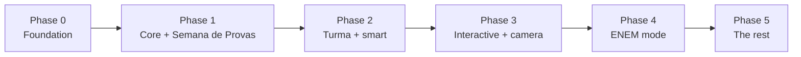
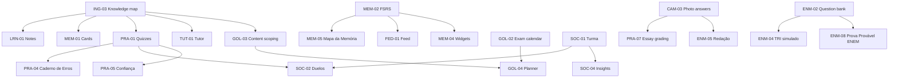

# Studify — Roadmap

Feature IDs refer to the [PRD feature catalog](PRD.md#5-feature-catalog). A phase is done only when its **exit criteria** are met on a real Android phone with real class material.

## Implementation status

| Phase | Code | Exit criteria |
|---|---|---|
| 0–2 | Done: schema + RLS (pgTAP), shared logic, prompts, API, worker and app screens | Not yet verified on a real phone with real class material |
| 3 | Done: Câmera Mágica, Podcast Interativo, Ensine o Lucas, Salas de estudo, PRA-06/07/08, read-aloud and voice | Not yet verified |
| 4 | Done: ENEM bank import, TRI simulados, Correção de Redação, Meta SISU (computed on the phone), Atualidades, Repertório, Reta Final, Treino de Argumentação | Not yet verified; the Redação calibration set and the SISU data source are still owner decisions |
| 5 | Done: everything in the table below, including the Android focus module (`apps/mobile/modules/studify-focus`) | Not yet verified; app blocking needs the design review in mobile-app.md §16 before a Play listing |

"Done" means implemented and covered by the automated suites (shared, prompts, API, worker, pgTAP, mobile). A phase is only **done** for the roadmap when its exit criteria pass on a real Android phone, so the checkboxes below stay open until then.

---

## Phase 0 — Foundation

**Goal:** upload a PDF on your phone and see its topic outline, with every topic linked to its pages.

| Area | Features |
|---|---|
| Platform | PLT-01, PLT-02, PLT-03, PLT-04, PLT-06 |
| Ingestion | ING-01, ING-02, ING-03, ING-04, ING-05, ING-08 |
| Goals | GOL-01 (data model + empty "create goal" flow) |
| Trust | TRU-01 (page references on knowledge-map nodes) |

**Exit criteria**
- [ ] An install link puts the app on an Android phone; the UI is fully in PT-BR.
- [ ] A user can sign up, create a subject and upload a 50-page PDF.
- [ ] Within 2 minutes the outline (units → topics → concepts) appears; generation of the rest continues in the background with visible progress.
- [ ] Tapping a topic's 📄 chip opens the PDF viewer on the right page.
- [ ] The user can rename, merge, delete and mark topics "não cai na prova".
- [ ] AI spend per upload is logged; a per-user daily limit blocks further AI calls with a friendly message.
- [ ] Measured: tokens and cost per page for 3 real PDFs (slides, apostila, scanned notes) recorded in `docs/engineering/ai-pipeline.md`.

## Phase 1 — Core study + Semana de Provas

**Goal:** a student can prepare for a real school exam week with Studify alone.

| Area | Features |
|---|---|
| Learn | LRN-01, LRN-02, LRN-03 |
| Remember | MEM-01, MEM-02 |
| Practice | PRA-01, PRA-02, PRA-03, PRA-04 |
| Tutor | TUT-01, TUT-02, TUT-03, TUT-04 |
| Goals | GOL-01, GOL-02, GOL-03, GOL-04, GOL-05, GOL-06, GOL-07, GOL-08, GOL-12 |
| Platform | PLT-05, PLT-07 (offline reviews) |
| Trust | TRU-01 (all items), TRU-02 (flag only) |
| Wellbeing | WEL-04 (baseline accessibility) |

**Exit criteria**
- [ ] Create a Semana de Provas with ≥ 5 tests, photograph a content list, and get a day-by-day plan.
- [ ] Notes, flashcards and quizzes are generated for every in-scope topic and cite pages.
- [ ] FSRS reviews work offline and sync later without losing or duplicating reviews.
- [ ] A wrong quiz answer shows an explanation, a page link, and creates a card + a Caderno de Erros entry.
- [ ] The tutor answers with citations and refuses to invent content not in the material.
- [ ] "Quanto preciso tirar?" gives the right required grade for the school's rules (unit-tested against hand-computed cases).
- [ ] Missed plan days are redistributed automatically.
- [ ] A student starting 4 days before a test gets the Modo Desespero offer, a diagnostic and a plano de ataque with an honest coverage estimate.

## Phase 2 — Turma + smart

**Goal:** the class studies together and the app adapts to each student.

| Area | Features |
|---|---|
| Turma | SOC-01, SOC-02, SOC-03, SOC-04, SOC-09, TRU-02 (propagation) |
| Feed & memory | FED-01, MEM-04, MEM-05 |
| Practice | PRA-05, PRA-09 |
| Learn | LRN-04 |
| Tutor | TUT-05 |
| Goals | GOL-11, ING-07 |
| Motivation | MOT-01 |
| Platform | PLT-07 (full offline) |

**Exit criteria**
- [ ] One student uploads the teacher's PDF; classmates who join via WhatsApp link see the same material without re-generation cost.
- [ ] An async duel and a live battle with ≥ 10 players run end-to-end.
- [ ] Class insights never reveal an individual's answers.
- [ ] The Feed mixes due cards and micro-lessons; swiping a card counts as an FSRS review.
- [ ] Mapa da Memória reflects FSRS retrievability per concept.
- [ ] Home-screen widget reviews update the FSRS schedule.

## Phase 3 — Interactive + camera

| Area | Features |
|---|---|
| Camera | CAM-01, CAM-02, CAM-03 |
| Practice | PRA-06, PRA-07, PRA-08 |
| Interactive | INT-01, INT-02 |
| Tutor | TUT-06 |
| Remember | MEM-03 |
| Turma | SOC-05 |
| Wellbeing | WEL-04 (read-aloud, voice input) |

**Exit criteria**
- [ ] A photographed exercise returns a correct step-by-step solution linked to the right topic.
- [ ] A photographed handwritten answer is transcribed (user can correct the transcription) and graded.
- [ ] A 10-minute podcast is generated in natural PT-BR voices; a ✋ question gets answered in context.
- [ ] Ensine o Lucas sessions produce a score and a list of gaps.

## Phase 4 — ENEM mode

| Area | Features |
|---|---|
| ENEM | ENM-01 … ENM-10 |
| Interactive | INT-03 |

**Exit criteria**
- [ ] Official past ENEM questions are imported, tagged by area/skill, with answer keys verified.
- [ ] A full Day 2 simulado (90 questions, 5h timer) produces a TRI estimate per area and coherence alerts.
- [ ] Correção de Redação scores a calibration set (the example essays in INEP's Cartilha do Participante + ≥ 20 essays graded by a redação teacher) within ±80 points of the human grade on average.
- [ ] Meta SISU produces per-area targets and re-weights the plan.

## Phase 5 — The rest

| Area | Features |
|---|---|
| Learn | LRN-05, ING-06 |
| Remember | MEM-06 |
| Goals | GOL-09, GOL-10 |
| Turma | SOC-06, SOC-07, SOC-08 |
| Motivation | MOT-02, MOT-03, MOT-04 |
| Wellbeing | WEL-01, WEL-02, WEL-03 |

**Exit criteria**
- [ ] A topic with a process gets a diagram (or an honest "nenhum diagrama ajuda aqui"); every box opens its page.
- [ ] The material checker flags a seeded contradiction between two PDFs as a *possible* error, and two classmates' votes confirm it.
- [ ] A mnemonic created for a leech card shows up as the hint in the next review, offline.
- [ ] With calendar sync on, busy events reduce the day's minutes, study blocks appear in the "Studify" calendar, and no event title reaches the server (network inspection).
- [ ] After two weeks of use, Progresso shows the student's best study windows.
- [ ] A Turma splits a test's topics in Dividir e conquistar and gets one merged class summary per topic, with credits.
- [ ] Peer questions are checked by the AI, voted in by 3 classmates and then appear in quizzes.
- [ ] The weekly league only shows opted-in members and never makes anyone lose XP or a streak.
- [ ] A unit boss can be fought from the Mapa; a retry uses different questions; defeating it unlocks the hunter's beanie for Capi.
- [ ] A Retrospectiva arrives after an exam week, and a shared card image never shows a classmate's name or (unless toggled) a grade.
- [ ] A 25/5 focus session keeps counting with the app killed, alerts at each phase end, and blocks a chosen app with the overlay during focus only.
- [ ] Studying past 23:00 on a school night shows one gentle nudge; two lowest weekly check-ins show the CVV help card.

---

## Dependencies

