# Studify — User Flows

| | |
|---|---|
| **Status** | Draft v1 |
| **Scope** | End-to-end journeys across features. Screen ids (`S-…`) come from the [screen inventory](../design/ux-guidelines.md#4-screen-inventory); PT-BR strings from the [copy guide](../design/copy-pt-br.md). |
| **Related** | [PRD](PRD.md) · [Roadmap](roadmap.md) · [Feature specs](../specs/) · [Mobile app](../engineering/mobile-app.md) · [Security & privacy](../engineering/security-privacy.md) |

Every flow lists the phase in which it becomes available. Steps cite requirement IDs (e.g. `GOL-03.3`) so the flow can be traced back to the spec that owns the behavior. If a flow and a spec disagree, the spec wins and this document gets fixed.

## Index

| # | Flow | Phase |
|---|---|---|
| [UF-01](#uf-01--install-first-launch-and-onboarding) | Install, first launch and onboarding | 0 (guardian step 2) |
| [UF-02](#uf-02--first-upload--outline--first-session) | First upload → outline → first session | 0–1 |
| [UF-03](#uf-03--create-a-semana-de-provas) | Create a Semana de Provas | 1 |
| [UF-04](#uf-04--a-typical-hoje-day) | A typical "Hoje" day | 1 |
| [UF-05](#uf-05--flashcard-review-including-offline) | Flashcard review, including offline | 1 |
| [UF-06](#uf-06--quiz--wrong-answer--card--caderno-de-erros) | Quiz → wrong answer → card + Caderno de Erros | 1 |
| [UF-07](#uf-07--tutor-chat-with-citations--pdf-page) | Tutor chat with citations → PDF page | 1 |
| [UF-08](#uf-08--log-a-grade--quanto-preciso-tirar--replan) | Log a grade → Quanto preciso tirar? → replan | 1 |
| [UF-09](#uf-09--modo-véspera) | Modo Véspera | 1 |
| [UF-10](#uf-10--join-a-turma-from-a-whatsapp-link) | Join a Turma from a WhatsApp link | 2 |
| [UF-11](#uf-11--async-duel) | Async duel | 2 |
| [UF-12](#uf-12--live-battle) | Live battle | 2 |
| [UF-13](#uf-13--flag-an-error--the-fix-propagates) | Flag an error → the fix propagates | 1 (personal), 2 (Turma) |
| [UF-14](#uf-14--feed-session-with-a-gentle-stop) | Feed session with a gentle stop | 2 |
| [UF-15](#uf-15--câmera-mágica-on-an-exercise) | Câmera Mágica on an exercise | 3 |
| [UF-16](#uf-16--câmera-mágica-on-a-handwritten-answer) | Câmera Mágica on a handwritten answer | 3 |
| [UF-17](#uf-17--podcast-with-) | Podcast with ✋ | 3 |
| [UF-18](#uf-18--ensine-o-lucas) | Ensine o Lucas | 3 |
| [UF-19](#uf-19--enem-onboarding-with-meta-sisu) | ENEM onboarding with Meta SISU | 4 |
| [UF-20](#uf-20--simulado-com-tri--results) | Simulado com TRI → results | 4 |
| [UF-21](#uf-21--correção-de-redação) | Correção de Redação | 4 |
| [UF-22](#uf-22--data-export-and-account-deletion) | Data export and account deletion | 1 |
| [§ Failure paths](#cross-cutting-failure-paths) | No internet, budget exhausted, generation failed, bad photo | all |

---

## UF-01 — Install, first launch and onboarding

**Goal:** a new student goes from an install link to their first subject in about a minute.
**Features:** PLT-01, PLT-02, PLT-06, GOL-01 · **Policy:** security-privacy SP-01 (no users under 12), SP-02 (invite-gated pilot), SP-03 (guardian link for under 16), SP-10 (AI disclosure), SP-13 (privacy notice).

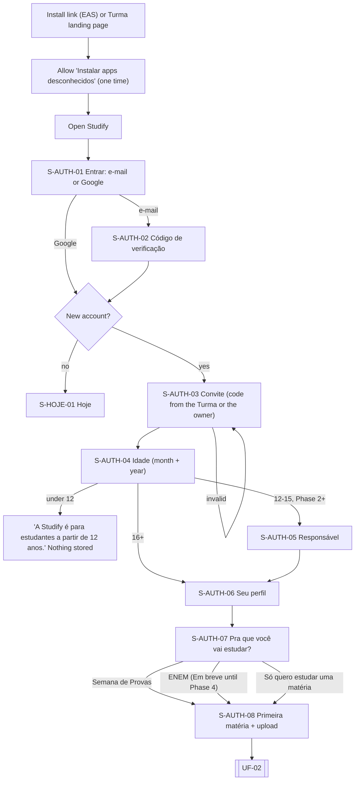

| Step | Screen | What happens | IDs |
|---|---|---|---|
| 1 | Install page | The EAS install link (or the Turma landing page, UF-10) downloads the APK. PT-BR, step-by-step help for "Instalar apps desconhecidos". | PLT-06, mobile-app §17.1 |
| 2 | S-AUTH-01 | "Entrar com Google" or "Entrar com e-mail". No passwords. | PLT-02, security §3 |
| 3 | S-AUTH-02 | Magic link or 6-digit code. Generic messages so e-mails can't be enumerated. | security §3 |
| 4 | S-AUTH-03 | **New accounts only:** invite code (Turma code or owner invite). If they came from a Turma link (UF-10), the code is prefilled. | SP-02 |
| 5 | S-AUTH-04 | Birth month + year. Under 12 → blocked, nothing stored. | SP-01 |
| 6 | S-AUTH-05 | **Phase 2+ for ages 12–15:** responsável's e-mail. The guardian gets a plain-PT-BR notice. Required vs recommended is an open owner decision. | SP-03, SP-04 |
| 7 | S-AUTH-06 | Display name (moderated), school year. Link to the privacy notice. | SP-13 |
| 8 | S-AUTH-07 | Intent. It only sets which call to action appears on Hoje; nothing is created yet. "ENEM" shows **Em breve** until Phase 4. | GOL-01 |
| 9 | S-AUTH-08 | Name the first subject (suggested list: Biologia, Matemática, História…) and pick a PDF → UF-02. Skippable: "Fazer isso depois". | PLT-03, ING-01 |

**Permissions:** none at first launch. Notifications are requested in context after the first upload ("Quer que eu avise quando seu material estiver pronto?"), per mobile-app §5.3.

**Edge paths**
- *No internet on first launch:* S-AUTH-01 shows "Você precisa de internet pra entrar pela primeira vez."
- *Invite expired:* "Código inválido ou expirado. Peça um novo pra quem organiza a turma." Rate-limited (SOC-01.14).
- *App version below `min_supported_version`:* S-SYS-01 "Atualização necessária" with the install link.

---

## UF-02 — First upload → outline → first session

**Goal:** the outline appears in under 2 minutes and the student starts studying before all content is generated.
**Features:** ING-01…05, ING-08, TRU-01, LRN-01, MEM-01/02, PRA-01, GOL-05.

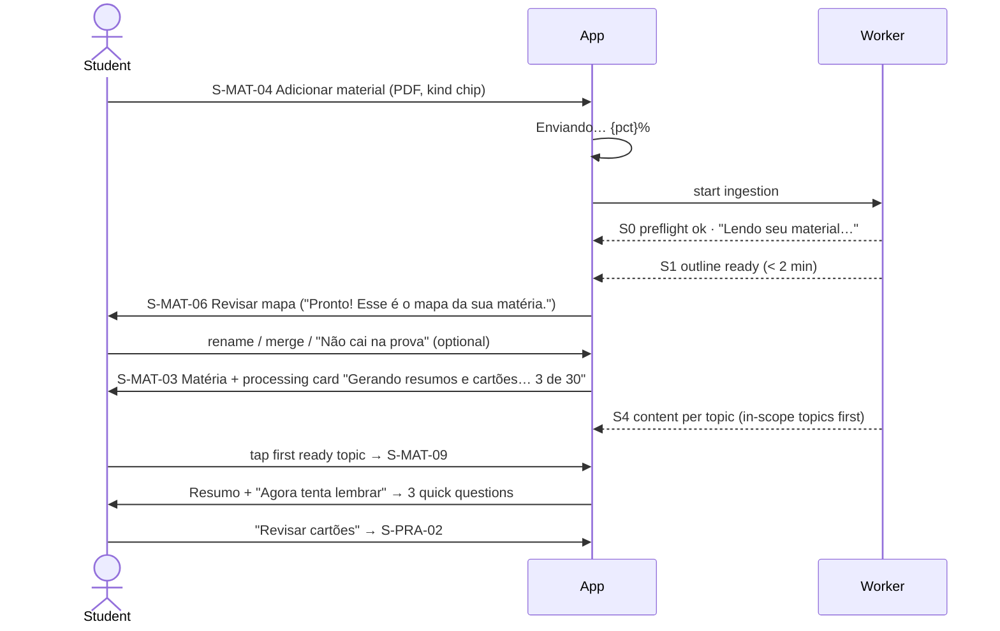

| Step | Screen | What happens | IDs |
|---|---|---|---|
| 1 | S-MAT-04 | Pick a file (or share a PDF from WhatsApp → "Salvar em qual matéria?"). Optional kind chip. | ING-01.1–01.3 |
| 2 | S-MAT-03 | Upload progress. Preflight catches password-protected, corrupt, too-large and duplicate files. | ING-02.1 |
| 3 | S-MAT-03 | "Lendo seu material…" → "Montando o mapa da matéria…" | ING-03.7 |
| 4 | S-MAT-06 | Outline review (skippable). Every topic shows 📄 page chips. | ING-04.1, TRU-01 |
| 5 | S-MAT-03 | Processing card with stage + count. Topics show "Pronto" as they finish. | ING-03.8, ING-03.13 |
| 6 | S-MAT-09 | Read the Resumo, tap 📄 p. N → S-MAT-08 at that page, highlighted. | LRN-01, ING-08 |
| 7 | S-MAT-09 → S-PRA-04 | "Responder 3 perguntas rápidas" (retrieval right after reading). | LRN-01, PRA-01 |
| 8 | S-PRA-02 | First review session with the new cards. | MEM-01, MEM-02 |
| 9 | Notification | "Seu material está pronto" when all S4 work is done (channel `processing`). | PLT-05 |

**Edge paths**
- *Not study material:* "Hmm, isso não parece material de estudo. Quer usar mesmo assim?"
- *Scanned PDF:* goes through the transcription path. In the viewer: "Página escaneada — o destaque pode não aparecer."
- *Budget exhausted mid-way:* the outline is kept and the rest waits: "Seu limite de IA de hoje acabou. O material fica salvo e eu continuo amanhã."
- *Second PDF in the same subject:* merge banner "Juntei o novo material ao mapa: {n_new} tópicos novos, {n_updated} atualizados." (ING-03.9).
- *Opening a topic that isn't ready yet:* "Ainda estou escrevendo esse resumo… ({done} de {total} tópicos prontos)", and that topic is moved up the queue (ING-03.13).

---

## UF-03 — Create a Semana de Provas

**Goal:** from "I have tests next week" to a day-by-day plan.
**Features:** GOL-01…04, GOL-06 (optional step), ING-04.

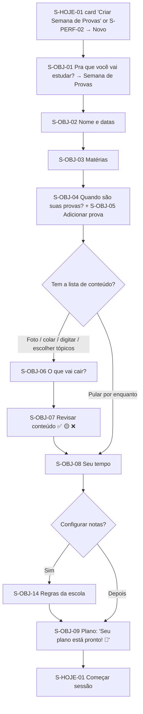

| Step | Screen | What happens | IDs |
|---|---|---|---|
| 1 | S-OBJ-02 | Name (default "{n}º Bimestre") and date range. | GOL-01.2 |
| 2 | S-OBJ-03 | Pick existing subjects or create new ones (a subject may have no material yet). | GOL-02.7 |
| 3 | S-OBJ-04/05 | Each test: subject, date, time or "Horário a definir", kind, weight. Two tests on the same day are allowed. The plan exists as soon as ≥ 1 test is added. | GOL-02.1–02.2, GOL-01.2 |
| 4 | S-OBJ-06 | Content list per test: photo of the board, text pasted from WhatsApp, typed, or topics picked from the map. | GOL-03.1–03.2 |
| 5 | S-OBJ-07 | Review the mapping: ✅ accept all, 🟡 pick a topic, ❌ "Não encontrei no seu material" → becomes a placeholder topic ("sem material") or is removed. Warns when an item maps to a "não cai na prova" topic. | GOL-03.3–03.6 |
| 6 | S-OBJ-08 | Minutes per weekday (presets Leve / Médio / Puxado), exceptions ("sábado não dá"). | GOL-04.3 |
| 7 | S-OBJ-14 | Optional: school grading rules preset → "Personalizar". | GOL-06.1 |
| 8 | S-OBJ-09 | Plan for each day, with "why" text per item ("Biologia hoje porque a prova é quarta e você está com 42% em Genética"). | GOL-04.1–04.2 |

**Edge paths**
- *Too much content for the time:* triage banner "Tá apertado! Pra caber tudo, eu encurtei: {items}. Quer aumentar seu tempo diário?" (GOL-04.4).
- *No content list:* "Sem conteúdo definido — vou considerar a matéria toda…" (GOL-03.5).
- *Test without material:* the plan includes an "Enviar material" item. "Pedir material pra turma" appears from Phase 2.
- *Offline:* the wizard saves locally. Content matching and plan generation run on reconnect ("Vou montar seu plano quando você estiver online").

---

## UF-04 — A typical "Hoje" day

**Features:** GOL-05, GOL-04, MEM-02, PRA-01, MOT-01 (Phase 2), PLT-05.

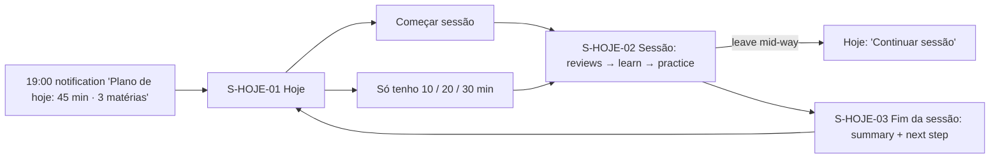

| Moment | Screen | What the student sees | IDs |
|---|---|---|---|
| Open app | S-HOJE-01 | Greeting, "Hoje: 45 min · 3 matérias", countdown chips ("Biologia · Faltam 3 dias"), today's items with reasons, and at most 3 cards (log grade, confirm scope, replan notice, Modo Véspera, upload material). | GOL-05.1, GOL-05.6 |
| Start | S-HOJE-02 | Session builder: due reviews first, then learning blocks and practice for the most urgent test. | GOL-05.2, GOL-04.2 |
| During | S-HOJE-02 | Progress updates plan items live. Leaving saves progress. | GOL-05.3 |
| End | S-HOJE-03 | "Sessão concluída! 🎉 Você revisou 40 cartões em 12 min." + next suggested step. Daily goal ring and streak update (Phase 2). | MEM-02, MOT-01 |
| Missed day | S-HOJE-01 next day | "Reorganizei seu plano: {summary}." No guilt copy. | GOL-04 (replan) |

**Edge paths**
- *No active goal:* due reviews + "Criar Semana de Provas" (GOL-05.4).
- *Offline:* last synced plan. Sessions use cached cards, notes and downloaded questions; AI steps are skipped and marked "precisa de internet" (GOL-05.5).
- *Quiet hours:* reminders never fire 22:00–07:00 (mobile-app §5.3).

---

## UF-05 — Flashcard review, including offline

**Features:** MEM-02, PLT-07 · architecture §4.2 · [ADR 0007](../engineering/adr/0007-offline-first-append-only-reviews.md).

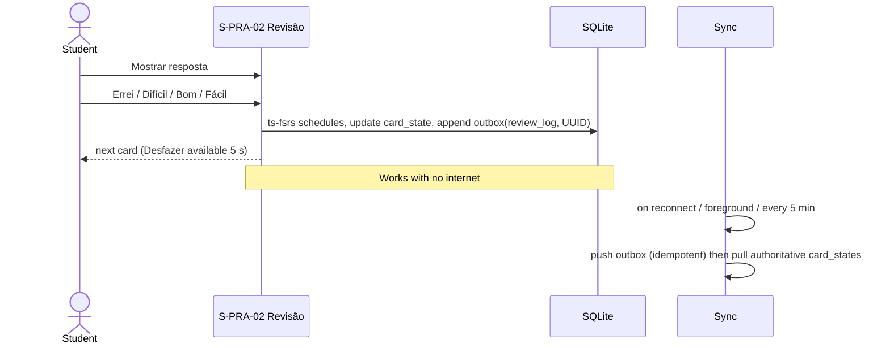

| Step | What happens | IDs |
|---|---|---|
| 1 | Entry from Hoje, Praticar, the review notification ("3 cartões quase esquecendo. 1 minutinho?") or the widget (Phase 2). | MEM-02, MEM-04 |
| 2 | Front → "Mostrar resposta" → back with 📄 chip. | MEM-02, TRU-01 |
| 3 | Rating buttons show the next interval under each label. Cards in scope of an upcoming test carry the tag "Reforço pra prova · Biologia em 3 dias". | MEM-02, spec 04 exam-aware rule |
| 4 | "Desfazer" reverts the last rating. | MEM-02 |
| 5 | Session ends when the queue is empty or the session limit is reached → S-HOJE-03. | MEM-02 |
| 6 | Sync. A second device's offline reviews are merged by replaying logs in time order. | architecture §4.2, mobile-app §4.3 |

**Edge paths**
- *Card with a broken source:* chip shows "Material removido".
- *Leech:* "Esse cartão tá difícil de fixar. Quer reescrever, criar um macete ou ver uma explicação diferente?"
- *Huge backlog:* "Acumulou bastante revisão (620). Bora espalhar em 5 dias? (Modo recuperação)"
- *Sync stuck:* Perfil → Sincronização shows "3 revisões aguardando sincronização" (mobile-app §4.3 rule 7).

---

## UF-06 — Quiz → wrong answer → card + Caderno de Erros

**Features:** PRA-01, PRA-02, PRA-04, PRA-05 (Phase 2), MEM-01, TRU-01.

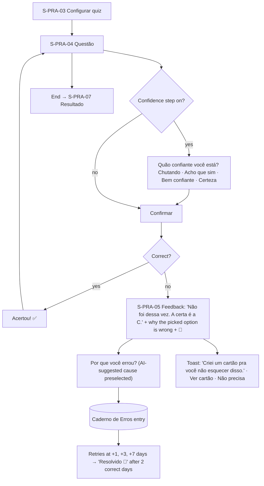

| Step | Screen | IDs |
|---|---|---|
| Configure scope (topic / test / goal), length, types, timer | S-PRA-03 | PRA-01, PRA-03 |
| Answer. Short answers are AI-graded with partial credit ("Quase!") | S-PRA-04 → S-PRA-08 | PRA-01 |
| Wrong → explanation + page link + auto card | S-PRA-05 | PRA-02 |
| Cause: Não sabia · Confundi · Desatenção · Li errado | S-PRA-05 sheet | PRA-04 |
| Result, then "Refazer erros" | S-PRA-07 → S-PRA-09 | PRA-04 |

**Edge paths**
- *Offline:* auto-gradable questions grade locally. Short answers queue: "Vou corrigir quando você tiver internet."
- *Disagree with AI grading:* "Eu discordo da correção" (PRA-01 dispute).
- *Gabarito looks wrong:* ⚑ Reportar erro → UF-13.

---

## UF-07 — Tutor chat with citations → PDF page

**Features:** TUT-01…04, ING-08, TRU-01, SP-10.

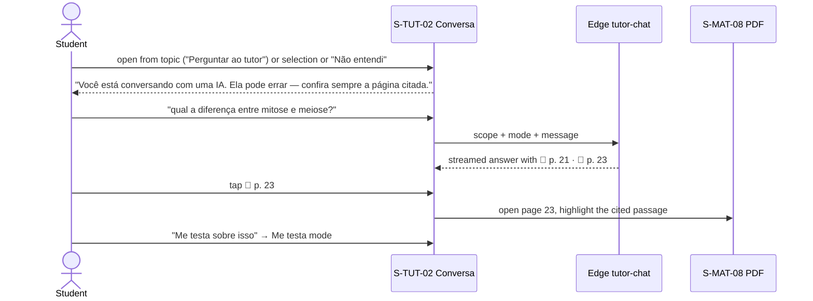

| Step | What happens | IDs |
|---|---|---|
| Entry | From topic / note selection / PDF region / question feedback "Não entendi" / Praticar → Tutor. The scope is preset ("Falando sobre: Biologia ▾"). | TUT-03 |
| Mode | Responder · Socrático · Me testa. | TUT-02 |
| Answer | Streams with inline 📄 chips. Follow-up chips: Explica mais simples · Me dá um exemplo · Me testa sobre isso · Criar cartão. | TUT-01 |
| Citation | Opens S-MAT-08 at the original page with the highlight. Scanned page: no highlight + notice. | ING-08 |
| Not in material | "Isso não está no seu material de {matéria}." + nearest topic + opt-in "Responder com conhecimento geral" (badge "Conhecimento geral"). | TUT-04 |

**Edge paths:** offline → "Sem internet. O tutor precisa de conexão — seus cartões funcionam offline." · daily limit reached → message limit copy + suggestion to review · stream interrupted → "Resposta interrompida · Tentar de novo" · long thread → "Continuar numa nova? Eu levo um resumo."

---

## UF-08 — Log a grade → Quanto preciso tirar? → replan

**Features:** GOL-02.4, GOL-06, GOL-11 (Phase 2), GOL-04.

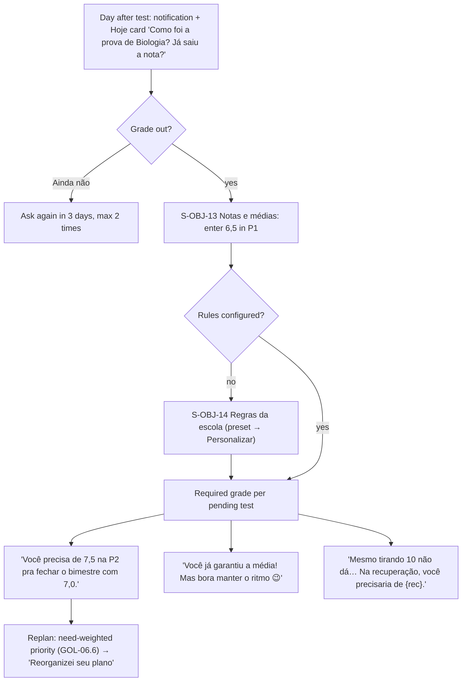

| Step | IDs |
|---|---|
| Ask once after the test date (notification outside quiet hours + Hoje card) | GOL-02.4 |
| Log the grade on the component linked to the test | GOL-06.2 |
| Compute the requirement. Several pending components → same grade on all ("se você tirar a mesma nota em tudo que falta") | GOL-06.3–06.5, learning-engine |
| Replan | GOL-06.6 |
| Predicted-grade calibration (Phase 2) | GOL-11 |

**Edge paths:** grade scale 0–100 or sum of points (preset differences) · recuperação test created from the original ("Criar recuperação", GOL-02.5) · grades are never shared, even when grading rules are shared in a Turma (GOL-06.7).

---

## UF-09 — Modo Véspera

**Features:** GOL-07, MEM-02, PRA-04, WEL-03.

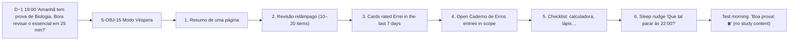

- Calm visual style: no XP, streak or celebration prompts (spec 07 §5.1).
- No new material is introduced. Topics never studied show "Não deu tempo de estudar esse — foca no básico." (GOL-07.3).
- Two tests the next day → one session, time split by weight × (1 − readiness) (GOL-07.4).
- Afternoon test not prepared the evening before → optional 15-min "aquecimento" in the morning (GOL-07.5).
- Offline: the véspera session is pre-downloaded when scheduled. The cheat sheet is generated at D−2 if possible.

---

## UF-10 — Join a Turma from a WhatsApp link

**Features:** SOC-01, SOC-09.4–09.5, PLT-06 · SP-02.

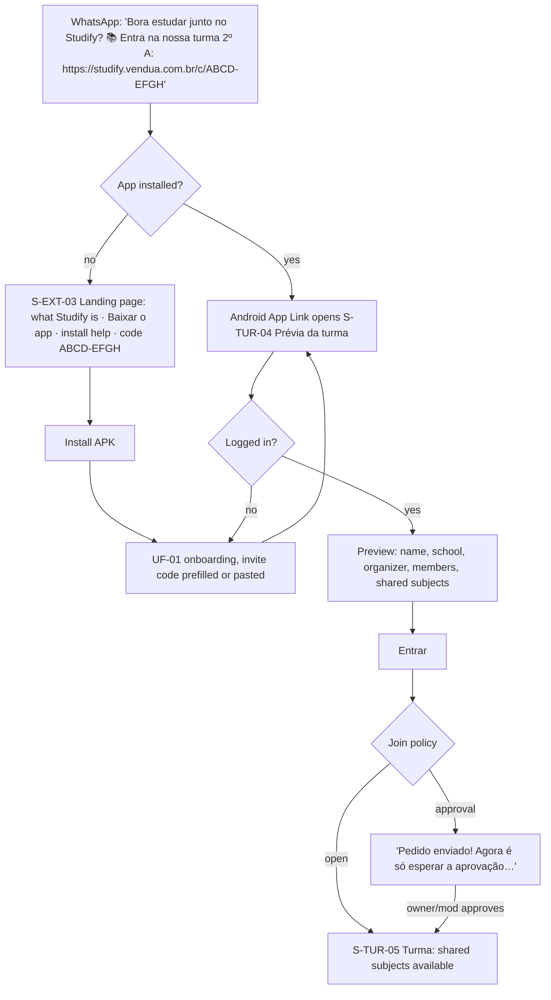

| Step | IDs |
|---|---|
| Owner shares from S-TUR-06 Convidar ("Compartilhar no WhatsApp", QR, "Copiar link") | SOC-01.3, SOC-09.5 |
| App Link → preview. The landing page is the fallback when the app isn't installed | SOC-09.4 |
| Approval (default) or open join | SOC-01.5–01.6 |
| Shared subjects appear without new AI cost | SOC-01.10, SOC-01.13 |

**Edge paths:** expired or invalid code (rate-limited, SOC-01.14) · Turma full at 60 members (SOC-01.7) · user already in 10 Turmas · approval pending for a long time (the owner sees a badge "{n} pedidos para entrar").

---

## UF-11 — Async duel

**Features:** SOC-02, PRA-04, MOT-01.

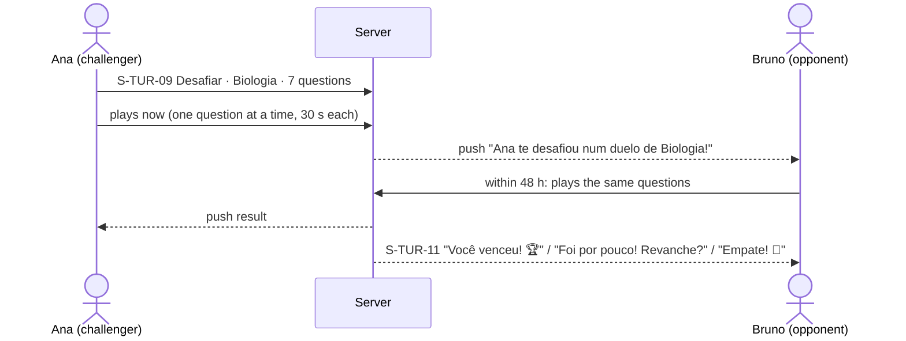

- Questions are served one by one by the server; answers are timed server-side (SOC-02.4).
- Results are visible only to the two players: side by side ✓/✗, times, explanations, 📄 (SOC-02.7).
- Wrong answers create Caderno de Erros entries (SOC-02.8).
- *Edge:* the opponent declines or 48 h pass → "Esse duelo expirou." No penalty (SOC-02.10). Blocked users and users with "Não quero receber desafios" don't appear in the picker (SOC-02.11–02.12).

---

## UF-12 — Live battle

**Features:** SOC-03.

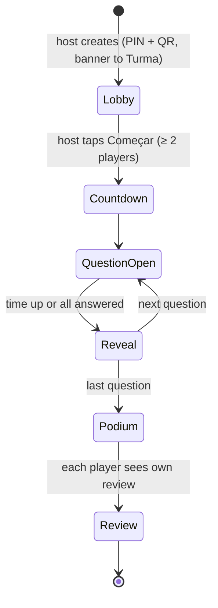

- Lobby (S-TUR-12) shows players live (presence). Late join is allowed until question 3 (SOC-03.7).
- Reveal (S-TUR-13) shows the correct option. Answer distribution appears only if ≥ 5 players answered, and never per player (SOC-03.10).
- Pódio (S-TUR-14): top 5 + "Você ficou em {n}º!", then a personal review with explanations (SOC-03.9).
- *Edge:* the host disconnects → auto-advance (SOC-03.8) · a player loses connection → rejoins with their score kept · fewer than 2 players → "Esperando a galera entrar…"

---

## UF-13 — Flag an error → the fix propagates

**Features:** TRU-02 (flag Phase 1, propagation Phase 2).

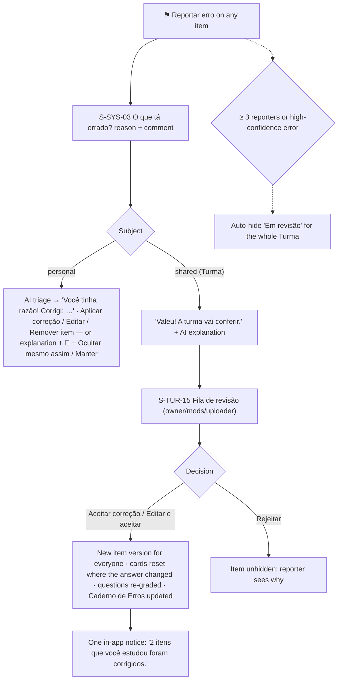

IDs: TRU-02.1–02.11. Reporters whose report is accepted get +5 XP and progress toward "Caçador de erros" (TRU-02.10).

---

## UF-14 — Feed session with a gentle stop

**Features:** FED-01, MEM-02 · SP-06 (no compulsive-use design).

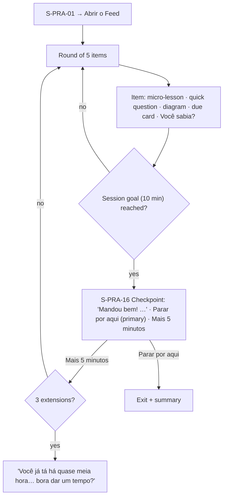

- Due cards in the Feed use two ratings: "← Errei · Lembrei →". Each one is a real FSRS review.
- Daily soft limit (45 min): "Hoje você já estudou 45 min no Feed. Que tal um simulado ou descansar?"
- Late night: "Já tá tarde 😴 Dormir bem também é estudar…"
- Offline: pre-generated items keep working ("Sem internet — o Feed continua funcionando.").

---

## UF-15 — Câmera Mágica on an exercise

**Features:** CAM-02, PRA-01, TUT-03 (capture scope).

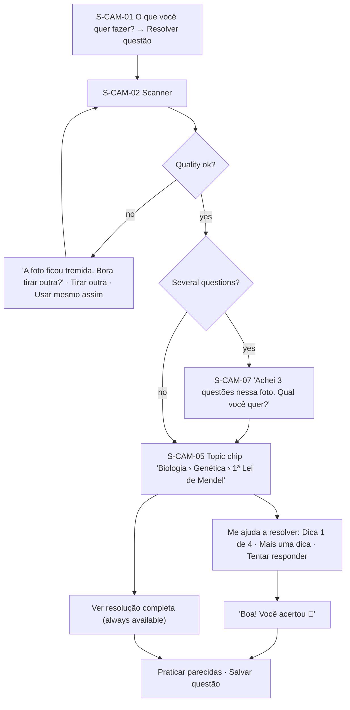

- The hint ladder is the default. The full solution is always one tap away (CAM-02.4–02.5).
- Using hints or the full solution counts as **assisted**: no positive mastery evidence (CAM-02.10).
- *Edge:* part of the question was cut off → "Parte da questão ficou de fora da foto." · not in the material → general explanation labeled "Isso não está no seu material…" · offline → the photo is queued ("Sem internet agora — eu processo assim que você conectar.").

---

## UF-16 — Câmera Mágica on a handwritten answer

**Features:** CAM-03, PRA-07, ENM-05.

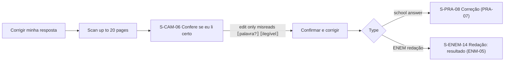

- The transcription is faithful, errors included. The review screen is mandatory before grading (CAM-03.2, CAM-03.4).
- More than 15% of characters edited → the result shows "Transcrição editada por você" (CAM-03.5).
- Legibility feedback: "{n} trechos ficaram difíceis de ler — na prova, letra legível evita perder pontos." (CAM-03.7).

---

## UF-17 — Podcast with ✋

**Features:** INT-01.

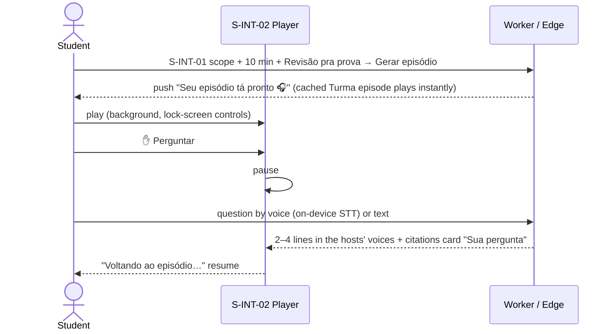

- Hosts: Bia (explains) and Caio (asks) (INT-01.3).
- If the cloud voice takes longer than 6 s, the text appears and is read with on-device TTS (INT-01.11).
- *Edge:* the question is outside the material → "Isso não tá no seu material. Quer perguntar ao tutor?" (spoken register) · "Baixar pra ouvir offline" · notes changed by a TRU-02 fix → "Nova versão disponível".

---

## UF-18 — Ensine o Lucas

**Features:** INT-02.

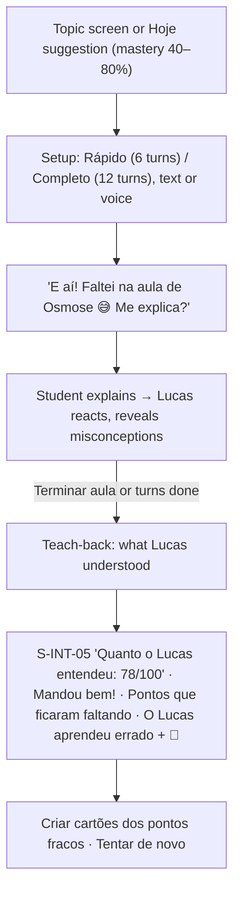

- If the student teaches something wrong, Lucas believes it. The results show the correction with 📄 (INT-02.5).
- A retry uses different misconceptions (INT-02.9).
- Safety: harmful content or distress → Lucas steps out of character, with the CVV resource for distress (INT-02.10).

---

## UF-19 — ENEM onboarding with Meta SISU

**Features:** ENM-01, ENM-06, ENM-07.

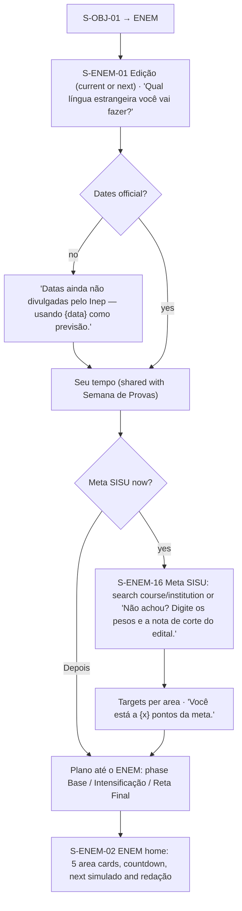

- Subjects map to areas automatically. Tagging against the Matriz de Referência runs in the background (ENM-01.3–01.4).
- Only the cut-off to use is asked for, never why a quota modality applies. Targets are never shared with the Turma (ENM-06.5).
- Coexistence: during a Semana de Provas, the ENEM share of the plan drops to its minimum (ENM-07.7).

---

## UF-20 — Simulado com TRI → results

**Features:** ENM-04, ENM-02, ENM-05 (Day 1 essay).

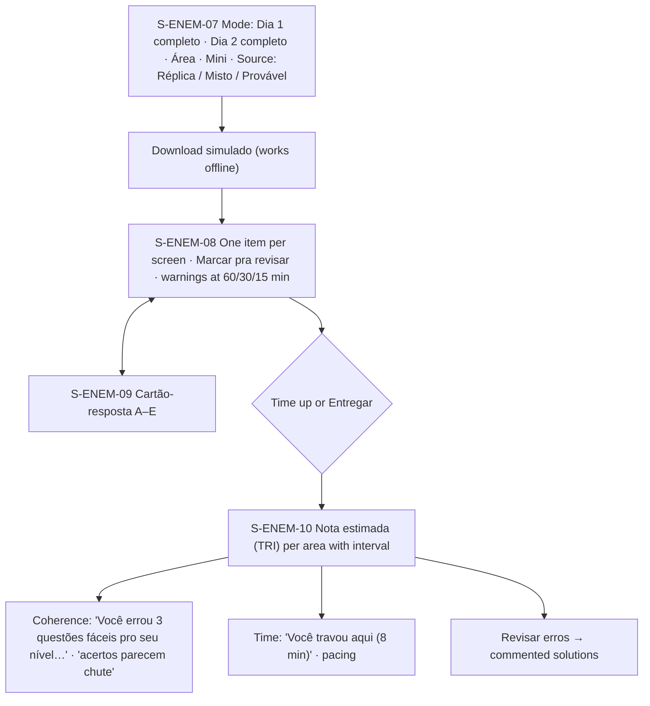

- Every number is labeled "Nota estimada (TRI)" with the footnote "Estimativa do Studify. A nota oficial do Inep pode ser diferente." (ENM-04.10).
- Blanks count as wrong: "Nunca deixe em branco: em branco conta como erro." (ENM-04.7).
- Paused full-day simulados are labeled "Simulado com pausa" (ENM-04.4).
- Day 1 includes the redação (typed in the 30-line editor or photographed → UF-16 → UF-21). Results show 5 separate scores, no total (ENM-04.8).

---

## UF-21 — Correção de Redação

**Features:** ENM-05, CAM-03, ENM-08 (themes).

```mermaid
flowchart TD
  A["S-ENEM-12 Tema: 'Me dá um tema' (predicted / past / Atualidades) or pick"] --> B{Input}
  B -- type --> C["S-ENEM-13 30-line editor · '{n} de 30 linhas'"]
  B -- paper --> D["Câmera → S-CAM-06 Confere se eu li certo"]
  C --> E{"≤ 7 lines?"}
  D --> E
  E -- yes --> Z["'Com até 7 linhas, a redação leva nota zero.' (checked before any AI call)"]
  E -- no --> F["'Corrigindo sua redação… te aviso quando ficar pronta.'"]
  F --> G["S-ENEM-14 Nota estimada · C1–C5 with evidence · Proposta checklist · Repertório ✅ ⚠️ ❌ · 2 rewrites"]
  G --> H["S-ENEM-15 Evolução por competência"]
```

- Human-rights violation → C5 = 0, not the whole essay: "Essa proposta desrespeita os direitos humanos: a Competência 5 fica com zero." (ENM-05.4).
- Budget: 3 corrections per week by default. The 4th attempt shows the weekly-limit message (ENM-05.9).
- Unverified repertório: "Não consegui confirmar essa referência. Confira antes de usar." (ENM-05.5).

---

## UF-22 — Data export and account deletion

**Features:** SP-14 · security-privacy §10.

```mermaid
flowchart TD
  P["S-PERF-11 Privacidade"] --> X["Baixar meus dados"]
  X --> X1["Export job → ZIP (JSON + CSV of cards + personal uploads), link valid for 7 days, notified when ready"]
  P --> D["Excluir minha conta → S-PERF-12"]
  D --> D1["Explain what is deleted · choice 'Apagar também o que eu compartilhei'"]
  D1 --> D2["Re-authentication code"]
  D2 --> D3["Type EXCLUIR to confirm"]
  D3 --> D4["Signed out · local data wiped · confirmation in-app + e-mail · completed within 15 days"]
```

- Shared documents stay with the Turma (uploader shown as "ex-membro") unless the student chooses to delete them too.
- Turma ownership: an owner must transfer ownership first, or the Turma is deleted via SOC-01.15.
- Guardians of users under 16 can request deletion through the supervision panel (SP-04, Phase 2).

---

## UF-23 — Modo Desespero (test in less than a week)

```mermaid
flowchart TD
  A[Student adds a test 4 days away<br/>no sessions yet] --> B{Eligible?<br/>GOL-12.1}
  B -- no --> N[Normal plan]
  B -- yes --> C[S-OBJ-17 offer]
  C -- Agora não --> N
  C -- Ativar --> D[S-OBJ-18 Diagnóstico rápido<br/>≤ 12 questions]
  D -- Pular --> E
  D --> E[Time: 1h / 2h / 3h / 4h]
  E --> F[S-OBJ-19 Plano de ataque<br/>Foco total · Só o básico · Fica de fora<br/>~coverage %]
  F --> G[Hoje: 25-min loops<br/>Resumo rápido → cards → questions]
  G --> H[D−1 Modo Véspera]
  H --> I[Test] --> J[Log grade · offer reminder<br/>2 weeks before next test]
```

| Step | What happens | IDs |
|---|---|---|
| 1 | A test 6 days away or less with low coverage/readiness or no sessions triggers the offer | GOL-12.1 |
| 2 | Optional diagnostic sets mastery per topic | GOL-12.3 |
| 3 | Student picks daily time (max 4 h) | GOL-12.4 |
| 4 | Plano de ataque with coverage estimate; topics can be moved between groups | GOL-12.5 |
| 5 | If content is still generating, Foco total topics are generated first on the standard API | GOL-12.8 |
| 6 | Daily sessions with breaks; stop suggestion after 3 h | GOL-12.7, GOL-12.10 |
| 7 | Véspera on D−1; mode ends after the test | GOL-07, GOL-12.11 |

**Edge paths:** test today or tomorrow → diagnostic max 6, no mini-simulado (GOL-12.12); budget exhausted → Foco total generated first, the rest waits (PLT-04); several tests in the window → one plano de ataque across all of them (GOL-12.2).

## Cross-cutting failure paths

| Situation | Where it shows | Behavior | Copy (PT-BR) |
|---|---|---|---|
| **No internet** | Persistent top banner; AI buttons disabled with explanation | Reviews, cached notes, downloaded quizzes, Feed items and plan keep working; mutations queue in the outbox | "Sem internet — revisões e resumos baixados continuam funcionando." |
| **Per-user daily AI budget exhausted** | Banner on AI surfaces; AI buttons disabled | Non-AI features keep working; queued generation resumes the next day | "Seu limite de IA de hoje acabou. O que não precisa de IA continua funcionando — e eu continuo o resto amanhã." |
| **Turma budget ≥ 90%** | Turma home banner (members) / usage numbers (owner) | Shared generation slows or pauses at 100% | "A turma está perto do limite de IA deste mês." |
| **Global cap reached** | App-wide banner | Only reviews and offline features | "A IA do Studify está pausada por hoje. Seus cartões e resumos continuam aqui." |
| **Generation failed** | Item placeholder or processing card | One automatic retry, then a manual retry | "Algo deu errado ao preparar isso. · Tentar de novo" |
| **Bad photo** | Inline over the thumbnail (S-CAM-03) | Specific problem, retake or continue | "A foto ficou tremida. Bora tirar outra?" · "Usar mesmo assim" |
| **Rate limited** | Toast | Retry after a short wait | "Calma! Tenta de novo em instantes." |
| **App too old** | S-SYS-01 | Blocks use until updated (sync schema change) | "Tem uma versão nova do Studify. Atualize pra continuar." |
| **AI refusal** | Inline in the AI surface | No raw error; offer to rephrase | "Não consigo ajudar com isso aqui. Quer perguntar de outro jeito?" |
| **Distress detected** (`[[APOIO]]`) | Any conversational feature | Steps out of the task with care + CVV resource | "Precisa conversar? O CVV atende de graça, 24 horas, pelo 188 ou no chat em cvv.org.br. Em emergência, ligue 192." |
