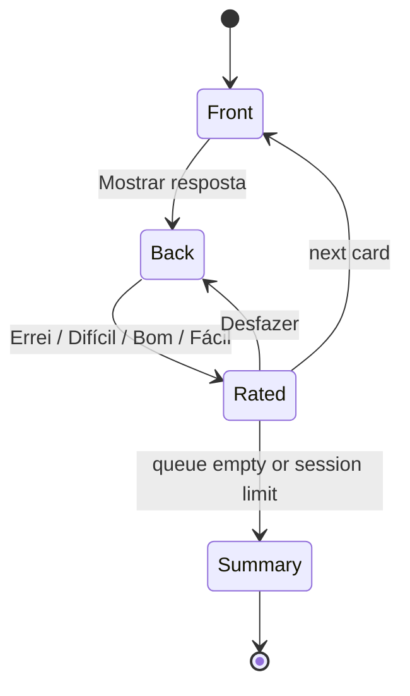

# 04 — Flashcards & memory

| Status | Phase(s) | Features |
|---|---|---|
| Draft v1 | 1 (MEM-01, MEM-02) · 2 (MEM-04, MEM-05) · 3 (MEM-03) · 5 (MEM-06) | MEM-01, MEM-02, MEM-03, MEM-04, MEM-05, MEM-06 |

Related: [PRD](../product/PRD.md#54-remember-mem) · [Architecture](../engineering/architecture.md) · [05 — Practice & exams](05-practice-exams.md) (cards created from mistakes) · [06 — Feed de Estudos](06-feed-de-estudos.md) (reviews in the feed) · [07 — Goals & Semana de Provas](07-goals-semana-de-provas.md) (plan, Modo Véspera) · [learning-engine.md](../engineering/learning-engine.md)

---

## 1. Summary

Studify generates flashcards from every topic of the knowledge map, schedules them with **FSRS** on the device (works offline), and bends the schedule around the student's real exam dates so that everything in a test's scope is fresh on test day. Cards can be reviewed in a session, from a home-screen widget or from a notification. The **Mapa da Memória** shows which concepts are fading. Later phases add image-occlusion cards for diagrams and a mnemonics studio.

## 2. Goals and non-goals

**Goals**
- Good cards without effort: atomic, grounded in the material, each with a 📄 page link.
- A schedule that is scientifically sound (FSRS, desired retention 90%) **and** exam-aware.
- Reviews are instant and work with no internet.
- Short, phone-friendly sessions; reviews possible in 30 seconds from the home screen.
- Make forgetting visible (Mapa da Memória) so students act before it's too late.

**Non-goals**
- An Anki clone with decks, note types and add-ons. One card model, minimal settings.
- Importing/exporting Anki decks (Phase 5 candidate at most; not in this spec).
- A second AI pass that verifies every generated card (PRD §6). Trust = page citations + TRU-02 flag.
- Audio cards / text-to-speech on cards (WEL-04 read-aloud covers accessibility).

## 3. User stories

| # | As a… | I want… | So that… |
|---|---|---|---|
| U1 | student | cards to appear automatically after I upload my Biologia PDF | I start reviewing in minutes |
| U2 | student | to see where each card came from in the PDF | I trust it and can read more |
| U3 | student | to fix a card that's badly written | my reviews make sense |
| U4 | student | reviews to work on the bus without internet | I use dead time |
| U5 | student with a test on Friday | everything on the test to be reviewed before Friday | I don't forget something I learned 3 weeks ago |
| U6 | student | to know how many new cards to learn per day to cover the content in time | I don't cram |
| U7 | student | to review 2 cards from my home screen without opening the app | I keep up with almost no effort |
| U8 | student | to see what I'm forgetting | I review the right things |
| U9 | student in a Turma | to edit a shared card without changing it for everyone | I personalize safely |
| U10 | student | to learn diagram labels (e.g. cell parts) | I can answer image questions |
| U11 | student stuck on a card | a memory trick | I finally remember it |

## 4. Functional requirements

### MEM-01 — Auto-generated flashcards

- **MEM-01.1** After the knowledge map is built (ING-03), the worker generates cards for every topic that is not `excluded`, via the Message Batches API. Target count per topic: `clamp(3 × concepts_in_topic, 8, 30)`.
- **MEM-01.2** Card types:
  - `basic` — front (question) / back (answer).
  - `cloze` — a sentence with one hidden part. Source text uses `{{c1::texto}}` or `{{c1::texto::dica}}`. A sentence with several deletions produces **sibling cards** (one per `cN`), sharing a `sibling_group_id`.
  - `reverse` — a basic card that is also studied backward. Stored as **two cards** (forward + backward) sharing a `sibling_group_id`. Only for term ↔ definition and vocabulary.
  - `image_occlusion` — see MEM-03.
- **MEM-01.3** Every card stores `source_pages` (`{document_id, page_start, page_end}[]`, original page numbers) and shows a 📄 chip that opens the PDF viewer (ING-08) at that page.
- **MEM-01.4** Cards follow the generation rules in §8.1. Items that fail deterministic validation (§8.2) are dropped; if more than 30% of a topic's cards are dropped, the topic is regenerated once.
- **MEM-01.5** No duplicates: a new card whose normalized front+back has trigram similarity ≥ 0.85 with an existing card **in the same subject** is dropped (applies to initial generation, "Gerar mais cartões" and new material merged into a subject).
- **MEM-01.6** "Gerar mais cartões" on a topic generates up to 10 additional cards synchronously (standard API, not batch), excluding existing ones. Subject to PLT-04 budget.
- **MEM-01.7** Users can create their own cards (`origin = user`): from scratch, from a text selection in notes (LRN-01), or from a selection in the PDF viewer ("Criar cartão" → AI drafts front/back from the selection, user edits before saving; one synchronous call, effort `low`).
- **MEM-01.8** Cards created from mistakes (`origin = from_mistake`) come from [PRA-02](05-practice-exams.md#pra-02--wrong-answer-explanation--page-link--auto-flashcard).
- **MEM-01.9** Editing:
  - On a **personal** subject, the edit changes the card. If the user marks "Mudou o sentido do cartão", the card's FSRS state is reset to New; otherwise the state is kept.
  - On a **shared** (Turma) subject, the edit creates a per-user `card_overrides` row; the user is offered "Sugerir correção pra turma", which files a TRU-02 flag with the proposed text.
  - Only the uploader, the Turma owner or moderators can edit shared cards for everyone.
- **MEM-01.10** Per-user actions on any card: **Suspender** (stop scheduling; reversible), **Excluir pra mim** (hidden; reversible from "Cartões ocultos"), **Avisar erro** (TRU-02 flag). Deleting a personal card the user created is a real delete (review history kept for stats).
- **MEM-01.11** Cards of topics marked `excluded` ("não cai na prova") are never introduced as new. Already-introduced cards keep their schedule; the user is offered "Pausar cartões desse tópico" (bulk suspend).
- **MEM-01.12** Card content is Markdown with KaTeX math. Cards may embed one image (a crop of a PDF page, stored in Storage).
- **MEM-01.13** Card browser per subject: list by topic, search (front/back text), filters (novo / aprendendo / revisão / suspenso / oculto / com erro avisado), counts per state.

### MEM-02 — FSRS scheduling and review sessions

- **MEM-02.1** Scheduling uses `ts-fsrs` (version pinned in `packages/shared`), executed **on device** for every review. The same package version runs in the worker for server-side replay.
- **MEM-02.2** Ratings shown as 4 buttons: **Errei** (Again=1), **Difícil** (Hard=2), **Bom** (Good=3), **Fácil** (Easy=4). Each button shows the resulting interval ("<1 min", "10 min", "3 dias", "2 sem.").
- **MEM-02.3** Defaults: desired retention **0.90** (setting "Meta de lembrança", allowed 0.80–0.95), learning steps 1 min / 10 min, relearning step 10 min, maximum interval 365 days, new cards per day 20 (overridden by the plan, §8.4), maximum reviews per day 200.
- **MEM-02.4** The review queue is built on device from SQLite according to §8.3, optionally filtered by subject, goal or exam ("Revisar só Biologia").
- **MEM-02.5** **Exam-aware scheduling**: for cards in the scope of an upcoming exam, an *effective due date* overlay guarantees a review before the exam when predicted retrievability on exam day is below target (§8.5). The overlay never modifies FSRS state; the review itself is a normal FSRS review logged with `reason = exam_boost`. Boosted cards show the tag "Reforço pra prova".
- **MEM-02.6** Review flow: front → "Mostrar resposta" (tap anywhere) → back + 📄 chip → rating. Available on every card: edit, suspend, flag, "Explica de outro jeito" (LRN-03).
- **MEM-02.7** Sibling burying: after reviewing a card, its siblings (same `sibling_group_id`) are not shown again until the next study day.
- **MEM-02.8** Undo: the last rating in the current session can be undone. Undo appends a review log with `undoes_log_id`; replay ignores both rows (review logs stay append-only).
- **MEM-02.9** Each review records duration (ms, capped at 60 s for statistics), source (`session` / `feed` / `widget` / `notification` / `map` / `vespera`) and device id.
- **MEM-02.10** Offline-first sync (architecture §4.2): reviews are written to SQLite and to an outbox with a client UUID; the server inserts idempotently and recomputes `card_states` by replaying logs in `reviewed_at` order.
- **MEM-02.11** Session lengths: "Revisar tudo" (all due), "5 minutos", "20 cartões". A session ends with a summary (cards reviewed, accuracy, time, next due count).
- **MEM-02.12** Leeches: a card with `lapses ≥ 6` (and every 3 lapses after) is marked leech; on the next lapse the user sees "Esse cartão tá difícil de fixar" with actions: rewrite it, create a mnemonic (MEM-06, when available), see a different explanation (LRN-03), or suspend. No automatic suspension.
- **MEM-02.13** The study day starts at **04:00 local time** (late-night studying counts for the previous day).
- **MEM-02.14** Parameter optimization: once a user has ≥ 1,000 valid review logs, the worker trains personal FSRS parameters weekly (§8.6). New parameters sync to the device; existing due dates are rescheduled with ts-fsrs's reschedule function, keeping history.
- **MEM-02.15** Changing "Meta de lembrança" reschedules existing due dates on device the same way.
- **MEM-02.16** Backlog recovery: when due reviews exceed 3 × the daily maximum (e.g. after a break), the app offers "Modo recuperação": the backlog is spread over up to 7 days, in priority order (§8.3), and new cards pause until the backlog falls below the daily maximum.

### MEM-03 — Image-occlusion cards (Phase 3)

- **MEM-03.1** Sources: a region selected in the PDF viewer ("Recortar imagem"), a figure already extracted for the Feed (FED-01), or a photo (CAM-01).
- **MEM-03.2** Mask suggestion: on-device text recognition (Google ML Kit, Latin script) detects text boxes in the image and proposes them as masks. The user toggles, resizes, adds (draw rectangle) and deletes masks. No AI call is required.
- **MEM-03.3** Modes: **Esconder um** (one mask hidden, others visible) and **Esconder todos** (all hidden, one is asked). Default: Esconder todos.
- **MEM-03.4** Each mask becomes one card; all cards from the same image share a `sibling_group_id` (buried per MEM-02.7).
- **MEM-03.5** Review: the masked area is highlighted; "Mostrar resposta" reveals the label. Pinch-to-zoom is supported on the image.
- **MEM-03.6** Masks use normalized coordinates (0–1), so the card renders correctly at any screen size.
- **MEM-03.7** Image-occlusion cards created on a shared subject are personal by default; the creator can choose "Compartilhar com a turma" (only for owner/moderators or the uploader, per architecture §3.2).

### MEM-04 — Review anywhere (Phase 2)

- **MEM-04.1** **Home-screen widget** (`react-native-android-widget`), sizes 2×2 and 4×2: shows the front of the highest-priority due card → "Mostrar" → back → **Errei** / **Lembrei** (mapped to Again / Good). After rating, the next card is shown; when nothing is due: "Tudo revisado por hoje ✨".
- **MEM-04.2** Widget eligibility: only cards whose front ≤ 140 characters and back ≤ 200 characters, without LaTeX or images. If the next card is not eligible, the widget shows "Próximo cartão tem fórmula/imagem — abrir no app".
- **MEM-04.3** The widget reads the queue from the shared SQLite database and writes reviews to the same outbox (source `widget`). Ratings work offline.
- **MEM-04.4** Widget refresh: immediately after every interaction; otherwise on Android's periodic update (minimum 30 min) and when the app syncs.
- **MEM-04.5** **Answer from notification**: a local notification "3 cartões quase esquecendo. 1 minutinho?" carries the front of the first card and actions **Mostrar resposta** → (notification updates with the back) → **Errei** / **Lembrei**. If in-place updates are not feasible on a given device, actions open the app on a one-card mini review (see Open questions).
- **MEM-04.6** Notification rules (minors): at most 3 review prompts per day; never during quiet hours (default 22:00–07:00, configurable); optional "Horário de aula" window (off by default); off entirely with one switch ("Lembretes de revisão"). Prompts are sent only when ≥ 3 eligible cards are due and the user hasn't reviewed in the last 3 hours.
- **MEM-04.7** Widget and notification reviews count toward plan items and streaks exactly like in-app reviews.

### MEM-05 — Mapa da Memória (Phase 2)

- **MEM-05.1** A visual map of the subject's concepts, grouped by topic (clusters) and connected by prerequisite edges (`node_prerequisites`). Each concept is drawn with a **glow** whose brightness reflects current retrievability (§8.7).
- **MEM-05.2** Status bands (also shown as icon + label, never color alone): **Forte** (R ≥ 0.90), **Ok** (0.75–0.90), **Apagando** (0.50–0.75), **Quase esquecido** (< 0.50), **Ainda não estudado** (no introduced cards and no question evidence).
- **MEM-05.3** Time slider: "Agora" / "Daqui a 3 dias" / "Daqui a 7 dias" / "No dia da prova" (when the subject has an upcoming exam) shows predicted retrievability without reviews.
- **MEM-05.4** Tapping a concept opens a sheet: name, R %, number of cards (due / total), last review, link to notes, and **Reacender**: a mini session with that concept's due and near-due cards (reviews are real FSRS reviews, source `map`; early reviews are allowed and handled by FSRS).
- **MEM-05.5** "Reacender tudo que tá apagando" starts a session with all concepts in the Apagando + Quase esquecido bands, sorted by exam urgency.
- **MEM-05.6** Levels: subject view shows topics (aggregated); tapping a topic zooms into its concepts. Maximum ~150 concept nodes rendered at once; beyond that, only topic level with drill-down.
- **MEM-05.7** An accessible **list view** (sorted by R ascending) is always available as an alternative to the graph.
- **MEM-05.8** Computed on device from SQLite (`card_states`, `mastery`); works offline.

### MEM-06 — Estúdio de Mnemônicos (Phase 5)

- **MEM-06.1** Entry points: any card ("Criar mnemônico"), any concept, leech prompt (MEM-02.12), and lists inside notes (e.g. "as 7 etapas da mitose").
- **MEM-06.2** Types: **Acrônimo** (initial letters form a word), **Frase** (sentence whose word initials encode the list), **Rima/Música** (short rhyme), **Historinha** (vivid short story linking items), **Palácio da memória** (ordered items placed along the loci of a place the user knows), **Palavra-chave** (sound-alike keyword for foreign vocabulary).
- **MEM-06.3** The AI proposes 3 options; the user picks, edits or asks for another round ("Outras ideias").
- **MEM-06.4** The chosen mnemonic is attached to the card (or concept) **for that user**, shown on the back after reveal and available before reveal behind "Ver dica" (using the hint doesn't change the rating options, but is logged).
- **MEM-06.5** Memory palaces: the user creates a palace once ("Minha casa": portão → sala → cozinha → …, up to 20 loci) and reuses it; the AI places items in order onto loci.
- **MEM-06.6** Content must be appropriate for minors (no sexual, violent or offensive associations), in PT-BR.

## 5. UX and screens

| Screen | Purpose |
|---|---|
| **Revisão** (review session) | Card front/back, rating buttons with intervals, progress bar, tags (Reforço pra prova, Novo), actions menu |
| **Fim da sessão** | Summary + next step (from plan) |
| **Cartões da matéria** (browser) | List/search/filter cards by topic and state |
| **Editor de cartão** | Edit front/back (Markdown + math preview), type, image, source pages |
| **Recortar imagem / Máscaras** (MEM-03) | Crop, ML Kit mask suggestions, mask editing |
| **Mapa da Memória** (MEM-05) | Graph + time slider + list view |
| **Widget** (MEM-04) | 2×2 / 4×2 |
| **Ajustes → Memória** | Meta de lembrança, cartões novos por dia, máximo de revisões, lembretes, horário silencioso |
| **Estúdio de Mnemônicos** (MEM-06) | Options, editor, palaces |

**Key PT-BR strings**

| Context | String |
|---|---|
| Today card | "Você tem **34 cartões** pra revisar (≈ 8 min)" · "Revisar agora" |
| Reveal | "Mostrar resposta" |
| Ratings | "Errei" · "Difícil" · "Bom" · "Fácil" |
| Exam tag | "Reforço pra prova · Biologia em 3 dias" |
| New tag | "Novo" |
| Session end | "Sessão concluída! 🎉 Você revisou 40 cartões em 12 min." |
| Undo | "Desfazer" |
| Edit shared | "Essa edição vale só pra você. Quer sugerir a correção pra turma?" · "Sugerir correção" |
| Meaning changed | "Mudou o sentido do cartão? (o progresso dele recomeça)" |
| Suspend / hide | "Suspender" · "Excluir pra mim" · "Cartões ocultos" |
| Flag | "Esse cartão tem erro? Avisar" |
| Generate more | "Gerar mais cartões" · "Gerando… isso leva uns segundos" |
| Leech | "Esse cartão tá difícil de fixar. Quer reescrever, criar um macete ou ver uma explicação diferente?" |
| Excluded topic | "Esse tópico não cai na prova. Pausar os cartões dele?" |
| Too much content | "Tem muito conteúdo pra pouco tempo: seriam 85 cartões novos por dia. Quer marcar tópicos que não caem ou priorizar as provas mais próximas?" |
| Recovery | "Acumulou bastante revisão (620). Bora espalhar em 5 dias? (Modo recuperação)" |
| Map | "Mapa da Memória" · "Forte" · "Ok" · "Apagando" · "Quase esquecido" · "Ainda não estudado" · "Reacender" · "Como vai estar daqui a 7 dias" · "No dia da prova" |
| Widget | "Mostrar" · "Errei" · "Lembrei" · "Tudo revisado por hoje ✨" · "Próximo cartão tem fórmula — abrir no app" |
| Notification | "3 cartões quase esquecendo. 1 minutinho?" |
| Settings | "Meta de lembrança: 90%" · "Cartões novos por dia" · "Lembretes de revisão" · "Horário silencioso" |
| Mnemonics | "Criar macete" · "Ver dica" · "Outras ideias" · "Palácio da memória" |

UI uses "macete" (common Brazilian term for memory trick) in buttons; the feature name stays "Estúdio de Mnemônicos".

## 6. Data

**Entities used:** `cards`, `card_states`, `review_logs`, `knowledge_nodes`, `node_sources`, `node_prerequisites`, `exams`, `goals`, `plan_items`, `mastery`, `content_flags`, `ai_usage`, `ai_jobs`, `profiles.settings`, `documents`.

### New entities / fields

| Table | Column | Type | Purpose |
|---|---|---|---|
| `cards` | `sibling_group_id` | uuid, nullable | Groups cloze siblings, reverse pairs and image-occlusion masks (burying) |
| `cards` | `cloze_index` | int, nullable | Which `cN` this card asks |
| `cards` | `concept_id` | uuid → `knowledge_nodes` | The concept the card tests (cards hang off a topic via `node_id`; concept used for the map) |
| `cards` | `status` | enum `active` / `archived` | Archived when shared card is deleted by owner (history kept) |
| `cards` | `prompt_version`, `gen_batch_id` | text, uuid | Traceability of generation |
| `cards` | `media` | jsonb | Image: `{path, width, height}`; image occlusion: `{path, width, height, mode: "hide_one"|"hide_all", masks: [{id, x, y, w, h, label}], target_mask_id}` (x/y/w/h normalized 0–1) |
| `card_states` | `hidden` | bool | "Excluir pra mim" |
| `card_states` | `is_leech` | bool | Leech marker |
| `card_states` | `introduced_at` | timestamptz | When the card left New (for new-card accounting) |
| `review_logs` | `source` | enum `session` / `feed` / `widget` / `notification` / `map` / `vespera` | Where the review happened |
| `review_logs` | `reason` | enum `scheduled` / `exam_boost` / `early` | Why it was shown |
| `review_logs` | `undoes_log_id` | uuid, nullable | Undo marker (MEM-02.8) |
| `review_logs` | `duration_ms` | int | Time to answer |
| `review_logs` | `client_reviewed_at` | timestamptz | Raw device timestamp (server may clamp `reviewed_at`) |
| `review_logs` | `hint_used` | bool | Mnemonic hint viewed before reveal (MEM-06.4) |
| **`card_overrides`** (new) | `user_id`, `card_id`, `front`, `back`, `media`, `updated_at` | — | Personal edits on shared cards |
| **`mnemonics`** (new) | `id`, `user_id`, `card_id` (nullable), `node_id` (nullable), `type`, `content` jsonb, `palace_id` (nullable), `created_at` | — | MEM-06 |
| **`memory_palaces`** (new) | `id`, `user_id`, `name`, `loci` jsonb (ordered list of strings) | — | MEM-06.5 |
| `profiles.settings.memory` | `desired_retention`, `new_per_day`, `max_reviews_per_day`, `fsrs_params`, `fsrs_params_version`, `fsrs_optimized_at`, `reminders_enabled`, `quiet_hours {start,end}`, `class_hours` (nullable) | jsonb | Settings |

Local only (SQLite): `queue_cache` (card id, effective due, priority, boost exam id) recomputed on app start, after sync and at the study-day boundary; read by the widget.

## 7. AI behavior

All calls: model `claude-opus-5-5`, adaptive thinking (default), effort set explicitly, server-side fallbacks (`fallbacks: "default"` with the server-side fallback beta), `stop_reason` checked (including `refusal` and `max_tokens`), PLT-04 budget checked **before** the call, one `ai_usage` row per call with the feature ID. Outputs validated with Zod.

| Task | Feature | Mode | Effort | Inputs | Output (structured, `output_config.format`) |
|---|---|---|---|---|---|
| Generate topic cards | MEM-01.1 | **Batch**, worker | `medium` | Frozen system prompt (rules §8.1) → topic PDF slice as `document` block (**cache_control**, shared with notes/questions/feed generation for the same topic) → topic JSON (concepts with ids, key terms, objectives) + list of existing card fronts in the subject + target count + material language | `{cards: [{type: "basic"\|"cloze"\|"reverse", front, back, cloze_text?, concept_id, source_pages: [{document_id, page_start, page_end}], difficulty_estimate: 1–5}]}` |
| Generate more cards | MEM-01.6 | Sync, Edge Function | `medium` | Same as above, target ≤ 10, existing fronts of the topic | Same schema |
| Card from selection | MEM-01.7 | Sync | `low` | Selected text (or page image region) + concept candidates of that page | `{front, back, type, concept_id}` (one card) |
| Mnemonic options | MEM-06.3 | Sync | `medium` | Card/concept text, requested type (or "any"), palace loci if type = palace, language | `{options: [{type, title, content, how_to_use}]}` (3 items) |

- **Page numbers.** The slice sent is labeled in the prompt with its original document id and page range (e.g. "Documento X, páginas originais 12–19"). Returned `source_pages` must fall inside that range; otherwise the card is dropped (MEM-01.4).
- Card generation from mistakes is part of the question-generation output (PRA-02); no extra call at answer time.
- Image occlusion (MEM-03), FSRS (MEM-02), widget (MEM-04) and the map (MEM-05) use **no AI**.
- Material and user text are passed as data; prompts instruct the model to ignore instructions found inside documents.

## 8. Rules and algorithms

### 8.1 Card generation rules (prompt + validation)

1. **Atomic:** one fact or idea per card. Target answer ≤ 15 words; hard limits front ≤ 200 chars, back ≤ 300 chars.
2. **Specific, unambiguous question:** "Qual organela produz ATP?" — not "Fale sobre a mitocôndria". No yes/no questions.
3. **Context prefix** when a term is ambiguous across subjects ("Em Química: …").
4. **Lists > 3 items** are split into several cards or cloze siblings (and later suggested for a mnemonic).
5. **Cloze:** the deletion is a key term/number/name, never a trivial word; the remaining sentence must make the answer uniquely determinable; ≤ 3 deletions per sentence.
6. **Reverse** only for term ↔ definition and vocabulary, where both directions make sense.
7. **Mix of knowledge types:** definitions, cause → effect, comparisons, steps of a process, examples, formulas (LaTeX; ask about meaning/use, not just symbols).
8. **Grounded:** only information present in the material; every card has `source_pages`.
9. **Language:** the material's language (ING-05).
10. **Priority:** learning objectives and key terms from the knowledge map come first.

### 8.2 Deterministic validation

Drop a generated card if any is true: length limits exceeded; cloze card without valid `{{cN::…}}` syntax; the answer appears verbatim in the front; `concept_id` not in the topic; `source_pages` outside the sent range; trigram similarity ≥ 0.85 with an existing card in the subject (normalized: lowercase, accents and punctuation removed, Markdown/LaTeX stripped) or with another card in the same batch.

### 8.3 Review queue

Built on device for "now" (study day boundary 04:00):

1. **Learning / relearning** cards whose step is due.
2. **Due reviews**, where *effective due* = `min(fsrs_due, exam_due)` (§8.5) ≤ end of today. Order: effective due ascending, then retrievability ascending.
3. **New cards** up to today's new limit (§8.4). Order: soonest exam first, then knowledge-map order (unit → topic → concept order), so prerequisites come first. New cards are interleaved: 1 new after every 4 reviews.

If due reviews exceed `max_reviews_per_day`, select by priority:

`priority = (1 − R_now) × (1 + exam_factor)`, with `exam_factor = exam.weight_norm × (1.0 if exam ≤ 7 days, 0.5 if ≤ 14 days, else 0)`, where `exam.weight_norm` is the exam's weight divided by the max weight in the goal (0–1].

Siblings of a card reviewed today are excluded (MEM-02.7). Suspended/hidden cards and cards of archived subjects are excluded.

### 8.4 New-card limit (tied to the plan)

For each upcoming exam `E` in the next 30 days:
- `N_E` = new (never introduced) cards in `E.scope` (scope nodes + descendants, not `excluded`, not suspended/hidden).
- `days_E = max(1, days_until(E) − 2)` (the last 2 days are review-only).

`required = Σ_E ceil(N_E / days_E)` (a card in the scope of several exams counts for the earliest one only).

`new_limit_today = min(60, max(settings.new_per_day, required))`.

If `required > 60`, the planner (GOL-04) shows the "too much content" warning and introduces cards by exam date, then exam weight. The planner reads `required` to size `plan_items` of activity `learn`; cards introduced via the Feed (FED-01) count against the same limit.

### 8.5 Exam boost (exam-aware overlay)

Applies to exams with `starts_at` within the next **14 days**. For each *introduced*, non-suspended card in an exam's scope:

- `R_T` = predicted FSRS retrievability at `exam.starts_at` if the card is **not** reviewed before then.
- If `fsrs_due < day(T) − 1` → no overlay needed now (FSRS will show it first; the rule re-evaluates after that review).
- Else if `R_T ≥ r_exam` (default 0.90, follows "Meta de lembrança") → no overlay.
- Else `exam_due = day(T) − d`, where `d = 1` if `R_T ≥ 0.75`, and `d = 3` if `R_T < 0.75` (leaves room for a second review, after which the rule runs again and may set `exam_due = day(T) − 1`).
- `exam_due` is never earlier than today; if `day(T) − d` has passed, `exam_due = today`.

Cards in the scope of several exams use the earliest resulting `exam_due`. The overlay is recomputed on app start, after every sync, at the study-day boundary and whenever an exam or its scope changes. Exams in the past (or `status` done/cancelled) produce no overlay. **Goal metric:** ≥ 95% of in-scope introduced cards with `R ≥ r_exam` at exam start (see §10).

### 8.6 Personal parameter optimization

- Trigger: weekly worker job, for users with ≥ 1,000 valid logs (excluding undone pairs and logs with `reason = early` from the map within 10 min of a previous review).
- Train with the official FSRS optimizer (fsrs-rs, via its Node binding) on the user's logs; evaluate on the chronologically last 20% vs the current parameters (log loss).
- Adopt only if log loss improves by ≥ 1%; store in `profiles.settings.memory.fsrs_params` with a new version; the device reschedules due dates on next sync (MEM-02.14).

### 8.7 Mapa da Memória aggregation

- `R_card(t)` = ts-fsrs retrievability of the card at time `t` (introduced, not suspended/hidden).
- `R_concept(t)` = mean of `R_card(t)` over the concept's cards. If the concept has no introduced cards but `mastery.evidence_count ≥ 3`, use `mastery.retrievability` (shown with a dashed outline: "baseado em questões").
- `R_topic(t)` = mean of its concepts' values weighted by number of cards (concepts without data excluded); the topic is "Ainda não estudado" if no concept has data.
- Glow intensity = `R` mapped linearly to 20–100% opacity/brightness; bands as in MEM-05.2.

### 8.8 Sync conflict rules

- Server clamps `reviewed_at` to the server receive time if the device timestamp is > 5 min in the future (raw value kept in `client_reviewed_at`).
- During replay, a log for the same card within 60 s of a previous log **from a different device** is ignored (double review on two phones).
- `card_states` is always derivable from `review_logs`; the device replaces its local state with the server's after sync.

## 9. Edge cases and errors

| Case | Behavior |
|---|---|
| Generation returns `refusal` or `max_tokens` | Retry once with half the target count; then mark the topic's card job failed: "Não consegui gerar cartões desse tópico — tentar de novo". |
| Budget exceeded (PLT-04) | Generation is queued until the budget resets; banner "Limite de IA de hoje atingido — os cartões chegam amanhã". Reviews never need AI. |
| Exam date moved or scope edited | Overlay and new-card limit recomputed immediately. |
| Exam passed | Overlay stops. After the last exam of a goal: "Essa matéria acabou? Pausar cartões" (bulk suspend) or keep (e.g. for ENEM). |
| Topic marked excluded after cards introduced | Cards keep scheduling; prompt to pause them (MEM-01.11). |
| Source document deleted | Cards remain; 📄 chip shows "Material removido". |
| Shared card deleted by owner | `cards.status = archived`; hidden from queues; history kept for stats. |
| User edits a card heavily | Only reset FSRS state if the user confirms "Mudou o sentido do cartão". |
| Two phones review offline | Replay rules §8.8. |
| Phone clock wrong | Clamping §8.8; day boundary uses local time zone at review time. |
| Huge backlog | Modo recuperação (MEM-02.16). |
| Card with LaTeX/image in widget or notification | Not eligible; fallback message (MEM-04.2). |
| ML Kit finds no text (MEM-03) | Manual mask drawing; tip "Desenhe retângulos sobre o que quer esconder". |
| Rotated/skewed photo (MEM-03) | Rotate/crop step before mask editing. |
| Mnemonic content inappropriate | Prompt forbids; user can flag via TRU-02; flagged mnemonics hidden. |
| User changes time zone | Day boundary follows device time zone; overlay recomputed. |

## 10. Metrics

| Metric | Target |
|---|---|
| True retention (share of non-Again ratings on review-state cards) | 85–92% (near the 0.90 target) |
| Exam coverage: in-scope introduced cards with `R ≥ r_exam` at exam start | ≥ 95% |
| New cards introduced vs planned (`required`) | ≥ 90% |
| Flagged-as-wrong rate (cards shown) | < 2% |
| Cards edited / generated | tracked (high = generation quality issue) |
| Leech rate | < 5% of introduced cards |
| Median review time per card | tracked (~6–10 s expected) |
| Widget / notification review share, notification opt-out rate | tracked; opt-out > 30% → revisit frequency |
| Mapa "Reacender" sessions per active user per week | tracked |

## 11. Acceptance criteria

- [ ] After uploading a 50-page PDF, every non-excluded topic has between 8 and 30 cards; each card has a working 📄 chip to an original page inside the topic's range.
- [ ] No two cards in a subject have normalized trigram similarity ≥ 0.85 (checked by a test over generated fixtures).
- [ ] A cloze sentence with `{{c1::…}}` and `{{c2::…}}` creates two cards; after reviewing one, the other is not shown until the next study day.
- [ ] With the phone in airplane mode, a 30-card session works end to end; after reconnecting, exactly 30 review logs exist on the server and `card_states` match the device.
- [ ] Reviewing the same card on two offline devices within 60 s produces one effective review after sync.
- [ ] Undo restores the previous card state locally and the server replay ignores the undone pair.
- [ ] Given an exam in 5 days and an in-scope card with FSRS due in 12 days and predicted `R_T = 0.82`, the card appears in the queue on day(T) − 1 tagged "Reforço pra prova"; with `R_T = 0.70` it appears on day(T) − 3.
- [ ] Given 120 new in-scope cards and an exam in 8 days, today's new limit is `ceil(120 / 6) = 20`; with 400 cards it caps at 60 and shows the warning.
- [ ] Editing a shared card creates a `card_overrides` row; other Turma members still see the original.
- [ ] A widget review offline appears in `review_logs` with `source = widget` after sync.
- [ ] No review notification is sent during quiet hours or more than 3 times per day (unit test on the scheduler).
- [ ] The Mapa da Memória shows the same R % for a concept as the mean of its cards' ts-fsrs retrievability (unit test), and the list view is reachable by screen reader.
- [ ] Image occlusion: an image with 5 masks creates 5 cards that render correctly on a 5" and a 6.7" screen.
- [ ] Personal FSRS parameters are adopted only when holdout log loss improves ≥ 1% (worker unit test with synthetic logs).

## 12. Open questions

1. **Model for bulk card generation.** Spec uses `claude-opus-5-5` everywhere; a cheaper model for batch generation is the owner's cost decision.
2. **Answer-from-notification feasibility.** Updating a notification in place and logging the review without opening the app needs a prototype with expo-notifications on Android; fallback is opening a one-card mini review.
3. **Widget ratings.** Two buttons (Errei/Lembrei) vs four. Two is proposed for simplicity; confirm with users.
4. **FSRS optimizer binding.** Confirm the fsrs-rs Node binding runs in the worker's hosting environment; fallback is the WASM build.
5. **After the exam week.** Default for cards of finished subjects: keep scheduling (useful for ENEM) or auto-suggest pausing? Proposed: ask the user.
