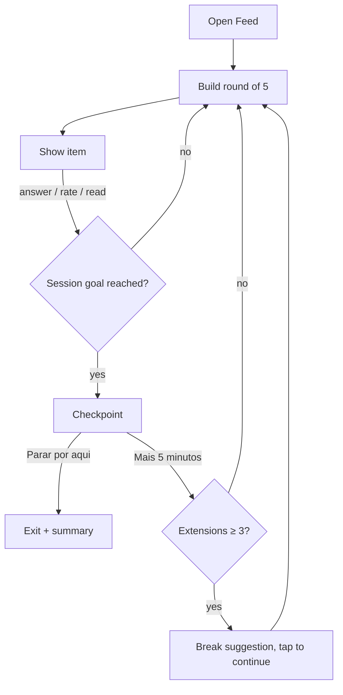

# 06 — Feed de Estudos

| Status | Phase(s) | Features |
|---|---|---|
| Draft v1 | 2 | FED-01 |

Related: [PRD](../product/PRD.md#55-feed-de-estudos-fed) · [04 — Flashcards & memory](04-flashcards-memory.md) (FSRS, review logs, new-card limit) · [05 — Practice & exams](05-practice-exams.md) (quick questions, Caderno de Erros retries) · [07 — Goals & Semana de Provas](07-goals-semana-de-provas.md) (exam urgency, plan) · [13 — Motivation & wellbeing](13-motivation-wellbeing.md) (XP, healthy use) · [learning-engine.md](../engineering/learning-engine.md)

---

## 1. Summary

A vertical, swipe-to-advance feed built **only from the student's own material**: 15-second micro-lessons, quick questions, diagrams from the PDFs and "Você sabia?" items, interleaved with the flashcards that are due and the Caderno de Erros retries. It turns phone time into retrieval practice. Sessions are finite by design: the feed stops at a checkpoint and suggests a break — it is not an infinite scroll.

## 2. Goals and non-goals

**Goals**
- Make studying feel as easy to start as opening a social app — one tap, no decisions.
- Keep most of the feed **retrieval** (answering), not passive watching.
- Fully offline once prefetched.
- Respect the FSRS schedule: due cards in the feed are real reviews.
- Healthy for teenagers: finite sessions, no manipulative engagement tricks.

**Non-goals**
- Video. Items are text, math, images and diagrams only (no autoplay, no sound).
- Content from outside the student's material (no general "edutainment" catalog).
- Social features in the feed (likes, comments, follower content). Turma features live in [10 — Turma & social](10-turma-social.md).
- Push notifications from the feed (review reminders belong to MEM-04).

## 3. User stories

| # | As a… | I want… | So that… |
|---|---|---|---|
| U1 | student with 5 free minutes | to open one screen and just swipe | I study without planning |
| U2 | student | short explanations of concepts I haven't studied yet, followed by a question about them | I learn and immediately check |
| U3 | student | my due flashcards to show up in the feed | my reviews get done while I scroll |
| U4 | student | the feed to focus on the exam coming up | my phone time counts for Friday's test |
| U5 | student on the bus without data | the feed to work offline | I don't need internet |
| U6 | student | the app to tell me when to stop | I don't burn out or lose the evening |

## 4. Functional requirements

- **FED-01.1** Entry: the **Feed** tab and the "Hoje" screen ("Abrir o Feed"). A scope selector at the top: **Tudo** (all active goals), a goal, a subject, or an exam. Default: the nearest exam's scope if an exam is within 14 days, else Tudo.
- **FED-01.2** Item types (`feed_items.type`, plus items pulled from other features):

  | Type | Source | Interaction |
  |---|---|---|
  | `micro_lesson` | `feed_items` | Read (≤ 15 s): title + ≤ 280 chars, optional formula/image, 📄 chip |
  | `quick_question` | `feed_items` | 3–4 alternatives or Verdadeiro/Falso; instant feedback |
  | `diagram` | `feed_items` | Figure from the material + caption + optional "O que é isso?" question |
  | `did_you_know` ("Você sabia?") | `feed_items` | Read; a surprising fact or real-world link of a concept |
  | `due_card` | `cards` + `card_states` (MEM-02 queue) | Flip → rate (real FSRS review) |
  | `mistake_retry` | `mistakes` due today (PRA-04) | Answer the retry question |
  | `checkpoint` | Generated by the client | Session summary + stop/continue choice |

- **FED-01.3** The feed is assembled on device in **rounds of 5 items** according to §8 (ranking + interleaving rules) and refilled ahead of the user's position (≥ 10 items buffered).
- **FED-01.4** **Retrieval share:** at least 60% of items in every round require an answer (`due_card`, `quick_question`, `mistake_retry`, or a `diagram` with a question).
- **FED-01.5** **Learn → check:** a `micro_lesson` about a concept is followed 2–4 items later by a `quick_question` on the same concept when one exists.
- **FED-01.6** **Due cards** (§8.3): tap to flip; after flipping, **swipe right = Lembrei** (Good), **swipe left = Errei** (Again); buttons "Errei" / "Lembrei" are also shown, and long-press reveals all 4 ratings (Errei, Difícil, Bom, Fácil). Swiping up on an unflipped card skips it (no review logged, stays due). Swiping up on a flipped but unrated card shows a hint "Avalia o cartão: Errei ou Lembrei?" and doesn't advance.
- **FED-01.7** Reviews from the feed are written to the same outbox as review sessions with `review_logs.source = feed`; they count toward plan items and streaks like any review.
- **FED-01.8** **Quick questions** record `attempt_answers` (in a per-user, per-study-day implicit attempt of a quiz with `kind = feed`) and update mastery; wrong answers run a compact PRA-02 flow (correct answer + one-line rationale + 📄 chip; the Caderno entry is created with the suggested cause; "Por que errei?" can be changed later in the Caderno).
- **FED-01.9** A wrong `quick_question` or `mistake_retry` is re-shown **once** 5–8 items later in the same session (in-session spacing).
- **FED-01.10** **Micro-lessons introduce concepts:** a `micro_lesson` viewed for ≥ 3 s marks its concept as introduced and releases that concept's new cards into the review queue, counting against the day's new-card limit ([04 §8.4](04-flashcards-memory.md#84-new-card-limit-tied-to-the-plan)). When the limit is reached, micro-lessons for **new** concepts stop appearing (reviews and questions continue).
- **FED-01.11** No item (other than FED-01.9 re-shows) is repeated within 24 h; a `micro_lesson` or `did_you_know` already seen is shown again only after 14 days and only if the concept's mastery is < 0.6.
- **FED-01.12** **Healthy use** (§8.5): sessions end at a checkpoint; continuing is an explicit choice; no autoplay, no sound, no variable rewards, no streak-loss messages inside the feed, gentle bedtime nudge.
- **FED-01.13** **Offline:** the device prefetches feed content for active goals (§8.6); the feed works with no connection and syncs answers/reviews later.
- **FED-01.14** Each item has a "…" menu: **Avisar erro** (TRU-02), **Não mostrar mais isso** (hides the item for the user), **Ver no material** (📄), and for lessons "Explica de outro jeito" (LRN-03, online only).
- **FED-01.15** A thumbs signal "Isso ajudou?" (👍/👎) appears on at most 1 in 10 `micro_lesson`/`did_you_know` items, to measure content quality (not used for ranking popularity).
- **FED-01.16** Feed time counts as a `study_sessions` row (activities: reviews, questions, lessons) and contributes to plan items of activity `review` and `learn`.
- **FED-01.17** Content for shared (Turma) subjects is generated once and shared; per-user state (impressions, answers, hides) stays personal.
- **FED-01.18** Content top-up: when a user has seen ≥ 80% of a subject's feed items, the worker enqueues generation of more items for the least-covered concepts (batch, subject to PLT-04 budget), deduplicated against existing items.

## 5. UX and screens

- Full-screen vertical pager (one item per screen), swipe up for next. Progress dots for the current round; a thin bar for the session goal (default 10 min).
- Header: scope chip ("Prova de Biologia · 3 dias") and an exit "×".
- Items use the subject's color as an accent; text is large (min 18 sp) and fits without scrolling; if it doesn't fit, it's not a valid feed item (validator).
- Feedback is shown in place (no navigation): ✅ / ❌ with the right alternative highlighted, one-line rationale, 📄 chip.
- Due card: front large; "Toque pra ver a resposta"; after flip, side hints "← Errei · Lembrei →".
- Checkpoint screen: summary (cards reviewed, questions right, concepts learned, minutes) + two buttons, **Parar por aqui** (primary) and **Mais 5 minutos** (secondary).

**Key PT-BR strings**

| Context | String |
|---|---|
| Tab / entry | "Feed" · "Abrir o Feed" |
| Swipe hint (first use) | "Arrasta pra cima pra próxima" |
| Scope | "Tudo" · "Prova de Biologia · 3 dias" |
| Due card | "Toque pra ver a resposta" · "← Errei · Lembrei →" · "Avalia o cartão: Errei ou Lembrei?" |
| Question feedback | "Acertou! ✅" · "Quase! A certa é a **B**." |
| Micro-lesson | "📄 p. 12" · "Explica de outro jeito" |
| Você sabia? | "Você sabia?" |
| Item menu | "Avisar erro" · "Não mostrar mais isso" · "Ver no material" |
| Quality signal | "Isso ajudou?" |
| Checkpoint | "Mandou bem! Você revisou **18 cartões**, acertou **7 de 9** questões e aprendeu **3 conceitos** em 10 min." · "Parar por aqui" · "Mais 5 minutos" |
| Break suggestion (after 3 extensions) | "Você já tá há quase meia hora. Seu cérebro guarda melhor com pausas — bora dar um tempo?" · "Fazer uma pausa" · "Continuar mesmo assim" |
| Daily soft limit | "Hoje você já estudou 45 min no Feed. Que tal um simulado ou descansar?" |
| Bedtime | "Já tá tarde 😴 Dormir bem também é estudar — a memória se fixa durante o sono." |
| New-card limit reached | "Você já aprendeu os conceitos novos de hoje. Agora é só revisão e questões." |
| Empty | "Você zerou o feed de hoje! 🎉 Volta amanhã ou faz um simulado." |
| Offline | "Sem internet — o Feed continua funcionando." |
| Not enough content yet | "Ainda estamos preparando o Feed dessa matéria (60%)." |

## 6. Data

**Entities used:** `cards`, `card_states`, `review_logs`, `questions`, `quizzes`, `quiz_attempts`, `attempt_answers`, `mistakes`, `mastery`, `knowledge_nodes`, `exams`, `plan_items`, `study_sessions`, `content_flags`, `ai_usage`, `ai_jobs`.

### New entities / fields

| Table | Column | Type | Purpose |
|---|---|---|---|
| **`feed_items`** (new) | `id` | uuid | |
| | `subject_id` | uuid → `subjects` | Owner subject (personal or Turma-shared) |
| | `node_id` | uuid → `knowledge_nodes` | Topic |
| | `concept_id` | uuid → `knowledge_nodes`, nullable | Concept (required for `micro_lesson`, `quick_question`) |
| | `type` | enum `micro_lesson` / `quick_question` / `diagram` / `did_you_know` | |
| | `content` | jsonb | Per type, §8.1 |
| | `media_path` | text, nullable | Storage path of image (diagram / lesson figure) |
| | `source_pages` | jsonb | `{document_id, page_start, page_end}[]` |
| | `external_knowledge` | bool | `did_you_know` that uses facts beyond the material (labeled in UI) |
| | `status` | enum `active` / `archived` | |
| | `prompt_version`, `gen_batch_id`, `created_at` | | Traceability |
| **`feed_impressions`** (new) | `id` (client UUID), `user_id`, `feed_item_id` (nullable for cards/mistakes), `item_kind`, `item_ref_id`, `session_id`, `shown_at`, `dwell_ms`, `action` (`answered` / `rated` / `read` / `skipped` / `hidden`), `helpful` (bool, nullable) | | Recency rules, metrics, quality signal. Synced from device in batches. |
| `quizzes.kind` | add `feed` | enum value | Implicit per-day attempt for feed questions |
| `study_sessions` | `kind` | enum, add `feed` | Session accounting |
| `profiles.settings.feed` | `session_minutes` (default 10), `daily_soft_limit_min` (default 45), `bedtime` (default 23:00) | jsonb | Healthy-use settings |

`review_logs.source = feed` comes from [04 §6](04-flashcards-memory.md#6-data).

## 7. AI behavior

All calls: model `claude-opus-5-5`, adaptive thinking, explicit effort, server-side fallbacks (`fallbacks: "default"`), `stop_reason` checked, PLT-04 budget checked before the call, `ai_usage` row with feature ID `FED-01`, Zod validation.

| Task | Mode | Effort | Inputs | Output (structured) |
|---|---|---|---|---|
| Generate feed items for a topic | **Batch**, worker — part of the per-topic generation wave (same cached topic slice prefix as cards/notes/questions) | `medium` | Frozen system prompt (rules §8.1) → topic PDF slice `document` (**cached**) → topic JSON (concepts with ids, key terms) + list of pages that contain figures (from `document_pages.has_images`) + existing item titles | `{items: [{type, concept_id, title, body, formula_latex?, question?: {stem, options: [{id, text, rationale}], correct}, figure_page?, caption?, external_knowledge, source_pages}]}` |
| Top-up (FED-01.18) | Batch | `medium` | Same, restricted to least-covered concepts | Same |

- Per concept target: 1 `micro_lesson` + 2 `quick_question`; per topic: 1–2 `did_you_know`, and a `diagram` for each figure page (up to 3 per topic).
- **Figures:** Claude chooses `figure_page` and writes the caption/question; it does not produce coordinates. The worker renders the image: embedded image objects extracted with pdfjs when the PDF has them, otherwise a render of the page cropped to its content bounds. Images are compressed to ≤ 200 KB.
- Page references are model-reported `source_pages`, validated to lie inside the sent range (structured outputs can't use the Citations API).
- "Explica de outro jeito" from a feed item reuses LRN-03 (online, sync).

## 8. Rules and algorithms

### 8.1 Content rules (prompt + validation)

1. **Micro-lesson:** one idea; first line is a hook (question or surprising fact); ≤ 280 characters body (~40 words PT-BR, readable in ≤ 15 s); optional single formula; grounded with `source_pages`.
2. **Quick question:** answerable in ≤ 20 s; 3–4 alternatives (or true/false); same distractor rules as [05 §8.2](05-practice-exams.md#82-generation-quality-rules-prompt--deterministic-validation); rationale ≤ 140 chars per option.
3. **Diagram:** caption ≤ 160 chars; question optional; must reference a page that has an image.
4. **Você sabia?:** ≤ 240 chars; must connect to a concept in the material; if it relies on facts beyond the material, `external_knowledge = true` and the UI shows "Curiosidade além do material". No sensational or inappropriate content for minors.
5. **Validator drops** items over length, without `concept_id` (where required), with `source_pages` out of range, or with title/body trigram similarity ≥ 0.85 to an existing item of the subject.

### 8.2 Ranking

Candidate pools (scope-filtered): due cards **D** (MEM-02 queue incl. exam boost), Caderno retries due **M**, quick questions **Q**, diagrams **G**, micro-lessons **L**, você-sabia **K**.

For every candidate `i`:

`priority_i = 0.4·exam_urgency_i + 0.3·(1 − mastery_i) + 0.2·due_pressure_i + 0.1·novelty_i − recency_penalty_i + jitter`

- `exam_urgency = weight_norm(E) × exp(−days_until(E) / 7)` for the earliest exam `E` whose scope contains the item's concept; 0 if none.
- `mastery` = `mastery.mastery` of the concept (0.5 when unknown).
- `due_pressure` = for due cards `clamp((now − effective_due) / max(1 day, stability), 0, 1)` + 0.5 if exam-boosted; for `M` = 1; others 0.
- `novelty` = 1 for unseen items, 0 otherwise.
- `recency_penalty` = 1 if shown in the last 24 h (except FED-01.9 re-shows), 0.5 if the same concept appeared in the last 3 items.
- `jitter` ∈ [−0.05, 0.05] (uniform) — only to break ties, not to create unpredictable rewards.

### 8.3 Interleaving (round template)

Each round of 5 is filled from the ranked pools with this slot template, falling back to the next available pool when one is empty:

| Slot | Preferred pools (in order) |
|---|---|
| 1 | L or G (learn) → K |
| 2 | D → M → Q |
| 3 | Q (same concept as slot 1 if available) → D |
| 4 | D → M → Q |
| 5 | M → K → Q → D |

Constraints applied on top: ≥ 3 retrieval items per round (FED-01.4); no more than 2 consecutive items from the same subject when ≥ 2 subjects are in scope; L only for concepts allowed by the new-card limit (FED-01.10); if only D remains (content exhausted), the feed becomes a review session with occasional Q.

### 8.4 Swipes → FSRS

| State | Gesture | Result |
|---|---|---|
| Due card, front | Tap | Flip |
| Due card, front | Swipe up | Skip — no log, card stays due, `feed_impressions.action = skipped` |
| Due card, flipped | Swipe right / "Lembrei" | Rating **Good (3)** |
| Due card, flipped | Swipe left / "Errei" | Rating **Again (1)** |
| Due card, flipped | Long-press → choose | Errei (1) / Difícil (2) / Bom (3) / Fácil (4) |
| Due card, flipped | Swipe up | Not allowed — hint shown |
| Quick question / retry | Answer | `attempt_answers` (no FSRS change) |
| Micro-lesson | Dwell ≥ 3 s | Concept introduced (FED-01.10) |

### 8.5 Healthy use (teen-safe design)

- **Finite sessions:** checkpoint at `session_minutes` (default 10) or 30 items, whichever first. "Parar por aqui" is the primary button.
- **Extensions:** "Mais 5 minutos" adds 5 min; after 3 extensions, a break suggestion requires an explicit tap ("Continuar mesmo assim").
- **Daily soft limit:** after `daily_soft_limit_min` (default 45) of feed time in a study day, the checkpoint suggests other activities (simulado, rest). Never a hard lock.
- **Bedtime:** after `bedtime` (default 23:00) the first item is the bedtime message; the feed still works.
- **No dark patterns:** no autoplay or infinite scroll past checkpoints; no sound; no randomized rewards or loot; XP from the feed follows the same flat rules as elsewhere (MOT-01); no "you'll lose your streak" messages; no notifications to pull users back into the feed.

### 8.6 Prefetch and offline cache

- On sync (Wi-Fi or mobile data, user setting "Baixar Feed só no Wi-Fi", default off), the device keeps for each active goal: all due/near-due cards (next 3 days), Caderno retries (next 3 days), and ≥ 200 `feed_items` ranked by the priority formula with `novelty = 1`.
- Images cached with LRU; total feed media cache cap 50 MB (setting).
- `feed_impressions` and answers are stored locally and uploaded in batches; recency rules use local impressions so offline sessions don't repeat items.

## 9. Edge cases and errors

| Case | Behavior |
|---|---|
| New subject, feed items still generating | Feed shows due cards/questions available; banner with progress ("Ainda estamos preparando o Feed dessa matéria (60%)"). |
| No content at all in scope | Empty state with links to upload material or switch scope. |
| All content seen | Top-up generation (FED-01.18); meanwhile review-only mode. |
| Budget exceeded | No top-up; feed continues with existing items; message only if the feed would be empty. |
| Item references a removed document | Item archived on next sync; 📄 chip hidden if still cached. |
| Figure extraction fails | `diagram` item is not created; the lesson is shown without image. |
| Flagged item (TRU-02) | Hidden for the reporter immediately; for others when the flag is accepted. |
| Card edited/archived on server while cached | Replaced/removed on next sync; offline review of a since-archived card is still accepted and kept in history. |
| User rotates phone / changes font size so text overflows | Item scrolls internally (fallback) and is reported to metrics as overflow. |
| Accessibility (TalkBack) | Swipes have button equivalents; every item is reachable with "Próximo" / "Anterior" actions. |
| Scope = exam already passed | Default scope falls back to the next exam or Tudo. |

## 10. Metrics

| Metric | Target / use |
|---|---|
| Median feed session length | 8–12 min |
| Sessions ending at the first checkpoint by choice ("Parar por aqui") | tracked; healthy if ≥ 50% |
| Sessions with ≥ 3 extensions | < 10% (if higher, revisit design) |
| Retrieval share of items shown | ≥ 60% |
| Due-card reviews completed via feed | tracked; share of all reviews |
| Quick-question accuracy | 60–85% |
| Retention of concepts introduced via feed vs. via sessions (30-day true retention of their cards) | no worse than sessions |
| Flagged-as-wrong rate | < 2% of items shown |
| "Isso ajudou?" 👍 share | ≥ 75% |
| Skips of unflipped due cards | tracked; high skip = cards too hard/long for the feed |
| Content exhaustion events per subject | tracked; drives top-up quotas |

## 11. Acceptance criteria

- [ ] Opening the Feed with an exam in 3 days defaults the scope to that exam and the first round contains ≥ 3 retrieval items.
- [ ] A micro-lesson about concept X is followed by a quick question on X within the next 4 items (when one exists).
- [ ] Swiping right on a flipped due card writes a `review_logs` row with rating Good and `source = feed`; swiping up on an unflipped card writes nothing.
- [ ] A wrong quick question is re-shown once 5–8 items later and creates one Caderno de Erros entry.
- [ ] With new-card limit reached, no micro-lessons for new concepts appear; reviews and questions continue.
- [ ] In airplane mode, a 10-minute feed session works with no errors and no repeated items; after reconnecting, impressions, answers and reviews are synced exactly once.
- [ ] The checkpoint appears at 10 minutes (default) with "Parar por aqui" as the primary button; after 3 extensions the break suggestion requires an explicit tap.
- [ ] After 23:00 (default bedtime) the first item is the bedtime message.
- [ ] No two consecutive items come from the same subject more than twice in a row when the scope has ≥ 2 subjects (unit test of the interleaver).
- [ ] Feed items for a shared Turma subject are generated once; a second member's feed uses the same `feed_items` rows (no extra `ai_usage`).
- [ ] Every item is navigable with TalkBack using button actions instead of swipes.

## 12. Open questions

1. **Model for feed generation.** Spec uses `claude-opus-5-5`; a cheaper model for this high-volume batch content is the owner's cost decision.
2. **Default session length** (10 min) and daily soft limit (45 min): validate with the class during the first exam week.
3. **Feed in Phase 2 vs earlier:** the feed reuses Phase 1 content (cards, questions); only micro-lessons, diagrams and você-sabia items are new. Could a "cards + questions only" feed ship in Phase 1?
4. **"Você sabia?" beyond the material:** keep `external_knowledge` items (labeled) or restrict to strictly grounded facts?
