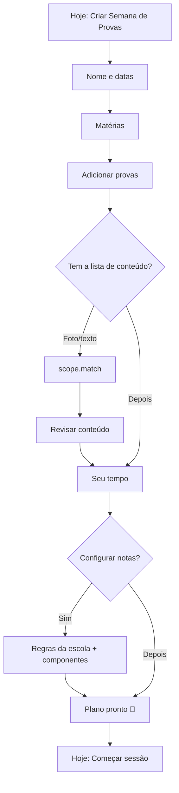

# 07 — Goals & Semana de Provas

| Status | Phase(s) | Features |
|---|---|---|
| Draft v1 | 0 (GOL-01 skeleton) · 1 (GOL-01…GOL-08, GOL-12) · 2 (GOL-11) · 5 (GOL-09, GOL-10) | GOL-01 … GOL-12 |

Related: [PRD](../product/PRD.md) · [Architecture](../engineering/architecture.md) · [04 — Flashcards & memory](04-flashcards-memory.md) (FSRS, exam-aware scheduling) · [05 — Practice & exams](05-practice-exams.md) (quizzes, simulados) · [08 — Prova Provável](08-prova-provavel.md) (topic weights) · [09 — ENEM mode](09-enem-mode.md) (ENEM goals) · [Learning engine](../engineering/learning-engine.md) (consolidates the algorithms in §8)

---

## 1. Summary

A **Goal** (`Objetivo`) is how a student tells Studify *what they are studying for*. In Phase 1 the only mode is **Semana de Provas** (`exam_week`): a school exam period with several tests (`Provas`), each with a subject, a date, a weight and a content list (`Conteúdo da prova`).

From that, Studify:

1. **Scopes** all content to what is actually on each test (GOL-03).
2. **Plans** every day until the last test, balancing all subjects, reserving time for spaced reviews, and replanning when life happens (GOL-04).
3. Turns the plan into **one button** on the **Hoje** screen (GOL-05).
4. Tells the student **the grade they need** on each test under their school's rules (GOL-06).
5. Runs a short **Modo Véspera** the evening before each test (GOL-07).
6. Shows a **dashboard** with countdown and readiness per subject (GOL-08), and later a **predicted grade** with a confidence range (GOL-11).

Phase 5 adds device **calendar sync** (GOL-09) and **energy-aware scheduling** (GOL-10). ENEM goals reuse the same goal, planner and Hoje machinery; their specifics live in [09 — ENEM mode](09-enem-mode.md).

## 2. Goals and non-goals

**Goals**
- A student creates a Semana de Provas with 5+ tests in under 3 minutes (excluding uploads).
- Every day has a realistic plan that fits the student's available time and never silently drops a test.
- The required-grade calculation is exactly right for the school's configured rules (unit-tested).
- Plans recover automatically from missed days, moved tests and new material.
- Works for students who join mid-week or have a test tomorrow.

**Non-goals**
- Not a school-management system: no teacher accounts, no official report cards.
- No automatic scraping of school portals (students type or photograph schedules; ING-07 import comes in Phase 2).
- The planner does not decide *what* a test covers — the student (or their content list) does; Prova Provável ([08](08-prova-provavel.md)) only adjusts *weights* inside the scope.
- No study after quiet hours for minors (default 22:00–07:00), no streak pressure in this spec (MOT-01 is in [13](13-motivation-wellbeing.md)).

## 3. User stories

| # | As a… | I want to… | So that… |
|---|---|---|---|
| US-1 | student | create "Semana de Provas — 2º bimestre" and add each test with its date | Studify knows my deadlines |
| US-2 | student | photograph the content list the teacher wrote on the board / sent on WhatsApp | I only study what will be on the test |
| US-3 | student | tell Studify I have ~1 hour on weekdays and more on weekends | the plan fits my life |
| US-4 | student | press one button and study the right thing for today | I don't waste time deciding |
| US-5 | student | skip a day without the plan breaking | I don't give up after one bad day |
| US-6 | student | know the grade I need on the P2 to close the bimestre with 6,0 | I know how hard to push |
| US-7 | student | get a short review the night before each test and a reminder to sleep | I walk in confident and rested |
| US-8 | student | see how ready I am for each test | I know where to focus |
| US-9 | student | see a predicted grade range | I can plan for recuperação early if needed |
| US-10 | student | have study blocks appear in my phone calendar (Phase 5) | the plan fits my real schedule |
| US-11 | student who joins on Wednesday with a test on Thursday | still get a useful plan | Studify helps even last-minute |

## 4. Functional requirements

### GOL-01 — Goals

- **GOL-01.1** A user can create, edit, archive and delete goals. Modes: `exam_week` (Phase 1) and `enem` (Phase 4; the option is visible but disabled with "Em breve" until then).
- **GOL-01.2** Creating a Semana de Provas is a wizard: (1) name and date range, (2) subjects, (3) tests (GOL-02), (4) content per test (GOL-03, skippable), (5) available time (§8.2 inputs), (6) grading rules (GOL-06, skippable). Any step after (3) can be completed later; the plan is generated as soon as step 3 has ≥ 1 test.
- **GOL-01.3** Default name: `Semana de Provas — {n}º bimestre` (or `trimestre`, from the school's grading rules if set), editable. Optional `term_index` links the goal to a school term for GOL-06.
- **GOL-01.4** A user may have several active goals. Phase 1 plans all active `exam_week` goals as one pool. When an `enem` goal is also active (Phase 4), capacity is split per §8.9.
- **GOL-01.5** A goal ends automatically the day after its last test (status `completed`) and shows a recap card (grades logged, plan adherence). Archived/completed goals keep their data; their plan items are no longer scheduled.
- **GOL-01.6** Phase 0 delivers only the data model, the "Novo objetivo" entry point and goal creation with name + dates (no plan).
- **GOL-01.7** If the subject of a test is a Turma-shared subject ([10](10-turma-social.md)), the goal still belongs to the individual user; classmates create their own goals but can **copy** a classmate's goal setup (tests, dates, content lists) from a "Usar a semana de provas da turma" shortcut (Phase 2, SOC-01). Copying never copies grades.

### GOL-02 — Exam calendar

- **GOL-02.1** Each test (`exam`) has: subject (required), title (default `Prova de {Matéria}`), local date (required), start time (optional; "horário a definir" allowed), duration (optional), weight (optional; default derived from GOL-06 if the test is linked to a grade component, otherwise 1), kind (`regular` / `recuperacao` / `final`), teacher name (optional, used by Prova Provável), notes.
- **GOL-02.2** Two or more tests may share the same date (and even overlap in time).
- **GOL-02.3** A test can be moved, cancelled or marked done. Moving or cancelling triggers a replan (§8.2.6). Cancelled tests remain visible (struck through) for 7 days, then hide.
- **GOL-02.4** After the test's date, Studify asks once (notification + Hoje card): "Como foi a prova de {Matéria}? Já saiu a nota?" The student can log the grade (feeds GOL-06 and GOL-11 calibration) or dismiss.
- **GOL-02.5** A recuperação test can be created from a regular test ("Criar recuperação") and inherits its subject and scope; it links to the original via `parent_exam_id`.
- **GOL-02.6** Phase 2 (ING-07, specified in [01](01-ingestion-knowledge-map.md)) can create tests from a photographed exam schedule; such tests arrive with `status = draft` and appear in a confirmation list before they affect the plan.
- **GOL-02.7** Subjects without any uploaded material can still have tests. The plan then includes an `upload_material` item (§8.2.3) and Studify suggests asking the Turma.

### GOL-03 — Conteúdo da prova (scoping)

- **GOL-03.1** For each test the student can provide the content list by: typing, pasting text (e.g. from WhatsApp), photographing / picking an image (board, printed list, chat screenshot), or selecting topics manually from the knowledge map.
- **GOL-03.2** Text and images are sent to the `scope.match` AI task (§7.1), which splits the list into items and maps each item to topics/concepts of the subject's knowledge map, with a confidence.
- **GOL-03.3** The student reviews the mapping on a **scope review** screen: matched items (✅), partial matches (🟡, shows the candidate topics), and unmatched items (❌ "não encontrei no seu material"). The student can accept, change, or remove each mapping. Nothing is applied until "Confirmar conteúdo".
- **GOL-03.4** Unmatched items can become **placeholder topics** (`knowledge_nodes.is_placeholder = true`): they appear in the outline marked "sem material", count in the plan as `upload_material` work, and are excluded from generated quizzes until material arrives. When new material is ingested, placeholders are re-matched automatically and the student is notified.
- **GOL-03.5** If no content list is given, the scope defaults to **all non-excluded topics** of the subject, with a banner: "Sem conteúdo definido — vou considerar a matéria toda. Adicione o conteúdo pra um plano mais certeiro."
- **GOL-03.6** Topics marked "não cai na prova" (ING-04) are never in scope, even if matched; the review screen warns when a content item maps to an excluded topic.
- **GOL-03.7** Scope drives, for that test: generation priority (in-scope topics are generated first by the ingestion pipeline), planner units, quiz and simulado question pools (PRA-01, PRA-03), the tutor's default scope (TUT-03), the Feed filter (FED-01) and FSRS exam-aware scheduling (MEM-02, see [04](04-flashcards-memory.md)).
- **GOL-03.8** Scope is stored at **topic level**; selecting a unit selects all its topics; concept-level selections are stored as concept nodes and roll up to their topic for planning.
- **GOL-03.9** Scope can be edited at any time; edits trigger a replan.

### GOL-04 — Exam-week planner

- **GOL-04.1** The planner produces `plan_items` for every local date from today to the date of the last scheduled test of all active goals, following the algorithm in §8.2.
- **GOL-04.2** Every day reserves time for FSRS reviews first (§8.3), then assigns learning, practice, simulado and véspera work so that each test's work finishes before its deadline.
- **GOL-04.3** The planner respects: minutes available per weekday, date exceptions ("sábado não dá"), block length limits, max subjects per day, and quiet hours.
- **GOL-04.4** When the work does not fit, the planner **triages** (§8.2.5) instead of overbooking: it shows exactly what was shortened or left out and offers "Aumentar tempo diário" or "Ajustar prioridades".
- **GOL-04.5** Replanning runs automatically on the triggers in §8.2.6 and must be stable: items already done never change, today's plan is frozen once a session started today (except when a test is moved/cancelled), and no more than necessary moves.
- **GOL-04.6** Each plan item has a one-line, template-generated **reason** ("Biologia hoje porque a prova é quinta e você está com 35% de domínio em Genética") — no AI call.
- **GOL-04.7** The student can: mark an item done/skip, move an item to another day, pin an item (planner won't move it), and change daily minutes. Manual changes trigger a replan around pinned items.
- **GOL-04.8** The planner is a **pure, deterministic function** in `packages/shared` (`buildPlan(input) → PlanResult`). The worker runs it as the source of truth; the app may run it offline to show a provisional plan, replaced by the server result on sync.
- **GOL-04.9** Plans are versioned (`plan_runs`); each run stores its trigger, feasibility and triage decisions for explanations and debugging.

### GOL-05 — "Hoje" screen

- **GOL-05.1** Hoje is the app's home tab. It shows: greeting, today's total planned minutes, the list of today's plan items, countdown chips for upcoming tests, and one primary button **"Começar sessão"**.
- **GOL-05.2** "Começar sessão" builds a session with the session builder (§8.4) from today's plan; the student can also pick a quick length (10 / 20 / 30 min) that overrides the plan for that session.
- **GOL-05.3** Session progress updates plan items in real time; leaving mid-session saves progress, and "Continuar" resumes.
- **GOL-05.4** With no active goal, Hoje shows due reviews (if any) and a "Criar Semana de Provas" call to action.
- **GOL-05.5** Offline: Hoje shows the last synced plan; sessions use cached cards, notes and downloaded questions (PLT-07). Items completed offline sync later.
- **GOL-05.6** Cards on Hoje (max 3, in priority order): log grade (GOL-02.4), confirm scope (GOL-03.3), triage warning (GOL-04.4), "Reorganizei seu plano" (after replan), Modo Véspera (GOL-07), upload material for a placeholder topic.

### GOL-06 — Quanto preciso tirar?

- **GOL-06.1** The student configures their school's grading rules once (per school year): grade scale (0–10 or 0–100), rounding, terms (bimestres / trimestres / semestres) and their weights, how each term grade is composed (weighted average of components or sum of points), passing average, recuperação policy and final-exam policy (§8.5). Presets cover common cases; "Personalizar" allows the rest.
- **GOL-06.2** Per subject and term the student lists **grade components** (e.g. P1 40%, P2 40%, Trabalho 20%) and logs grades as they come out. A component can be linked to a test of the calendar.
- **GOL-06.3** For every upcoming linked test Studify shows **the minimum grade needed** to reach the target, using §8.5. Target options: "Passar" (passing average) or a custom goal ("Quero fechar com 8,0"), at term or year level.
- **GOL-06.4** The result is one of: required grade (rounded **up** to the school's grade step), "Você já garantiu", or "Mesmo com nota máxima não dá" + the recuperação/final-exam requirement when those policies exist.
- **GOL-06.5** When several components are pending, the requirement is computed as the **same grade on every pending component** and explained as such ("se você tirar a mesma nota em tudo que falta").
- **GOL-06.6** Logging a grade recomputes requirements and triggers a replan (weights depend on need, §8.2.4).
- **GOL-06.7** Grading rules can be shared as a template inside a Turma ("Regras da escola"), so classmates don't retype them (Phase 2). Grades are never shared.
- **GOL-06.8** All calculations run on device and server from the same shared function and are covered by table-driven unit tests including every worked example in §8.5.

### GOL-07 — Modo Véspera

- **GOL-07.1** On the day before each test (local date `D − 1`), Studify schedules a **véspera** plan item (default 25 min, max 40) and a notification at the student's chosen time (default 19:00, never inside quiet hours).
- **GOL-07.2** The véspera session contains, in order: (1) a one-page **cheat sheet** of the test scope (§7.2), (2) **revisão relâmpago** — 10–20 quick retrieval items on the weakest high-weight in-scope concepts, (3) all in-scope cards rated "Errei" in the last 7 days, (4) the student's unresolved Caderno de Erros entries for this scope, (5) a personal checklist (editable: "calculadora", "lápis e borracha", "tabela periódica?"), (6) the sleep nudge.
- **GOL-07.3** No new material is introduced in véspera. If a topic was never studied, the cheat sheet shows its essentials, marked "não deu tempo de estudar — foca no básico".
- **GOL-07.4** Two tests on the same next day → one véspera session with time split by weight × (1 − readiness).
- **GOL-07.5** If the test is in the afternoon (start time ≥ 12:00) and véspera was not done, an optional 15-min **aquecimento** is offered on the morning of the test.
- **GOL-07.6** The sleep nudge suggests a stop time 8–9 h before the test start (or 22:00 when time is unknown).
- **GOL-07.7** On the morning of the test: notification "Boa prova! 🍀" (only if outside quiet hours) — no study content.

### GOL-08 — Exam-week dashboard

- **GOL-08.1** The dashboard shows a timeline of the goal's tests and, per test: subject color/icon, countdown ("faltam 3 dias" / "amanhã" / "hoje às 7h30"), readiness % (§8.6), required grade (GOL-06), scope coverage (topics studied / topics in scope), and plan progress (minutes done / planned).
- **GOL-08.2** Tapping a test opens its detail: scope list with per-topic mastery bars, quick actions (quiz on weakest topics, simulado, tutor scoped to this test, edit scope, Prova Provável when available).
- **GOL-08.3** Readiness colors: < 40% red, 40–69% amber, ≥ 70% green; always shown with the number (color is never the only signal).
- **GOL-08.4** The dashboard is readable offline from cached data, with "atualizado há X" when stale.

### GOL-09 — Calendar sync (Phase 5)

- **GOL-09.1** Opt-in. Uses the **Android device calendar** (expo-calendar / CalendarContract), so it works with any Google account already on the phone without a separate Google sign-in.
- **GOL-09.2** Read: the student picks which calendars count as "busy"; busy time inside the student's study window reduces that day's available minutes. Event titles/details **never leave the device** — only the computed free minutes per date are sent to the planner.
- **GOL-09.3** Write: Studify creates a local calendar "Studify" and writes tests and planned study blocks (with start times chosen by §8.8 or the student's preferred window). Updates and deletions follow replans. Studify only edits events in its own calendar.
- **GOL-09.4** Turning sync off removes the Studify calendar from the device after confirmation.

### GOL-10 — Energy-aware scheduling (Phase 5)

- **GOL-10.1** Studify measures performance by time of day (§8.8) and, once there is enough data, tells the student their best windows.
- **GOL-10.2** When calendar sync is on, demanding work (new topics, low-mastery practice, simulados) is placed in the best windows; light work (mature reviews, véspera summary) elsewhere. Without calendar sync, Studify suggests reminder times and orders the Hoje session so demanding items come first when the student opens the app in a good window.
- **GOL-10.3** Never schedules or nudges inside quiet hours.

### GOL-11 — Predicted grade (Phase 2)

- **GOL-11.1** For each upcoming test with enough evidence (§8.7), the dashboard shows a predicted grade **range** ("entre 6,5 e 8,0"), never a single number, with a "Como calculamos?" explainer.
- **GOL-11.2** The prediction updates after every study session and is snapshotted daily (`readiness_snapshots`) so it can be calibrated against the grades students log.
- **GOL-11.3** When the predicted upper bound is below the required grade (GOL-06), the dashboard shows a supportive alert with concrete actions ("Mais 20 min/dia em Física até quinta aumenta bastante sua chance").
- **GOL-11.4** The prediction is labeled as an estimate; it is not shown to anyone else, including the Turma.

### GOL-12 — Modo Desespero (Phase 1)

For the student who opens Studify less than a week before a test with little done. It turns the remaining days into a focused "plano de ataque": a 5-minute diagnostic, an honest triage of what fits, and short sessions on the topics worth the most points. The tone stays calm; the name is playful, the content never shames.

- **GOL-12.1 Offer.** Studify offers Modo Desespero (never forces it) when a scheduled test is **6 days away or less** (`D_e − today ≤ 6`) and preparation is low: scope coverage < 50%, readiness < 40%, or no study session yet for that test (§8.10.1). The offer appears at the end of the goal wizard, when a test is added or moved into the window, and as the first Hoje card. It is always available manually from **Detalhe da prova** for any test 6 days away or less. "Agora não" hides the offer for that test for 24 h.
- **GOL-12.2 Coverage.** One Modo Desespero covers **every** scheduled test inside the 7-day window. Tests further out keep the normal planner with whatever capacity is left, and the student is told ("As provas depois de {data} ficam com o tempo que sobrar").
- **GOL-12.3 Diagnóstico rápido.** An optional 5-minute check: one objective question per in-scope topic, highest topic weight first, max 12 (max 6 when the test is today or tomorrow). It estimates mastery so the triage doesn't assume zero. Results are mastery evidence (source `diagnostic`). Wrong answers are shown as "a revisar" and do **not** create Caderno de Erros entries. "Pular — começo do zero" skips it.
- **GOL-12.4 Time.** Studify asks "Quanto tempo você tem por dia até a prova?" with presets **1h / 2h / 3h / 4h**. The answer overrides available minutes for each day until the last covered test. Planned study is capped at **4 h per day**; quiet hours and the véspera sleep stop time (GOL-07.6) are never violated, and nothing is planned after 23:00 even if quiet hours were moved.
- **GOL-12.5 Plano de ataque.** After the diagnostic, Studify shows the triage up front (§8.10.2) in three groups: **Foco total**, **Só o básico** and **Fica de fora**, with an honest coverage estimate per test: "Com {h} por dia, dá pra cobrir ~{pct}% do que deve cair." The student can move a topic between groups with one tap; the plan and the estimate recompute instantly.
- **GOL-12.6 Planner changes while active** (§8.10.3):
  - Foco total topics get `learn_light` then `practice`. Practice may happen the **same day**, in a later session at least 2 h after learning.
  - Só o básico topics get `learn_light` only (Resumo rápido + top 3 cards).
  - Fica de fora topics get no units. Their Resumo rápido stays one tap away and appears in the véspera cheat sheet (GOL-07.3).
  - One 20-min mini-simulado on `D − 2` when the test is 3 or more days away. Véspera (GOL-07) is unchanged.
- **GOL-12.7 Sessions.** Hoje shows a "Modo Desespero · faltam {n} dias" header. Each session loops through Foco total topics: Resumo rápido (LRN-01 `tldr`) → up to 5 key cards → 5 questions → explanations for wrong answers (PRA-02). Blocks are 25 minutes with a 5-minute break prompt.
- **GOL-12.8 Content first.** If material for an in-scope topic is still being generated, Foco total topics jump the job queue and use the **standard API instead of Batch**, so content arrives in minutes. This costs more per item (no batch discount) and counts against the normal budget (PLT-04). If the budget can't cover everything, Foco total topics are generated first and the rest waits.
- **GOL-12.9 Signals used.** Prova Provável topic weights (PRA-09) and uploaded past tests are used when available. In-scope cards keep the exam overlay (MEM-02.5).
- **GOL-12.10 Wellbeing.** No streak or XP pressure prompts while active, no all-nighter plans, and the burnout guard (WEL-03) applies. After 3 h of active study in a day, the session suggests stopping: "Você já fez bastante hoje. Descansar também conta."
- **GOL-12.11 Exit.** Ends automatically after the last covered test, or when the student taps "Sair do Modo Desespero" (normal planning resumes with a replan). After the test, the grade prompt (GOL-06) appears as usual, plus one optional offer, at most once per goal: "Quer que eu te avise 2 semanas antes da próxima prova?" (creates a reminder for the next scheduled test).
- **GOL-12.12 Test today or tomorrow.** The "plano relâmpago" case (§9) is the 0–1 day version of Modo Desespero: diagnostic max 6 questions, no mini-simulado, straight to Foco total, then véspera tonight.

## 5. UX and screens

### 5.1 Screens

| Screen | Purpose | Notes |
|---|---|---|
| **Hoje** (home tab) | Today's plan + "Começar sessão" | GOL-05 |
| **Novo objetivo** | Choose mode | Semana de Provas / ENEM ("Em breve" until Phase 4) |
| **Wizard: Semana de Provas** | Steps 1–6 (GOL-01.2) | Progress dots; "Pular por enquanto" on optional steps |
| **Adicionar prova** | Bottom sheet | Subject picker, date, time ("horário a definir"), kind, weight |
| **Conteúdo da prova** | Input (text / paste / photo / pick topics) | Camera + gallery; paste button reads clipboard on tap only |
| **Revisar conteúdo** | Scope review (GOL-03.3) | ✅ 🟡 ❌ grouped; bulk "Aceitar todos os ✅" |
| **Seu tempo** | Minutes per weekday + exceptions | Slider per day; presets "Leve / Médio / Puxado" (30 / 60 / 90 min) |
| **Plano** | Week view (days × items) | Drag to move, long-press to pin; triage banner |
| **Painel da semana** | Dashboard (GOL-08) | Timeline + test cards |
| **Detalhe da prova** | Scope, mastery, actions | GOL-08.2 |
| **Notas e médias** | Grading rules + components + required grades (GOL-06) | Per subject; presets |
| **Modo Véspera** | Guided session (GOL-07) | Calm visual style, no streak/XP prompts |
| **Modo Desespero: oferta** | Bottom sheet offering the mode (GOL-12.1) | "Ativar" / "Agora não" |
| **Diagnóstico rápido** | 5-min check (GOL-12.3) | Progress bar, "Pular" always visible |
| **Plano de ataque** | Triage groups + coverage estimate (GOL-12.5) | Tap a topic to move it between groups; time presets on top |

### 5.2 Key flows



### 5.3 Key PT-BR strings

| Key | String |
|---|---|
| `goal.new.title` | Pra que você vai estudar? |
| `goal.mode.exam_week` | Semana de Provas |
| `goal.mode.enem` | ENEM |
| `goal.mode.soon` | Em breve |
| `goal.wizard.exams.title` | Quando são suas provas? |
| `exam.add` | Adicionar prova |
| `exam.time.tbd` | Horário a definir |
| `scope.title` | O que vai cair? |
| `scope.hint` | Tira uma foto da lista de conteúdo ou cola o texto que o professor(a) mandou. |
| `scope.result` | Encontrei {matched} de {total} tópicos no seu material. |
| `scope.unmatched` | Não encontrei no seu material: {items}. Quer enviar o material ou pedir pra turma? |
| `scope.default_all` | Sem conteúdo definido — vou considerar a matéria toda. Adicione o conteúdo pra um plano mais certeiro. |
| `scope.excluded_warning` | "{topic}" está marcado como "não cai na prova". Quer incluir mesmo assim? |
| `time.title` | Quanto tempo você consegue estudar por dia? |
| `plan.ready` | Seu plano está pronto! 🎯 |
| `today.summary` | Hoje: {minutes} min · {subjects} matérias |
| `today.start` | Começar sessão |
| `today.continue` | Continuar sessão |
| `today.quick` | Só tenho {n} minutos |
| `plan.replanned` | Reorganizei seu plano: {summary}. |
| `plan.tight` | Tá apertado! Pra caber tudo, eu encurtei: {items}. Quer aumentar seu tempo diário? |
| `plan.reason.example` | {Matéria} hoje porque a prova é {weekday} e você está com {mastery}% em {topic}. |
| `countdown.days` | Faltam {n} dias |
| `countdown.tomorrow` | É amanhã! |
| `countdown.today` | Hoje às {time} |
| `readiness.label` | Prontidão: {pct}% |
| `grade.title` | Quanto preciso tirar? |
| `grade.need` | Você precisa de {grade} na {exam} pra fechar o {term} com {target}. |
| `grade.need.uniform` | Se você tirar a mesma nota em tudo que falta, precisa de {grade}. |
| `grade.secured` | Você já garantiu a média! Mas bora manter o ritmo 😉 |
| `grade.impossible` | Mesmo tirando {max} não dá pra fechar com {target}. Na recuperação, você precisaria de {rec}. |
| `grade.ask` | Como foi a prova de {Matéria}? Já saiu a nota? |
| `vespera.notify` | Amanhã tem prova de {Matéria}. Bora revisar o essencial em {minutes} min? |
| `vespera.not_studied` | Não deu tempo de estudar esse — foca no básico. |
| `vespera.sleep` | Dormir bem ajuda sua memória a fixar o que você estudou. Que tal parar às {time}? |
| `exam.good_luck` | Boa prova! 🍀 |
| `desperate.offer.title` | Prova em {n} dias? Bora pro Modo Desespero 😅 |
| `desperate.offer.body` | Calma, dá pra fazer muita coisa. Eu foco no que mais vale ponto e monto um plano de ataque pra você. |
| `desperate.offer.yes` | Ativar Modo Desespero |
| `desperate.offer.no` | Agora não |
| `desperate.diag.title` | Diagnóstico rápido (5 min) |
| `desperate.diag.body` | Umas perguntas rápidas pra eu saber o que você já sabe. Sem nota, sem pressão. |
| `desperate.diag.skip` | Pular — começo do zero |
| `desperate.time.title` | Quanto tempo você tem por dia até a prova? |
| `desperate.plan.title` | Seu plano de ataque |
| `desperate.group.focus` | Foco total |
| `desperate.group.basic` | Só o básico |
| `desperate.group.out` | Fica de fora |
| `desperate.coverage` | Com {hours} por dia, dá pra cobrir ~{pct}% do que deve cair. |
| `desperate.out.hint` | Esses ficam de fora do plano, mas o resumo continua aqui se sobrar tempo. |
| `desperate.header` | Modo Desespero · faltam {n} dias |
| `desperate.break` | Pausa de 5 min. Bebe uma água 💧 |
| `desperate.enough` | Você já fez bastante hoje. Descansar também conta. |
| `desperate.exit` | Sair do Modo Desespero |
| `desperate.after` | Quer que eu te avise 2 semanas antes da próxima prova? |
| `predict.range` | Previsão de nota: entre {low} e {high} |
| `predict.not_enough` | Responda mais algumas questões pra eu conseguir prever sua nota. |
| `predict.label` | É uma estimativa, não uma garantia. |
| `material.missing` | Sem material ainda |
| `material.ask_class` | Pedir material pra turma |

## 6. Data

### 6.1 Entities used

`goals`, `exams`, `grading_rules`, `plan_items`, `study_sessions`, `knowledge_nodes`, `node_sources`, `mastery`, `cards`, `card_states`, `review_logs`, `questions`, `quizzes`, `quiz_attempts`, `attempt_answers`, `mistakes`, `notes`, `documents`, `subjects`, `class_groups`, `ai_jobs`, `ai_usage` (see [architecture §3](../engineering/architecture.md#3-domain-model)).

### 6.2 New entities / fields

| Table | Column | Type | Purpose |
|---|---|---|---|
| `goals` | `status` | enum `active` / `completed` / `archived` | GOL-01.5 |
| `goals` | `term_index` | int, nullable | School term this exam week belongs to (GOL-06) |
| `goals` | `school_year` | int, nullable | Links to grading rules of that year |
| `exams` | `title` | text | Display title |
| `exams` | `local_date` | date | The test's local date (planning uses this; `starts_at` may be null) |
| `exams` | `starts_at` | timestamptz, **nullable** | Null when "horário a definir" |
| `exams` | `duration_min` | int, nullable | |
| `exams` | `kind` | enum `regular` / `recuperacao` / `final` | GOL-02.1 |
| `exams` | `status` | enum `draft` / `scheduled` / `done` / `cancelled` | `draft` used by ING-07 import |
| `exams` | `parent_exam_id` | uuid, nullable | Recuperação → original test |
| `exams` | `teacher_name` | text, nullable | Used by Prova Provável ([08](08-prova-provavel.md)) |
| `exams` | `weight` | numeric, nullable | Planner weight override (else derived from grade component) |
| `exams` | `scope_status` | enum `none` / `pending_review` / `confirmed` | GOL-03 |
| `exams` | `grade` / `grade_max` | numeric, nullable | Logged result |
| `exam_scope_items` (new) | `id`, `exam_id`, `raw_text`, `position`, `status` (`matched` / `partial` / `unmatched`), `placeholder_node_id` (nullable), `source_document_id` (nullable, the photo) | | One row per item of the content list |
| `exam_scope_nodes` (new) | `exam_id`, `node_id`, `scope_item_id` (nullable), `source` (`ai` / `user` / `default_all`), `confidence` (0–1), `confirmed` (bool) | | Replaces the inline "scope (node ids)" in the architecture summary |
| `knowledge_nodes` | `is_placeholder` | bool | Topic created from a content item with no material (GOL-03.4) |
| `knowledge_nodes` | `est_learn_minutes` | int, nullable | Cached estimate (§8.2.2) |
| `grading_rules` | `owner_profile_id`, `subject_id` (nullable = school default), `school_year`, `formula` (JSON, schema §8.5.1), `template_class_group_id` (nullable) | | GOL-06 |
| `grade_components` (new) | `id`, `user_id`, `subject_id`, `school_year`, `term_index`, `name`, `kind` (`exam` / `assignment` / `other`), `weight` (nullable), `max_points` (nullable), `grade` (nullable), `exam_id` (nullable), `position` | | GOL-06.2 |
| `plan_items` | `exam_id` (nullable), `unit_type` (`learn` / `learn_light` / `practice` / `mock` / `vespera` / `warmup` / `review` / `upload_material` / `essay`), `node_ids` (uuid[]), `deadline` (date), `priority` (numeric), `order_in_day` (int), `demanding` (bool), `pinned` (bool), `plan_run_id`, `reason_key` + `reason_params` (JSON) | | GOL-04 |
| `plan_runs` (new) | `id`, `user_id`, `version`, `trigger` (enum, §8.2.6), `input_hash`, `feasible` (bool), `triage` (JSON), `created_at`, `computed_by` (`server` / `device`) | | GOL-04.9 |
| `study_preferences` (new, 1 row per user) | `minutes_by_weekday` (int[7], Mon…Sun), `window_start` / `window_end` (time), `min_block_min` (default 15), `max_block_min` (default 45), `max_subjects_per_day` (default 3), `quiet_start` / `quiet_end` (default 22:00 / 07:00), `vespera_time` (default 19:00), `day_rollover_hour` (default 4), `enem_min_share` (default 0.2), `review_seconds_estimate` (learned) | | §8.2 inputs |
| `availability_exceptions` (new) | `user_id`, `local_date`, `minutes` (0 = blocked), `source` (`user` / `calendar` / `desperate`) | | GOL-04.3, GOL-09.2, GOL-12.4 |
| `desperate_modes` (new) | `id`, `user_id`, `goal_id`, `status` (`active` / `ended` / `cancelled`), `exam_ids` (uuid[]), `minutes_per_day`, `topic_groups` (JSON `{node_id: focus \| basic \| out}`), `user_moves` (JSON), `diagnostic_attempt_id` (nullable), `started_at`, `ended_at` | | GOL-12 |
| `readiness_snapshots` (new) | `user_id`, `exam_id`, `local_date`, `readiness` (0–1), `readiness_proj` (0–1), `pred_low`, `pred_high`, `pred_mid` (numeric, nullable), `evidence` (JSON) | | GOL-08, GOL-11 calibration |
| `performance_windows` (new, derived) | `user_id`, `window` (int, 2-h bucket), `n_events`, `mean_residual`, `ci_low`, `ci_high`, `updated_at` | | GOL-10 |

Calendar event ids written by GOL-09 are stored **on device only** (SQLite), never on the server.

## 7. AI behavior

All calls: model `claude-opus-5-5`, budget check (PLT-04) before the call, `ai_usage` row with the feature ID, `stop_reason` handled (including `refusal`; server-side fallback `fallbacks: "default"` enabled), output validated with Zod; invalid → one retry → user-facing error with a manual fallback.

### 7.1 `scope.match` (GOL-03)

| | |
|---|---|
| **Runs** | Edge Function, synchronous (user is waiting); target < 15 s p50 |
| **Inputs** | Content list as text **or** image block(s) (photo/screenshot); the subject's knowledge-map outline (node id, kind, title, one-line summary, excluded flag) — this outline block is **prompt-cached** because it is reused for every test of the same subject |
| **Effort** | `medium` |
| **Output** | Structured output (`output_config.format`, JSON schema): `{ items: [{ raw_text, normalized_title, matches: [{ node_id, confidence }], status: "matched" | "partial" | "unmatched", note? }], detected_exam_info?: { subject_guess?, date_guess? } }` |
| **Rules in prompt** | Split lists into atomic items; keep the student's wording in `raw_text`; prefer topic-level matches; never invent node ids (validated server-side against the outline); `confidence ≥ 0.8` = matched, `0.4–0.8` = partial, otherwise unmatched; handwritten/blurry text is transcribed with best effort and flagged in `note` |
| **Fallback** | On failure or budget exhaustion: manual topic picker |

### 7.2 `vespera.cheatsheet` (GOL-07)

| | |
|---|---|
| **Runs** | Worker job at `D − 1` 04:00 local (or immediately when véspera is opened and the sheet is missing); standard API, not Batch (latency matters) |
| **Inputs** | For in-scope topics ordered by weight × (1 − mastery): the topic's `tldr` notes (with their stored citations), glossary terms, the student's unresolved mistakes in scope (question stem + correct answer), test date/kind |
| **Effort** | `medium` |
| **Output** | Structured output: `{ title, sections: [{ node_id, heading, bullets: [{ text, source_pages: [{document_id, page_start, page_end}] }], formula?: string }], watch_out: [{ text, from_mistake_id? }] }` — `source_pages` must be chosen from the pages already cited by the input notes (validated) |
| **Length** | Fits one phone screen-height × 3 (≈ 350 words max) |
| **Caching** | The notes block per test is cached so regeneration after a scope edit is cheap |

### 7.3 No AI in the planner

Planning, required-grade math, readiness and predicted grade are deterministic code (no model calls). Plan item reasons are templates (GOL-04.6). This keeps them explainable, testable, free and offline-capable.

### 7.4 Phase 2 hook (ING-07)

The schedule-import task is specified in [01](01-ingestion-knowledge-map.md). Its contract with this spec: it returns `exams` with `status = draft`, `subject_id` (or a subject-name guess to be confirmed), `local_date`, optional `starts_at`, optional `title`, and optional content-list text that is fed to `scope.match`.

## 8. Rules and algorithms

> These rules will be consolidated in [learning-engine.md](../engineering/learning-engine.md); until then this section is normative.

### 8.1 Dates and time zones

- All planning is done in **local dates** in the user's device time zone (default `America/Sao_Paulo`; the zone is stored in `profiles.settings.timezone` and updated when the device zone changes).
- The **plan day** rolls over at `day_rollover_hour` (default 04:00): studying at 01:00 still counts for the previous day.
- A test's `local_date` is authoritative; `starts_at` (when present) is used for véspera timing, morning warm-up, and "hoje às 7h30".
- Server jobs that run "at night" run per user at their local rollover time.

### 8.2 Planner (`buildPlan`)

#### 8.2.1 Inputs

| Input | Source |
|---|---|
| Tests `E` with `local_date D_e`, `starts_at`, `kind`, `status = scheduled`, weight `W_e` | `exams` |
| Scope topics `N_e` (concepts roll up to their topic) | `exam_scope_nodes` (or all non-excluded topics, GOL-03.5) |
| Topic weight inside a test `ω_{e,n}` (Σ = 1 per test) | Default ∝ `est_learn_minutes(n)`; replaced by Prova Provável weights when present ([08](08-prova-provavel.md)) |
| Mastery `m_n ∈ [0,1]`, studied flag | `mastery` (learning engine) |
| Required grade ratio `ρ_e = required / scale_max` (if GOL-06 is configured) | §8.5 |
| Available minutes `A(d)` | `study_preferences.minutes_by_weekday`, `availability_exceptions` |
| Review forecast `R_raw(d)` | `forecastReviewLoad` (§8.3) |
| Done / pinned items | `plan_items` |
| Personal pace factor `κ` (actual ÷ estimated minutes, EMA α = 0.3, clamp 0.5–2.0, start 1.0) | `study_sessions` |

#### 8.2.2 Work units

For each scheduled test `e` and each topic `n ∈ N_e`:

| Unit | When created | Minutes | Earliest day | Deadline |
|---|---|---|---|---|
| `learn(n)` | `n` not yet studied | `est_learn_minutes(n) × κ` | today | `D_e − 2` |
| `practice(n)` | `m_n < 0.8` | 10 | day after `learn(n)` is scheduled (spacing ≥ 1 day) | `D_e − 1` |
| `practice₂(n)` | after a practice, if `m_n < 0.6` | 10 | ≥ 1 day after `practice(n)` | `D_e − 1` |
| `mock(e)` | once per test | `min(45, 3 × \|N_e\| + 15)` | `D_e − 4` | `D_e − 1` (prefer `D_e − 2`) |
| `vespera(e)` | always | 25 (GOL-07) | fixed: `D_e − 1` | `D_e − 1` |
| `upload_material(n)` | `n.is_placeholder` | 5 | today | `D_e − 3` |

`est_learn_minutes(n) = clamp( Σ_{sources} pages × f(kind), 10, 90 )`, with `f(slides) = 1.5`, `f(notes) = 3`, `f(textbook) = 4`, `f(other) = 3` min/page. Units longer than `max_block_min` are split into blocks of `max_block_min` (last block ≥ `min_block_min`, merged otherwise).

A topic shared by two tests (e.g. recuperação with the same scope) produces **one** `learn` unit with the earliest deadline; practice units are per test.

#### 8.2.3 Capacity

For each day `d` in `[today, max D_e]`:

```
R(d)   = min( ceil5(R_raw(d)), 0.6 × A(d) )        // reviews first (§8.3)
C(d)   = A(d) − R(d)                                // for units
C(D_e) = C(D_e) × 0.5 if a test is on day d          // lighter test days
```

If `R_raw(d) > 0.6 × A(d)`, the overflow is reported (`plan.review_overflow`) and FSRS carries it (in-scope cards first, see §8.3).

#### 8.2.4 Priority

```
π(u) = W'_e × ω_{e,n} × (1 − m_n) × (1 + ρ_e)
W'_e = W_e / max_e W_e
```

`ρ_e` defaults to 0.5 when no grading rules exist. Units without a node (`mock`, `vespera`) use `ω = 1`, `m = readiness_e`.

#### 8.2.5 Scheduling and triage

1. **Feasibility check.** Sort deadlines ascending. For each distinct deadline `x`: `work(≤ x) ≤ Σ_{d=today}^{x} C(d)`. Fixed `vespera` units are pre-placed and their minutes removed from `C`.
2. **Triage** (only while infeasible, in this order, each step choosing lowest `π` first, re-checking after each change):
   1. drop `practice₂` units;
   2. downgrade `learn` → `learn_light` (TL;DR + key cards, 50% minutes) for topics with lowest `π`;
   3. shorten `mock` to 20 min;
   4. drop `learn_light` of the lowest-`π` topics (they stay accessible but are marked "fora do plano");
   5. never drop `vespera` or the last remaining unit of a test.
   Each step is recorded in `plan_runs.triage` and summarized to the student (`plan.tight`). Ties among equal `π` in triage: the topic **later** in knowledge-map order is downgraded first (earlier topics tend to be prerequisites).
3. **Placement — day by day, from today:**
   - **Pass 1 (pacing):** for each test `e` (by deadline), place up to its daily quota `q_e(d) = ceil( remaining_e / max(1, deadline_e − d + 1) )` minutes of its available units.
   - **Pass 2 (EDF fill):** fill remaining `C(d)` with available units by earliest deadline.
   - **Candidate order** (both passes, full tie-break): earliest deadline → higher `π` → unit kind (`learn` < `practice` < `practice₂` < `mock`) → knowledge-map order → unit id. This makes the plan deterministic.
   - **Soft constraints** (a candidate violating them is skipped for this day if another candidate fits): at most `max_subjects_per_day` subjects; no more than 2 consecutive blocks of the same subject; at most `1.5 × q_e(d)` for one test unless needed for feasibility.
   - Pinned items are placed first on their day.
4. **Order within the day** (`order_in_day`): reviews → `learn` → `practice` (for topics learned on earlier days) → `mock` → `vespera` last. Demanding units are flagged for GOL-10.
5. **Repair.** The aggregate check in step 1 can pass while block sizes still leave a unit unplaced by its deadline. Then: (a) apply the next triage step and re-place from the earliest affected day; (b) if no triage step remains, place the unit on its deadline day, exceeding `C(d)` by at most 15 min, and report `plan.tight`; (c) otherwise mark it "fora do plano" (it stays accessible). Canonical pseudocode: [learning-engine.md §11.5](../engineering/learning-engine.md#115-feasibility-triage-and-placement).

#### 8.2.6 Replanning

| Trigger (`plan_runs.trigger`) | Scope of change |
|---|---|
| `nightly` (rollover) | Unstarted items of the previous day → `skipped`; their units return to the pool; replan from today |
| `exam_changed` (added / moved / cancelled / done) | Replan from today, **including** today even if a session started |
| `scope_changed` | Replan from tomorrow (today if no session started) |
| `grade_logged` | Same as `scope_changed` |
| `mastery_shift` (any in-scope topic moved ≥ 0.15 since last run) | Same as `scope_changed` |
| `material_ready` (new topics or placeholders resolved) | Same as `scope_changed` |
| `availability_changed` | Same as `scope_changed` |
| `manual_edit` (move / pin) | Replan around pinned items from the edited day |

Stability rules: `done` items never change; pinned items never move; a replan moves at most what is needed (implementation: keep the previous assignment as a tie-breaker preference). A "Reorganizei seu plano" card is shown only when ≥ 15 minutes of future work changed day.

### 8.3 FSRS contract (planner side)

The FSRS engine and its **exam-aware scheduling** (in-scope cards get extra reviews in the final days before a test) are specified in [04](04-flashcards-memory.md). The planner relies on these shared functions:

```ts
forecastReviewLoad(userId, fromDate, toDate): Array<{
  date: LocalDate;
  dueCount: number;        // normal FSRS due
  examBoostCount: number;  // extra in-scope reviews added by exam-aware scheduling
  estMinutes: number;      // (dueCount + examBoostCount) × reviewSeconds / 60
}>

newCardQuota(userId, date): { total: number; bySubject: Record<SubjectId, number> }

activeExamScopes(userId, date): Array<{ examId; localDate; nodeIds: NodeId[] }>
```

Planner obligations:

1. **Reserve review time first:** `R(d) = min(ceil5(estMinutes(d)), 0.6 × A(d))`. `reviewSeconds` starts at 10 s and is learned per user (median of the last 200 reviews).
2. **Set the new-card quota** for each day from the `learn` units placed that day: `quota(d) = min(50, floor(0.25 × learnMinutes(d) × 60 / 20))` (25% of learning time spent on first exposures at ~20 s per new card), distributed to subjects proportionally to their learn minutes.
3. **Protect future load:** if adding `quota(d)` new cards would push the forecast for any of the next 7 days above `0.5 × A(day)` (assume each new card adds ≈ 3 reviews spread over the next 7 days), reduce `quota(d)` until it doesn't.
4. **Stop new cards for a test** on `D_e − 1` (véspera day) and on `D_e`, except cards created from mistakes (`origin = from_mistake`), which are always allowed.
5. **Expose scopes:** `activeExamScopes` returns the tests in the next 14 days so the review queue (spec 04) can put in-scope cards first when `R(d)` is capped.

### 8.4 Session builder (Hoje, GOL-05)

Given a target length `T` (today's remaining planned minutes, or 10/20/30 chosen by the student):

1. **Reviews:** `min(due_in_scope_first, 40% of T)`; if `T ≤ 10`, reviews only.
2. **Next plan items** in `order_in_day`, truncated to fit `T` (a learn block can stop at a topic boundary).
3. After each `learn` block: a **3–5 question retrieval check** on what was just learned (counts toward the topic's mastery).
4. **Close** with a 1–2 min recap of the cards first seen in this session.
5. If nothing is planned (no goal / plan done): due reviews → weakest-topic quiz → "Você zerou o dia! 🎉".

### 8.5 Quanto preciso tirar? (GOL-06)

#### 8.5.1 Grading-rules model (`grading_rules.formula`)

```json
{
  "scale_max": 10,
  "grade_step": 0.1,
  "rounding": { "applies_to": ["term", "year"], "mode": "round_half_up", "step": 0.1 },
  "passing_average": 6.0,
  "terms": { "count": 4, "label": "bimestre", "weights": [1, 1, 1, 1] },
  "term_formula": "weighted_average",
  "recovery": { "type": "replace_if_higher", "applies_to": "term", "cap": null },
  "final_exam": { "enabled": true, "eligible_below": 6.0, "annual_weight": 6, "exam_weight": 4, "passing": 5.0 }
}
```

| Field | Values |
|---|---|
| `term_formula` | `weighted_average` (components have `weight`) · `points_sum` (components have `max_points`; term grade = Σ points, scaled to `scale_max` if Σ max ≠ scale_max) |
| `rounding.mode` | `none` · `round_half_up` · `ceil` · `floor`; `step` ∈ {0.1, 0.25, 0.5, 1} |
| `recovery.type` | `none` · `replace_if_higher` (`g' = max(g, r)`) · `average_with_original` (`g' = (g + r)/2`) · `max_of_original_and_average` (`g' = max(g, (g + r)/2)`) · `replace_capped` (`g' = min(cap, max(g, r))`, `cap` default = passing average) |
| `recovery.applies_to` | `term` · `year` |
| `final_exam` | Optional: students with year average `< eligible_below` take a final; final average `= (annual × annual_weight + exam × exam_weight) / (annual_weight + exam_weight)`, must be `≥ passing` |

**Presets** offered in the UI: "Média simples por bimestre (média 6)", "Média simples por bimestre (média 7)", "Pesos 2-2-3-3 (média 6)", "Trimestres (média 6)", "Soma de pontos (10 pontos por bimestre)". Every preset maps to this JSON.

#### 8.5.2 Solver

1. Build the evaluation pipeline `f(x)`: components → term grade (rounded per policy) → year average (rounded per policy), where **every pending component of the evaluated scope gets grade `x`** (GOL-06.5). Logged grades are fixed; future terms get `x` only when the target is at year level.
2. `f` is monotonic non-decreasing in `x` for every supported policy. Find the minimum `x ∈ [0, scale_max]` on the grid of `grade_step` with `f(x) ≥ target` by binary search over the grid (exact with rounding).
3. Outcomes: `f(0) ≥ target` → **secured**; `f(scale_max) < target` → **impossible**, then compute (a) the recuperação grade `r` needed under `recovery` (same binary search on `r`), and (b) if eligible, the final-exam grade; otherwise → **required = x**, displayed with the school's decimal separator (`5,4`).
4. Targets: `pass_term` (term grade ≥ passing average; default when the test belongs to a term), `pass_year`, `custom_term(v)`, `custom_year(v)`.

#### 8.5.3 Worked examples (these are unit-test fixtures)

**A — one pending test, weighted average.** Term = 0,4·P1 + 0,4·P2 + 0,2·Trabalho; passing 6,0; P1 = 5,0; Trabalho = 8,0.
`0,4·5 + 0,2·8 + 0,4·x ≥ 6 → 3,6 + 0,4x ≥ 6 → x ≥ 6,0` → **"Você precisa de 6,0 na P2."**

**B — year level, weighted terms.** Weights 2-2-3-3; passing 6,0; B1 = 5,5, B2 = 6,0, B3 = 7,0; B4 pending.
`(11 + 12 + 21 + 3x)/10 ≥ 6 → x ≥ 5,333…` → on the 0,1 grid **x = 5,4** (check: 6,02 ≥ 6 ✓; 5,3 gives 5,99 ✗).
Nested: B4 = 0,4·P1 + 0,4·P2 + 0,2·Trab, P1 = 4,0, Trab = 9,0 → `1,6 + 1,8 + 0,4x ≥ 5,4 → x ≥ 5,0` → **"Você precisa de 5,0 na P2 pra passar de ano."**

**C — recuperação, average with original.** Term grade 4,0; `average_with_original`; target 6,0. `(4 + r)/2 ≥ 6 → r ≥ 8,0` → **"Na recuperação, você precisa de 8,0."** With `replace_capped` (cap 6,0): `r ≥ 6,0`, resulting term grade 6,0.

**D — final exam.** Year average 4,0 (< 6,0, eligible); `(4·6 + PF·4)/10 ≥ 5 → PF ≥ 6,5` → **"Na prova final, você precisa de 6,5."**

**E — points sum.** Bimestre = Prova (6 pts) + Trabalho (2 pts) + Lista (2 pts); passing 6,0 pts; Trabalho = 1,5, Lista = 2,0 → Prova ≥ 2,5 → **"Você precisa de 2,5 de 6,0 pontos na prova (42%)."**

**F — two pending components.** Same as A but P1 also pending: `0,8x + 1,6 ≥ 6 → x ≥ 5,5` → **"Se você tirar a mesma nota em tudo que falta, precisa de 5,5."**

**G — rounding helps.** Term rounding `round_half_up` step 0,5; P1 = 5,0, Trab = 8,0, target 6,0: `f(x) = round_0.5(3,6 + 0,4x)`; x = 5,7 → 5,88 → rounds to 6,0 ✓; x = 5,6 → 5,84 → 6,0 ✓; x = 5,0 → 5,6 → 5,5 ✗; x = 5,3 → 5,72 → 5,5 ✗; x = 5,4 → 5,76 → 6,0 ✓ → **x = 5,4**.

**H — secured.** P1 = 9,0, Trab = 10,0 → `f(0) = 3,6 + 2 = 5,6 < 6` → not secured; but with P1 = 10, Trab = 10 → `f(0) = 6,0 ≥ 6` → **"Você já garantiu a média!"**

### 8.6 Readiness (GOL-08)

Per test `e`, using current state ("se a prova fosse hoje"):

```
readiness_e = Σ_{n ∈ N_e} ω_{e,n} · p_n
p_n = cov_n · ( λ_n · R̄_n + (1 − λ_n) · acc_n )
```

- `cov_n = 1` if the topic is *studied* (learn unit done, or ≥ 5 card reviews, or ≥ 3 questions answered in the topic), else `0`.
- `R̄_n` = mean FSRS retrievability **today** of the user's cards in `n` (suspended cards excluded).
- `acc_n` = recency-weighted accuracy on questions in `n`: posterior mean of `Beta(1 + Σ w·correct, 1 + Σ w·wrong)` with weights `w = 0.5^(age_days/7)`.
- `λ_n = 0.5` when both cards and questions exist; `1` with cards only; `0` with questions only.

The learning engine may later replace `p_n` with the `mastery` table value; the formula above is the reference.

### 8.7 Predicted grade (GOL-11)

1. **Projected readiness at the test date** assumes the student keeps their recent review adherence:
   `R̄_n^proj = α · r_target + (1 − α) · R̄_n(D_e | no further reviews)`, where `α` = share of due reviews completed on time in the last 14 days (default 0.7) and `r_target` = FSRS desired retention (default 0.9). `readiness_proj_e` uses `R̄^proj` in §8.6.
2. **Mapping to the grade scale:** `ĝ = clamp(a_u + b_u · readiness_proj_e · scale_max, 0, scale_max)`. Start with `a = 0, b = 1`. After the user has logged ≥ 3 grades with snapshots, fit `(a_u, b_u)` by least squares on (`readiness_proj` at `D_e − 1`, logged grade ÷ grade_max × scale_max) and shrink toward the Turma/global fit: `θ_u = (n·θ_fit + k·θ_prior)/(n + k)`, `k = 5`.
3. **Uncertainty:** `σ² = σ_model² + σ_sample²`, with `σ_sample = scale_max · sqrt(Σ_n ω_n² · p_n (1 − p_n))` and `σ_model = 0.15 · scale_max` until calibrated, then the residual SD of the user's (shrunk) fit. Display the **80% interval** `ĝ ± 1.28σ`, clipped to `[0, scale_max]` and rounded outward to 0,5.
4. **Evidence gate:** show only when covered weight `Σ ω·cov ≥ 0.5` and ≥ 15 answered questions in scope; otherwise `predict.not_enough`.
5. **Snapshots:** a `readiness_snapshots` row per active test per day (nightly job) and on grade logging.

### 8.8 Energy-aware windows (GOL-10)

- For every review and question answered, compute a **performance residual**: `observed (1/0) − expected`, where expected = FSRS retrievability (cards) or the question's estimated difficulty-adjusted success probability (questions; from [learning-engine](../engineering/learning-engine.md)).
- Bucket by local 2-hour window. After ≥ 14 days with activity and ≥ 300 events, compute each window's mean residual and 90% CI (bootstrap or normal approx.). A window is **good** when its CI lower bound exceeds the user's overall mean residual; show at most 2 good windows.
- Placement (with GOL-09): demanding units go to good windows first, inside `window_start…window_end` and outside quiet hours; light units fill the rest. Start times snap to 15 minutes; blocks never overlap busy calendar time.

### 8.9 Several goals at once

- All active `exam_week` goals form one pool of tests.
- With an active `enem` goal (Phase 4): if any `exam_week` test is within the next 14 days, ENEM gets `enem_min_share × A(d)` (default 20%; the student can set 0 = "pausar ENEM durante as provas"), and the exam week gets the rest. Otherwise the ENEM planner ([09 §8](09-enem-mode.md)) gets all unit capacity. Reviews are shared and reserved first regardless of goal.

### 8.10 Modo Desespero (GOL-12)

#### 8.10.1 Eligibility

```
eligible(e) = e.status = scheduled
              and D_e − today ≤ 6
              and (coverage_e < 0.5 or readiness_e < 0.4 or sessions_e = 0)
coverage_e  = studied in-scope topics / in-scope topics
```

#### 8.10.2 Plano de ataque (triage up front)

Topics of all covered tests compete in one list:

```
light_min(n) = 0.5 × est_learn_minutes(n) × κ           // learn_light
gain(n)      = W'_e × ω_{e,n} × (1 − m_n)               // share of the test's points still missing
yield(n)     = gain(n) / (light_min(n) + 10)             // + one 10-min practice block
capacity     = Σ_{d = today}^{D_last − 1} C(d) − vespera minutes − mini-simulado minutes

sort topics by yield desc (ties: knowledge-map order)
Foco total  : take topics while Σ (light_min + 10) ≤ 0.7 × capacity
Só o básico : then take topics while Σ light_min ≤ remaining capacity
Fica de fora: the rest
coverage_pct(e) = 100 × ( Σ_{Foco} ω_{e,n} + 0.5 × Σ_{Básico} ω_{e,n} )   // shown rounded to 5%
```

`m_n` comes from the diagnostic when taken (§8.10.4), else the learning-engine default for unknown mastery. A topic the student moves by hand keeps its group on recomputes; the greedy fill runs only over the remaining topics.

#### 8.10.3 Planner overrides while active

| Rule | Normal planner (§8.2) | Modo Desespero |
|---|---|---|
| `A(d)` | `study_preferences` | `minutes_per_day` (≤ 240), stored as `availability_exceptions` with source `desperate` |
| `learn` units | `learn` | Foco total and Só o básico → `learn_light`; Fica de fora → none |
| Spacing `learn → practice` | ≥ 1 day | Same day allowed, ≥ 2 h later or next session |
| `practice₂` | If `m_n < 0.6` | Foco total only, if capacity remains |
| `mock` | `min(45, 3 × \|N_e\| + 15)` | One 20-min mini-simulado on `D − 2` if `D_e − today ≥ 3`; else none |
| Block size | `max_block_min` (45) | 25 min + 5-min break |
| Latest planned time | Quiet hours | Earlier of quiet-hours start, 23:00 and the véspera sleep stop time |

Triage steps of §8.2.5 still apply if the plan is infeasible after these overrides.

#### 8.10.4 Diagnostic

One objective question (`mcq_single` / `true_false` / `fill_blank`) per in-scope topic, ordered by `W'_e × ω_{e,n}` desc, max 12 (6 for a test today or tomorrow), predicted difficulty near medium. Each answer is mastery evidence with source `diagnostic` ([learning-engine.md §5.2](../engineering/learning-engine.md#52-evidence-weights)). Topics without a diagnostic answer keep the default.

## 9. Edge cases and errors

| Case | Behavior |
|---|---|
| Goal created with a test **tomorrow** or **today** | Handled by Modo Desespero (GOL-12.12). No `learn` deadlines are feasible → "plano relâmpago": skip spacing rules, triage to the top-π topics (`learn_light`), mock skipped, véspera today/tonight. Message: "Pouco tempo, mas dá pra fazer muita coisa. Bora no essencial." |
| Student **joins mid-week** (some tests already past) | Past-date tests are created as `done` (or ignored if added after the fact); the plan starts today. |
| **Two tests on the same day** | Shared capacity before that day; one combined véspera (GOL-07.4); `C(D_e)` halved once, not twice. |
| Test **moved earlier** | `exam_changed` replan; triage may kick in; card "A prova de {Matéria} foi pra {data}. Ajustei o plano." |
| Test **cancelled** | Its units removed; shared topics keep the other tests' deadlines; done work stays in mastery. |
| Test **date in the past but not marked done** | After rollover it becomes `done` automatically and the grade prompt (GOL-02.4) appears. |
| **No material** for a subject | `upload_material` items + placeholders; quizzes for that test are disabled with "Sem material ainda"; véspera shows only the content list and tutor shortcut (general answers clearly labeled, TUT-04). |
| **Content list maps to nothing** (wrong subject photographed) | `scope.match` returns all unmatched → screen offers "Essa lista é de outra matéria?" with subject switcher. |
| **Recuperação** with no scope given | Inherits the original test's scope; if the original had none, all topics of the term. |
| **All available minutes = 0** for the whole period | Plan cannot be built; Hoje shows "Defina pelo menos alguns minutos por dia pra eu montar o plano." |
| Reviews alone exceed 60% of the day | Overflow warning; in-scope reviews first (spec 04); suggest suspending old out-of-scope subjects. |
| **Offline** replan (device) conflicts with server plan | Server result wins on sync; items the student completed offline are matched by `plan_item.id` and kept as done. |
| Device **time zone changes** (travel) | Plan dates stay; rollover uses the new zone from the next rollover. |
| Test with **unknown time** | Treated as 07:30 for véspera/sleep suggestions, labeled "horário a definir". |
| Grading rules **incomplete** | Required grade not shown; card "Complete as regras da sua escola pra eu calcular." Planner uses `ρ = 0.5`. |
| Logged grade **> grade_max** or negative | Validation error in form. |
| Weights in a term don't sum to 1 / 100% | Normalize and show "Normalizei os pesos pra somar 100%." |
| Two devices editing the plan | Last write wins per item; pins are merged. |

## 10. Metrics

| Metric | Definition | Target |
|---|---|---|
| Goal setup completion | Users who create a goal and reach "Plano pronto" | ≥ 80% |
| Scope provided | Tests with `scope_status = confirmed` | ≥ 60% |
| `scope.match` precision | Share of AI matches kept by the student in review | ≥ 85% |
| Plan adherence | Done minutes ÷ planned minutes per day (excluding triaged) | ≥ 60% during exam weeks |
| Replan stability | Mean minutes moved per nightly replan | < 20 min |
| Véspera completion | Véspera sessions started ÷ tests | ≥ 50% |
| Required-grade engagement | Users with ≥ 1 linked component | track |
| Prediction calibration | Share of logged grades inside the 80% interval | 70–90% |
| Readiness → grade correlation | Pearson r between `readiness_proj` at D−1 and logged grade | > 0.4 (Phase 2) |

## 11. Acceptance criteria

- [ ] Create a Semana de Provas with 6 tests across 5 subjects in < 3 min (usability test with 3 classmates).
- [ ] A photographed handwritten content list with 8 items produces a scope review in < 15 s (p50) and ≥ 6 items correctly matched on the 3 real test lists in the eval set.
- [ ] Unmatched items can be turned into placeholders; uploading material later re-matches them and notifies the student.
- [ ] For a fixture with 6 tests, 40 topics and 60 min/day, `buildPlan` returns a feasible plan where every test's `learn` units finish by `D − 2`, `practice` by `D − 1`, and véspera is on `D − 1`.
- [ ] For an infeasible fixture, triage follows §8.2.5 order exactly and the summary lists every change.
- [ ] Skipping a whole day causes the nightly replan to redistribute the skipped units without moving pinned or done items, and shows "Reorganizei seu plano".
- [ ] Moving a test 2 days earlier replans the same day, including today.
- [ ] `buildPlan` is deterministic: same input → byte-identical output (snapshot test).
- [ ] Review minutes are reserved before units every day; `newCardQuota` is 0 for a subject on `D − 1` and `D` of its test (except mistake cards).
- [ ] All worked examples A–H in §8.5.3 pass as unit tests on device and server.
- [ ] The véspera notification fires at the configured time (default 19:00) and never inside quiet hours; the session contains the six parts of GOL-07.2.
- [ ] The cheat sheet only cites pages present in the input notes (validation test with a forged citation must fail).
- [ ] Hoje works offline with the last synced plan and syncs completed items later without duplicates.
- [ ] (GOL-12) A test 4 days away with no sessions triggers the Modo Desespero offer; a test 8 days away does not.
- [ ] (GOL-12) For a fixture with 10 topics and 2 h/day, the Plano de ataque groups and coverage estimate match §8.10.2 exactly; moving a topic by hand keeps it in its group after recompute.
- [ ] (GOL-12) No plan item is placed after 23:00 or inside quiet hours; planned study never exceeds 4 h on a day.
- [ ] (GOL-12) While material is still generating, Foco total topics get notes, cards and questions before any other topic (standard API, logged to `ai_usage` with feature `GOL-12`).
- [ ] (GOL-12) The mode ends automatically after the last covered test and normal planning resumes.
- [ ] Dashboard shows countdown, readiness (number + color), required grade and coverage per test.
- [ ] (Phase 2) Predicted grade is hidden below the evidence gate and shows an 80% interval above it; nightly snapshots are written.
- [ ] (Phase 5) With calendar sync on, busy events reduce available minutes; no event title/description is sent to the server (network inspection).

## 12. Open questions

1. **Default available time:** presets 30/60/90 min — which should be the default for your class (60 weekdays / 90 weekends proposed)?
2. **Your school's rules:** we need 1–2 real examples of your school's grading/recuperação rules to validate the presets (especially rounding and whether recuperação replaces or averages).
3. **Quiet hours for minors:** keep 22:00–07:00 as a hard default that students can't turn off, or let them change it?
4. **Shared grading templates (GOL-06.7):** OK for any Turma member to publish "Regras da escola", or only the Turma owner?
5. **Exam-day load:** halve capacity on test days (proposed), or leave the day free after the test?
