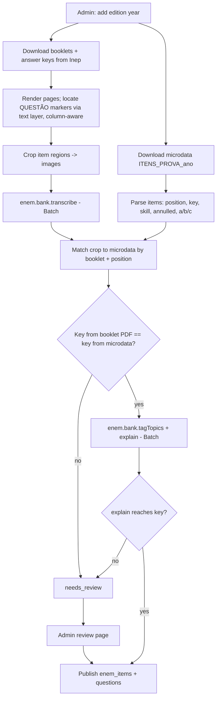

# 09 — ENEM mode

| Status | Phase(s) | Features |
|---|---|---|
| Draft v1 | 4 | ENM-01 … ENM-10 (ENM-08 is specified in [08 — Prova Provável](08-prova-provavel.md)) |

Related: [PRD](../product/PRD.md) · [Architecture](../engineering/architecture.md) · [07 — Goals & Semana de Provas](07-goals-semana-de-provas.md) (goals, planner engine, Hoje) · [08 — Prova Provável](08-prova-provavel.md) (topic statistics, Simulado Provável, predicted redação themes) · [05 — Practice & exams](05-practice-exams.md) (quiz engine, Caderno de Erros) · [11 — Câmera Mágica](11-camera-magica.md) (CAM-03 handwritten transcription) · [12 — Interactive learning](12-interactive-learning.md) (INT-03 Treino de Argumentação) · [Learning engine](../engineering/learning-engine.md)

> **Facts about ENEM in this spec were checked against INEP/MEC material on 2026-10-26 (see [Sources](#sources)).** Items that could not be confirmed from a primary source are marked **(unverified)**. Rules change between editions: anything edition-specific (dates, times, durations, checklist) lives in data (`enem_editions`), is entered from that year's **edital**, and is never hard-coded.

---

## 1. Summary

ENEM mode is a second **goal mode** (`goals.mode = enem`, [07 GOL-01](07-goals-semana-de-provas.md)) that reshapes Studify around the Exame Nacional do Ensino Médio:

- **Structure (ENM-01):** the 4 knowledge areas + Redação, the student's foreign language (Inglês or Espanhol), and every topic tagged with the official **Matriz de Referência** skills (H1–H30 per area).
- **Practice with real items (ENM-02)** from past ENEMs, plus **ENEM-style questions generated from the student's own material (ENM-03)**.
- **Simulado com TRI (ENM-04):** full exam days, timed like the real thing, with an **estimated** TRI score per area, coherence alerts and time coaching.
- **Correção de Redação (ENM-05):** the 5 competências, 0–1000, actionable feedback, proposta de intervenção checklist, repertório checks, rewrites and progress.
- **Meta SISU (ENM-06):** target course → per-area target scores that weight the plan.
- **Plano até o ENEM (ENM-07)**, **Atualidades (ENM-09)** and **Reta Final (ENM-10)**.
- **Prova Provável ENEM (ENM-08)** — in [08](08-prova-provavel.md).

### 1.1 ENEM facts this spec relies on

| Fact | Value | Source |
|---|---|---|
| Objective tests | 4 tests × 45 items = 180 items, 5 alternatives (A–E) | Edital 2025 [S1] |
| Day 1 | Linguagens, Códigos e suas Tecnologias (includes 5 foreign-language items, Inglês **or** Espanhol, chosen at registration) + Ciências Humanas e suas Tecnologias + Redação; **5h30** | Edital 2025 [S1][S2] |
| Day 2 | Ciências da Natureza e suas Tecnologias + Matemática e suas Tecnologias; **5h00** | Edital 2025 [S1][S2] |
| Exam-day times (2025) | Gates open 12:00, close 13:00, start 13:30 (horário de Brasília) — **edition data, re-check every year** | Edital 2025 [S1][S2] |
| Area codes | `LC`, `CH`, `CN`, `MT` (used in INEP microdata as `SG_AREA`) | Microdata usage [S7] **(column name unverified against the dictionary)** |
| Matriz de Referência | 5 eixos cognitivos common to all areas; LC 9 competências, MT 7, CN 8, CH 6; **H1–H30 in every area** | Matriz de Referência (reproduced in UFG 2027 edital, Anexo VI) [S3] |
| Redação type | Texto dissertativo-argumentativo on a social theme; proposta de intervenção must respect human rights | Cartilha do Participante 2025 [S4] |
| Redação grading | 5 competências, each 0–200 in six levels (0, 40, 80, 120, 160, 200); ≥ 2 independent evaluators; final = arithmetic mean of the two totals | Cartilha 2025 [S4] |
| Discrepancy | Totals differ by > 100 points **or** any competência differs by > 80 → third evaluator (final = mean of the two closest totals); if still discrepant → panel of three | Cartilha 2025 [S4] (text partly garbled in our copy; thresholds match long-standing INEP rules) |
| Redação zero | Fuga total ao tema; não obediência ao tipo dissertativo-argumentativo; texto em branco; até 7 linhas (texto insuficiente — copied lines don't count); impropérios/desenhos/outras formas propositais de anulação; parte deliberadamente desconectada do tema; identificação fora do espaço próprio; texto predominantemente ou integralmente em língua estrangeira; texto ilegível | Cartilha 2025 [S4] |
| Human rights | Per the 2025 Cartilha, a proposta that disrespects human rights gets **0 in Competência V** (not a zero for the whole essay); re-check each edition's cartilha | Cartilha 2025 [S4] |
| Redação sheet | 30 lines **(unverified in this pass; long-standing format)** | — |
| TRI | 3-parameter logistic model; scale fixed in 2009 with the reference group (concluintes regulares 2009) at mean 500, SD 100; no fixed min/max; score depends on the pattern of answers, not only the count | [S5][S6] |
| Item data | INEP microdata are published for editions 1998–2025; they include an item table `ITENS_PROVA_<ano>` (position, answer key, skill, abandoned-item flag, TRI parameters a/b/c per item) | INEP microdata page [S7]; columns per community usage [S8] **(exact columns and scale of the parameters: verify in each year's dictionary)** |
| Redação evaluator microdata | "Notas Detalhadas dos Avaliadores da Redação" files for 2019–2024 (per-competência grades, no essay texts) | INEP microdata page [S7] |
| Past exams | Exam booklets and answer keys of past editions are downloadable free from INEP | [S9] — **redistribution/licensing terms unverified** |
| SISU | Each institution sets per-course weights for the 4 areas + Redação and optional minimum scores; the *nota de corte* shown during registration is informational and updated during the process | Portaria Normativa MEC nº 21/2012 (as amended) [S10]; USP FAQ [S11] |
| SISU score | Weighted average: Σ(score × weight) ÷ Σ weights | Secondary sources only [S12] **(confirm in the SISU edital)** |

## 2. Goals and non-goals

**Goals**
- A student preparing for ENEM gets a long-horizon plan, real-item practice, TRI-aware simulados and essay correction in one place.
- Every TRI number is labeled as an **estimate**, with an interval, and the estimator is validated against official scores from INEP microdata.
- Redação feedback is specific enough to act on (quotes, levels, concrete rewrites) and calibrated against human grades.
- ENEM mode reuses the shared machinery: goals, planner, Hoje, quiz engine, FSRS, Caderno de Erros, tutor.

**Non-goals**
- Official scores or guarantees of approval. No "você passou".
- Advice on eligibility for quotas (cotas) or any legal/administrative SISU guidance beyond showing published numbers.
- Predicting the real redação theme (see [08 ENM-08.6](08-prova-provavel.md)).
- Vestibulares other than ENEM (FUVEST, Unicamp…) — later, if ever.
- PRD non-goals stay out (no lecture recording, no voice oral examiner).

## 3. User stories

| # | As a… | I want to… | So that… |
|---|---|---|---|
| US-1 | vestibulando | create "ENEM {ano}" and choose Espanhol | the app knows my exam and language |
| US-2 | vestibulando | practice real past ENEM questions by topic and skill | I train on the real thing |
| US-3 | vestibulando | get ENEM-style questions from my cursinho's apostila | my own material trains me in the ENEM format |
| US-4 | vestibulando | take a full Dia 2 (90 questions, 5 hours) | I build stamina and timing |
| US-5 | vestibulando | see an estimated TRI score and why it's lower than my hit count suggests | I understand coherence |
| US-6 | vestibulando | photograph my handwritten redação and get a 0–1000 estimate per competência | I improve the way the real exam is graded |
| US-7 | vestibulando | pick "Medicina — UF X" and get a target per area | I know how much I need in each area |
| US-8 | vestibulando | follow a plan until the exam that balances areas, essays and simulados | I don't neglect anything |
| US-9 | vestibulando | read a weekly digest of news that matters for ENEM | I have repertório and context for Humanas |
| US-10 | vestibulando | get a Reta Final routine and an exam-day checklist | I arrive calm and prepared |

## 4. Functional requirements

### ENM-01 — ENEM structure

- **ENM-01.1 — Create an ENEM goal.** Options: edition year (current or next), foreign language (Inglês / Espanhol → `profiles.foreign_language`), target SISU course (optional, ENM-06), availability (shared with [07](07-goals-semana-de-provas.md) `study_preferences`).
- **ENM-01.2 — Edition dates.** Dates and times come from `enem_editions` (admin-entered from the official edital, with `source_url` and `verified_at`). If the edital is not out yet, the goal uses a **provisional date** entered by the student or the admin ("Datas ainda não divulgadas pelo Inep — usando {data} como previsão"), and replans automatically when official dates are entered.
- **ENM-01.3 — Areas.** The goal shows 5 tracks: Linguagens (`LC`), Humanas (`CH`), Natureza (`CN`), Matemática (`MT`), Redação. Subjects map to areas with `subjects.enem_area` (Português/Literatura/Inglês/Espanhol/Artes/Educação Física → LC; História/Geografia/Filosofia/Sociologia → CH; Biologia/Química/Física → CN; Matemática → MT). Missing standard subjects are created empty (they still get bank practice).
- **ENM-01.4 — Matriz tagging.** On goal creation (and when new material is ingested into an ENEM-mapped subject), the batch job `enem.tagNodes` (§7.1) tags topics/concepts with skill codes (`knowledge_nodes.enem_skill_codes`, e.g. `CN-H17`) and links them to the global ENEM topic taxonomy (`knowledge_node_enem_topics`).
- **ENM-01.5 — Skill view.** Per area, a grid of H1–H30 grouped by competência, colored by the student's mastery (aggregated from tagged nodes and bank items answered); tapping a skill shows its official description, related topics, and "Praticar essa habilidade".
- **ENM-01.6 — Language filter.** Foreign-language items, generation and simulados always follow the student's chosen language; the other language is hidden unless the student switches.

### ENM-02 — Banco de Questões ENEM

- **ENM-02.1 — Content.** Official items from the regular application of each edition from **2009** on (current 4 × 45 format), with answer keys; reapplications/PPL stored but hidden by default (see [08 §12](08-prova-provavel.md#12-open-questions)).
- **ENM-02.2 — Faithful display.** Each item is shown as the **original image crop(s)** from the official booklet (texts, figures, tables exactly as printed), with a **transcription** toggle (Markdown + LaTeX) for accessibility, search, zoom and read-aloud. Figures have alt text.
- **ENM-02.3 — Metadata.** Edition, day, area, position, skill (`CO_HABILIDADE` → `MT-H21`), answer key, TRI parameters (when published), annulled flag, subject, ENEM topic(s), difficulty band (from `b`: Fácil / Média / Difícil / Muito difícil by quartiles of the item's area across editions).
- **ENM-02.4 — Practice.** Filters: area, subject, topic, skill, edition, difficulty, "não respondidas", "que errei". Modes: lista (untimed), cronometrado (3 min/item default), por habilidade, aleatório. Answers go to `attempt_answers`; wrong answers create Caderno de Erros entries (PRA-04) and optional flashcards (PRA-02).
- **ENM-02.5 — Resolução comentada.** Each item has a generated commented solution (`enem.bank.explain`, §7.3): resolution, why each wrong alternative is wrong, the skill being tested, and links to the student's own topics when mapped. Labeled "Resolução comentada pelo Studify". The solution **must reach the official key** (validated).
- **ENM-02.6 — Annulled items** are shown with a banner "Questão anulada pelo Inep" and are never used in TRI estimates or statistics.
- **ENM-02.7 — Attribution.** Every item shows "ENEM {ano} · {dia}º dia · Questão {n} · Fonte: Inep".
- **ENM-02.8 — Import pipeline** (admin/worker, §8.1): yearly, after INEP publishes booklets, answer keys and microdata. Items are global (system-owned), shared by all users at no per-user AI cost.
- **ENM-02.9 — Admin review.** An internal review page lists items whose segmentation, key cross-check or explanation validation failed; nothing flagged is published until fixed.

### ENM-03 — ENEM-style questions from your material

- **ENM-03.1** For ENEM-mapped subjects, Studify generates questions in ENEM format from the student's material: **texto-base** (support text, chart or table) + **comando** + **5 alternatives (A–E)**, one correct, distractors built from plausible misconceptions.
- **ENM-03.2** Each question is tagged with an ENEM skill and a difficulty estimate (Fácil / Média / Difícil), cites the material pages it tests (`source_pages`), and stores `enem_style = true`.
- **ENM-03.3** Texto-base kinds: `excerpt` (≤ 600 characters quoted from the student's material, with page), `written` (a realistic context written by Studify, labeled "Texto elaborado pelo Studify"), `chart` / `table` (data in `chart_data`, rendered by the app's chart component). Studify never attributes invented text to real outlets, authors or institutions.
- **ENM-03.4** Generated questions are practiced in lists, mixed into the Feed (FED-01) and quizzes, but **are not used in TRI estimates** (they have no calibrated parameters); in results they appear as "% de acerto".
- **ENM-03.5** Generation happens in bulk via the Batch API when an ENEM goal is created or new material arrives (5 per in-scope topic by default), and on demand ("Gerar mais 5 questões estilo ENEM") synchronously.

### ENM-04 — Simulado com TRI

- **ENM-04.1 — Modes:**

  | Mode | Content | Time limit |
  |---|---|---|
  | **Dia 1 completo** | 45 LC (with the 5 items of the chosen language) + 45 CH + Redação | Edition's Day 1 duration (5h30 in 2025) |
  | **Dia 2 completo** | 45 CN + 45 MT | Edition's Day 2 duration (5h00 in 2025) |
  | **Área** | 45 items of one area | 45 × 3 min = 2h15 (editable) |
  | **Mini** | 15 or 30 items of one area | 3 min/item |

- **ENM-04.2 — Item sources:** **Réplica** (a full past edition exactly as applied — best TRI fidelity), **Misto** (items from several editions matched to a real edition's difficulty distribution), **Provável** (ENM-08.4). Only official, non-annulled items with TRI parameters are used.
- **ENM-04.3 — Exam UI:** one item per screen, swipe/next; **cartão-resposta** screen (A–E bubbles, answered/blank/marked); "Marcar pra revisar"; countdown with warnings at 60, 30 and 15 minutes left; auto-submit at zero; optional "Modo prova" (suggests Do Not Disturb). The full simulado (images + transcriptions) is downloaded before starting and works offline.
- **ENM-04.4 — Pauses:** full-day modes allow pausing but record `paused_seconds` and label the result "simulado com pausa"; Mini/Área pause freely.
- **ENM-04.5 — Scoring per area** (§8.3): estimated score on the ENEM scale with an 80% interval, number correct, coherence level, **erros fáceis** (wrong answers on items the student was very likely to get right) and **acertos improváveis** (right answers on items far above their level — likely guesses).
- **ENM-04.6 — Time analysis:** time per item, items over 6 min ("você travou aqui"), accuracy by position (fatigue), suggested pacing for each day (§8.5).
- **ENM-04.7 — Guessing coaching:** blanks are treated as incorrect by our estimator, so the app reminds students to answer every item and shows the impact of each blank in the result.
- **ENM-04.8 — Day 1 essay:** in Dia 1 completo, the redação is written in the app's 30-line editor or on paper and photographed (CAM-03), then graded by ENM-05; the simulado result shows the 5 scores (LC, CH, CN, MT, Redação) as ENEM does — no single "nota total"; with a Meta SISU target, the weighted SISU estimate is shown too (§8.4).
- **ENM-04.9 — History:** a chart per area of estimated scores over time (with intervals), and a "Revisar erros" action that opens the wrong items with their commented solutions.
- **ENM-04.10 — Label:** every TRI number is shown as "Nota estimada (TRI)" with the footnote "Estimativa do Studify. A nota oficial do Inep pode ser diferente."

### ENM-05 — Correção de Redação

- **ENM-05.1 — Input:** typed in a **30-line editor** that mimics the answer sheet (line counter with an estimated handwritten-line conversion, §8.6) or **photographed** handwritten pages (CAM-03 transcription, which the student reviews and corrects before grading). Theme required (from predicted themes, past themes, Atualidades, or typed by the student).
- **ENM-05.2 — Zero checks first:** the grader checks every zero condition (§1.1) and, when one applies, returns 0 with the reason and how to avoid it. Fewer than 8 lines is checked deterministically before calling the model.
- **ENM-05.3 — Per-competência result:** for C1–C5, a score in {0, 40, 80, 120, 160, 200}, the level description, a justification, quoted evidence from the essay, a list of issues with suggested fixes (C1: grammar/spelling with corrections; C2: tangency, type, repertório use; C3: argument selection and organization; C4: cohesion devices and repetition; C5: intervention proposal), and strengths.
- **ENM-05.4 — Proposta de intervenção checklist:** agente, ação, modo/meio, efeito/finalidade, detalhamento — each ✅/❌ with the quote, plus the human-rights check (failing it sets C5 = 0, not the whole essay).
- **ENM-05.5 — Repertório check:** every factual reference in the essay (quote, data, law, author) is listed and checked by `repertorio.verify` (§7.6): ✅ confirmed (with source link), ⚠️ couldn't confirm, ❌ contradicted. The model never invents citations; suggested repertório *directions* (e.g. "dados do IBGE sobre…") come with sources only when verified.
- **ENM-05.6 — Rewrites:** up to 2 paragraphs (the weakest) get a suggested rewrite with "por que ficou melhor".
- **ENM-05.7 — Progress:** total and per-competência chart across essays; "competência que mais evoluiu"; streak of weekly essays (feeds MOT-01).
- **ENM-05.8 — Theme generator:** "Me dá um tema" picks from predicted themes ([08 ENM-08.6](08-prova-provavel.md)), past themes (with the original proposal page crop from the bank when available), or Atualidades; shows the full prompt with motivating texts.
- **ENM-05.9 — Labeling and limits:** results show "Nota estimada" and the calibration status; budget: default 3 corrections per user per week (PLT-04; owner-configurable).
- **ENM-05.10 — Calibration:** before release, the grader is calibrated on the set defined in the roadmap (Cartilha examples + ≥ 20 teacher-graded essays) and its score distribution is compared with INEP's evaluator microdata (2019–2024) so it isn't systematically generous or harsh (§10).

### ENM-06 — Meta SISU

- **ENM-06.1 — Choose targets:** up to 3 targets (course, institution, campus, shift, modality label). Search uses `sisu_offers` (seeded from public data when available, §8.4); if not found, **manual entry**: weights for LC/CH/CN/MT/Redação, optional minimum scores, and the reference cut-off.
- **ENM-06.2 — Show the numbers:** weights, minimum scores, last available cut-offs (with edition and source), and the "nota de corte é só referência" note.
- **ENM-06.3 — Targets per area:** from the student's current estimates (latest simulados and essays), compute per-area targets that reach the cut-off + margin (default +15) using §8.4, respecting minimum scores; show "Você está a {x} pontos da meta".
- **ENM-06.4 — Plan weighting:** targets and weights feed Plano até o ENEM (ENM-07) area shares and ENM-08.3 priorities.
- **ENM-06.5 — Privacy:** modality (ampla concorrência / cotas) can reveal sensitive personal data (racial origin, income, disability). The app asks only for the **cut-off to use** and an optional free-text label; it never asks *why* a modality applies and never shares targets with the Turma.

### ENM-07 — Plano até o ENEM

- **ENM-07.1** Plans from today to the edition's Day 2 date using the shared planner engine ([07 §8.2](07-goals-semana-de-provas.md#82-planner-buildplan)) with an ENEM unit generator (§8.7): weekly quotas instead of per-test deadlines.
- **ENM-07.2 — Phases:** **Base** (> 12 weeks out; more learning), **Intensificação** (12 → 4 weeks; more practice and simulados), **Reta Final** (last 4 weeks; ENM-10).
- **ENM-07.3 — Area shares** ∝ SISU weight × gap to target (§8.7), with a floor so no area is abandoned.
- **ENM-07.4 — Redação cadence:** 1 essay per week (2 per week in the last 8 weeks), each followed by a feedback-review unit.
- **ENM-07.5 — Simulados:** an area simulado every 2 weeks (rotating areas) and a full-day simulado every 4 weeks (alternating Dia 1/Dia 2), placed on the student's longest available day (default Sunday).
- **ENM-07.6 — Topics without material** are practiced with bank items ("Lista de questões") and the tutor (general answers labeled, TUT-04), with a suggestion to upload material.
- **ENM-07.7 — Coexistence with school:** during a Semana de Provas the ENEM share drops to `enem_min_share` ([07 §8.9](07-goals-semana-de-provas.md#89-several-goals-at-once)).
- **ENM-07.8 — Weekly review** (Sunday evening card): last week's minutes per area, essays done, simulado trend, next week's focus.

### ENM-08 — Prova Provável ENEM

Specified in [08 — Prova Provável](08-prova-provavel.md#enm-08--prova-provável-enem).

### ENM-09 — Atualidades

- **ENM-09.1** A weekly digest (published Monday 06:00 Brasília) of 5–8 current-events items relevant to Humanas, Natureza (environment, health, science) and Redação. Global (same for everyone), generated once per week.
- **ENM-09.2** Each item: title, neutral summary (≤ 150 words), "Por que importa pro ENEM" (areas, skills, possible redação axes), repertório (data points with source), 2 ENEM-style practice questions (ENM-03 format, `texto-base kind = written`, citing the item's sources), and source links with outlet names and dates.
- **ENM-09.3** Sources come only from an **admin-maintained allowlist** of reputable outlets and official bodies (§7.7); every claim in the summary must be supported by at least one cited source.
- **ENM-09.4 — Tone and safety:** neutral and age-appropriate; on politically contested topics present facts and the main positions without taking sides; no graphic detail of violence; during election periods, no candidate or party evaluation.
- **ENM-09.5** Push notification on publication (opt-in), archive of past digests, and "Salvar como repertório" (adds the item to the student's personal repertório list used by ENM-05 and INT-03).
- **ENM-09.6** Digest items feed predicted redação themes ([08 ENM-08.6](08-prova-provavel.md)) and Treino de Argumentação (INT-03).

### ENM-10 — Reta Final

- **ENM-10.1** Activates automatically 4 weeks before Day 1 (configurable 2–6) with a card "Começou a Reta Final".
- **ENM-10.2 — Plan changes:** no new heavy topics in the last 7 days; focus on high-frequency × weak topics (ENM-08.3); 2 full-day simulados at the **real time of day** (start time from `enem_editions`, e.g. 13:30 Brasília in 2025) on the two Sundays before the exam when available; 2 redações per week; FSRS reviews prioritized for ENEM-tagged cards.
- **ENM-10.3 — Checklist** from `enem_editions.checklist` (admin-entered from that year's edital; 2025 seed: official photo ID, black ballpoint pen made of transparent material, printed confirmation card recommended, check the exam location in advance, gate times in Brasília time). Always shown with "Confira sempre o edital oficial do Inep" and a link to it.
- **ENM-10.4 — Day before each day:** light review only (cheat sheet per area of the most frequent topics + formulas), sleep and routine nudge adjusted to an afternoon exam, "separe documento e caneta" reminder.
- **ENM-10.5 — Between Day 1 and Day 2:** rest-first guidance, light Natureza/Matemática review, and a suggestion to avoid obsessing over unofficial answer keys.
- **ENM-10.6 — Exam days:** a single morning notification ("Boa prova! Documento e caneta preta transparente na mochila? 🍀"); no study notifications that day.

## 5. UX and screens

| Screen | Content |
|---|---|
| **ENEM home** (goal dashboard) | Countdown to Day 1/Day 2 (or "data prevista"), 5 area cards with estimated score + target (Meta SISU), this week's plan, next simulado, next essay |
| **Área** | Skill grid H1–H30 by competência, topic list with mastery, bank practice, generated questions |
| **Banco de Questões** | Filters; item viewer (crop + transcription toggle); answer; commented solution |
| **Simulado** setup → **Prova** → **Cartão-resposta** → **Resultado** | ENM-04 |
| **Redação**: tema → escrever/fotografar → revisar transcrição → aguardando → resultado | ENM-05 |
| **Meta SISU** | Search / manual entry → targets per area |
| **Atualidades** | Weekly digest list → item detail |
| **Reta Final** | Checklist, final-weeks schedule |

### Key PT-BR strings

| Key | String |
|---|---|
| `enem.goal.title` | ENEM {ano} |
| `enem.dates.provisional` | Datas ainda não divulgadas pelo Inep — usando {data} como previsão. |
| `enem.language` | Qual língua estrangeira você vai fazer? |
| `enem.area.LC` | Linguagens |
| `enem.area.CH` | Humanas |
| `enem.area.CN` | Natureza |
| `enem.area.MT` | Matemática |
| `enem.area.RED` | Redação |
| `enem.skill.practice` | Praticar essa habilidade |
| `bank.source` | ENEM {ano} · {dia}º dia · Questão {n} · Fonte: Inep |
| `bank.annulled` | Questão anulada pelo Inep |
| `bank.solution.label` | Resolução comentada pelo Studify |
| `gen.text.written` | Texto elaborado pelo Studify |
| `sim.mode.day1` | Dia 1 completo |
| `sim.mode.day2` | Dia 2 completo |
| `sim.cartao` | Cartão-resposta |
| `sim.mark` | Marcar pra revisar |
| `sim.time.warning` | Faltam {min} minutos |
| `sim.paused` | Simulado com pausa |
| `sim.score.label` | Nota estimada (TRI) |
| `sim.score.footnote` | Estimativa do Studify. A nota oficial do Inep pode ser diferente. |
| `sim.easy_misses` | Você errou {n} questões fáceis pro seu nível — elas pesam mais na TRI. |
| `sim.lucky_hits` | {n} acertos parecem chute. Na TRI, eles valem menos. |
| `sim.blank` | Nunca deixe em branco: em branco conta como erro. |
| `sim.stuck` | Você travou aqui ({min} min). Na prova, pule e volte depois. |
| `red.theme.pick` | Me dá um tema |
| `red.lines` | {n} de 30 linhas |
| `red.too_short` | Com até 7 linhas, a redação leva nota zero. |
| `red.grading` | Corrigindo sua redação… te aviso quando ficar pronta. |
| `red.score.label` | Nota estimada |
| `red.proposta.checklist` | Agente · Ação · Meio/modo · Finalidade · Detalhamento |
| `red.hr.zero` | Essa proposta desrespeita os direitos humanos: a Competência V fica com zero. |
| `red.repertorio.unverified` | Não conseguimos confirmar essa referência. Confira antes de usar. |
| `sisu.title` | Meta SISU |
| `sisu.cutoff.note` | Nota de corte é só referência — ela muda a cada edição. |
| `sisu.gap` | Você está a {x} pontos da meta. |
| `sisu.manual` | Não achou? Digite os pesos e a nota de corte do edital. |
| `atual.title` | Atualidades da semana |
| `atual.save` | Salvar como repertório |
| `final.start` | Começou a Reta Final! 🏁 |
| `final.checklist.note` | Confira sempre o edital oficial do Inep. |
| `final.good_luck` | Boa prova! Documento e caneta preta transparente na mochila? 🍀 |

## 6. Data

### 6.1 Entities used

`goals` (`mode = enem`), `profiles` (`foreign_language`), `subjects` (`enem_area`), `knowledge_nodes` (`enem_skill_codes`), `questions` (`origin = enem_official`, ENEM fields), `quizzes` (`kind = enem_simulado`), `quiz_attempts` (`tri_estimate`), `attempt_answers`, `mistakes`, `mastery`, `essays`, `plan_items`, `study_preferences`, `ai_jobs`, `ai_usage`; plus `topic_predictions`, `enem_topic_stats`, `enem_topic_trends`, `enem_redacao_themes` from [08](08-prova-provavel.md).

### 6.2 New entities / fields

| Table | Column | Type | Purpose |
|---|---|---|---|
| `enem_editions` (new) | `year` (PK), `day1_date`, `day2_date` (nullable), `dates_status` (`official` / `provisional`), `gates_open`, `gates_close`, `start_time` (local time), `timezone` (default `America/Sao_Paulo`), `day1_duration_min`, `day2_duration_min`, `checklist` (JSON), `edital_url`, `verified_at`, `verified_by` | | ENM-01.2, ENM-10.3 |
| `enem_skills` (new, seed) | `code` (PK, e.g. `CN-H17`), `area`, `competency_no`, `skill_no`, `description` | | Matriz (ENM-01) |
| `enem_topics` (new, curated taxonomy) | `id`, `area`, `subject`, `parent_id`, `title`, `position` | | Global topics for the bank and statistics |
| `knowledge_node_enem_topics` (new) | `node_id`, `enem_topic_id`, `confidence` | | Links a student's topics to the global taxonomy |
| `knowledge_nodes` | `enem_skill_codes` | text[] | (exists in architecture) |
| `enem_items` (new) | `id`, `question_id` (FK `questions`), `edition_year`, `application` (`regular` / `ppl` / `other`), `day`, `area`, `co_item` (INEP item id), `positions` (JSON: `[{co_prova, color, position}]`), `answer_key`, `skill_code`, `language` (`en` / `es` / null), `annulled` (bool), `annul_reason`, `crop_paths` (text[]), `transcription_md`, `alt_text`, `enem_topic_ids` (uuid[]), `subject`, `explanation_status` (`pending` / `ok` / `flagged`), `review_status` (`ok` / `needs_review`) | | ENM-02 |
| `enem_item_params` (new) | `enem_item_id`, `a`, `b`, `c`, `scale` (`std` / `enem`), `source` (`microdata_<year>`), `logistic_d` (numeric, default 1.0, see §8.3) | | TRI |
| `questions` | `enem_skill_code` (text), `enem_style` (bool), `texto_base` (JSON: `{kind, content_md, chart_data?, source_pages?, label?}`), `difficulty_band` (`facil` / `media` / `dificil` / `muito_dificil`) | | ENM-02, ENM-03 |
| `quizzes` | `config` for `enem_simulado`: `{ mode, area?, source: "replica" | "misto" | "provavel", edition?, language, item_ids, time_limit_min, includes_essay, seed }` | JSON | ENM-04 |
| `quiz_attempts` | `area_results` | JSON: per area `{ theta, se, score, ci80_low, ci80_high, n_items, n_correct, n_blank, coherence: { lz, level, easy_miss_ids[], lucky_hit_ids[] }, time: { total_s, per_item_s[], stuck_ids[] } }` | ENM-04.5–6 |
| `quiz_attempts` | `paused_seconds`, `essay_id` (nullable) | | ENM-04.4, ENM-04.8 |
| `essays` | `kind` (`enem_redacao` / `dissertativa`), `theme_id` (FK `essay_themes`), `input_mode` (`typed` / `photo`), `line_count`, `est_handwritten_lines`, `status` (`draft` / `grading` / `graded` / `failed`), `total`, `is_zero`, `zero_reasons` (text[]), `competencias` (JSON), `proposta` (JSON), `repertorio` (JSON), `rewrites` (JSON), `grading_runs` (JSON, if dual correction) | | ENM-05 |
| `essay_themes` (new) | `id`, `title`, `axis`, `source` (`past_enem` / `predicted` / `atualidades` / `custom`), `edition_year` (nullable), `prompt` (JSON: instruction + motivating texts with sources), `rationale`, `connections` (JSON), `proposal_crop_path` (nullable, past themes), `valid_until`, `created_by` (nullable user for custom) | | ENM-05.8, ENM-08.6 |
| `repertorio_items` (new) | `id`, `user_id`, `kind` (`quote` / `data` / `law` / `work` / `event`), `text`, `source_url`, `source_name`, `verified` (`yes` / `no` / `contradicted`), `atualidades_item_id` (nullable), `tags` | | ENM-05.5, ENM-09.5 |
| `sisu_offers` (new) | `id`, `edition_year`, `institution`, `institution_acronym`, `campus`, `course`, `degree`, `shift`, `weights` (JSON `{LC, CH, CN, MT, RED}`), `min_scores` (JSON), `cutoffs` (JSON `[{modality_label, cutoff, edition}]`), `source` (`open_data` / `edital` / `manual_admin`), `source_url`, `verified_at` | | ENM-06 |
| `sisu_targets` (new) | `id`, `user_id`, `goal_id`, `offer_id` (nullable), `manual` (JSON, when no offer), `cutoff_used`, `modality_label` (free text, optional), `margin` (default 15), `priority` (1–3), `targets` (JSON per area), `computed_at` | | ENM-06 (sensitive, see ENM-06.5) |
| `atualidades_digests` (new) | `id`, `week_start`, `status` (`draft` / `published` / `withdrawn`), `published_at` | | ENM-09 |
| `atualidades_items` (new) | `id`, `digest_id`, `title`, `summary_md`, `why_md`, `areas` (text[]), `skill_codes` (text[]), `redacao_axes` (text[]), `repertorio` (JSON), `sources` (JSON `[{url, name, published_at}]`), `question_ids` (uuid[]) | | ENM-09 |

## 7. AI behavior

All calls: model `claude-opus-5-5`; PLT-04 budget checks (global jobs bill to the system budget, not to students); `ai_usage` rows with the feature ID; `stop_reason` handled, including `refusal`, with server-side fallbacks (`fallbacks: "default"`) on synchronous (non-Batch) calls only — Batch requests don't accept `fallbacks`; refused batch results are re-run on the standard API ([ai-pipeline.md R1](../engineering/ai-pipeline.md#14-reconciliations)); Zod validation with one retry, then flag.

| # | Task | Feature | Runs | Inputs | Effort | Output (structured unless noted) |
|---|---|---|---|---|---|---|
| 7.1 | `enem.tagNodes` | ENM-01.4 | Worker, **Batch API** | Topic/concept outline of the subject; the area's skill list (`enem_skills`) and `enem_topics` subtree — both **prompt-cached** | `medium` | `{ nodes: [{ node_id, skill_codes: [{code, confidence}], enem_topic_ids: [{id, confidence}] }] }` (codes/ids validated) |
| 7.2 | `enem.bank.transcribe` | ENM-02 | Import worker, **Batch API** | Item crop image(s) + the booklet page as a PDF slice | `medium` | `{ statement_md, alternatives: [{label: "A".."E", text_md}], has_figure, alt_text, subject_guess }` |
| 7.3 | `enem.bank.explain` | ENM-02.5 | Import worker, **Batch API** | Crop + transcription + official key + skill description | `high` | `{ chosen_answer, solution_md, distractors: [{label, why_wrong}], skill_explanation }` — `chosen_answer` must equal the official key, else regenerate once, else `explanation_status = flagged` |
| 7.4 | `enem.bank.tagTopics` | ENM-02.3 | Import worker, **Batch API** | Transcription + skill code + `enem_topics` (cached) | `low` | `{ subject, enem_topic_ids: [{id, confidence}] }` |
| 7.5 | `enem.question.generate` | ENM-03 | Batch API (bulk) / Edge Function (on demand, 5 items) | PDF slices of the topic (cached per subject); skill descriptions; 2–3 official items of the same skill as style examples (transcriptions) | `high` | `{ items: [{ texto_base: {kind, content_md, chart_data?, source_pages?}, comando_md, alternatives: [5], answer, explanation_md, distractor_rationales: [4], skill_code, difficulty: "facil" | "media" | "dificil", source_pages }] }` — `source_pages` within slices; `excerpt` text must match the page text (deterministic check) |
| 7.6 | `essay.grade` | ENM-05 | Worker job (standard API), target < 90 s, push when done | Theme prompt; essay text with line numbers; the official competência level descriptors (cached system block); 3–5 calibrated anchor essays with their official/teacher scores (cached) | `high` | `{ zero_check: {is_zero, reasons[], evidence}, competencias: [{ id: 1-5, score: 0|40|80|120|160|200, level_text, justification, evidence: [{quote, line}], issues: [{type, quote, line, fix}], strengths[] }], proposta: { agente, acao, meio, finalidade, detalhamento: {present, quote}, direitos_humanos_ok, note }, repertorio_refs: [{text, kind, line}], rewrites: [{paragraph, original, suggested, why}], top_actions: [3] }` — total computed in code (Σ scores, or 0 if zero) |
| 7.7 | `repertorio.verify` | ENM-05.5 | Worker, after 7.6 (parallel per reference); max 6 references | One reference + context; **web search** (`web_search_20260209`, `max_uses` 3) | `low` | Step 1 (text + citations) → step 2 structured `{ status: "confirmed" | "not_found" | "contradicted", source_url?, source_name?, note }` |
| 7.8 | `atualidades.research` + `atualidades.structure` | ENM-09 | Weekly worker | Step 1: **web search** (`web_search_20260209`, `allowed_domains` = admin allowlist, `max_uses` ≈ 20) over the past 7 days → text with citations. Step 2: structuring call over step-1 text and its citation URLs | `high` (step 1), `medium` (step 2) | `{ items: [{ title, summary_md, why_md, areas[], skill_codes[], redacao_axes[], repertorio: [{text, source_url}], sources: [{url, name, published_at}], questions: [2 × ENM-03 schema] }] }` — every `source_url` must come from step-1 citations (validated) |

Notes:
- **Citations vs structured outputs:** the Citations API cannot be combined with `output_config.format`; where we need both (7.7, 7.8) we use two calls — a research call that returns cited text, then a structuring call whose URLs are validated against the first call's citations.
- **Calibration anchors** in 7.6 are the main lever for grading accuracy; they are versioned (`essay.grade@vN`) and changes require re-running the calibration set (§10).
- **No AI in TRI, SISU math, statistics or planning** — all deterministic code.
- **Optional dual correction** (open question): run 7.6 twice with evaluator variants; final = mean; if the totals differ by > 100 or any competência by > 80, run a third and use the mean of the two closest — mirroring INEP's procedure. Off by default for cost.

## 8. Rules and algorithms

### 8.1 Bank import pipeline (ENM-02.8)



- One booklet color per day is processed for crops; other colors are matched through the microdata positions so any booklet's numbering can be shown.
- The parameter scale is detected per edition: if the median of `b` across items is > 50, parameters are on the ENEM reporting scale and are converted (`b_std = (b − 500)/100`, `a_std = a × 100`); otherwise they are treated as standardized (`scale = std`). **The correct interpretation must be confirmed from each edition's data dictionary (unverified).**

### 8.2 Skill codes

`{AREA}-H{n}` with `AREA ∈ {LC, CH, CN, MT}` and `n ∈ 1..30`. Competência by area (from the Matriz [S3]):

| Area | Competências → habilidades |
|---|---|
| LC (9) | C1 H1–H4 · C2 H5–H8 (foreign language) · C3 H9–H11 · C4 H12–H14 · C5 H15–H17 · C6 H18–H20 · C7 H21–H24 · C8 H25–H27 · C9 H28–H30 |
| MT (7) | C1 H1–H5 · C2 H6–H9 · C3 H10–H14 · C4 H15–H18 · C5 H19–H23 · C6 H24–H26 · C7 H27–H30 |
| CN (8) | C1 H1–H4 · C2 H5–H7 · C3 H8–H12 · C4 H13–H16 · C5 H17–H19 · C6 H20–H23 · C7 H24–H27 · C8 H28–H30 |
| CH (6) | C1 H1–H5 · C2 H6–H10 · C3 H11–H15 · C4 H16–H20 · C5 H21–H25 · C6 H26–H30 |

The full descriptions are seeded into `enem_skills` from the Matriz document.

### 8.3 TRI estimate (ENM-04.5)

**Model (3PL):**

```
P_i(θ) = c_i + (1 − c_i) / (1 + exp(−D · a_i · (θ − b_i)))
```

with item parameters on the standardized scale (after §8.1 conversion) and `D` stored per edition (`logistic_d`; default 1.0; set to 1.7 if the dictionary indicates the normal-ogive constant — **unverified**).

**Estimation — EAP with a standard-normal prior** (the reference population):

1. Quadrature grid θ_k: 81 points from −4 to 4.
2. Likelihood `L(θ_k) = Π_i P_i(θ_k)^{u_i} (1 − P_i(θ_k))^{1−u_i}`, `u_i = 1` if correct, else 0. **Blank = incorrect.** Annulled items are skipped.
3. Posterior `w_k ∝ L(θ_k) · φ(θ_k)`; `θ̂ = Σ w_k θ_k`; `se = sqrt(Σ w_k (θ_k − θ̂)²)`.
4. Reported score `= 500 + 100 · θ̂`; 80% interval `= 500 + 100 · (θ̂ ± 1.2816 · se)`; rounded to the nearest point.
5. Mini simulados (15/30 items) use the same method; their wider interval is shown as is.

**Coherence (ENM-04.5):**
- **Erro fácil:** wrong item with `P_i(θ̂) ≥ 0.70`.
- **Acerto improvável:** right item with `P_i(θ̂) ≤ 0.35`.
- **Person-fit `l_z`:** `l_0 = Σ [u_i ln P_i + (1 − u_i) ln(1 − P_i)]`, `E = Σ [P_i ln P_i + (1 − P_i) ln(1 − P_i)]`, `Var = Σ P_i (1 − P_i) [ln(P_i / (1 − P_i))]²`, `l_z = (l_0 − E)/sqrt(Var)`. Level: `alta` if `l_z ≥ −1`, `média` if `−1.64 ≤ l_z < −1`, `baixa` if `l_z < −1.64`.

**Mixed-edition simulados** assume item parameters from different editions are on the common ENEM scale. This is our working assumption (INEP keeps scores comparable across editions [S5][S6]); results are labeled as estimates either way.

**Validation (acceptance, §11):** INEP participant microdata contain, per participant and area, the booklet code, the response string and the official score **(field names to be confirmed in the dictionary; unverified)**. The validation script samples ≥ 10,000 participants per area for ≥ 3 editions, runs §8.3 on their responses and compares with official scores. Targets: correlation ≥ 0.98 and mean absolute error ≤ 15 points. If missed, the method (prior, `D`, scale detection) is tuned, and until then intervals are widened by the observed RMSE.

### 8.4 Meta SISU math (ENM-06)

```
SISU score = Σ_k w_k · s_k / Σ_k w_k,     k ∈ {LC, CH, CN, MT, RED}
```

(as described by public guides [S12]; confirm against the SISU edital before release).

**Current estimates** `s_k`: mean of the last 2 simulado estimates per area (ENM-04), and the mean of the last 3 graded essays for RED. Missing area → ask the student for a self-estimate or show "Faça um simulado de {área} pra calcular".

**Targets** for cut-off `C` and margin `m` (default 15):

1. `T = C + m`; required weighted total `G = T · Σw − Σ w_k s_k`. If `G ≤ 0` → "Você já está acima da nota de corte de referência".
2. Headroom `h_k = cap_k − s_k` with `cap_k = 850` for objective areas and `cap_RED = 960` (realistic ceilings; configurable).
3. Allocate weighted points proportionally to `w_k · h_k`: `g_k = G · (w_k h_k) / Σ_j (w_j h_j)`; target `t_k = s_k + g_k / w_k`.
4. If `t_k > cap_k`, set `t_k = cap_k` and redistribute the remainder among the others; if `t_k < min_k` (institution minimum), set `t_k = min_k` and reduce the others accordingly. If impossible within caps → "Meta muito alta pro tempo que falta — que tal uma segunda opção?".
5. Round objective targets up to multiples of 5 and RED up to a multiple of 20.

**Worked example (fixture).** Weights LC 1, CH 1, CN 2, MT 3, RED 2 (Σ 9). Estimates LC 650, CH 700, CN 600, MT 620, RED 760 → current SISU score = 5930/9 = **658,9**. Cut-off 720, margin 15 → `T = 735`, `G = 6615 − 5930 = 685`. Headroom: 200, 150, 250, 230, 200 → `w·h` = 200, 150, 500, 690, 400 (Σ 1940).
`g` = 70.6, 53.0, 176.6, 243.6, 141.2 → `t` = LC **720,6**, CH **753,0**, CN **688,3**, MT **701,2**, RED **830,6** (check: Σ w·t = 6615 ✓) → displayed as LC 725, CH 755, CN 690, MT 705, RED 840.

### 8.5 Time coaching (ENM-04.6)

- **Day 2 pace:** `duration ÷ 90` (≈ 3,3 min/item for 5h00), minus a 30-min reserve for filling the cartão-resposta → target ≈ 3,0 min/item.
- **Day 1 pace:** reserve 60–90 min for the redação (student setting, default 75) + 30 min for the cartão → target ≈ (330 − 75 − 30) / 90 ≈ 2,5 min/item.
- Flag items > 2 × target ("travou"); show accuracy by blocks of 15 positions to reveal fatigue; recommend the "duas passadas" strategy (first pass: answer what you know; second pass: hard items; never leave blanks).

### 8.6 Redação rules (ENM-05)

- Scores per competência only in {0, 40, 80, 120, 160, 200}; total = Σ (0–1000).
- Any zero condition → total 0 and per-competência scores hidden (the reason is shown instead).
- Human-rights violation → C5 = 0, others graded normally.
- **Line counting:** photographed essays use the transcription's line breaks. Typed essays estimate handwritten lines as `ceil(chars_per_paragraph / chars_per_line)` summed over paragraphs, with `chars_per_line = 75` by default (**unverified heuristic; to be calibrated with photographed essays**). ≤ 7 lines → zero (deterministic, before the model call); > 30 lines → warning "Na folha oficial só cabem 30 linhas".
- **Dual correction** (if enabled): INEP-like aggregation as in §7.

### 8.7 Plano até o ENEM (ENM-07)

Runs inside `buildPlan` ([07 §8.2](07-goals-semana-de-provas.md#82-planner-buildplan)) with an ENEM unit generator and **weekly quotas**:

1. **Weekly capacity** `W = Σ_{d∈week} C(d)` (after reviews), times the ENEM share from [07 §8.9](07-goals-semana-de-provas.md#89-several-goals-at-once).
2. **Fixed units first:** redações (1/week; 2/week in the last 8 weeks) — `essay` 60 min + `essay_review` 15 min; simulados per ENM-07.5 (`mock`, duration = mode duration), placed on the longest available day.
3. **Area shares** for the remaining minutes: `share_a ∝ max(0.10, w_a · gap_a)`, with `gap_a = max(0, t_a − s_a)/100 + 0.2` (no SISU target → `w_a = 1`, `t_a = s_a + 50`); normalize; LC/CH/CN/MT only (redação has its fixed units).
4. **Within an area:** topics by `priority_t` ([08 §8.4](08-prova-provavel.md)); units: `learn(n)` for the student's nodes linked to the topic (if not studied), `practice` (bank list, 30 min, ~10 items, or generated ENM-03 questions when the student has material), `practice₂` when mastery stays < 0.6.
5. **Phase mix:** Base → learn 60% / practice 40%; Intensificação → 30% / 70%; Reta Final → 0–10% / 90–100% (ENM-10).
6. Each week's quota is a virtual deadline (end of week); unfinished quota rolls into the next week with priority boost 1.2.

### 8.8 Reta Final (ENM-10)

- Window start = `day1_date − 4 weeks` (configurable 2–6).
- `learn` units allowed only for topics with `priority_t` in the area's top quartile and `mastery < 0.5`, and never in the last 7 days.
- Full-day simulados scheduled on the 2 Sundays before Day 1 (if available ≥ duration), starting at the edition's `start_time`.
- The day before each exam day: `vespera`-style unit per area (cheat sheet of top-frequency topics and formulas; no new content); no unit after 21:00.
- Exam days: capacity 0; one notification.

## 9. Edge cases and errors

| Case | Behavior |
|---|---|
| Edital not published / dates unknown | Provisional date; banner; automatic replan when official dates are entered (ENM-01.2). |
| Official dates change (e.g. regional rescheduling) | Admin updates `enem_editions`; students in affected regions can set a personal override date (`goals.settings.enem_date_override`). |
| Student switches foreign language | Future simulados/practice switch; past results keep their language; Linguagens estimates keep both histories. |
| Item with missing TRI parameters | Usable in practice; excluded from TRI-scored simulados. |
| Booklet/microdata key mismatch | `needs_review`, not published until fixed (ENM-02.9). |
| Annulled item answered in an old attempt | Excluded from the score on recompute; banner on the item. |
| Student pauses a full-day simulado for hours / days | Allowed; labeled "com pausa"; time analysis excludes pauses. |
| Simulado submitted with many blanks | Scored as incorrect; result shows "{n} em branco = {n} erros". |
| Essay photo partially unreadable | CAM-03 marks unreadable spans; student must fix them before grading; ilegível parts are never guessed. |
| Essay off-topic | Zero (fuga total) or C2 penalty (tangência) with explanation and the theme's key terms. |
| Essay in Spanish/English | Zero (língua estrangeira predominante), explained. |
| Repertório verification unavailable (search fails) | Status "não verificada" (⚠️), grading result still delivered. |
| No SISU data for a course | Manual entry (ENM-06.1). |
| Cut-off not available for the chosen modality | Use the student-typed cut-off; label "informada por você". |
| Atualidades week with no suitable news | Publish fewer items (min 3) or skip the week with a note; never pad with low-quality sources. |
| An Atualidades source is later corrected/retracted | Admin can withdraw an item (`withdrawn`); linked practice questions are hidden. |
| ENEM goal created < 4 weeks before the exam | Starts directly in Reta Final. |
| Student has no material at all | ENEM mode works from the bank + tutor; ENM-03 hidden until material exists. |

## 10. Metrics

| Metric | Definition | Target |
|---|---|---|
| TRI estimator accuracy | Correlation / MAE vs official scores on the microdata validation set (§8.3) | ≥ 0.98 / ≤ 15 pts |
| Redação calibration | Mean absolute error vs human grades on the calibration set | ≤ 80 pts total (roadmap); ≤ 40 per competência |
| Redação distribution check | Our score distribution on the calibration set vs INEP evaluator microdata quantiles | no systematic shift > 40 pts |
| Repertório verification rate | References confirmed or contradicted (not "not found") | ≥ 70% |
| Bank coverage | Published items ÷ official items (2009+ regular) | ≥ 98% |
| Explanation validity | Explanations whose chosen answer equals the key | 100% published |
| Simulado completion | Full-day simulados finished ÷ started | ≥ 60% |
| Essays per active ENEM user per month | | ≥ 3 |
| Meta SISU adoption | ENEM goals with ≥ 1 target | ≥ 50% |
| Atualidades engagement | Weekly digest opens ÷ ENEM users | ≥ 40% |

## 11. Acceptance criteria

- [ ] Creating an ENEM goal sets language, area mapping and triggers `enem.tagNodes`; tagged skill codes exist in `enem_skills` (validation).
- [ ] Bank: ≥ 98% of regular-application items from 2009 to the latest imported edition are published with crop, transcription, key (cross-checked), skill, and — when published by INEP — TRI parameters.
- [ ] Every published commented solution reaches the official key.
- [ ] ENM-03 questions have exactly 5 alternatives, one key, a skill code, `source_pages` inside the slices, and `excerpt` texts match the source page text.
- [ ] Dia 2 completo runs 90 items with the edition's duration, works offline after download, auto-submits at zero, and shows per-area estimates with 80% intervals.
- [ ] TRI validation script meets §10 targets on ≥ 3 editions (or intervals are widened by the measured RMSE, and the gap is documented).
- [ ] Coherence: unit tests for `l_z`, easy misses and lucky hits on synthetic response patterns.
- [ ] Redação: zero checks for ≤ 7 lines happen without a model call; human-rights failure sets only C5 to 0; every score is in the 40-point grid; calibration MAE ≤ 80 on the calibration set.
- [ ] Repertório: a fabricated quote in a test essay is marked ⚠️ or ❌, never ✅.
- [ ] Meta SISU reproduces the worked example in §8.4 exactly (unit test), respects minimum scores, and never asks for the reason behind a modality.
- [ ] Plano até o ENEM: for a 20-week fixture, weekly plans contain the redação and simulado cadence of ENM-07.4/07.5 and area shares within ±5% of §8.7.
- [ ] Atualidades: every item's sources come from the allowlist and from the research call's citations; no item without a source.
- [ ] Reta Final activates at `day1_date − 4 weeks`; the checklist is read from `enem_editions` (no hard-coded times or items in the app bundle).
- [ ] No screen shows a TRI or redação number without the "estimada" label.

## 12. Open questions

1. **Licensing of past ENEM items:** INEP publishes booklets for free download, but redistribution terms inside an app are unverified. Owner decision: proceed for a private class app with attribution (proposed), or seek written confirmation first?
2. **Dual redação correction** (INEP-like, 2–3× cost per essay): enable by default, make it a per-essay option, or keep single correction?
3. **Weekly essay budget:** 3 corrections per user per week (proposed) — adjust?
4. **SISU data source:** spend effort building an importer from MEC open data (if it contains weights and cut-offs), or start with manual entry only?
5. **Atualidades allowlist:** approve an initial list (e.g. Agência Brasil, IBGE, Ipea, Fiocruz, BBC News Brasil, Nexo, g1, Folha, Estadão, ONU Brasil, UNICEF Brasil) — any to add or remove?
6. **Reapplications (PPL):** include in the bank for practice (proposed: yes, hidden by default) and in statistics (proposed: no)?

## Sources

- **[S1]** Edital ENEM 2025 (copy of the official PDF): https://static.poder360.com.br/2025/05/EDITAL-Enem-2025.pdf
- **[S2]** Folha de Pernambuco, summary of the 2025 edital (dates, durations, times): https://www.folhape.com.br/noticias/edital-do-enem-2025-e-publicado-veja-datas-e-regras-do-exame/413429/
- **[S3]** Matriz de Referência do ENEM (eixos cognitivos, competências and habilidades of the 4 areas), as reproduced in UFG Vestibular 2027, Anexo VI: https://sistemas.institutoverbena.ufg.br/2026/vestibular-ufg/sistema/arquivos/editais/VESTIBULAR_UFG_2027_ANEXO_VI_MATRIZ_DE_REFERENCIA_ENEM.pdf
- **[S4]** INEP, *A redação no Enem 2025 — Cartilha do Participante* (copy hosted by Curso Objetivo): https://curso-objetivo.br/vestibular/assets/download/a-redacao-no-enem-2025-cartilha-do-participante.pdf ; press coverage: https://www.diariodepernambuco.com.br/dp-/dp-educacao/2025/10/11697363-enem-2025-cartilha-de-redacao-esta-disponivel-para-consulta.html
- **[S5]** Instituto Ayrton Senna, procedure for calculating ENEM scores (2009 reference group, mean 500, SD 100): https://institutoayrtonsenna.org.br/app/uploads/2023/09/proced_calculo_notas.pdf ; INEP, *Entenda a sua nota no ENEM — Guia do Participante* (2012, mirror): https://fisica.net/enem/Entenda-a-Sua-Nota-no-ENEM-Guia-do-Participante-v2012.pdf
- **[S6]** *Estudos em Avaliação Educacional* (3-parameter logistic model in ENEM): https://publicacoes.fcc.org.br/eae/article/download/7203/4117/40235
- **[S7]** INEP, Microdados do Enem (editions 1998–2025; ITENS_PROVA tables; "Notas Detalhadas dos Avaliadores da Redação" 2019–2024): https://www.gov.br/inep/pt-br/acesso-a-informacao/dados-abertos/microdados/enem
- **[S8]** ITENS_PROVA column usage (CO_HABILIDADE, NU_PARAM_A/B/C, TX_GABARITO, IN_ITEM_ABAN…): https://github.com/IFSP-HTO/BancoFisica/issues/245 ; dataset of ITENS_PROVA 2009–2023: https://zenodo.org/records/18801899
- **[S9]** Past ENEM booklets and answer keys available free from INEP (press guide): https://diariodonordeste.verdesmares.com.br/ceara/provas-anteriores-do-enem-onde-baixar-e-como-usa-las-para-uma-revisao-eficaz-1.3703437
- **[S10]** Portaria Normativa MEC nº 21/2012 (as amended by Portaria nº 1.127/2024), institutions publish courses, places, weights and minimum scores: https://ufape.edu.br/sites/default/files/2024-12/PORTARIA%20NORMATIVA%20N%C2%BA%2021%2C%20DE%205%20DE%20NOVEMBRO%20DE%202012%20%28Alterada%20pela%20Portaria%20n%C2%BA%201.127-2024%29%20%286%29.pdf
- **[S11]** USP, Dúvidas Frequentes SiSU (cut-off is informational, updated during registration): https://prg.usp.br/wp-content/uploads/Dúvidas-Frequentes-SiSU-2019.pdf
- **[S12]** Weighted-average formula for the SISU score (secondary sources): https://www.vestibulandoweb.com.br/sisu/peso-nota-enem-sisu/ ; https://www.gazetasp.com.br/cotidiano/sua-nota-do-enem-nao-e-a-final-veja-como-o-sisu-faz-o-calculo/
