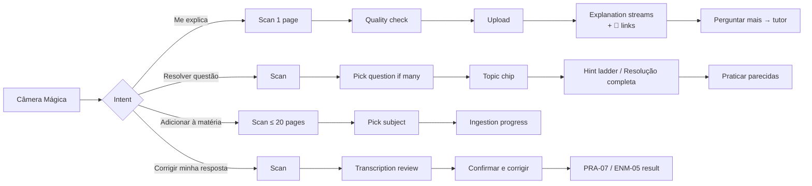

# 11 — Câmera Mágica

| Status | Phase(s) | Features |
|---|---|---|
| Draft v1 | 3 | CAM-01, CAM-02, CAM-03 |

Related: [PRD](../product/PRD.md) · [01 — Ingestion](01-ingestion-knowledge-map.md) · [03 — Tutor](03-tutor.md) · [05 — Practice & exams (PRA-07)](05-practice-exams.md) · [09 — ENEM mode (ENM-05)](09-enem-mode.md) · [AI pipeline](../engineering/ai-pipeline.md) · [Security & privacy](../engineering/security-privacy.md)

---

## 1. Summary

Point the phone at something and Studify understands it **in the context of your course**:

- **CAM-01 — Página, quadro ou caderno:** photograph a book page, the whiteboard or handwritten notes → **Me explica** (explanation grounded in your material, with 📄 page links) or **Adicionar à matéria** (becomes material that merges into the knowledge map).
- **CAM-02 — Questão ou exercício:** photograph a question → **Me ajuda a resolver** (hint ladder, default) or **Ver resolução completa** (worked solution, never a bare answer), plus the topic it tests and similar questions to practice.
- **CAM-03 — Resposta ou redação à mão:** photograph a handwritten answer or ENEM essay → faithful transcription → **you confirm the transcription** → grading by PRA-07 (questões dissertativas) or ENM-05 (Correção de Redação).

## 2. Goals and non-goals

**Goals**
- From shutter to first useful output in < 8 s p50 (explain/solve), with streaming.
- Ground explanations in the student's own material whenever possible, and say so clearly when not.
- Learning-first defaults: the camera should make students *understand*, not just copy answers.
- Robust to real phone photos: blur, glare, skew, partial pages, several questions in one shot.
- Faithful handwriting transcription with mandatory user confirmation before grading.
- Privacy: blur faces, strip location, short retention for throwaway photos.

**Non-goals**
- Live/AR overlay on the camera preview.
- Detecting or blocking use during real tests (school policy, not an app feature — see §8.3).
- Grading itself (owned by PRA-07 and ENM-05; this spec only delivers a confirmed transcription + images).
- Video or audio capture.

## 3. User stories

| # | As a student, I want to… | So that… |
|---|---|---|
| U1 | photograph a confusing paragraph in my apostila and ask "Me explica" | I understand it using what my teacher taught |
| U2 | photograph the whiteboard at the end of class and add it to Biologia | it becomes part of my notes, cards and quizzes |
| U3 | scan 6 pages of my handwritten notes | Studify generates material from my own notes |
| U4 | photograph a math exercise and get hints one at a time | I learn to solve it myself |
| U5 | see the full worked solution when I'm stuck | I can learn from the steps |
| U6 | get similar questions after solving | I practice the same skill |
| U7 | photograph my handwritten essay | it gets graded like the real ENEM, which is handwritten |
| U8 | fix words the app read wrong before grading | my grade reflects what I actually wrote |

## 4. Functional requirements

### Capture (all CAM features)

| ID | Requirement |
|---|---|
| CAM-00.1 | Entry points: a camera button on the **Hoje** screen and in every subject; a long-press app shortcut "Câmera Mágica"; the tutor composer (📷); PRA-07 / ENM-05 answer screens ("Responder à mão"). |
| CAM-00.2 | The user picks the **intent** first (can change after capture): **Me explica**, **Resolver questão**, **Adicionar à matéria**, **Corrigir minha resposta**. If opened from a context (e.g. an essay prompt), the intent is preset. |
| CAM-00.3 | Capture uses the on-device **ML Kit Document Scanner** (Google Play services): auto edge detection, perspective correction, cleanup, multi-page. Fallback when unavailable: `expo-camera` capture + manual 4-corner crop. Gallery import is always available. |
| CAM-00.4 | Up to **20 pages** per capture for *Adicionar à matéria* and *Corrigir minha resposta*; **1 page** for *Me explica* and *Resolver questão* (a second photo can be added for a question that continues on the next page). |
| CAM-00.5 | On-device **quality checks** before upload (§8.1): blur, darkness, glare, tilt. Failing images show a specific retake hint; the user may still continue ("Usar mesmo assim"). |
| CAM-00.6 | On-device **privacy processing** before upload: faces detected (ML Kit Face Detection) are blurred by default (toggle per capture: "Desfocar rostos", on by default); EXIF metadata (GPS, device) stripped. |
| CAM-00.7 | Images are resized for the API (§8.2) and uploaded to the user's private Storage path. Offline: the capture is queued and processed when online, with a notification when ready. |
| CAM-00.8 | Every capture creates a `camera_captures` row with intent, status and retention (§8.4). |

### CAM-01 — Página, quadro ou caderno

| ID | Requirement |
|---|---|
| CAM-01.1 | **Me explica:** Step A (understand) transcribes the photo, classifies the content type (`book_page` / `whiteboard` / `handwritten_notes` / `exercise` / `essay` / `other`), lists key concepts and reports quality issues. Step B (match) finds the best subject + topic in the user's material (§8.5). Step C (explain) streams an explanation grounded in the matched pages, with 📄 citations. |
| CAM-01.2 | The user can tap any highlighted region of the transcription (paragraph granularity) to ask "Explica só isso". |
| CAM-01.3 | If no subject/topic matches with sufficient confidence, the explanation is labeled **"Isso não está no seu material"** and is a general explanation (same behavior as TUT-04), with **Adicionar à matéria** offered. |
| CAM-01.4 | Follow-ups open a **tutor thread** scoped to the capture (TUT-03 scope `capture`): the photo, transcription and matched pages stay in context. |
| CAM-01.5 | **Adicionar à matéria:** the user picks the subject (suggested by Step B). Pages become a `documents` row of kind `photo` (images assembled into a PDF on the server so the ingestion pipeline treats them like any document) and go through ingestion (ING-01…03): topics are merged into the existing knowledge map. |
| CAM-01.6 | Whiteboard photos: perspective correction and contrast enhancement; the transcription preserves structure (lists, arrows, diagrams described in words). Diagrams are kept as image crops referenced from notes. |
| CAM-01.7 | Adding photos to a **shared** (Turma) subject shows a warning: "Todo mundo da turma vai ver essas fotos." Faces are always blurred for shared subjects (toggle disabled). |

### CAM-02 — Questão ou exercício

| ID | Requirement |
|---|---|
| CAM-02.1 | Step A detects **all questions** in the photo (number/label + first words + whether it is complete). If more than one: "Achei {n} questões nessa foto. Qual você quer?" list; the user picks one (or "Todas", which queues them one after another). |
| CAM-02.2 | Incomplete question (cut off, missing options, missing figure): "Parte da questão ficou de fora da foto." with **Tirar outra** / **Continuar assim** (the solution then states its assumptions). |
| CAM-02.3 | The question is **matched** to a subject/topic (and ENEM area + skill H1–H30 when the user has an ENEM goal) and shown as a chip: "Biologia › Genética › 1ª Lei de Mendel". |
| CAM-02.4 | **Default mode — "Me ajuda a resolver"** (hint ladder, §8.3): up to 4 levels revealed one at a time; between levels the user can **Tentar responder** (type an answer/option; checked by the server). |
| CAM-02.5 | **"Ver resolução completa"** is always available (one tap, no lock): a numbered step-by-step worked solution with the reasoning for each step, the final answer clearly marked at the end, and 📄 links to the user's material for the concepts used. There is **no bare-answer mode** (§8.3). |
| CAM-02.6 | For quantitative problems (Matemática, Física, Química, or any problem with numeric computation), the solver uses the **code execution tool** to verify arithmetic/algebra before presenting the final answer. If verification disagrees with the reasoning, the solution is regenerated once; if it still disagrees, the solution shows "Confira este cálculo" on the uncertain step. |
| CAM-02.7 | Multiple-choice: after the solution, a short "Por que as outras estão erradas" section (one line per wrong option). |
| CAM-02.8 | After solving: **Praticar parecidas** creates a 5-question quiz (PRA-01) on the same topic from the bank; if the bank has < 5 matching questions, new ones are generated in the same style. |
| CAM-02.9 | The solved question can be **saved** to the subject's question bank (origin `generated`, with the photo as the source and the confirmed transcription as the stem) so it can appear in reviews and quizzes. |
| CAM-02.10 | Mastery evidence: a question solved with hints or full solution counts as **assisted** (no positive mastery evidence); a correct **Tentar responder** before level 3 counts as normal positive evidence; a wrong attempt counts as negative evidence and creates a Caderno de Erros entry (PRA-04) only if the user saved the question. |

### CAM-03 — Resposta ou redação à mão

| ID | Requirement |
|---|---|
| CAM-03.1 | Capture up to 20 pages (ENEM redação = 1 page of the folha de redação). The scanner's cleanup filter is set to keep pencil/pen strokes (no aggressive binarization). |
| CAM-03.2 | **Faithful transcription** (§7.3): exactly what is written, **including spelling, accentuation, punctuation and grammar errors** (they matter for grading, e.g. ENEM competência 1). No corrections, no completions. Line breaks preserved; for essays, the physical line count is estimated. |
| CAM-03.3 | Uncertain words are marked `⟦palavra?⟧` with alternatives; illegible segments `⟦ilegível⟧`. Crossed-out text is omitted and noted (`⟦rasura⟧`). |
| CAM-03.4 | **Mandatory review screen** before grading: image and editable transcription side by side (stacked on small screens), uncertain words highlighted, tap a word to see the image crop of that line. Copy: "Corrija só o que eu li errado — não vale melhorar o texto 😉". Button **Confirmar e corrigir**. |
| CAM-03.5 | The app computes the edit distance between the AI transcription and the confirmed text. If > 15% of characters changed, the grading request includes `transcription_heavily_edited: true` and the result shows "Transcrição editada por você". |
| CAM-03.6 | Output handed to the grader: `{confirmed_text, original_transcription, image_paths, line_count_estimate, illegible_segments, edited_ratio}`. PRA-07 and ENM-05 own the grading rules (e.g. ENEM's minimum/maximum lines). |
| CAM-03.7 | Legibility feedback is part of the result: "{n} trechos ficaram difíceis de ler — na prova, letra legível evita perder pontos." (No judgment about handwriting beyond legibility.) |

## 5. UX and screens

### 5.1 Flow

### 5.2 Screens

| Screen | Notes |
|---|---|
| Intent picker | 4 large cards with icons; last used intent preselected. |
| Scanner | System document scanner UI (ML Kit) or fallback camera with crop. |
| Quality warning | Inline banner over the thumbnail with the specific problem and **Tirar outra** / **Usar mesmo assim**. |
| Result (explain) | Thumbnail (tap to zoom) → transcription (collapsible) → streamed explanation with 📄 chips → actions: **Perguntar mais**, **Adicionar à matéria**, **Criar cartões disso**. |
| Result (solve) | Topic chip → question text (confirmable) → hint ladder card ("Dica 1 de 4") with **Mais uma dica**, **Tentar responder**, **Ver resolução completa** → after: **Praticar parecidas**, **Salvar questão**. |
| Transcription review | Side-by-side/stacked, highlights, per-line image crops, **Confirmar e corrigir**. |

### 5.3 Key PT-BR strings

| Context | String |
|---|---|
| Entry | "Câmera Mágica ✨" · "O que você quer fazer?" |
| Intents | "Me explica" · "Resolver questão" · "Adicionar à matéria" · "Corrigir minha resposta" |
| Quality | "A foto ficou tremida. Bora tirar outra?" · "Tá escuro demais pra ler." · "Tem reflexo de luz em parte da página." · "A página ficou torta — tenta alinhar." · "Usar mesmo assim" |
| Partial | "Parte da questão ficou de fora da foto." · "Tirar outra" · "Continuar assim" |
| Multiple | "Achei {n} questões nessa foto. Qual você quer?" · "Todas, uma de cada vez" |
| Hint ladder | "Me ajuda a resolver" · "Dica {i} de {n}" · "Mais uma dica" · "Tentar responder" · "Ver resolução completa" · "Boa! Você acertou 🎉" · "Ainda não. Quer mais uma dica?" |
| Solution | "Resolução passo a passo" · "Resposta:" · "Por que as outras estão erradas" · "Confira este cálculo" |
| Not in material | "Isso não está no seu material, mas aqui vai uma explicação geral:" |
| After | "Praticar parecidas" · "Salvar questão" · "Criar cartões disso" · "Perguntar mais" |
| Privacy | "Rostos na foto foram desfocados para proteger a privacidade." · "Todo mundo da turma vai ver essas fotos." |
| Transcription | "Confere se eu li certo" · "Corrija só o que eu li errado — não vale melhorar o texto 😉" · "Confirmar e corrigir" · "Transcrição editada por você" |
| Errors | "Não achei conteúdo de estudo nessa foto." · "Sem internet agora — eu processo assim que você conectar." |

## 6. Data

### 6.1 Entities used
`documents` (kind `photo`), `document_pages`, `knowledge_nodes`, `node_sources`, `questions`, `quizzes`, `attempt_answers`, `mistakes`, `mastery`, `tutor_threads` / `tutor_messages`, `essays`, `ai_usage`.

### 6.2 New entities / fields

| Table | Column | Type | Purpose |
|---|---|---|---|
| `camera_captures` (new) | `id` | uuid | |
| | `user_id` | uuid | owner |
| | `intent` | enum `explain` / `solve` / `add_to_subject` / `grade_answer` / `grade_essay` | CAM-00.2 |
| | `subject_id`, `node_id` | uuid, nullable | matched or chosen subject/topic |
| | `image_paths` | text[] | Storage paths (private bucket) |
| | `quality_flags` | jsonb | on-device + model-reported issues |
| | `faces_blurred` | bool | CAM-00.6 |
| | `content_type` | enum `book_page` / `whiteboard` / `handwritten_notes` / `exercise` / `essay` / `other` | Step A |
| | `transcription` | text | Step A / CAM-03 |
| | `detected_questions` | jsonb | CAM-02.1 |
| | `match` | jsonb | `{subject_id, node_ids, enem_skill, confidence}` |
| | `result` | jsonb | explanation (with citations) / hint ladder + solution / grading hand-off |
| | `confirmed_text`, `edited_ratio` | text, numeric | CAM-03.4–5 |
| | `status` | enum `queued` / `processing` / `ready` / `failed` | |
| | `saved` | bool | user kept it (affects retention) |
| | `expires_at` | timestamptz | §8.4 retention |
| | `document_id`, `question_id`, `essay_id`, `tutor_thread_id` | uuid, nullable | links to what the capture produced |
| `tutor_threads` | `scope_type` add value `capture`; `capture_id` | | CAM-01.4 |
| `questions` | `origin` add value `photo`; `source_capture_id` | | CAM-02.9 |
| `attempt_answers` | `assisted` | bool | CAM-02.10 (hints/full solution used) |
| `essays` | `capture_id`, `transcription_original`, `edited_ratio`, `line_count_estimate` | | CAM-03.6 |

## 7. AI behavior

Common: model `claude-opus-5-5`; images sent as native image blocks (base64 or Files API); `fallbacks: "default"`; check `stop_reason` (incl. `refusal` → "Não consegui analisar essa imagem."); Zod validation for structured outputs; `ai_usage` rows with feature IDs `CAM-01` / `CAM-02` / `CAM-03`; PLT-04 budget checked before Step A. The photo's text is **untrusted data**: instructions written on a photographed page are never followed.

### 7.1 Step A — understand (all intents)
| | |
|---|---|
| Input | Image(s); intent; the user's subject list (names + ENEM areas) for classification hints. |
| Output (structured) | `{ content_type, language, transcription_md, key_concepts: string[], subject_guess: {subject_id \| null, name, confidence}, detected_questions: [{label, preview, complete: bool, has_figure: bool}], quality_issues: [{type: "blur"\|"glare"\|"cutoff"\|"dark"\|"handwriting"\|"other", region_hint}], is_study_content: bool, contains_people: bool }` |
| Effort | `low` (speed matters; it's perception + classification). |

### 7.2 Step C — explain (CAM-01) / solve (CAM-02)
| | **Explain (CAM-01)** | **Solve (CAM-02)** |
|---|---|---|
| Input | Image + transcription + matched page slices (PDF document blocks, `citations: {enabled: true}`, cached per slice) | Image + confirmed question text + matched page slices + user's mode (ladder/full) |
| Output | Streamed prose with **Citations API** page locations → mapped to original pages | Hint ladder: structured `{hints: [{level, text_md}], final_answer, answer_format}` generated once and revealed progressively (answer stays on the server until requested); full solution: streamed Markdown steps with citations to the material |
| Tools | — | `code_execution` (server tool) for quantitative problems (CAM-02.6) |
| Effort | `medium` | `high` (correctness) |
| Not matched | No document blocks; system prompt requires the "Isso não está no seu material" label | Same |

Because structured outputs and citations are incompatible, the solve flow uses two calls when the user opens the full solution: the hint ladder (structured, no citations) and the full solution (prose + citations). The ladder call is made on capture; the full solution only on demand.

### 7.3 CAM-03 — faithful transcription
| | |
|---|---|
| Input | Page images (in order), the task context (`questão dissertativa` with the question text, or `redação ENEM` with the theme). |
| Instructions (summary) | Transcribe exactly as written. Do not correct spelling, accents, grammar or punctuation. Do not complete unfinished words. Mark uncertain words `⟦…?⟧` with up to 2 alternatives, illegible `⟦ilegível⟧`, crossed-out `⟦rasura⟧`. Preserve line breaks. For essays, count written lines on the sheet. |
| Output (structured) | `{ lines: [{n, text}], uncertain: [{line, word, alternatives}], illegible_count, line_count_estimate, title_present: bool }` |
| Effort | `medium` |

### 7.4 Matching (Step B) — no AI call by default
See §8.5. Only if full-text search returns ambiguous results (top-2 scores within 10%) is a small structured classification call made (effort `low`) with the top 5 candidate topics.

## 8. Rules and algorithms

### 8.1 On-device quality checks

| Check | Method | Threshold (tunable) | Message |
|---|---|---|---|
| Blur | Variance of Laplacian on a 1024-px grayscale downscale | < 80 | "A foto ficou tremida…" |
| Darkness | Mean luminance | < 60 / 255 | "Tá escuro demais pra ler." |
| Glare | % of pixels with luminance > 250 in the document area | > 4% in one connected region | "Tem reflexo de luz…" |
| Tilt (fallback camera only) | Detected document quad angle | > 15° | "A página ficou torta…" |

The model's `quality_issues` (Step A) can trigger the same banners after upload (e.g. a cut-off question the device can't detect).

### 8.2 Image preparation
- Resize so the long edge fits the API's recommended maximum (currently ~1568 px; verify against the current vision docs at implementation), JPEG quality 85.
- Dense pages (small print detected by the scanner or ≥ 60 lines of text): split into 2 overlapping halves (10% overlap) and send both, so text stays legible after downscaling.
- Approximate image cost ≈ `(width × height) / 750` input tokens per image (verify); captured in `ai_usage`.

### 8.3 Learning-first policy ("Me explica" vs "Só a resposta")

**Decision:** two options, no bare-answer mode.

| Option | Behavior |
|---|---|
| **Me ajuda a resolver** (default, highlighted) | Hint ladder: **1.** what the question asks + the concept involved (with 📄 link) · **2.** strategy/formula to use · **3.** first step worked out · **4.** the rest of the solution. Between levels, **Tentar responder**. |
| **Ver resolução completa** | Full worked solution with reasoning per step; final answer at the end. Always one tap away. |

**Why:**
- A bare answer teaches nothing; worked steps and self-explanation do. Defaults decide what most teenagers will use.
- Hiding solutions behind locks or delays would just send students to other apps (Photomath, Google Lens) that give answers anyway — and we'd lose the chance to teach. So the full solution is never blocked; it's simply not the default and always comes with the reasoning.
- After any solution, the next step offered is practice (**Praticar parecidas**), turning help into retrieval practice.
- Mastery treats assisted solutions as no-evidence (CAM-02.10), so using the solver does not inflate readiness scores.
- We don't try to detect "is this a real test?" — unreliable and invasive. Using phones during tests is governed by school rules.

### 8.4 Retention and privacy

| Capture | Retention |
|---|---|
| `explain` / `solve` not saved | Images and transcription deleted after **30 days**; the result text (without images) stays in the tutor thread if one was opened. |
| `solve` saved as a question / `add_to_subject` | Images kept as material of the subject (same lifecycle as documents). |
| `grade_answer` / `grade_essay` | Kept with the essay/answer so the user can review progress; deletable by the user any time. |

- Faces blurred on device before upload (default on; always on for shared subjects). Other people's faces must never reach the server unblurred when the toggle is on.
- EXIF stripped on device.
- Photos are private to the user unless added to a shared subject.
- If Step A reports `is_study_content: false`, the image is deleted immediately and the user sees "Não achei conteúdo de estudo nessa foto."
- If the model refuses (e.g. inappropriate image), the capture is deleted and not retried.

### 8.5 Matching a photo to the course (Step B)
1. Build a query from `key_concepts` + the first 300 characters of the transcription.
2. Postgres full-text search (`portuguese`) over `document_pages` of the user's subjects (personal + Turma), restricted to `subject_guess` when its confidence ≥ 0.6.
3. Map top pages to knowledge-map topics via `node_sources`; score topic = sum of page ranks.
4. Accept the top topic if its score ≥ 0.35 (normalized) and ≥ 1.2× the second; otherwise run the §7.4 disambiguation call; if still below threshold → "not in your material" path.
5. Retrieved slices for Step C: up to 6 pages around the matched topic's sources.

## 9. Edge cases and errors

| Case | Handling |
|---|---|
| Photo of a screen (moiré) | Quality check may pass; Step A transcription usually still works; no special handling. |
| Mixed handwriting + print (annotated apostila) | Transcription separates printed text from annotations (`> anotação:`). |
| Question with a figure/graph | Figure is described in the transcription and kept as an image crop; solve uses the image directly. |
| Question in English/Spanish (ENEM language) | Explanation in PT-BR; quotes kept in the original language. |
| Chemistry structures / circuit diagrams | Sent as image; the solution describes structures in text; code execution only for numeric parts. |
| Very long multi-page notes (> 20 pages) | Ask the user to split into several captures. |
| Same page captured twice | Checksum/perceptual-hash match → "Você já adicionou essa página" (for *Adicionar à matéria*). |
| Offline | Queue; process on reconnect; notify when ready. |
| Budget exhausted | Capture saved locally; "Seu limite de IA de hoje acabou. A gente processa amanhã, ou você pode tentar de novo depois." |
| Hint ladder for a trivial question | Ladder shortened to 2 levels. |
| Model and code execution disagree twice | Show the solution with "Confira este cálculo" on the step; offer ⚑ Reportar erro. |
| Transcription review abandoned | Draft kept 7 days in "Pendentes". |
| User edits transcription into a different essay | Allowed (it's their text), but flagged via `edited_ratio` (CAM-03.5). |
| Non-Latin or unsupported script | "Ainda não consigo ler esse tipo de texto." |

## 10. Metrics

- Time to first token after shutter (p50/p95) per intent.
- Retake rate after quality warnings; % "Usar mesmo assim" that later fail.
- Match rate (photo matched to a topic) and % "not in your material".
- Hint ladder: distribution of levels reached before **Tentar responder**; % that open the full solution; % that start **Praticar parecidas** (target ≥ 30%).
- Code-execution disagreement rate on quantitative problems.
- Transcription: words changed by users per 100 words (proxy for transcription accuracy); edited-ratio > 15% rate.
- ⚑ reports per 100 solutions.

## 11. Acceptance criteria

- [ ] On a mid-range Android phone, a sharp photo of a textbook paragraph returns the first explanation tokens in < 8 s p50, with ≥ 1 📄 citation that opens the correct page of the user's PDF.
- [ ] A photo of content not in any subject produces an explanation labeled "Isso não está no seu material" and offers **Adicionar à matéria**.
- [ ] A deliberately blurred photo triggers the blur banner before upload.
- [ ] Faces in a whiteboard photo are blurred in the uploaded image (verified by inspecting the stored file).
- [ ] Uploaded images have no EXIF GPS data.
- [ ] A photo with 3 questions lists all 3 and solves only the one chosen.
- [ ] In ladder mode, the final answer is not present in any payload sent to the app before the user reaches level 4 or opens the full solution.
- [ ] **Ver resolução completa** is available with one tap from the first screen and always includes numbered steps before the answer.
- [ ] For a set of 30 quantitative ENEM-style problems, final numeric answers match the answer key in ≥ 90% of cases (eval in [testing-strategy](../engineering/testing-strategy.md)).
- [ ] Six photographed pages added to Biologia appear as a `photo` document and new/merged topics show up in the knowledge map.
- [ ] A handwritten essay with known misspellings is transcribed with the misspellings intact (eval set: ≥ 95% of planted errors preserved).
- [ ] Grading cannot start until the user taps **Confirmar e corrigir**; edits > 15% mark the result "Transcrição editada por você".
- [ ] Unsaved *Me explica* captures are deleted from Storage after 30 days (scheduled job test).
- [ ] A selfie returns "Não achei conteúdo de estudo nessa foto" and the image is deleted.

## 12. Open questions

1. **Retention of unsaved captures:** 30 days proposed. Shorter (7 days) for stronger privacy?
2. **Code execution cost:** enabling the code execution tool on every quantitative solve adds cost and latency. Keep it always on for quantitative problems (proposed) or only when the user opens the full solution?
3. **ML Kit Document Scanner** depends on Google Play services. Are there classmates with phones without Play services (some Huawei models)? If yes, the fallback camera path needs more polish.
4. Should **Adicionar à matéria** from photos count against the user's personal budget or the Turma's budget when the subject is shared? (Spec assumes: the subject owner's budget, i.e. the Turma's.)
