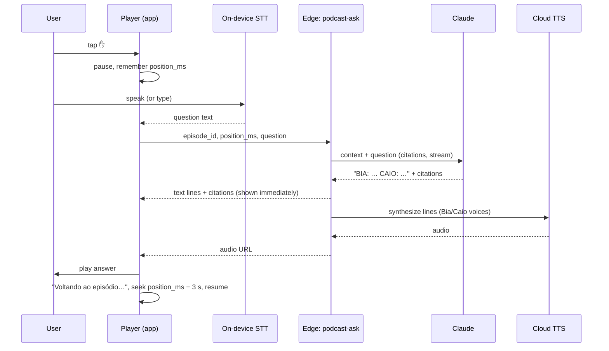

# 12 — Interactive learning

| Status | Phase(s) | Features |
|---|---|---|
| Draft v1 | 3 (INT-01, INT-02) · 4 (INT-03) | INT-01 Podcast Interativo, INT-02 Ensine o Lucas, INT-03 Treino de Argumentação |

Related: [PRD](../product/PRD.md) · [02 — Learn](02-learn-notes.md) · [03 — Tutor](03-tutor.md) · [09 — ENEM mode (ENM-05 Redação)](09-enem-mode.md) · [13 — Motivation & wellbeing (WEL-04 voice)](13-motivation-wellbeing.md) · [AI pipeline](../engineering/ai-pipeline.md) · [Learning engine](../engineering/learning-engine.md)

---

## 1. Summary

Three ways to learn by **talking** instead of reading:

| Feature | One line |
|---|---|
| **INT-01 Podcast Interativo** | Two PT-BR hosts discuss your material in a 5/10/20-minute episode. Tap ✋ any time to ask a question; the hosts answer in context and the episode resumes. |
| **INT-02 Ensine o Lucas** | You teach a virtual classmate who missed class. Lucas has hidden misconceptions taken from the material; your score is how well Lucas ends up understanding. |
| **INT-03 Treino de Argumentação** | The AI plays devil's advocate against your thesis, scores your arguments with a rubric, and (in ENEM mode) turns the debate into a redação outline. |

Claude produces all text. Voice uses other services: **on-device Android STT/TTS** for interactive input/output (✋ questions, Lucas, debate), and a **cloud TTS provider with natural PT-BR voices** for podcast episodes (provider TBD, §12).

## 2. Goals and non-goals

**Goals**
- Turn commute/gym/bus time into study time (podcast, offline playback).
- Use the *protégé effect* (learning by teaching) and *elaborative interrogation* (debate) — both research-backed.
- Keep everything grounded in the student's material, with page references.
- Feel conversational: first audio/text within a few seconds of a question.

**Non-goals**
- Voice cloning or celebrity/teacher voices.
- Real-time full-duplex voice conversation (turn-based only).
- Live multiplayer podcast/debate between students (Turma features live in [10](10-turma-social.md)).
- Video.

## 3. User stories

| # | As a student, I want to… | So that… |
|---|---|---|
| U1 | generate a 10-min episode on what's in Friday's Biologia test | I review on the bus |
| U2 | tap ✋ and ask "o que é alelo mesmo?" in the middle | I don't get lost |
| U3 | download episodes | I can listen without data |
| U4 | have a "revisão pra prova" episode that focuses on my weak topics | it's personal |
| U5 | teach Lucas photosynthesis | I find out what I don't really understand |
| U6 | see what Lucas still got wrong at the end | I know my gaps |
| U7 | defend a thesis against a tough opponent | I learn to argue for my redação |
| U8 | get an outline of a redação from my debate | I can write it right after |

## 4. Functional requirements

### INT-01 — Podcast Interativo (Phase 3)

| ID | Requirement |
|---|---|
| INT-01.1 | Entry points: subject screen, topic screen, exam (Semana de Provas) screen ("Ouvir revisão desta prova"), Hoje screen suggestion. |
| INT-01.2 | Options: **scope** (topic, several topics, a whole exam scope, or "tudo que cai na prova"), **duração** 5 / 10 / 20 min, **estilo**: *Resumão* (overview), *Aprofundado* (deep), *Revisão pra prova* (focus on the user's weak concepts and Caderno de Erros). |
| INT-01.3 | Two fixed hosts (§8.1): **Bia** (explains) and **Caio** (curious, asks the questions students would ask). Same voices in every episode. |
| INT-01.4 | Generation runs in the **worker** (job `podcast.generate`): script (§7.1) → validation → TTS per line → audio assembly → upload. The user sees progress and gets a push when ready ("Seu episódio tá pronto 🎧"). Target: a 10-min episode ready in < 5 min p95. |
| INT-01.5 | Script structure (§8.2): hook → agenda → one segment per topic (explanation → example → common mistake → "pausa pra pensar" recall question) → recap → 3 quick-fire questions → outro. Every segment lists its source pages. |
| INT-01.6 | **Reuse/caching:** *Resumão* and *Aprofundado* episodes of a **shared** subject are shared within the Turma (cache key in §8.4); *Revisão pra prova* is personal (uses the user's mastery). A cached episode is reused instantly at no AI/TTS cost. |
| INT-01.7 | **Player:** background playback with lock-screen/notification controls, speed 0.75×–2×, ±15 s skip, chapter list (one per segment), synced transcript (tap a line to seek), **Fontes** list with 📄 links, download for offline. |
| INT-01.8 | **✋ Interruption** (§8.3): tap ✋ → playback pauses → question by voice (on-device STT, pt-BR) or text → the hosts answer in 2–4 short lines grounded in the current segment's pages → answer is played in the hosts' voices → "Voltando ao episódio…" → resume 3 s before the pause point. |
| INT-01.9 | ✋ answers appear in the transcript as a "Sua pergunta" card with citations; they're stored per user (not shared). |
| INT-01.10 | If the question is outside the material, the hosts say so ("Isso não tá no seu material…") and offer **Perguntar ao tutor** (TUT-04 behavior). |
| INT-01.11 | If cloud TTS is slow/unavailable for a ✋ answer (> 6 s), the answer text is shown immediately and read with on-device TTS. |
| INT-01.12 | "Pausa pra pensar" questions: the player pauses for 5 s with a countdown chip (skippable) before the hosts give the answer. Optional setting: off. |
| INT-01.13 | Episodes are regenerated (new version) when the underlying notes change (e.g. TRU-02 fix); listeners see "Nova versão disponível". |

### INT-02 — Ensine o Lucas (Phase 3)

| ID | Requirement |
|---|---|
| INT-02.1 | Entry points: topic screen ("Ensine o Lucas"), Hoje screen suggestion for topics with mastery 40–80% (best range for consolidation, see [learning-engine](../engineering/learning-engine.md)), end of a study session. |
| INT-02.2 | Setup: topic (required); length *Rápido* (~5 min, 6 turns) or *Completo* (~10 min, 12 turns); input by text or voice (on-device STT); Lucas's replies can be read aloud (on-device TTS, optional). |
| INT-02.3 | Before the first turn, the server builds a hidden **lesson plan** (§7.2): 3–5 misconceptions from the material, key concepts to cover, Lucas's naive questions, and fix criteria. The plan is never sent to the app until the results screen. |
| INT-02.4 | Lucas opens: "E aí! Faltei na aula de {tópico} 😅 Me explica?" The user explains; Lucas reacts in character (§8.5): asks follow-ups, reveals misconceptions at natural moments, and only "gets it" when the user's explanation meets the fix criteria. |
| INT-02.5 | If the user teaches something **wrong**, Lucas believes it (realistic) — the evaluator records it as an `error_taught` and it appears in the results with the correction and 📄 link. |
| INT-02.6 | The user can end any time (**Terminar aula**). At the end, Lucas does a **teach-back**: a short summary of what Lucas understood, which reflects the user's teaching (including mistakes). |
| INT-02.7 | **Results** (§8.6): score 0–100 "Quanto o Lucas entendeu", band label, rubric breakdown, **Pontos que ficaram faltando** (unfixed misconceptions, uncovered key concepts), **O Lucas aprendeu errado** (errors taught + corrections + 📄), buttons **Criar cartões dos pontos fracos** and **Tentar de novo**. |
| INT-02.8 | Evidence to mastery: concepts explained correctly → positive evidence; errors taught → negative evidence; weights in [learning-engine](../engineering/learning-engine.md). |
| INT-02.9 | Retry on the same topic generates a **different** set of misconceptions when the material allows (avoid memorizing Lucas). |
| INT-02.10 | Safety: if the user writes something harmful, sexual, or expresses distress, Lucas steps out of character with a safe response (and the CVV resource for distress — see [13 §8.6](13-motivation-wellbeing.md#8-rules-and-algorithms)). Attempts to make Lucas say inappropriate things are declined in character ("Mano, bora focar na matéria 😂"). |

### INT-03 — Treino de Argumentação (Phase 4, both modes)

| ID | Requirement |
|---|---|
| INT-03.1 | Available in **Semana de Provas** mode (any subject; best for Sociologia, Filosofia, História, Geografia, Português) and in **ENEM** mode (redação themes from ENM-05's theme generator and ENM-09 Atualidades). |
| INT-03.2 | Theme source: (a) suggested debatable questions generated from the knowledge map (school), (b) ENEM themes (ENEM mode), (c) custom theme typed by the user (moderated, §8.8). |
| INT-03.3 | Two modes: **Debate** (the AI, as *Advogado do Diabo*, argues the opposite side over 3–5 rounds) and **Construir argumento** (scaffolded steps: tese → argumento 1 → argumento 2 → refutação → conclusão; in ENEM mode, conclusão = *proposta de intervenção*). |
| INT-03.4 | The user states a **thesis** (1–2 sentences) first. Thesis quality gets immediate feedback (clarity, position) before round 1. |
| INT-03.5 | Each round: the user writes (or speaks) an argument → the opponent replies (streamed) with a counterargument, a request for evidence, or a pointed question → micro-feedback on the user's argument appears below it (rubric chips, detected fallacies). |
| INT-03.6 | In school mode, the opponent and the feedback cite the user's material when relevant (📄). In ENEM mode, repertório suggestions may come from general knowledge and Atualidades, labeled "Repertório geral" vs "Do seu material". |
| INT-03.7 | **Summary** at the end: overall rubric (§8.7), strongest argument, weakest point, fallacies found, suggested repertório, and in ENEM mode an **Esqueleto de redação** (introduction with thesis, D1, D2, conclusion with the 5-element intervention proposal) with **Escrever redação com este esqueleto** → opens ENM-05. |
| INT-03.8 | The opponent never argues for positions that violate human rights or promote hate/violence; for politically sensitive themes it presents legitimate arguments from multiple sides and does not state its own political opinion (§8.8). |

## 5. UX and screens

### 5.1 Screens

| Screen | Notes |
|---|---|
| **Podcast setup** | Scope chips, duration segmented control, style cards, **Gerar episódio**; shows "Já existe um episódio da turma sobre isso" when a cached one exists (play instantly). |
| **Player** | Cover (subject color + hosts' avatars), play/pause, speed, chapters, transcript, big **✋** floating button, **Fontes**. Mini-player persists across the app. |
| **✋ sheet** | Mic button (hold-to-talk or tap-toggle), text field, recent questions; answer card with citations. |
| **Ensine o Lucas** | Chat layout with Lucas's avatar; the user's messages; a subtle "Lucas está pensando…" indicator; header shows turn count; **Terminar aula**. |
| **Lucas results** | Score ring, band, rubric bars, gap lists, action buttons. |
| **Argumentação setup** | Theme picker (suggestions / ENEM themes / custom), mode (Debate / Construir argumento), thesis field. |
| **Debate** | Alternating cards (você / Advogado do Diabo), rubric chips under the user's cards, round counter. |
| **Argumentação summary** | Rubric radar or bars, highlights, fallacies, repertório, Esqueleto (ENEM). |

### 5.2 Key PT-BR strings

| Context | String |
|---|---|
| Podcast | "Podcast Interativo 🎧" · "Gerar episódio" · "Duração" · "Resumão" · "Aprofundado" · "Revisão pra prova" · "Seu episódio tá sendo gravado… eu aviso quando ficar pronto 🎧" · "Seu episódio tá pronto 🎧" · "Já existe um episódio da turma sobre isso. Ouvir agora?" · "Baixar pra ouvir offline" · "Fontes" |
| ✋ | "✋ Perguntar" · "Segure pra falar" · "Ou digite sua pergunta" · "Voltando ao episódio…" · "Isso não tá no seu material. Quer perguntar ao tutor?" |
| Pausa | "Pausa pra pensar… 5" |
| Lucas | "Ensine o Lucas" · "E aí! Faltei na aula de {tópico} 😅 Me explica?" · "Lucas está pensando…" · "Terminar aula" · "O que o Lucas entendeu" · "Quanto o Lucas entendeu: {n}/100" · "Pontos que ficaram faltando" · "O Lucas aprendeu errado:" · "Criar cartões dos pontos fracos" · "Tentar de novo" |
| Lucas bands | 0–39 "O Lucas ficou mais confuso 😅" · 40–69 "Tá quase!" · 70–89 "Mandou bem!" · 90–100 "Nasceu pra ensinar! 🏆" |
| Argumentação | "Treino de Argumentação" · "Qual é a sua tese?" · "Debate" · "Construir argumento" · "Advogado do Diabo" · "Rodada {i} de {n}" · "Falácia detectada: {nome}" · "Repertório geral" · "Do seu material" · "Esqueleto de redação" · "Escrever redação com este esqueleto" |
| Moderation | "Esse tema não dá pra debater aqui. Que tal outro?" |

## 6. Data

### 6.1 Entities used
`knowledge_nodes`, `node_sources`, `notes`, `glossary_terms`, `mistakes`, `mastery`, `questions`, `cards`, `subjects`, `class_groups`, `ai_usage`, `essays` (ENM-05 hand-off), `xp_events`.

### 6.2 New entities / fields

| Table | Column | Type | Purpose |
|---|---|---|---|
| `podcast_episodes` (new) | `id`, `subject_id`, `node_ids` uuid[], `style` enum `overview`/`deep`/`exam_review`, `length_minutes` int, `owner_user_id` (nullable; set for personal `exam_review`), `class_group_id` (nullable), `cache_key` text, `script` jsonb, `script_version` int, `source_notes_versions` jsonb, `audio_path`, `duration_ms`, `chapters` jsonb `[{segment_id, start_ms, title}]`, `line_timings` jsonb, `voices` jsonb, `status` enum `queued`/`scripting`/`synthesizing`/`ready`/`failed`, `superseded_by` uuid, `created_by`, `created_at` | | INT-01 |
| `podcast_plays` (new) | `user_id`, `episode_id`, `position_ms`, `completed_at`, `downloaded` | | resume + metrics |
| `podcast_interactions` (new) | `id`, `user_id`, `episode_id`, `position_ms`, `segment_id`, `question_text`, `input_mode` (`voice`/`text`), `answer_lines` jsonb `[{speaker, text}]`, `citations` jsonb, `answer_audio_path` (nullable), `tts_fallback` bool, `created_at` | | INT-01.8–9 |
| `teaching_sessions` (new) | `id`, `user_id`, `node_id`, `length` enum `short`/`full`, `plan` jsonb (hidden misconceptions, key concepts, fix criteria, source pages), `messages` jsonb `[{role, text, at}]`, `evaluation_state` jsonb, `score` int, `rubric` jsonb, `gaps` jsonb, `errors_taught` jsonb, `teach_back` text, `status` enum `active`/`finished`/`abandoned`, `created_at`, `finished_at` | | INT-02 |
| `argument_sessions` (new) | `id`, `user_id`, `goal_mode` enum `exam_week`/`enem`, `subject_id` (nullable), `theme` text, `theme_source` enum `suggested`/`enem`/`custom`, `mode` enum `debate`/`build`, `thesis` text, `rounds` jsonb `[{user_text, opponent_text, feedback}]`, `rubric` jsonb, `summary` jsonb, `outline` jsonb (ENEM), `essay_id` (nullable), `status`, `created_at` | | INT-03 |

## 7. AI behavior

Common: model `claude-opus-5-5`; `fallbacks: "default"`; check `stop_reason` incl. `refusal`; Zod validation; `ai_usage` rows tagged `INT-01` / `INT-02` / `INT-03`; PLT-04 budget check before every call (podcast generation is checked once for the whole job; personal budget for personal episodes, Turma budget for shared ones). User-provided text (questions, explanations, arguments, custom themes) is **untrusted data** placed in the user turn and never treated as instructions.

### 7.1 Podcast script (INT-01, worker)
| | |
|---|---|
| Input | Scope nodes (knowledge-map titles, objectives, key terms), `study`-depth notes of each node, glossary terms, for *Revisão pra prova*: the user's weakest concepts (mastery) and recent mistakes; PDF page slices of the scope (cached document blocks) for grounding; target word count (§8.2); host personas. |
| Output (structured) | `{ title, segments: [{ id, kind: "hook"\|"agenda"\|"topic"\|"recap"\|"quickfire"\|"outro", node_ids, title, lines: [{ speaker: "bia"\|"caio", text, pause_after_ms?, emphasis?: string[] }], source_pages: [{document_id, page_start, page_end}], recall_question?: {question, answer} }] }` |
| Validation | Total words within ±15% of target; every `topic` segment has ≥ 1 source page inside the provided slices; no line > 60 words; alternation (no host speaks > 4 lines in a row). One retry on failure. |
| Effort | `medium`. Streamed to the worker (long output). The Batch API is **not** used here: the user is waiting for the episode. |

### 7.2 Lucas lesson plan (INT-02)
| | |
|---|---|
| Input | Topic node + its concepts, notes (`study`), glossary, source page slices, top distractors from Caderno de Erros / class insights for this topic (when available, anonymized aggregates only), previous sessions' misconceptions for this user+topic (to vary). |
| Output (structured) | `{ key_concepts: [{id, statement, source_pages}], misconceptions: [{id, lucas_belief, correct_concept, fix_criteria: string[], trigger: "early"\|"mid"\|"late", source_pages}], naive_questions: string[], opener }` with 3–5 misconceptions and 3–6 key concepts. |
| Effort | `medium` |

### 7.3 Lucas turn (INT-02, Edge Function, streamed)
| | |
|---|---|
| Input | System (static for the whole session): Lucas persona (§8.5). Messages: the hidden plan as the first user-turn content, then the conversation so far replayed verbatim from stored `raw_content`, with the current `evaluation_state` **appended** as a mid-conversation system message after each student turn. The system prompt is never edited during a session and earlier messages are never rewritten: with preserved thinking, editing earlier context makes replayed thinking blocks fail and breaks the cache ([ai-pipeline.md §6.6](../engineering/ai-pipeline.md#66-threads-must-be-append-only-preserved-thinking), R5). |
| Output (structured, streamed) | `{ lucas_reply: string, evaluation: { misconception_updates: [{id, status: "hidden"\|"revealed"\|"partially_fixed"\|"fixed"}], concepts_covered: [{id, quality: "correct"\|"partial"\|"wrong"}], errors_taught: [{claim, correction, severity: "minor"\|"major", source_pages}], clarity_signals: {used_example: bool, used_analogy: bool, checked_understanding: bool} } }` — `lucas_reply` is the **first** field so the app can render it progressively from the partial JSON stream; `evaluation` is applied server-side and never shown during the session. |
| Effort | `medium` |
| Teach-back | Final turn uses the same call with `final: true`; `lucas_reply` contains the teach-back. |

### 7.4 ✋ answer (INT-01, Edge Function, streamed)
| | |
|---|---|
| Input | Episode title, current segment (± 1 neighbor) lines, last ~60 s of transcript before `position_ms`, the question, current segment's source pages as PDF document blocks with `citations: {enabled: true}` (cached). |
| Output | Prose using the **Citations API** (so page citations are API-verified), formatted as 2–4 lines prefixed `BIA:` / `CAIO:`; the server parses prefixes into lines (fallback: whole text as Bia). Max ~110 words (≈ 45 s). |
| Effort | `low` (latency is critical; content is short and grounded). |
| Then | Lines are sent to cloud TTS (§8.3); timeout → on-device TTS fallback (INT-01.11). |

### 7.5 Argumentation (INT-03)
| Call | Details |
|---|---|
| Opponent reply | Streamed prose. School mode: topic page slices with **Citations API** enabled; ENEM mode: no documents (general knowledge allowed, labeled). Effort `medium`. |
| Round feedback | Structured `{ rubric: {tese, fundamentacao, repertorio, coerencia, refutacao, falacias}: 0–4 each, fallacies: [{name, quote, explanation}], tip }`. Effort `medium`. Runs **in parallel** with the opponent reply. |
| Summary + outline | Structured, effort `high` (ENEM outline must follow the redação structure and the 5-element intervention proposal). |
| Theme suggestions | Structured list of 5 debatable questions grounded in the knowledge map, effort `low`. |

## 8. Rules and algorithms

### 8.1 Host personas (INT-01)
- **Bia** — explains clearly, uses everyday Brazilian examples, enthusiastic but not over the top. Leads segments.
- **Caio** — curious, asks the "dumb" questions students are afraid to ask, makes the occasional joke, summarizes in his own words (a natural recall moment).
- Both: informal PT-BR, no slang that ages fast, no profanity, never mock the listener, never claim to be human teachers, never mention being AI unless asked.
- Content language: PT-BR (quotes in other languages kept, e.g. English texts).

### 8.2 Episode length and structure

PT-BR conversational speech ≈ 150 words/min → target words = `150 × minutes` (750 / 1,500 / 3,000).

| Segment | Share of words | Notes |
|---|---|---|
| Hook | 3% | A surprising fact or question from the material. |
| Agenda | 3% | What the episode covers. |
| Topic segments | 78% | Split across topics weighted by importance (exam scope weight; for *Revisão pra prova*, by `1 − mastery`). Each: explanation → example → common mistake → recall question. Max 6 topics per 10 min; extra topics are dropped with a note ("Ficou de fora: …"). |
| Recap | 8% | Caio summarizes; Bia corrects/adds. |
| Quick-fire | 6% | 3 questions with 5 s pauses (INT-01.12). |
| Outro | 2% | Suggest next step (e.g. "Bora fazer os cartões de genética?"). |

### 8.3 ✋ interruption flow

- Latency targets: text visible < 3 s p50; answer audio starts < 5 s p50. Over 6 s → on-device TTS fallback.
- Max 10 ✋ per episode per user per day (budget protection); after that, ✋ opens the tutor instead.

### 8.4 Podcast caching
`cache_key = hash(subject_id, sorted(node_ids), style, length_minutes, script_version_of_prompt, max(notes.version of nodes))`. Shared within a Turma for `overview` and `deep` styles of shared subjects. `exam_review` episodes are never shared. Old episodes are kept until no plays for 60 days.

### 8.5 Lucas persona and conversation rules
- **Lucas:** a classmate of the same age who missed the class; friendly, curious, a bit distracted; uses informal PT-BR; never condescending; makes plausible mistakes. (Persona uses *ele/dele* in PT-BR copy.)
- Reveal misconceptions according to `trigger` (early: turns 1–3, mid: 4–7, late: 8+), at moments related to what the user just said.
- A misconception moves to `fixed` only when the user's message satisfies **all** `fix_criteria`; `partially_fixed` when some are met — Lucas then asks a narrower follow-up ("Tá, mas então por que…?").
- If the user explains something that isn't in the plan but is correct, Lucas accepts it and it counts toward clarity.
- If the user goes off-topic twice, Lucas steers back gently.
- Lucas never lectures or reveals the correct concept himself during the session.
- Each Lucas reply ≤ 60 words (it's a chat on a phone).

### 8.6 Lucas scoring rubric (0–100)

| Component | Points | Rule |
|---|---|---|
| Misconceptions fixed | 40 | `40 × Σ(fixed = 1, partially_fixed = 0.5, revealed/hidden = 0) / count` |
| Key concepts covered | 25 | `25 × Σ(correct = 1, partial = 0.5, wrong = 0) / count` |
| Accuracy | 20 | `max(0, 20 − 10 × major_errors − 5 × minor_errors)` |
| Clarity | 15 | 5 each for: used an example, used an analogy, checked understanding (asked Lucas a question) |

- Session ended before turn 4: score shown as "Aula curta demais pra dar nota" (no score, gaps still listed).
- Bands in §5.2. XP per [13 §8.1](13-motivation-wellbeing.md#8-rules-and-algorithms).

### 8.7 Argumentation rubric (INT-03)

Each criterion scored 0–4 per round and overall:

| Criterion | 0 | 4 |
|---|---|---|
| **Tese** | No clear position | Clear, specific, defensible position |
| **Fundamentação** | Reasons don't support the thesis | Reasons logically and directly support it |
| **Repertório / evidência** | None or irrelevant | Pertinent, accurate, productive (data, facts, authors, history, laws) — for ENEM: legitimized, pertinent and productive sociocultural repertoire |
| **Coerência e coesão** | Disconnected ideas | Logical progression with appropriate connectives |
| **Refutação** | Ignores the counterargument | Anticipates and answers it convincingly |
| **Ausência de falácias** | Several fallacies | None detected |

Fallacies detected (names in PT-BR): generalização apressada, ad hominem, falso dilema, apelo à emoção, espantalho, apelo à autoridade irrelevante, ladeira escorregadia, petição de princípio, falsa causa.

ENEM mode mapping (informative, not an official grade): Repertório ↔ competência 2; Fundamentação + Coerência ↔ competência 3; Coesão ↔ competência 4; the final *proposta de intervenção* is checked for the 5 elements (agente, ação, meio/modo, finalidade, detalhamento) ↔ competência 5, reusing ENM-05's checklist.

### 8.8 Theme and content safety (INT-03)
- Custom themes pass the moderation classification (same as [10 §8.9](10-turma-social.md#8-rules-and-algorithms)) plus a check that the theme is debatable and age-appropriate.
- The opponent may defend either side of legitimately debated questions. It refuses to argue for positions that deny human rights, promote hate, violence or discrimination, and explains why (aligned with ENEM's requirement that intervention proposals respect human rights).
- On politically sensitive themes, the opponent argues the assigned side with legitimate arguments, states that it is playing a role, and does not give personal political opinions.

## 9. Edge cases and errors

| Case | Handling |
|---|---|
| Scope too small for the chosen length (e.g. 1 small topic, 20 min) | Suggest a shorter length; or allow and let the script go deeper (Aprofundado) with a notice. |
| Scope too big for 5 min | Prioritize topics by weight; list "Ficou de fora". |
| TTS fails for some lines | Retry 2×; if still failing, job fails gracefully with "Não consegui gravar o episódio agora" and the script is kept for retry without regenerating. |
| Notes changed while generating | Episode completes with the old version; marked superseded when the new one is generated. |
| ✋ while offline | Question queued with text; "Sem internet — eu respondo quando você conectar" (answer shown later in transcript). |
| STT not available (no pt-BR language pack) | Show text input only; hint to install the language pack for voice. |
| Lucas: user pastes a long text from notes | Lucas reacts naturally ("Nossa, que textão 😅 explica com suas palavras?") and clarity scoring reflects it; no penalty beyond that. |
| Lucas: user answers only with "sim/não" | Lucas asks open questions; after 3 such turns, a gentle tip appears. |
| Lucas: topic has < 3 plausible misconceptions in the material | Use 2 + more naive questions; score weights renormalized. |
| Debate: user switches sides mid-debate | Feedback flags thesis inconsistency (Coerência). |
| Debate: very short answers | Feedback suggests developing the argument; round still counts. |
| Refusal on a theme | "Esse tema não dá pra debater aqui. Que tal outro?" with suggestions. |
| Budget exhausted mid-session | Current turn completes; next turn shows the budget message; session can be resumed later. |

## 10. Metrics

- Podcast: episodes generated per active user/week; cache hit rate (target ≥ 40% in shared subjects); completion rate (≥ 70% listened); ✋ per episode; ✋ latency p50/p95; offline downloads.
- Lucas: sessions per user/week; average score on first vs second attempt (learning signal); % that tap **Criar cartões dos pontos fracos**; average turns.
- Argumentação: sessions per user; average rubric improvement over 3 sessions; % ENEM sessions that open ENM-05 with the outline.
- Cost per episode / per session (from `ai_usage` + TTS billing).

## 11. Acceptance criteria

- [ ] A 10-minute *Resumão* episode of a 3-topic scope is generated in < 5 min, lasts 9–11 min, alternates both voices, and its **Fontes** list opens the right PDF pages.
- [ ] Script validation rejects scripts outside ±15% of the target word count (unit test with fixtures).
- [ ] A second Turma member requesting the same *Resumão* gets the cached episode instantly with no new `ai_usage` rows.
- [ ] *Revisão pra prova* episodes are never visible to other users.
- [ ] Tapping ✋ pauses playback; a spoken question is transcribed on device; the answer text appears with ≥ 1 citation in < 3 s p50, audio plays, and playback resumes 3 s before the pause point.
- [ ] With cloud TTS blocked (test flag), ✋ answers are read with on-device TTS.
- [ ] Episodes play in the background with lock-screen controls and work offline after download.
- [ ] The Lucas lesson plan never reaches the app before the results screen (payload inspection test).
- [ ] Teaching a planted wrong fact causes Lucas to accept it and the results list it under "O Lucas aprendeu errado" with the correct concept and a 📄 link.
- [ ] Lucas scores follow §8.6 exactly for a fixture of evaluation states (unit test).
- [ ] Retrying Lucas on the same topic yields at least one different misconception when the plan has ≥ 5 candidates.
- [ ] In ENEM mode, a finished debate produces an outline with all 5 intervention-proposal elements, and **Escrever redação com este esqueleto** opens ENM-05 prefilled.
- [ ] A custom theme promoting hate is refused with suggestions of other themes.

## 12. Open questions

1. **Cloud TTS provider** for natural PT-BR two-voice dialog. Candidates to evaluate on voice quality, PT-BR naturalness, multi-speaker support, streaming latency, price and data terms: Google Cloud Text-to-Speech (Neural2/Chirp HD pt-BR voices), Azure AI Speech (pt-BR neural voices), Amazon Polly (neural/generative pt-BR), ElevenLabs (multilingual). Needs a blind listening test with classmates.
2. **Podcast cost** per 10-min episode (script tokens + ~9,000 characters of TTS) is TBD until the provider is chosen; should personal *Revisão pra prova* episodes have a weekly cap per user?
3. **Lucas's name and avatar:** keep "Lucas" or let users pick between a few virtual classmates?
4. Should Lucas sessions also be possible fully by voice (STT + on-device TTS), or text-first with optional voice (spec assumes text-first)?
5. Should INT-03 be enabled in Semana de Provas mode from Phase 4, or only once ENEM mode ships (spec assumes both modes at Phase 4)?
